<br/>

<div align=left><br>
<br/> 
<br/> 
<br/> 
<br/>
<br/>
<br/> 

<center><b><font size=10 face="黑体">风雷软件应用与开发指南</font></b></center>
<br/>

<center><b><font size=6 face="Times New Roman">（2112.v9198）</font></b></center>
<br/> 
<br/>
<br/> 
<br/>

<br/>
<br/> 
<br/>
<br/>

<br/>

<center><b><font size=5face="黑体">中国空气动力研究与发展中心</font></b></center>
<center><b><font size=5 face="Times New Roman">2021年12月</font></b></center>
<div STYLE="page-break-after: always;"></div> 
<br/> 

<center><b><font size=10 face="黑体">前言</font></b></center>
<br/> 
<br/>

&ensp;&ensp;&ensp;&ensp;开发团队希望通过参考这本《风雷软件应用与开发指南》，软件用户能够更容易的使用风雷软件，或者进行二次开发工作。

&ensp;&ensp;&ensp;&ensp;本指南主要由三部分组成。若只是通过风雷软件进行常规流动问题的计算，用户仅需阅读指南的第一部分。用户若想更深层次的理解风雷软件的体系结构及数据结构，以便进行二次开发，那么务必详细阅读整本指南。

&ensp;&ensp;&ensp;&ensp;第Ⅰ部分介绍了风雷软件的基本情况，以便用户能了解软件的背景与发展历史。同时，通过学习本部分内容，能够有序的完成相关环境配置及风雷软件的编译运行过程，了解风雷算例工程的构成以及软件的基本使用流程。最后，通过实际算例的展示来帮助用户更为直观的掌握风雷软件的使用。

&ensp;&ensp;&ensp;&ensp;第Ⅱ部分详细介绍了风雷软件的架构、数据结构、前处理、CFD控制方程、边界条件、数值算法、并行计算、后处理，涵盖了风雷软件的底层及核心算法层。最后是高级内容，讲解了风雷中相对复杂的耦合计算和如何自定义求解器。

&ensp;&ensp;&ensp;&ensp;第Ⅲ部分介绍了风雷软件的编程规范及附录，方便开发人员熟悉风雷软件代码的编写习惯，保持代码的一致性，提高可读性。

&ensp;&ensp;&ensp;&ensp;最后，非常欢迎大家使用“风雷（PHengLEI）”软件，并提出宝贵的意见和建议。同时，也希望大家加入风雷开源这项工作中，为国产CFD软件的发展贡献自己的力量。

&ensp;&ensp;&ensp;&ensp;&ensp;&ensp;&ensp;&ensp;&ensp;&ensp;&ensp;&ensp;&ensp;&ensp;&ensp;&ensp;&ensp;&ensp;&ensp;&ensp;&ensp;&ensp;&ensp;&ensp;&ensp;&ensp;&ensp;&ensp;&ensp;&ensp;&ensp;&ensp;&ensp;&ensp;&ensp;&ensp;&ensp;&ensp;&ensp;&ensp;&ensp;&ensp;&ensp;&ensp;&ensp;&ensp;&ensp;&ensp;&ensp;&ensp;&ensp;&ensp;&ensp;&ensp;&ensp;&ensp;&ensp;&ensp;&ensp;&ensp;&ensp;&ensp;&ensp;&ensp;&ensp;&ensp;&ensp;&ensp;&ensp;&ensp;&ensp;&ensp;风雷软件开发团队


**版权声明** © since 2010 China Aerodynamics Research & Development Center.

**版本说明：**主版本号表示年月，次版本号表示代码提交版本，如 2112.v9198，代表2021年12月提交版本9198。

**作者：**孟丽媛 、徐刚、万云博、赵钟、何先耀、何磊、刘健、李鹏、何琨、郭勇颜

&ensp;&ensp;&ensp;&ensp;&ensp;&ensp;曾志春、马燕凯、徐庆新、张子佩、张扬、闵耀兵、梅杰、肖翰

**校对：**赵钟、何先耀、梅杰、张勇、何超、王令、肖翰

本指南由**中国空气动力研究与发展中心**授权发布。

<div STYLE="page-break-after: always;"></div> 
<br/> 
<br/> 

<center><b><font size=15 face="黑体">目  录</font></b></center>
[TOC]

<br/> 
<br/> 

<div STYLE="page-break-after: always;"></div>
# <center>第Ⅰ部分    说明与应用</center>


# 第1章  软件概述

&ensp;&ensp;&ensp;&ensp;本章主要对风雷软件相关信息进行简单的介绍，希望用户能够更加清晰的了解风雷软件的发展历程。同时也提供风雷源代码申请和相关环境软件的下载地址。

## 1.1  软件概述

&ensp;&ensp;&ensp;&ensp;风雷软件<sup>[1,2]</sup>（PHengLEI，Platform for Hybrid ENGineering simulation of flows）是中国空气动力研究与发展中心（CARDC）研发的面向流体工程的混合CFD平台。平台的建立遵循面向对象的设计理念，采用C++语言编程。自2010年开始，气动中心开始着力于工程化品牌CFD软件的开发；2016年4月，风雷软件面向全国免费发布，迄今为止，已有超过100家单位、1000人次申请下载使用；2020年7月，风雷软件面向“NNW项目”参研单位开源，行业内代码开源；2020年12月中旬，风雷软件正式面向全国用户开源发布，与其他开源CFD软件相比，风雷软件具有扩展能力强、开发难度低、计算效率高等特点。

&ensp;&ensp;&ensp;&ensp;风雷软件为了适应结构网格、非结构网格、混合网格、重叠网格等不同网格的计算，设计了具有良好通用性、可扩展性的体系结构和数据结构，实现了在同一个软件平台上，同时兼容结构求解器和非结构求解器。两种求解器可独立运行，也能耦合计算，即在流场中同时含有结构网格和非结构网格的情况下，在结构网格上调用结构求解器，在非结构网格上调用非结构求解器。特别地，风雷是目前全球唯一同时兼容结构/非结构的开源平台。

[1] 赵钟,等.通用CFD软件PHengLEI设计[J]. 计算机工程与科学, 2020, 42(2): 210-219.( Zhao Z, et al. 
&ensp;&ensp;&ensp;Design of general CFD software PHengLEI [J]. Computer Engineering & Science, 2020, 42(2): 
&ensp;&ensp;&ensp;210-219. (in Chinese) )
[2] 赵钟,等.适用于任意网格的大规模并行CFD计算框架PHengLEI[J]. 计算机学报, 2018, 42(11):2368
&ensp;&ensp;&ensp;-2383. ( Zhao Z, et al. PHengLEI: A Large Scale Parallel CFD Framework for Arbitrary Grids [J]. 
&ensp;&ensp;&ensp;Chinese Journal of Computers, 2018, 42(11): 2368-2383. (in Chinese) )

**声明：** 若用户将该软件用于学术研究或工程应用，须在相关的论文成果的显要位置处标注基于国家数值风洞“风雷（PHengLEI）“软件，并引用“风雷（PHengLEI）”软件相关的参考文献（例如[1]和[2]）。

## 1.2  功能描述

&ensp;&ensp;&ensp;&ensp;风雷软件是在气动中心现有CFD软件技术基础上，充分利用多年来在结构与非结构专业软件开发方面的技术储备，开发的结构/非结构通用CFD品牌软件，计算范围覆盖低速、亚跨声速和高超声速。开发过程中，以现代软件工程方法为指导，结合CFD行业特点，设计了面向下一代的软件体系结构。目前，软件具备的主要功能点如下图1-1所示。同时，风雷软件也提供常用前、后置软件接口，如Gridgen、Pointwise、ICEM-CFD、FieldView、Tecplot等。
<div align=center><br>图 1-1 软件功能</div><br>
## 1.3  相关资源

&ensp;&ensp;&ensp;&ensp;国内风雷软件社区、官网、交流群介绍，提供所有必备软件的下载地址，官网地址：www.cardc.cn/nnw/software/phenglei。

## 1.4  发布历史

&ensp;&ensp;&ensp;&ensp;软件的发布历史总结了每个风雷开源软件正式发布版本相关的功能变更。其中，为了保持发布历史信息的简洁性，将不写入用户不可见的变更。
| 发布时间   | 版本号             | 新增功能模块                                                 |
| ---------- | ------------------ | ------------------------------------------------------------ |
| 2021.01.26 | PHengLEI2012.v7129 | （1）初始开源版本。                                          |
| 2021.03.04 | PHengLEI2012.v7407 | （1）调整风雷软件构建过程；<br/>（2）网格转换/分区/计算合并流程；<br/>（3）重构亚声速入口、出口边界条件；<br/>（4）质量流量入口、出口边界条件；<br/>（5）平移周期边界条件；<br/>（6）点监控功能；<br/>（7）HDCS格式；<br/>（8）更新《风雷软件应用与开发指南》等。 |
| 2021.04.07 | PHengLEI2012.v7628 | （1）结构网格大涡模拟（LES）模块；<br/>（2）Smagorinsky亚格子模型；<br/>（3）动态Smagorinsky亚格子模型；<br/>（4）WALE亚格子模型；<br/>（5）修复部分内存泄漏问题；<br/>（6）调整文件格式；<br/>（7）更新《风雷软件应用与开发指南》等。 |

| 发布时间   | 版本号             | 新增功能模块                                                 |
| ---------- | ------------------ | ------------------------------------------------------------ |
| 2021.07.01 | PHengLEI2171.v7934 | （1）天河二号GPU并行版本；<br/>（2）无锡太湖之光并行版本；<br/>（3）结构/非结构重叠网格；<br/>（4）结构/非结构大涡湍流模拟（LES）模块；<br/>（5） $\sigma $亚格子模型；<br/>（6）旋转周期边界条件；<br/>（7）流场数据监控：线、面；<br/>（8）更新《风雷软件应用与开发指南》等。 |
| 2021.12.31 | PHengLEI2112.v9198 | （1）高阶有限差分方法LES求解器功能扩展；<br/>（2）转捩模型；<br/>（3）非定常动网格；<br/>（4）非结构网格变形；<br/>（5）自定义边界条件；<br/>（6）更新《风雷软件应用与开发指南》等。 |


# 第2章  环境配置和项目运行

&ensp;&ensp;&ensp;&ensp;本章节主要描述如何对风雷开发环境进行配置，以及如何运行风雷项目进行数值计算，旨在帮助用户初步了解风雷的运行过程。此外，风雷官网和社区提供了部分详细的算例报告可供参考。

&ensp;&ensp;&ensp;&ensp;在运行算例之前，必须确保正确安装风雷软件，保证风雷软件正常运行。下面将着重介绍风雷开发环境配置和项目创建过程。

## 2.1  风雷开发环境配置

&ensp;&ensp;&ensp;&ensp;风雷源代码采用C++语言编写，需要CMake软件构建项目，并行计算采用MPICH库。操作系统必须提供C++编译器、CMake3.0以上版本软件和MPI1.0或MPI2.0标准库。

### 2.1.1  Windows环境软件安装

&ensp;&ensp;&ensp;&ensp;Windows环境下所有必备软件按照默认步骤安装即可，安装完成后采用默认设置。
1. 安装Microsoft Visual Studio（2012及以上版本）；
2. 安装MPI库，推荐采用MSMPI。先安装MSMpiSetup.exe，再安装msmpisdk.msi；
3. 安装Cmake；
4. 打开风雷源码PHengLEI/3rdparty文件夹，解压eigen压缩包。

### 2.1.2  Linux环境调用库的编译(以CentOS Linux release 7.5.1804为例)

&ensp;&ensp;&ensp;&ensp;具体编译步骤如下：
1. 检查系统GCC版本，不可低于gcc-4.9.2；
2. 安装Cmake(推荐3.0.1及以上版本）；
3. 安装MPICH3库（推荐mpich3官方网站下载mpich3.3.1版本或操作系统对应版本，网址：www.mpich.org/downloads）；或使用openmpi-4.0以上版本，注意编译openmpi时要加入选项 --enable-mpi1-compatibility，不能使用自带的OpenMPI)。
- 解压mpich-3.3.2.tar.gz
```shell
tar -xvf mpich-3.3.2.tar.gz
```
- 进入解压文件夹，新建build目录
```shell
mkdir mpich3
cd mpich-3.3.2
mkdir build
```
- 进入build目录，编译安装mpich3
```shell
cd build
../configure --prefix=(mpich3文件夹的绝对路径)
make -j32 
make install
```
> 注意，prefix 路径将决定 ```mpich3``` 的安装路径，请根据自己的实际来设定。

- 配置环境变量，修改.bash_profile或.bashrc
```shell
vim ~/.bash_profile
在末尾添加
export MPI_HOME=(MPIPATH)
export PATH=${MPI_HOME}/bin:$PATH
export LD_LIBRARY_PATH=${MPI_HOME}/lib:$LD_LIBRARY_PATH
export LIB=${MPI_HOME}/lib:$LIB
export MANPATH=${MPI_HOME}/share/man:$MANPATH
添加完成后执行
source ~/.bash_profile
```
> 其中，prefix 路径将决定 ```mpich3``` 的安装路径，请根据自己的实际来设定。

4. 编译HDF5库
回到PHengLEI/3rdparty 目录：
- 解压HDF5
```shell
tar -xvf hdf5-1.8.8-p1.tar.gz
```
- 编译HDF5（推荐使用ccmake办法，如果系统自带的mpi并非风雷支持的mpi，则即便添加环境变量，仍需使用ccmake手动修改相关选项）
```shell
cd hdf5-1.8.8-p1
mkdir build
mkdir lib
cd build
cmake ..
ccmake ..
键入e，手动修改HDF5_ENABLE_PARALLEL=ON HDF5_ENABLE_LARGE_FILE=ON CMAKE_INSTALL_PREFIX=../lib,再键入c # 此处输入绝对路径
键入 t 以打开高级选项，找到 MPI_LINK_FLAGS ，回车修改为-Wl,-rpath -Wl,mpich3/lib绝对路径 ，即去掉尾部 -Wl,--enable-new-dtags
# mpich3路径查询指令 which mpicc ；which mpicxx ;which mpiexec，由此可知mpich3安装路径，以及相应的bin、lib、include等文件夹路径。
找到MPI_LIBRARY，回车修改libmpi.so为libmpi.a
键入 c ，configure
完成后，键入g， generate
# 如果编译环境内已经部署过其他mpi，或受到制约而导致无法读取出mpich3相关配置信息，则使用ccmake进入高级选项，手动修改mpi相关参数，保证系统可读取的全部mpi参数均为mpich3参数，如：
# MPI_COMPILER=mpich3/bin/mpicc的绝对路径 MPI_INCLUDE_PATH=mpich3/include的绝对路径；
# MPI_LIBRARY=mpich3/lib/libmpi.a 等等。
make -j4 
# 如果make或make install失败，ccmake ..检查各选项是否配置正确；j4代表四核同时编译，若用户环境为超算集群，可根据自身条件增加编译核数，提升编译效率，下同。
make install
cp ../lib/lib/*.a ../../Linux-x86_64（若系统为arrch架构，则在3rdparty文件夹中新建Linux-aarch64文件夹中，并把相关库拷贝到该文件夹下，下同）
```
5. 编译CGNS库
回到 3rdparty 目录：
- 解压cgns
```shell
tar -xvf cgns-3.3.0.tar.gz
```
- 编译安装cgns
```shell
cd CGNS-3.3.0
mkdir build
mkdir lib
cd build
cmake .. -DCGNS_ENABLE_HDF5=ON -DCGNS_ENABLE_LEGACY=ON -DHDF5_DIR=../../hdf5-1.8.8-p1/build -DCMAKE_INSTALL_PREFIX=../lib  
# 若无法读取HDF5_DIR，输入ccmake ../ 相关选项中手动输入hdf5-1.8.8-p1/build的绝对路径 按c后退出ccmake，此处路径输入也为绝对路径。
cmake .. -DHDF5_NEED_MPI=ON 
make -j4
make install
cp ../lib/lib/libcgns.a ../../Linux-x86_64
```
6. 编译parmetis库与metis库（下文以parmetis库为例，metis库编译方法一致，二者都需编译）
回到 3rdparty 目录：
- 解压parmetis（metis同理）
```shell
tar -xvf parmetis-4.0.3.tar.gz
```
- 编译Parmetis（Metis同理）
```shell
cd parmetis-4.0.3
make config prefix=(parmetis-4.0.3解压路径)
make -j4
make install
```
- 拷贝相关文件到指定目录（Metis同理）
```shell
cp  lib/libparmetis.a ../Linux-x86_64
```
&ensp;&ensp;&ensp;&ensp;风雷软件的开发环境配置完成，风雷可执行程序的创建与运用，请跳转至2.2.3节。

### 2.1.3 macOS环境风雷的编译和运行

&ensp;&ensp;&ensp;&ensp;macOS系统上的具体编译过程，请阅读附录A。

## 2.2  风雷项目创建与运行

&ensp;&ensp;&ensp;&ensp;风雷软件的开发环境配置完成以后，即可创建并运行风雷项目。风雷源代码请通过红山开源平台（网址：osredm.com）下载，本章节将分别介绍Windows和Linux平台上风雷项目的创建方法和运行过程。

&ensp;&ensp;&ensp;&ensp;风雷程序运行的基本流程为：
<div align=center></div>
&ensp;&ensp;&ensp;&ensp;通过对源码的下载和编译等操作，风雷在Windows操作系统下已经可以运行。风雷运行时的流程大致需要进行三步：①将计算网格文件转换成PHengLEI自定义的网格格式.fts（文件中包含了网格、边界条件等信息）；②将得到的fts文件进行网格分区；③根据计算条件设置参数并运行PHengLEI程序。
- 网格转换
修改bin文件夹中总控文件key.hypara和网格控制文件grid_para.hypara中的参数；
运行风雷完成网格转换，grid文件夹中生成对应的fts文件。
- 网格分区
修改bin文件夹中总控文件key.hypara和并行分区文件partition.hypara中的参数；
运行风雷完成网格分区，grid文件夹中生成对应的分区网格文件。
- 开始计算
修改bin文件夹中总控文件key.hypara和CFD计算参数控制文件（如低速）cfd_para_subsonic.hypara中的参数；
运行风雷开始计算，计算结果在自动生成的results文件夹中查看。

&ensp;&ensp;&ensp;&ensp;**备注：**所有步骤均需要包含默认的cfd_para.hypara文件。

### 2.2.1  Windows平台项目创建

&ensp;&ensp;&ensp;&ensp;在Windows操作系统下，首先将启动CMake建立PHengLEI项目工程，然后在Microsoft Visual Studio开发平台下，打开该项目，进行编译链接运行。

&ensp;&ensp;&ensp;&ensp;以安装有64位Windows 7操作系统及CMake3.0.1和Microsoft Visual Studio 2012应用软件的个人电脑为例，具体步骤如下：

- 将下载的源代码存放在任意的磁盘目录下。在创建项目前，通常选择在存放目录下的PHengLEI目录下新建build文件夹用于存放生成的工程文件；
- 运行CMake程序，按照下图设置路径：
<div align=center></div>
&ensp;&ensp;&ensp;&ensp;其中，第一个路径为PHengLEI源代码地址（PHengLEI代码中CMakeLists.txt文件所在文件夹的地址），第二个路径为提前准备好的PHengLEI项目工程所在地址。
- 点击Configure，选择Visual Studio 11（根据个人电脑安装的VS版本确定），点击Finish：
<div align=center>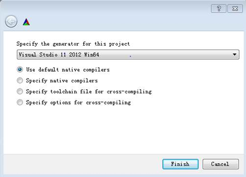</div>
- Configure完成后，得到如下结果：
<div align=center></div>
- 根据权限进行选项设置，再点击Generate，完成项目创建，得到如下结果：
<div align=center></div>
- 创建完成后，PHengLEI目录下build文件夹中生成PHengLEIv3d0.sln文件，如下图所示：
<div align=center></div>
- 用Visual Studio打开解决方案PHengLEIv3d0.sln文件，在解决方案资源管理器中将PHengLEIv3d0设为启动项目，进行编译（F7），如下图所示：
<div align=center></div>
- 将风雷源代码内算例文件夹（examples）下的bin、grid两个文件夹复制到风雷项目工程下的PHengLEIv3d0文件夹内，即可在VS里进行调试（F5）和运行（CTRL+F5）。

### 2.2.2  Windows平台程序运行

&ensp;&ensp;&ensp;&ensp;在Windows平台下，风雷程序运行的过程为：
- 建立工程算例，工程目录文件夹英文命名，尽量简明扼要（如ThreeD_m6_unstr）;
- 拷贝bin文件夹到工程目录；
- 建立grid目录并且拷贝网格文件到grid(grid目录没有相对位置的要求，可放在任意路径只需要在参数文件设置时，对网格路径能够正确指定即可)；
- 拷贝PHengLEI可执行程序到工程目录；
- 修改总控文件和网格控制参数文件，运行PHengLEI可执行程序完成网格转换，grid文件夹中生成对应的fts文件；
- 修改总控文件和网格分区参数文件，运行PHengLEI可执行程序完成网格分区，grid文件夹中生成对应的分区网格文件；
- 修改总控文件和计算参数文件，运行PHengLEI可执行程序开始计算，计算结果保存在自动生成的results文件夹中。

### 2.2.3  Linux平台项目创建

&ensp;&ensp;&ensp;&ensp;在Linux操作系统下，采用键入命令方式来建立风雷项目工程。

&ensp;&ensp;&ensp;&ensp;系统安装有64位Linux操作系统、编译器软件（如GNU Make 3.8.1）及MPICH库，安装CMake2.6以上软件，能够用Xshell连接到服务器（集群），具体步骤如下：

&ensp;&ensp;&ensp;&ensp;将风雷源代码的所有文件上传至服务器，包括目录为：API、CFD、Main、Mesh、PHengLEI并在PHengLEI文件夹下新建空目录build。（个人电脑省略此步骤）
```shell
cd PHengLEI
mkdir build
cd build
cmake ..
make -j4 
#完成此步骤后即可生成可执行程序，程序位于./PHengLEIv3d0中。
#如果发生c++11以上数据格式读取错误导致编译失败，则检查一下gcc版本是否过低，若过低则更新4.9以上版本后重新完成包括三方库在内的全部编译流程。
#如果发生三方库全部无法查找的问题，检查系统架构是否是aarch64而非x86_64，若是aarch64则在3rdparty文件夹中新建Linux-aarch64文件夹，将Linux-86_84文件夹所有内容拷贝进来，再直接完成结算器编译流程，无需重编三方库。
```

### 2.2.4  Linux平台程序运行

&ensp;&ensp;&ensp;&ensp;在Linux平台下，风雷程序运行的过程为：
- 创建运行文件夹。与Windows PC机上类似，在工作目录下创建工程算例文件夹，并将Linux上编译的PHengLEI可执行程序拷贝到工作目录文件夹内；
- 拷贝bin文件夹到工程算例运行目录；
- 上传网格。将网格文件上传到grid文件夹内(grid目录没有相对位置的要求，网格路径能够正确指定即可)， 建议和bin文件夹放在同一目录下；
- 修改总控文件和网格控制参数文件，运行PHengLEI可执行程序完成网格转换，grid文件夹中生成对应的fts文件；
&ensp;&ensp;输入串行执行PHengLEIV3d0的命令（根据Linux系统或集群的命令）
- 修改总控文件和网格分区参数文件，运行PHengLEI可执行程序完成网格分区，grid文件夹中生成对应的分区文件；
&ensp;&ensp;输入串行执行PHengLEIV3d0的命令（根据Linux系统或集群的命令）
- 修改总控文件和计算参数文件，运行PHengLEI可执行程序开始计算，计算结果保存在自动生成的results文件夹中；
&ensp;&ensp;串行计算：输入串行执行PHengLEIV3d0的命令（根据Linux系统或集群的命令）
&ensp;&ensp;并行计算：输入并行执行PHengLEIV3d0的命令，并行计算的核数小于等于分区数（根据Linux系统或集群的命令）
- 运行风雷开始计算，在自动生成的results文件夹中查看计算结果。


# 第3章  风雷算例工程

&ensp;&ensp;&ensp;&ensp;本章节主要介绍风雷算例的文件结构。风雷的算例采用英文命名，推荐命名方式能够完全说明算例的基本情况，比如是二维还是三维，是结构还是非结构，湍流模型等等。在任意位置新建算例工程目录，目录下bin文件夹存储所有参数文件，算例网格grid文件夹放在任意目录下都可以。用户通过本章节可以了解并熟悉风雷算例的文件夹结构。

## 3.1  文件构成

&ensp;&ensp;&ensp;&ensp;风雷工程算例的基本文件结构包含了所有必需的文件，如图3-1所示。
- 参数文件夹bin：包含了程序进行网格相关操作（转换、分区）以及进行CFD计算所需要的参数文件。
- 网格文件夹grid：包含了所有网格数据文件。
- 结果文件夹results：是计算过程中自动生成的，用来保存计算结果文件。
<div align=center>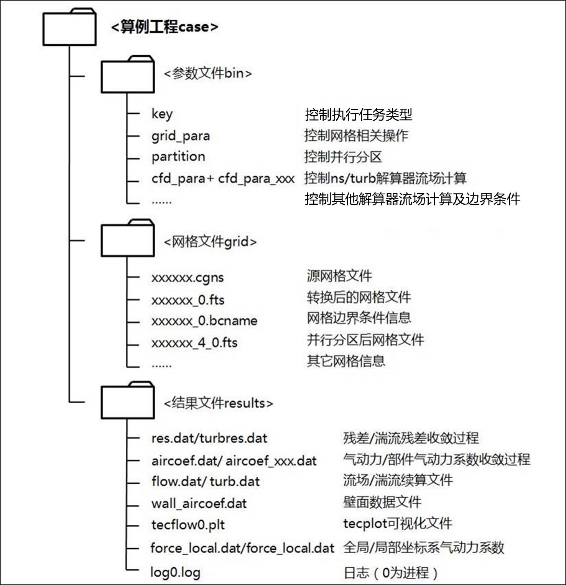<br>图 3-1 风雷工程算例的文件结构</div><br>
### 3.1.1  参数文件夹

&ensp;&ensp;&ensp;&ensp;bin参数文件夹：包括网格转换、网格分区、以及CFD计算过程中用到的所有的参数文件。

#### 3.1.1.1  总控文件

&ensp;&ensp;&ensp;&ensp;总控文件key.hypara：控制程序执行的任务类型。通过修改总控文件中的参数，程序可以进行如下功能任务：
- 数值模拟计算任务。
- 网格操作：包括典型的网格转换、网格重构、网格合并和网格修复等任务。
- 壁面距离计算任务。
- 并行分区任务。
  | 类型   | 参数            | 描述                                                         |
  | ------ | --------------- | ------------------------------------------------------------ |
  | string | title           | 屏幕输出的文件名                                             |
  | string | defaultParaFile | 默认参数文件，通常不做任何修改                               |
  | int    | ndim            | 计算网格维数：2维或3维                                       |
  | int    | nparafile       | 参数文件数目                                                 |
  | int    | nsimutask       | 任务类型 0：数值计算；1：网格操作；2：壁面距离计算；3：网格分区 |
  | string | parafilename    | 与任务类型相匹配的参数文件名                                 |

#### 3.1.1.2  网格控制文件

&ensp;&ensp;&ensp;&ensp;网格控制文件grid_para.hypara：是程序执行网格相关操作的参数文件，当总控文件中选择网格操作nsimutask=1时，通过修改网格控制文件参数，可以进行如下网格操作：
- 网格转换
- 网格重构
- 网格合并
- 网格修复
- 网格变形

&ensp;&ensp;&ensp;&ensp;**备注：**在实际计算中，最常用是网格转换功能，即将第三方软件生成的计算网格转换成PHengLEI自定义的fts格式文件，转换后的fts文件包含了网格、边界条件等信息，所以目前的grid_para.hypara文件中只包含了下表中标红的参数，其他参数均包含在默认参数文件cfd_para.hypara中，可根据实际执行的网格功能操作从中提取相关的参数到grid_para.hypara文件。
| 类型   | 参数                              | 描述                                                         |
| ------ | --------------------------------- | ------------------------------------------------------------ |
| int    | <font color=red>gridtype</font>   | 网格类型：   0：非结构   1：结构   2：混合                   |
| int    | gridobj                           | 几何处理类型：   0：利用程序数据库生成网格；   1：网格转换   2：网格重构（自适应、局部重生成）   3：网格合并；   4：网格变形；   5：网格修复 |
| int    | multiblock                        | 输入的是否是多块网格（0/1）                                  |
| int    | iadapt                            | 自适应次数（用于非结构网格）                                 |
| int    | SymmetryFaceVector                | 对称面向量   0：X轴向上   1：Y轴向上   2：Z轴向上            |
| int    | <font color=red>axisup</font>     | Cartesian坐标系类型   1：y轴向上  2：Z轴向上                 |
| int    | omit_no_bound_bc                  | 无边界条件   1：交界面（默认）   2：物理边界（混合网格）     |
| int    | <font color=red>from_gtype</font> | 读入的网格类型   -1：混合网格   1：PHengLEI格式   2：CGNS格式   3：结构网格Gridgen/Plot3D格式   4：非结构网格FieldView格式   5：FLUENT格式 |
| int    | to_gtype                          | 转换后，输出的网格类型   目前只能选1，为PHengLEI格式网格文件 |
| int    | dumpOldGrid                       | 是否输出旧格式网格文件   0：否   1：是                       |
| string | <font color=red>from_gfile</font> | 输入的文件路径及文件名                                       |
| string | <font color=red>out_gfile</font>  | 输出的文件路径及文件名                                       |
| string | mixgrid_uns                       | 混合网格中的非结构网格文件路径及文件名                       |
| string | mixgrid_str                       | 混合网格中的结构网格文件路径及文件名                         |

#### 3.1.1.3  网格分区文件

&ensp;&ensp;&ensp;&ensp;网格分区文件partition.hypara：是程序执行网格分区操作的参数文件，当总控文件中选择网格操作即nsimutask=3时，通过修改分区文件参数，就可以进行网格分区。

&ensp;&ensp;&ensp;&ensp;**备注：**在实际计算中，网格分区后生成相应的分区文件信息，目前的partition.hypara文件中只包含了下表中标红的参数，其它参数一般情况下不做修改，均包含在默认参数文件cfd_para.hypara中，可根据实际需要从中提取相关的参数到partition.hypara文件中进行修改。
| 类型   | 参数                                       | 描述                                                       |
| ------ | ------------------------------------------ | ---------------------------------------------------------- |
| int    | <font color=red>pgridtype</font>           | 网格类型   0：非结构网格   1：结构网格                     |
| int    | <font color=red>maxproc</font>             | 网格分区数（最大进程数）                                   |
| int    | traceMark                                  | 是否追踪标记（只针对结构网格）   0：否   1：是             |
| int    | blockIndexOfMark[]                         | 标记块索引                                                 |
| int    | cellIndexOfMark[]                          | 标记单元索引                                               |
| string | <font color=red>original_grid_file</font>  | 分区前网格文件路径和文件名                                 |
| string | <font color=red>partition_grid_file</font> | 分区后网格文件路径和文件名                                 |
| int    | <font color=red>numberOfMultigrid</font>   | 多重网格计算重数（只针对结构网格）                         |
| int    | npartmethod                                | 界面重构方法，默认为1                                      |
| int    | parallelPartitionMethod                    | 并行分区方法（只针对非结构网格并行分区）                   |
| double | parmetisBalance                            | 不平衡度   1：完全平衡   maxproc：完全不平衡  1.05：推荐值 |

#### 3.1.1.4  解算器计算参数文件

- 解算器默认文件cfd_para.hypara：是程序执行任何操作的默认参数文件，包含了所有的参数（网格转换、分区、cfd计算），程序执行任何操作修改相应文件中的参数即可覆盖cfd_para.hypara中相同参数值，默认参数文件除特殊情况一般不允许修改。
- 亚声速流动参数文件cfd_para_subsonic.hypara：包含了亚声速流动计算推荐的参数，计算时只要修改相应参数即可覆盖cfd_para.hypara中相同参数值。
- 跨声速流动参数文件cfd_para_transonic.hypara：包含了跨声速流动计算推荐的参数，计算时只要修改相应参数即可覆盖cfd_para.hypara中相同参数值。
- 超声速流动参数文件cfd_para_supersonic.hypara：包含了超声速流动计算推荐的参数，计算时只要修改相应参数即可覆盖cfd_para.hypara中相同参数值。
- 高超声速流动参数文件cfd_para_hypersonic.hypara：包含了高超声速流动计算推荐的参数，计算时只要修改相应参数即可覆盖cfd_para.hypara中相同参数值。
&ensp;&ensp;&ensp;&ensp;**备注：**在实际计算中，默认参数文件中包含了所有的参数，数量庞大，在修改过程中比较麻烦、不易查找且耗费时间，按照计算速域区分参数文件能够快速修改相应的参数，既避免用户在修改参数时产生混淆和错误，又能够防止默认参数被修改得面目全非。
| 类型   | 参数                                        | 描述                                                         |
| ------ | ------------------------------------------- | ------------------------------------------------------------ |
| int    | intervalStepFlow                            | 流场数据文件存盘间隔步数                                     |
| int    | maxSimuStep                                 | 最大迭代计算步数                                             |
| int    | intervalStepPlot                            | 可视化文件输出间隔步数                                       |
| int    | intervalStepForce                           | 气动力输出间隔步数                                           |
| int    | intervalStepRes                             | 残差输出间隔步数                                             |
| int    | ifLowSpeedPrecon                            | 是否进行低速预处理   0：否   1：是                           |
| int    | compressible                                | 是否是可压缩流   0：不可压缩流   1：可压缩流                 |
| double | refMachNumber                               | 来流马赫数                                                   |
| double | attackd                                     | 来流攻角                                                     |
| double | angleSlide                                  | 侧滑角                                                       |
| int    | inflowParaType                              | 来流边界条件类型   0：无量纲参数   1：飞行参数  2：试验参数参 3：亚声速边界条件参数 |
| double | height                                      | 飞行高度                                                     |
| double | wallTemperature                             | 壁面温度                                                     |
| double | gridScaleFactor                             | 网格缩放因子                                                 |
| double | forceReferenceLength                        | 参考长度                                                     |
| double | forceReferenceLengthSpanWise                | 参考展长                                                     |
| double | forceReferenceArea                          | 参考面积                                                     |
| double | TorqueRefX <br/>TorqueRefY  <br/>TorqueRefZ | 参考点                                                       |
| int    | viscousType                                 | NS方程类型   0：无粘Euler方程   1：层流   2：代数湍流模型   3：一方程湍流模型   4：两方程湍流模型 |
| string | viscousName                                 | 粘性类型，可选项有：   "0eq-bl","1eq-sa","2eq-kw-menter-sst","2eq-kw-menter-bsl","2eq-kw-wilcox-1988","2eq-kw-wilcox-1998","2eq-kw-kok-tnt"，"2eq-kw-wilcox-2006"，"easm-kw-2003"，"easm-kw-2005" |
| int    | DESType                                     | DES类型   0：RANS  1：DES   2：DDES   3：IDDES               |
| string | inviscidSchemeName                          | 结构网格无粘项空间离散类型，可选项有：   "vanleer", "steger", "hlle", "roe", "modified_roe", "ausm+", "ausm+w", "ausm+up", "ausmdv", "ausmpw" |
| string | str_limiter_name                            | 结构网格限制器类型，可选项有：   "vanalbada", "vanleer", "minmod", "smooth", "minvan", "nolim" |
| string | uns_scheme_name                             | 非结构无粘项空间离散类型，可选项有：   "vanleer",   "roe", "steger", "kfvs", "lax_f", "hlle", "ausm+", "ausmdv", "ausm+w", "ausmpw", "ausmpwplus" |
| string | uns_limiter_name                            | 非结构限制器类型，可选项有： "barth", "vencat", "vanleer", "minmod", "vanalbada", "smooth", "nnd",  "lpz", "1st", "nolim" |
| string | uns_vis_name                                | 非结构粘性项空间离散类型，可选项有：   "std", "test", "aver", "new1", "new2" |
| string | gradientName                                | 非结构梯度重构类型，可选项有：   "default", "ggcell", "ggnode", "lsq" |
| int    | ivencat                                     | vencat限制器类型   0：原始方法，与网格尺度无关  1：新方法，依赖网格尺度   4：Ustar 限制器模型   7：默认推荐 |
| double | venkatCoeff                                 | vencat限制器系数                                             |
| int    | reconmeth                                   | 重构面左右值限制器系数   0：左右单元采用各自的限制器系数  1：左右单元采用最小限制器系数 |
| int    | limitVariables                              | 限制模式   0：只限制压力和密度，取最小值  1：限制所有变量，取最小值 |
| int    | limitVector                                 | 变量限制系数   0：所有变量采用相同的限制器系数  1：每个变量采用各自的限制器系数 |
| double | skewnessAngle                               | 扭曲度                                                       |
| int    | roeEntropyFixMethod                         | ROE格式熵修正方法数   1：直接修正，限制最小特征值  2：多维修正，用于结构求解器    3：Harten型修正,默认 |
| double | roeEntropyScale                             | ROE格式熵修正系数缩放，默认为1                               |
| int    | iunsteady                                   | 定常或非定常计算   0：定常   1：非定常                       |
| double | physicalTimeStep                            | 物理时间步                                                   |
| int    | ifStartFromSteadyResults                    | 是否起始于定常流动   0：否   其他：是                        |
| int    | min_sub_iter                                | 非定常最小子迭代步                                           |
| int    | max_sub_iter                                | 非定常最大子迭代步                                           |
| double | tol_sub_iter                                | 非定常子迭代步ε量                                            |
| int    | tscheme                                     | 时间推进格式   1：Runge-Kutta Multi-State   2：Point implicit   3：Full implicit   4：LU-SGS   5：Block LU-SGS |
| int    | iSimplifyViscousTerm                        | BLU方法中是否进行粘性项简化计算，推荐1                       |
| double | CFLStart                                    | 起始CFL数                                                    |
| double | CFLEnd                                      | 终止CFL数                                                    |
| int    | CFLVaryStep                                 | 变CFL数步数                                                  |
| double | ktmax                                       | 用于控制局部时间步长中最大和最小时间步长的比值               |
| double | swapDq                                      | 前扫描和后扫描之间dq是否进行通信，默认为0                    |
| int    | nLUSGSSweeps                                | LUSGS中的前后扫描步数                                        |
| double | LUSGSTolerance                              | LUSGS中的前后扫描ε量                                         |
| int    | wallFunctionType                            | 是否计算壁面函数   0：否   1：是                             |
| int    | RKStage                                     | 显式Runge-Kutta推进多步数                                    |
| double | lamda[n]                                    | 显式Runge-Kutta推进步系数                                    |
| string | gridfile                                    | 计算网格路径和文件名                                         |
| int    | walldistMethod                              | 壁面距离计算方法数   0：精确  1：快速不精确   2：超级快速更加不精确 |
| string | resSaveFile                                 | 残差文件路径和文件名                                         |
| string | turbresfile                                 | 湍流残差文件路径和文件名                                     |
| string | aircoeffile                                 | 气动力系数文件路径和文件名                                   |
| string | restartNSFile                               | 流场变量文件路径和文件名                                     |
| string | turbfile                                    | 湍流变量文件路径和文件名                                     |
| string | visualfile                                  | 可视化输出文件路径和文件名                                   |
| string | wall_aircoefile                             | 壁面数据文件路径和文件名                                     |
| int    | plotFieldType                               | 是否输出全流场数据   0：否  1：是                            |
| int    | visualSlice                                 | 是否输出切片流场数据   0：否  1：是                          |
| int    | sliceAxis                                   | 切片方向   1：X轴方向  2：Y轴方向  3：Z轴方向                |
| double | slicePostion                                | 切片位置坐标                                                 |
| string | sliceFile                                   | 切片数据文件路径和文件名                                     |
| int    | nVisualVariables                            | tecplot可视化文件输出的变量数目                              |
| int    | visualVariables[]                           | tecplot可视化文件输出的变量类型                              |
| int    | ifSetProbesToMonitor                        | 是否设置点监控                                               |
| string | probesDefineFile                            | 点的位置信息文件                                             |
| int    | nProbeVariables                             | 点监控的变量个数                                             |
| int    | probeVariables[]                            | 点监控的变量类型                                             |
| int    | nMGLevel                                    | 多重网格数   1：单重  >1：多重                               |
| int    | MGCoarsestIteration                         | 最粗网格上迭代步数                                           |
| int    | MGPreIteration                              | 向前糙化网格迭代步数                                         |
| int    | MGFasType                                   | 多重网格循环方式数   1：V循环   2：W循环                     |
| int    | n_post                                      | 向后细化网格迭代步数                                         |
| int    | flowInitStep                                | 流场初始化步数                                               |
| int    | mprol                                       | 多重网格插值方法   0：0阶   1：1阶                           |
| double | mgCFLScale                                  | 粗网格上CFL数放大倍数                                        |
| double | mgCorrectionLimit                           | 修正限制量                                                   |
| double | MUSCLCoefXk                                 | MUSCL 插值[-1,1]                                             |

&ensp;&ensp;&ensp;&ensp;初始来流条件，包含了如下表的4种来流情况，不同来流条件下，在不同速域的参数文件中设置来流条件对默认参数文件进行覆盖。                          

| 类型                                                         | 参数                                        | 描述                                                         |
| ------                                                       | -------------------------                   | ------------------------------                               |
| int                                                          | inflowParaType=0                            | 无量纲参数（Ma、Re、T）                                      |
| double                                                       | refReNumber                                 | 来流单位雷诺数                                               |
| double                                                       | refDimensionalTemperature                   | 来流温度                                                     |
| int                                                          | inflowParaType=1                            | 飞行参数（Ma、Height）                                       |
| double                                                       | height                                      | 飞行高度                                                     |
| int                                                          | inflowParaType=2                            | 试验参数（Ma、T0、p0）                                       |
| double                                                       | refDimensionalTemperature                   | 总温（只针对试验参数）                                       |
| double                                                       | refDimensionalPressure                      | 总压（只针对试验参数）                                       |
| int                                                          | inflowParaType=3                            | 亚声速边界条件参数（Ma、T、p）                               |
| int                                                          | nsubsonicInlet                              | 亚声速入口                                                   |
| int                                                          | nsubsonicOutlet                             | 亚声速出口                                                   |
| string                                                       | inLetFileName                               | 入口边界条件的文件                                           |
| string                                                       | outLetFileName                              | 出口边界条件的文件                                           |
| double                                                       | refDimensionalTemperature                   | 参考温度                                                     |
| double                                                       | refDimensionalPressure                      | 参考压力                                                     |

### 3.1.2  网格文件夹

&ensp;&ensp;&ensp;&ensp;grid网格文件夹：所有网格数据文件，包括转换后的网格文件和分区后的网格文件。
- 原始网格文件。
- 转换成风雷程序可计算的网格文件。
- 网格分区生成风雷程序可计算的网格文件，其中串行分区得到一个分区文件（.fts），并行分区得到多个分区文件（.fts），且仅非结构网格支持并行分区。
|         网格文件类型          | 网格文件格式                                                 | 说明                                                         |
| :---------------------------: | :----------------------------------------------------------- | :----------------------------------------------------------- |
|         原始网格文件          | 结构/非结构CGNS格式<br/>结构Plot3D格式<br/>非结构FieldView格式<br/>非结构Fluent格式 | 第三方软件生成的网格。                                       |
|       转换后的网格文件        | xxx_0.fts                                                    | HDF5格式; <br/>网格转换是串行（单个进程）；<br/>转换后的文件自动添加当前进程号_0。 |
| 分区后的网格文件<br/>（串行） | xxx__n_0.fts                                                 | HDF5格式，n为分区数；<br/>网格分区通常是串行（单个进程）;<br/>分区后的文件自动添加当前进程号_0。 |
| 分区后的网格文件<br/>（并行） | xxx__n_Pid.fts                                               | HDF5格式，n为分区数，Pid为进程号；<br/>非结构网格可以并行分区（多个进程）；<br/>并行分区后的文件自动添加当前进程号_Pid。 |

### 3.1.3  结果文件夹

&ensp;&ensp;&ensp;&ensp;results结果文件夹：风雷执行cfd计算的过程中自动生成的文件夹，保存所有输出的结果数据文件。
| 结果文件名       | 文件格式         | 说明                             |
| ---------------- | :--------------- | :------------------------------- |
| res.dat          | ASCII格式        | 残差收敛过程                     |
| turbres.dat      | ASCII格式        | 湍流残差收敛过程                 |
| aircoef.dat      | ASCII格式        | 气动力收敛过程                   |
| aircoef_xx.dat   | ASCII格式        | 部件气动力收敛过程               |
| force_global.dat | ASCII格式        | 全局坐标系下全机和部件气动力系数 |
| force_local.dat  | ASCII格式        | 局部坐标系下部件气动力系数       |
| wall_aircoef.dat | ASCII格式        | 壁面数据文件                     |
| flow_0.dat       | 二进制           | 流场续算文件                     |
| turb_0.dat       | 二进制           | 湍流流场续算文件                 |
| tecflow.plt      | ASCII格式/二进制 | 流场数据可视化文件               |

## 3.2  运行流程

&ensp;&ensp;&ensp;&ensp;PHengLEI主要执行网格前置处理（包括网格转换、网格合并等）、网格分区及流场计算等功能，运行时，必须读入总控参数文件key.hypara和默认参数文件cfd_para.hypara，它们位于该项目工作目录的子目录bin中且定义了该软件所执行功能及所读入的相应控制参数文件名。

&ensp;&ensp;&ensp;&ensp;PHengLEI流场计算时采用自定义格式网格文件（网格文件后缀名为.fts），当采用外部网格文件时，在流场计算前，需进行网格转换，具体可参阅网格控制文件grid_para.hypara，并行计算时需进行网格划分，具体可参阅并行分区文件partition.hypara。下图可以说明大体的运行流程，参数设置因不同的算例存在一定的差异。
<div align=center><br>图 3-2 风雷程序运行基本流程</div>
&ensp;&ensp;&ensp;&ensp;基本的运行流程主要包括下面三个部分：
1. 网格转换：通过修改总控文件key.hypara和网格控制文件grid_para.hypara中的参数，运行风雷可执行程序完成Gridgen/Plot3D/FieldView等格式网格文件到自定义fts格式的转换。
2. 网格分区：通过修改总控文件key.hypara和网格控制文件partition.hypara中的参数，运行风雷可执行程序完成网格分区。 
3. 开始计算：通过修改总控文件key.hypara和解算器文件cfd_para_xxx.hypara中的参数，运行风雷可执行程序完成对算例的数值模拟。

### 3.2.1  拷贝参数文件

&ensp;&ensp;&ensp;&ensp;新建工程目录，在工程目录下建立2个子目录bin、grid，将examples示例里的bin文件夹的参数文件通常包括总控文件、网格控制文件、并行分区文件、默认参数文件以及相应计算速域的参数文件拷贝到工程目录下的bin子目录中，将原始网格文件存放在grid子目录中。将Release模式下编译好的PHengLEIv3d0.exe拷贝到工程目录下执行，也可以将子目录bin和grid直接拷贝到风雷项目工程build目录下的PHengLEIv3d0文件夹下，即可在VS里CTRL+F5直接串行运行程序。

### 3.2.2  网格转换

&ensp;&ensp;&ensp;&ensp;通过修改主控文件key.hypara和网格控制文件grid_para.hypara可以实现第三方软件生成的网格文件到自定义fts格式的转换功能。下述内容涉及主要参数的修改，其它参数如无特别说明，采用默认参数设置即可。各参数的说明见3.1.1.1和3.1.1.2。
- 打开key.hypara，根据对应修改网格维数，打开网格转换任务，设置网格控制文件路径和文件名：
```c++
string title     = "PHengLEI Main Parameter Control File";

// IMPORTANT NOTICE：DON NOT MODIFY THE FOWLLOWING LINE
string defaultParaFile = "./bin/cfd_para.hypara";

//! 设置网格维数，二维还是三维
int  ndim       = 3;
int  nparafile  = 1;

//! 打开网格转换任务，设置网格控制文件路径和文件名
int    nsimutask      = 1;
string parafilename   = "./bin/grid_para.hypara";

// ----------------  advanced Parameters, DO NOT care it -----------
int  numberOfGridProcessor  = 0;
// ATP read
//@string parafilename1    = ""
//@string parafilename2    = "";
```

- 打开文件grid_para.hypara，修改如下参数：

```c++
#########################################################################
#                           网格数据类型                              #
#########################################################################

//! 设置网格类型（0：非结构网格/1：结构网格）
int gridtype = 0;

//! 设置Cartesian坐标系类型（1：y轴向上/2：z轴向上）
int axisup   = 1;

//!设置原始网格的数据类型
//!-1：混合类型
//! 1：PHengLEI自生成网格*.fts
//! 2：CGNS , *.cgns
//! 3：Plot3D（结构）， *.dat /*.grd
//! 4：Fieldview（非结构），*.dat/*.inp
//! 5.Fluent, *.cas/*.msh
//! 6.Ustar, nMGLevel.in 
//! 7.结构非结构混合网格,*.fts
//! 8.GMSH,*.msh.
int from_gtype          = 2;

#########################################################################
#                          文件路径                                 #
#########################################################################

//! 设置网格转换前源网格数据文件路径和文件名，以CGNS网格为例
string from_gfile = "./grid/xxxxxx.cgns";

//! 设置网格转换程风雷自定义网格格式的目标文件路径和文件名
string out_gfile  = "./grid/xxxxxx.fts";
```
- 拷贝PHengLEI编译成的可执行程序到工程目录下，运行完成网格转换。
&ensp;&ensp;（1）直接双击运行exe（串行）
&ensp;&ensp;（2）cmd进入工程目录，输入命令：mpiexec -n 1 .\PhengLEI.exe
- 在程序调试过程中如果需要运行算例，可以拷贝bin和grid到风雷项目工程的PHengLEIv3d0目录下运行程序完成网格转换。
&ensp;&ensp;（1）在VS里选择Debug/Release编译，CTRL+F5直接运行程序。
- 此时grid文件夹内会生成xxxxxx_0.fts文件。

### 3.2.3  网格分区

&ensp;&ensp;&ensp;&ensp;完成网格转换之后，重新修改主控文件key.hypara和分区参数文件partition.hypara可以实现风雷自定义fts格式网格的分区功能。下述内容涉及主要参数的修改，其它参数如无特别说明，采用默认参数设置即可。各参数的说明见3.1.1.1和3.1.1.3。
- 打开key.hypara，打开网格并行分区任务，设置并行分区文件路径和文件名：
```c++
string title     = "PHengLEI Main Parameter Control File";

// IMPORTANT NOTICE：DON NOT MODIFY THE FOWLLOWING LINE
string defaultParaFile = "./bin/cfd_para.hypara";

int  ndim       = 3;
int  nparafile  = 1;

//! 打开网格并行分区任务，设置并行分区文件路径和文件名
int    nsimutask      = 3;
string parafilename   = "./bin/partition.hypara";

// ----------------  advanced Parameters, DO NOT care it -----------
int  numberOfGridProcessor  = 0;
// ATP read
//@string parafilename1    = ""
//@string parafilename2    = "";
```

- 打开文件partion.hypara，修改如下参数：

```c++
//! 设置分区网格类型（0：非结构网格/1：结构网格）
int pgridtype    = 0; 

//! 设置分区数（进程数）
int maxproc      = 4;

//! 设置并行分区源网格数据文件路径和文件名
string original_grid_file      = "./grid/XXXXXX.fts";

//! 设置并行分区目标网格数据文件路径和文件名
string partition_grid_file     = "./grid/XXXXXX__4.fts";


//! 设置多重网格数，只用于结构网格设置（1：单重/2：二重/n：n重）
int numberOfMultigrid       = 1;
```
- 拷贝PHengLEI编译成的可执行程序到工程目录下，运行程序完成网格分区。
&ensp;&ensp;（1）直接双击运行exe（串行）
&ensp;&ensp;（2）cmd进入工程目录，输入命令：mpiexec -n 1 .\PhengLEI.exe
- 在程序调试过程中如果需要运行算例，可以拷贝bin和grid到风雷项目工程的PHengLEIv3d0目录下运行程序完成网格分区。
&ensp;&ensp;（1）在VS里选择Debug/Release编译，CTRL+F5直接运行程序。
- 此时grid文件夹内会生成xxxxxx__4_0.fts文件。

### 3.2.4  流场计算

&ensp;&ensp;&ensp;&ensp;完成网格分区之后，再次修改主控文件key.hypara和解算器文件cfd_para_xxxx.hypara（以跨声速为例）可以开始进行流场数值模拟计算。下述内容涉及主要参数的修改，其它参数如无特别说明，采用默认参数设置即可。各参数的说明见3.1.1.1和3.1.1.4。
- 打开key.hypara，打开流场计算任务，设置解算器参数文件路径和文件名：
```c++
string title     = "PHengLEI Main Parameter Control File";

// IMPORTANT NOTICE：DON NOT MODIFY THE FOWLLOWING LINE
string defaultParaFile = "./bin/cfd_para.hypara";

int  ndim       = 3;
int  nparafile  = 1;

//! 打开流场计算任务，设置解算器参数文件路径和文件名
int    nsimutask      = 0;
string parafilename   = "./bin/cfd_para_transonic.hypara.hypara";

// ----------------  advanced Parameters, DO NOT care it -----------
int  numberOfGridProcessor  = 0;
// ATP read
//@string parafilename1    = ""
//@string parafilename2    = "";
```
- 打开cfd_para_transonic.hypara文件，修改如下参数：
```c++
#########################################################################
#                             基本控制参数                               #
#########################################################################
//! 设置迭代计算步数
int    maxSimuStep  = 10000;

//! 设置流场数据存盘步数
int    intervalStepFlow        = 1000;

//! 设置tecplot可视化输出间隔步数
int    intervalStepPlot    = 1000;

//! 设置气动力输出间隔步数
int    intervalStepForce    = 100;

//! 设置残差输出间隔步数
int    intervalStepRes     = 10;

#########################################################################
#                        		来流参数                        #
#########################################################################
//! 设置马赫数
double refMachNumber    = 0.73;

//! 设置攻角
double attackd           = 2.79;

//! 设置侧滑角
double angleSlide         = 0.00;

//! 设置来流参数类型，具体类型详见4.1.1.4来流条件类型，然后设置对应参数
int    inflowParaType      = 0;
//! 单位雷诺数
double refReNumber         = 6.5e6;
//! 来流温度
double refDimensionalTemperature    = 288.15;

//! 设置网格缩放因子
//! 0 - 米.
//! 1 - 分米, 1 dm = 0.1  m.
//! 2 - 厘米, 1 cm = 0.01 m.
//! 3 - 毫米, 1 mm = 0.001m.
//! 4 - 英尺, 1 inch = 0.0254m.
//! 5 - 英寸, 1 foot = 12 inches = 0.3048m.
//! 6 - 码,   1 yard = 3  feet   = 0.9144m.
double gridScaleFactor     = 0;

//! 设置参考展长，以米为单位（其他网格尺度单位，需要换算成米）
double forceReferenceLengthSpanWise = 1.0;	

//! 设置参考长度，以米为单位（其他网格尺度单位，需要换算成米）
double forceReferenceLength   = 1.0;	

//! 设置参考面积，以米的平方为单位（其他网格尺度单位，需要换算成米）
double forceReferenceArea     = 1.0;	

//! 设置参考点（x,y,z），以米的平方为单位（其他网格尺度单位，需要换算成米）
double TorqueRefX        = 0.0;	
double TorqueRefY        = 0.0;	
double TorqueRefZ        = 0.0;	

#*******************************************************************
#			          物理模型   	                       
#*******************************************************************
// viscousType:           Viscous model 
//                         0 - Euler 
//                         1 - Lamilar
//                         3 - 1eq turbulent
//                         4 - 2eq turbulent
// viscousName :           Laminar or tubulent model
//                         - "1eq-sa", when ViscousType = 3
//                         - "2eq-kw-menter-sst", when ViscousType = 4
// DESType :         Type of DES
//                        0 - RANS (default);
//                        1 - DES;
//                        2 - DDES;
//                        3 - IDDES;

//! 设置粘性模型类型，并对应设置相应粘性模型（）
//! 0 - 无粘欧拉 
//! 1 - 层流
//! 3 - 一方程湍流模型
//! 4 - 两方程湍流模型
int    viscousType        = 3;
//! 对应类型设置相应粘性模型
// viscousType = 0 - "Euler"
// viscousType = 1 - "laminar"
// viscousType = 3  - "1eq-sa"
// viscousType = 4  - "2eq-kw-menter-sst"
string viscousName         = "1eq-sa";

int     DESType        = 0;

int roeEntropyFixMethod  = 3;
double roeEntropyScale   = 1.0;
#########################################################################
#                                空间离散                               #
#########################################################################
#*******************************************************************
#			                    结构解算器	       	                     
#*******************************************************************
//! 如果是结构网格，设置空间离散格式，否则不进行修改
//! 根据实际计算情况选取"roe", "vanleer", "ausm+up", "ausmpw" 
//! 跨声速默认推荐roe格式
string inviscidSchemeName     = "roe";

//! 如果是结构网格，设置限制器类型，否则不进行修改
//! 根据实际计算情况选取"3rdsmooth", "smooth", "nolim"
//! 跨声速默认推荐smooth限制器
string str_limiter_name    = "smooth";

#*******************************************************************
#			  			   非结构解算器                  		       *
#*******************************************************************

//! 如果是非结构网格，设置空间离散格式，否则不进行修改
//! 根据实际计算情况选取"vanleer",  "roe",  "steger",  "kfvs",  "lax_f",  "hlle"，"ausm+",  "ausmdv",  "ausm+w",  "ausmpw",  "ausmpwplus"
//! 跨声速默认推荐roe格式
string uns_scheme_name   = "roe";

//! 如果是非结构网格，设置限制器类型，否则不进行修改
//! 根据实际计算情况选取"vencat", "barth", "1st"，"nolim"
//! 跨声速默认推荐vencat限制器，限制器系数5.0
string uns_limiter_name  = "vencat";
double venkatCoeff        = 5.0;

#########################################################################
#                               时间离散                                #
#########################################################################
//! 设置是否非定常计算（0：定常/1：非定常）
int    iunsteady     = 0;

//! 设置库朗数
double CFLEnd       = 30.0;

//! 默认LUSGS时间推进格式,设置LUSGS扫描子迭代步数单步还是多步扫描
//! 跨声速推荐单步扫描
int    nLUSGSSweeps        = 1;

#########################################################################
#                              多重网格参数                              #
#########################################################################

//! 设置多重网格数（1-4）         
int nMGLevel          = 1;

//! 设置粗网格上多重初始化步数
//! 跨声速多重初始化步数推荐值100
int flowInitStep   = 100;


#########################################################################
#                            输入输出文件                                #
#########################################################################
//! 计算网格文件路径和文件名
//! 并行计算采用分区后的网格文件XXXXXX__4.fts
//! 串行计算采用的网格文件XXXXXX.fts
string gridfile           = "./grid/XXXXXX__4.fts";

int    plotFieldType      = 0;


// ----------------  advanced Parameters, DO NOT care it -----------
//! 流场可视化变量输出
int    nVisualVariables     = 8;
int    visualVariables[]  = [0, 1, 2, 3, 4, 5, 6, 15];
//! 一些限制量（qL和qR），推荐采用默认参数
int reconmeth            = 1;
int limitVariables           = 0;
int limitVector          = 0;
```
- 拷贝PHengLEI编译成的可执行程序到工程目录下，运行程序完成CFD计算。
&ensp;&ensp;（1）直接双击运行exe（串行）
&ensp;&ensp;（2）cmd进入工程目录，输入命令：mpiexec -n 1 .\PhengLEI.exe（串行）
&ensp;&ensp;（3）cmd进入工程目录，输入命令：mpiexec -n 4 .\PhengLEI.exe（并行）
- 在程序调试过程中如果需要运行算例，可以拷贝bin和grid到风雷项目工程的PHengLEIv3d0目录下运行程序开始流场计算。
&ensp;&ensp;（1）在VS里选择Debug/Release编译，CTRL+F5直接运行程序（串行）
- 开始流场计算，窗口开始输出，输出数据存储在results文件夹中。

### 3.2.5  计算结果数据后处理

&ensp;&ensp;&ensp;&ensp;完成流场数值模拟计算之后，风雷工程算例路径下results文件夹保存所有的输出数据。各文件的详细说明见3.1.3。
<div align=center><br>图 3-3  风雷工程算例的结果文件</div>
&ensp;&ensp;&ensp;&ensp;可采用Tecplot对计算结果进行后处理，根据数据分析的需要画出残差收敛曲线图，升阻力系数曲线以及流场图等进行对比分析。


# 第4章  应用实例

&ensp;&ensp;&ensp;&ensp;本章主要通过三个典型算例来详细介绍使用“风雷”进行数值计算的过程，包括：如何对网格进行前处理，如何进行算例设置，如何使用求解器进行求解，以及使用Tecplot来后处理结果数据。关于后处理的详细过程（代码）描述，可以跳至第12章查看相关内容。

&ensp;&ensp;&ensp;&ensp;如果用户想要运行算例来熟悉风雷源代码的运行流程或者进行二次开发调试程序，建议把教程里或者自己的算例拷贝到上文中提到的风雷项目工程（源代码目录）下的PHengLEIv3d0文件夹下调试、运行和计算，这对于用户快速熟悉和掌握风雷源代码有非常大的帮助。下面进行具体算例的使用教程。

## 4.1  30P30N三段翼低速绕流（部件积分）

&ensp;&ensp;&ensp;&ensp;30P30N多段翼型包含着极为复杂的流动现象，如层流分离、湍流接触线和再层流化，湍流边界层的发展、层流发展、掺混边界层及粘性尾流相互作用等。本节主要讲述如何对30P30N多段翼型低速绕流算例进行前处理、运行计算以及后处理的过程，进而分析30P30N模型复杂的流动现象。
<div align=center><br>图 4-1 30P30N三段翼形几何外形</div><br>
###  4.1.1  新建工程

1. 建立工程目录，取名为TwoD_30P30N_Str；
2. 拷贝bin文件夹到工程目录；
3. 建立grid目录并且拷贝网格文件到grid（grid目录没有相对位置的要求，可放在任意路径只需要在参数文件设置时，对网格路径能够正确指定即可）；
4. 拷贝已经编译好的PHengLEI可执行程序到工程目录，通常使用Release编译生成的可执行程序进行计算（PHengLEI\build\PHengLEIv3d0\Release\PHengLEIv3d0.exe）。

###  4.1.2  前处理

####  4.1.2.1  网格转换

&ensp;&ensp;&ensp;&ensp;在本算例30P30N结构网格采用第三方软件Pointwise网格输出CGNS格式的网格，首先需要将CGNS格式网格转换成风雷自定义的fts网格格式。

&ensp;&ensp;&ensp;&ensp;30P30N结构网格如图4-2所示，计算域为x方向20倍弦长、y方向20倍弦长。网格单元总数为133568，壁面第一层网格约为1.0E-05m。
<div align=center><br>图 4-2 30P30N网格空间拓扑示意图及局部放大图</div>
&ensp;&ensp;&ensp;&ensp;网格转换过程：
1. 修改总控文件key.hypara，设置任务类型为网格转换：
```c++
string title       		 =   "PHengLEI Main Parameter Control File";
string defaultParaFile   =   "./bin/cfd_para.hypara";
int  ndim         =   2;
int  nparafile    =   1;
int    nsimutask          =   1;
string parafilename       =   "./bin/grid_para.hypara";
int  numberOfGridProcessor    =   0;
string parafilename1      =   ""
string parafilename2      =   "";
```
2. 修改网格控制文件grid_para.hypara，设置网格转换参数：
```c++
int gridtype              =   1;
int axisup                =   1;
int from_gtype            =   2;
string from_gfile   =   "./grid/30p30n_str.cgns";
string out_gfile    =   "./grid/30p30n_str.fts";
```
3. 工程目录下串行运行执行程序
- 双击运行PHengLEIv3d0.exe
- cmd进入工程目录，输入命令：mpiexec -n 1 ./PHengLEIv3d0.exe
4. 运行成功后得到转换后的网格文件
- 转换后的网格文件会自动加上当前的进程号，因为网格转换是串行，单进程，所以文件会自动加```_0```；
- 因为程序中自动加上当前进程号（```_0```），所以在参数设置的过程中不需要考虑进程的问题，只需要根据源网格文件的名称和路径设置参数即可。
<div align=center><br>图 4-3 转换后的网格文件</div><br>
####  4.1.2.2  边界条件

&ensp;&ensp;&ensp;&ensp;网格生成完毕，用户可以查看算例网格的边界条件信息boundary_condition.hypara。
```c++
int nBoundaryConditons = 4;
string bcName = "Wall-1";
{
  string bodyName = "body";
  int bcType = 2;
}
string bcName = "Wall-2";
{
  string bodyName = "body";
  int bcType = 2;
}
string bcName = "Wall-3";
{
  string bodyName = "body";
  int bcType = 2;
}
string bcName = "Farfield";
{
  int bcType = 4;
}
```

###  4.1.3  网格分区

&ensp;&ensp;&ensp;&ensp;求解过程采用并行计算，所以需要对转换后的网格进行分区。

&ensp;&ensp;&ensp;&ensp;网格分区过程：
1. 修改总控文件key.hypara，设置任务类型网格分区：
```c++
string title       		 =   "PHengLEI Main Parameter Control File";
string defaultParaFile   =   "./bin/cfd_para.hypara";
int  ndim         =   2;
int  nparafile    =   1;
int    nsimutask          =   3;
string parafilename       =   "./bin/partition.hypara";
int  numberOfGridProcessor=   0;
string parafilename1      =   ""
string parafilename2      =   "";
```
2. 修改分区文件partition.hypara，设置网格分区参数：
```c++
int pgridtype 	=  1;
int maxproc     =   4;
string original_grid_file  	=  "./grid/30p30n_str.fts";
string partition_grid_file  =  "./grid/30p30n_str__4.fts";
int numberOfMultigrid =  2;
```
3. 工程目录下串行运行执行程序
- 双击运行PHengLEIv3d0.exe
- cmd进入工程目录，输入命令：mpiexec -n 1 ./PHengLEIv3d0.exe
4. 运行成功后得到分区后的网格文件
- 分区后的网格文件名除了添加的分区标识（```__4```）之外，会自动加上当前的进程号，因为此处的结构网格分区是串行，单进程，所以文件会自动加```_0```；
- 因为程序中自动加上当前进程号（```_0```），所以在参数设置的过程中不需要考虑进程的问题，只需要根据网格文件的名称和路径以及分区数设置参数即可。
<div align=center><br>图 4-4 分区后的网格文件</div><br>
### 4.1.4  运行算例

&ensp;&ensp;&ensp;&ensp;30P30N多段翼型低速绕流在计算前需要对解算器参数进行设置，计算条件如下：
| 参数                  | 值      |
| :---------------------: | :-------: |
| 马赫数                | 0.2 |
| 单位长度雷诺数(m<sup>-1</sup>) | 9.0e6 |
| 攻角(°)               | 19 |
| 侧滑角(°)             | 0.0 |
| 来流温度(K)           | 288 |
| 壁温(K)               | 绝热壁  |
| 参考长度(m)           | 1.0 |
| 参考面积(m<sup>2</sup>) | 1.0     |
| 参考点                | (0,0,0) |
1. 修改总控文件key.hypara，设置任务类型为数值计算：
```c++
string title       		 =   "PHengLEI Main Parameter Control File";
string defaultParaFile   =   "./bin/cfd_para.hypara";
int  ndim         =   2;
int  nparafile    =   1;
int    nsimutask          =   0;
string parafilename       =   "./bin/cfd_para_subsonic.hypara";
int  numberOfGridProcessor=   0;
string parafilename1      =   ""
string parafilename2      =   "";
```
2. 修改解算器文件cfd_para_subsonic.hypara：
- 基本参数设置：
```c++
int    intervalStepFlow   	 =   1000;
int    maxSimuStep    		 =   20000;
int    intervalStepPlot      =   1000;
int    intervalStepForce     =   100;
int    intervalStepRes       =   10;
int    ifLowSpeedPrecon      =   0
```
- 来流条件参数设置：
```c++
double refMachNumber    = 0.2;
double attackd          = 19.0;
double angleSlide       = 0.0;
int    inflowParaType               = 0;
double refReNumber                  = 9e6;
double refDimensionalTemperature    = 288;
```
- 网格相关参数设置：
```c++
double gridScaleFactor     		=   0;
double forceReferenceLength     =   1.0;
double forceReferenceLengthSpanWise   =   1.0;
double forceReferenceArea       =   1.0;
double TorqueRefX          =   0.0;
double TorqueRefY          =   0.0;
double TorqueRefZ          =   0.0;
```
- 粘性模型设置：
```c++
int    viscousType:       = 3;
string viscousName     	  = "1eq-sa";
```
- 空间离散设置：
```c++
//! 低速默认推荐Roe格式
int roeEntropyFixMethod  = 3;
double roeEntropyScale   = 1.0;
string str_limiter_name  = "smooth";
```
- 时间离散设置：
```c++
//! 默认LUSGS隐式时间离散
int    iunsteady    	= 0;
double CFLEnd       	= 10.0;
int    nLUSGSSweeps  	= 5;
```
- 多重网格设置：
```c++
int nMGLevel        = 2;
int flowInitStep   	= 100;
```
- 计算网格路径设置：
```c++
string gridfile     = "./grid/30p30n_str__4.fts";
```
- 可视化输出设置：
```c++
int    plotFieldType        = 0;
int    nVisualVariables     = 8;
int    visualVariables[]  	= [0, 1, 2, 3, 4, 5, 6, 15];
```
- 其他限制参数设置：
```c++
int reconmeth            = 1;
int limitVariables       = 0;
int limitVector          = 0;
```
3. 修改解算器文件boundary_condition.hypara，设置局部坐标参考量：
- 部件积分参数设置（实际上当局部坐标和参考量与全局（全机）坐标一致时可以不设置，此处只是为了让大家了解如何进行部件积分参数设置）：
```c++
int nBoundaryConditons = 4;
string bcName = "Farfield";
{
	int bcType = 4;
}
string bcName = "Wall-1";
{
    string bodyName = "body";
	int bcType = 2;
	int dumpHingeMoment = 0;
	double forceReferenceArea = 1;
	double forceReferenceLength = 1;
	double forceReferenceLengthSpanWise = 1;
	double TorqueRefX = 0;
	double TorqueRefY = 0;
	double TorqueRefZ = 0;
	double wallTemperature = -1.0;
}
string bcName = "Wall-2";
{
    string bodyName = "body";
	int bcType = 2;
	int dumpHingeMoment = 0;
	double forceReferenceArea = 1;
	double forceReferenceLength = 1;
	double forceReferenceLengthSpanWise = 1;
	double TorqueRefX = 0;
	double TorqueRefY = 0;
	double TorqueRefZ = 0;
	double wallTemperature = -1.0;
}
string bcName = "Wall-3";
{
    string bodyName = "body";
	int bcType = 2;
	int dumpHingeMoment = 0;
	double forceReferenceArea = 1;
	double forceReferenceLength = 1;
	double forceReferenceLengthSpanWise = 1;
	double TorqueRefX = 0;
	double TorqueRefY = 0;
	double TorqueRefZ = 0;
	double wallTemperature = -1.0;
}
```
4. 工程目录下并行运行程序
- cmd进入工程目录，输入命令：mpiexec -n 4 ./PHengLEIv3d0.exe
5. 计算完成后得到结果文件
<div align=center><br>图 4-5 计算完成后的结果文件</div><br>
### 4.1.5  数据后处理

&ensp;&ensp;&ensp;&ensp;可采用Tecplot对计算结果进行后处理，载入工程文件夹results中相应的结果文件，绘制残差、气动力收敛曲线和流场图。

#### 4.1.5.1  残差收敛过程

&ensp;&ensp;&ensp;&ensp;载入工程文件夹TwoD_30P30N_Str的子目录results中相应的结果文件res.dat，绘制残差收敛曲线。
<div align=center>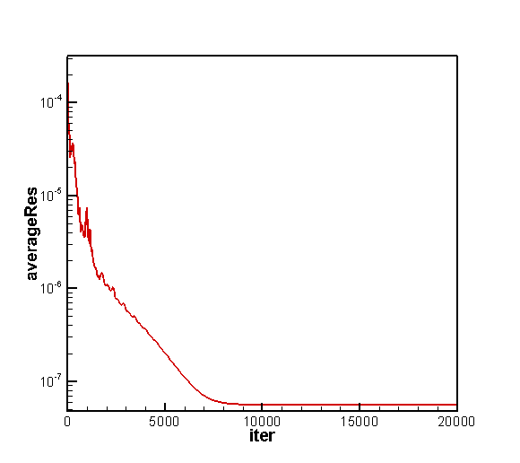<br>图 4-6 残差收敛曲线</div><br>
#### 4.1.5.2  升力系数收敛过程

&ensp;&ensp;&ensp;&ensp;载入工程文件夹TwoD_30P30N_Str的子目录results中相应的结果文件aircoef.dat、aircoef_Wall-1.dat、aircoef_Wall-2.dat、aircoef_Wall-3.dat，绘制升力系数收敛曲线。
<div align=center><br>图 4-7 升力系数（Wall_All）收敛曲线</div>
<div align=center><br>图 4-8 升力系数（Wall-1）收敛曲线</div>
<div align=center>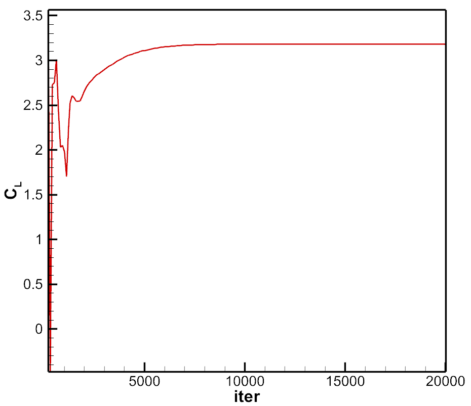<br>图 4-9 升力系数（Wall-2）收敛曲线</div>
<div align=center>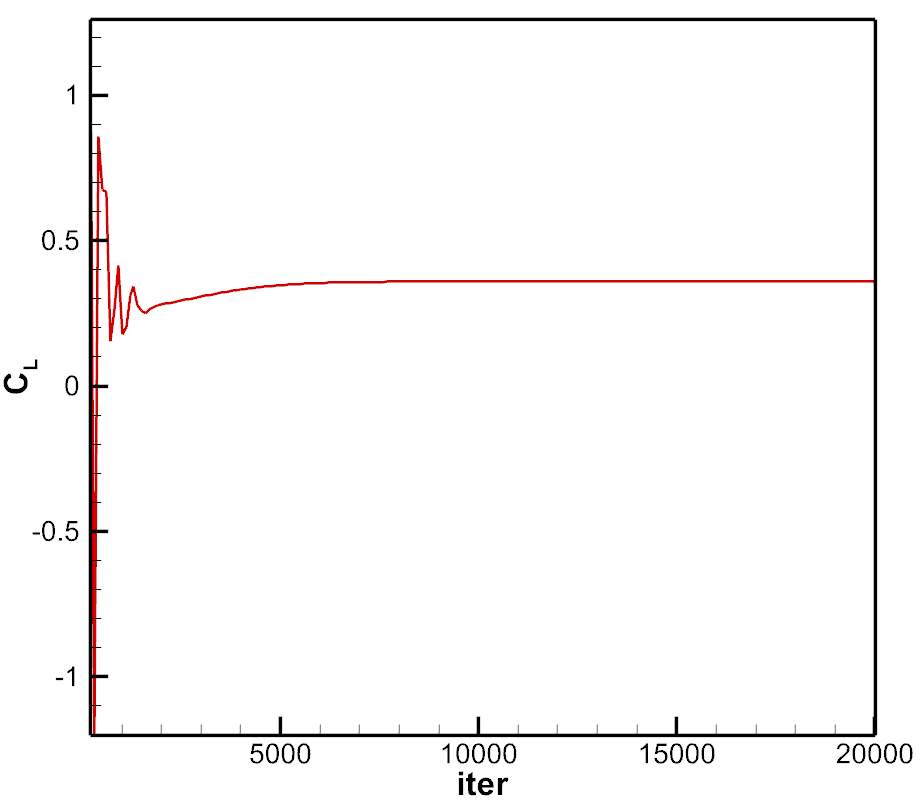<br>图 4-10 升力系数（Wall-3）收敛曲线</div><br>
#### 4.1.5.3  阻力系数收敛过程

&ensp;&ensp;&ensp;&ensp;载入工程文件夹TwoD_30P30N_Str的子目录results中相应的结果文件aircoef.dat、aircoef_Wall-1.dat、aircoef_Wall-2.dat、aircoef_Wall-3.dat，绘制阻力系数收敛曲线。
<div align=center>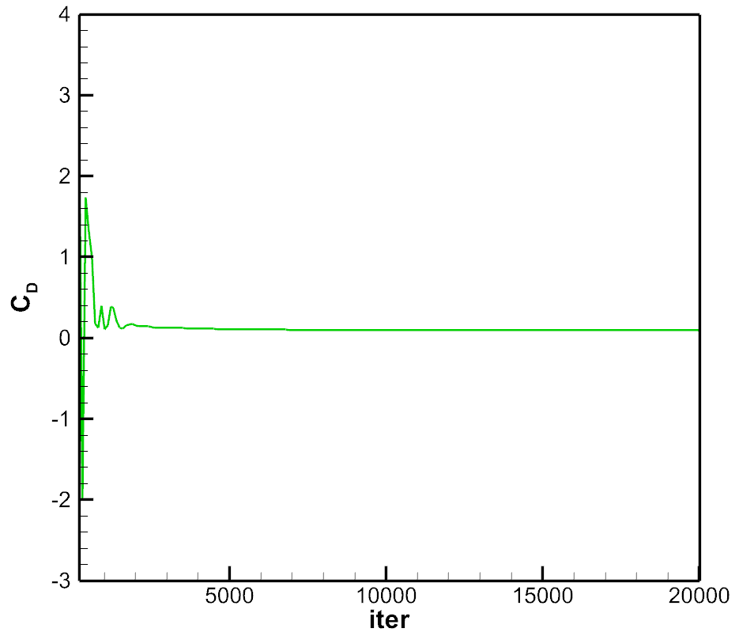<br>图 4-11 阻力系数（总）收敛曲线</div>
<div align=center>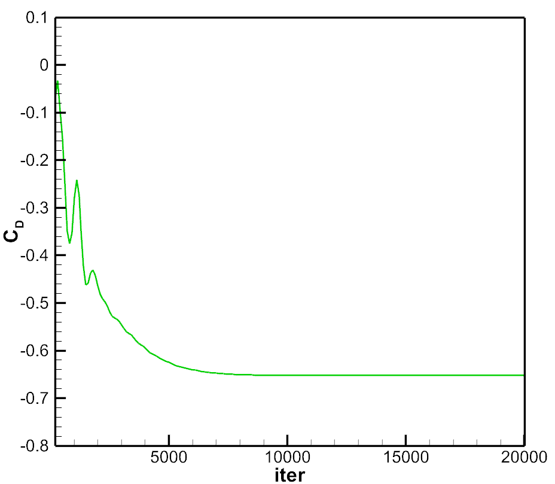<br>图 4-12 阻力系数（Wall-1）收敛曲线</div>
<div align=center>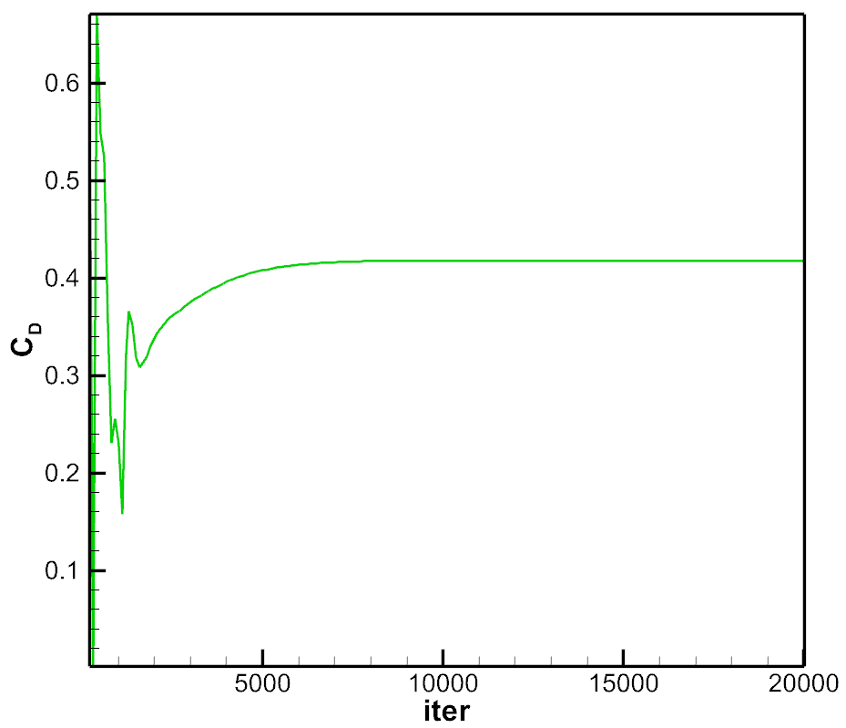<br>图 4-13 阻力系数（Wall-2）收敛曲线</div>
<div align=center>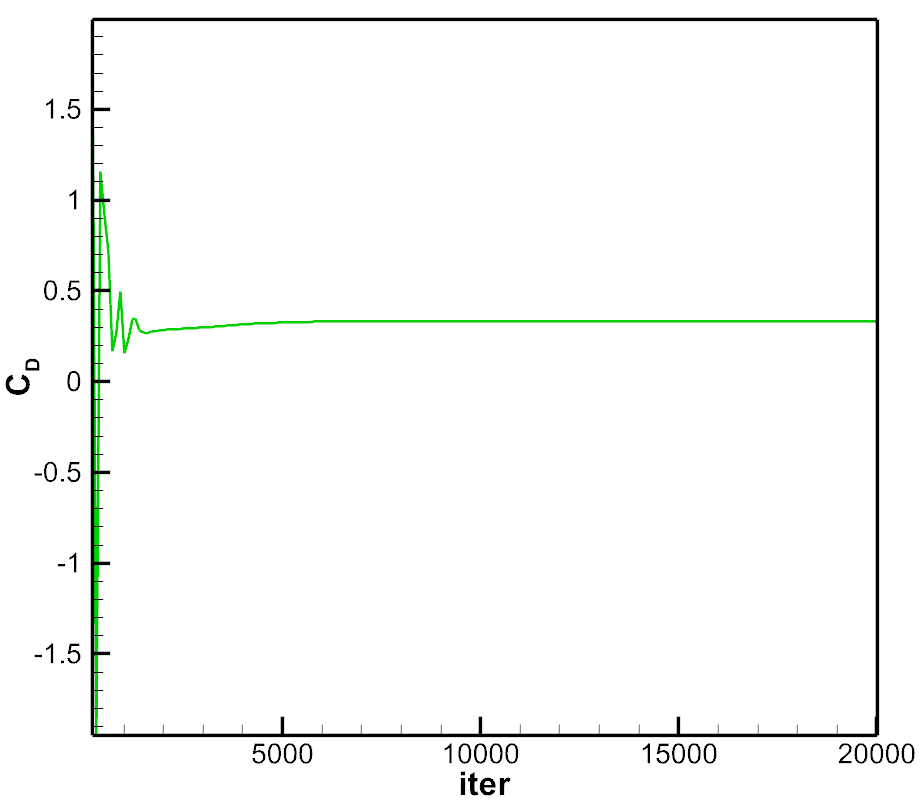<br>图 4-14 阻力系数（Wall-3）收敛曲线</div><br>
#### 4.1.5.4  流场结果

&ensp;&ensp;&ensp;&ensp;载入工程文件夹TwoD_30P30N_Str的子目录results中相应的结果文件tecflow0.plt，绘制流场图。
<div align=center><br>图 4-15 密度等值线</div>
<div align=center><br>图 4-16 压力等值线</div>
<div align=center><br>图 4-17 马赫数等值线</div>
#### 4.1.5.5  壁面压力系数

&ensp;&ensp;&ensp;&ensp;载入工程文件夹TwoD_30P30N_Str的子目录results中相应的结果文件wall_aircoef.dat，绘制切片截面壁面压力分布。
<div align=center><br>图 4-18 壁面压力系数分布对比：（a）wall_All，（b）slat</div>
<div align=center><br>图 4-19 壁面压力系数分布对比：（c）main，（d）flap</div><br>
## 4.2  M6机翼跨声速绕流（铰链力矩）

&ensp;&ensp;&ensp;&ensp;M6三维机翼定常跨声速绕流问题。本节主要讲述如何对M6跨声速绕流算例进行前处理、运行、以及后处理的过程，进而分析M6的流动现象，捕捉$\lambda $激波。
<div align=center>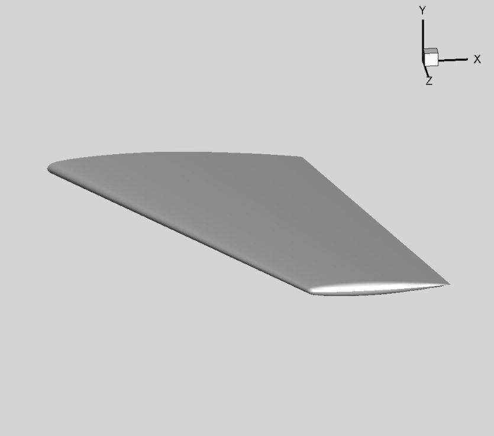<br>图 4-20 三维M6机翼几何外形</div><br>
###  4.2.1  新建工程

1. 建立工程目录，取名为ThreeD_M6_Str；
2. 拷贝bin文件夹到工程目录；
3. 建立grid目录并且拷贝网格文件到grid（grid目录没有相对位置的要求，可放在任意路径，只需要在参数文件设置时，对网格路径能够正确指定即可）；
4. 拷贝已经编译好的PHengLEI可执行程序到工程目录，通常使用Release编译生成的可执行程序进行计算（PHengLEI\build\PHengLEIv3d0\Release\PHengLEIv3d0.exe）。

###  4.2.2  前处理

####  4.2.2.1  网格转换

&ensp;&ensp;&ensp;&ensp;在本算例中，M6结构网格为CGNS格式的网格，首先需要将CGNS格式网格转换成风雷自定义fts的网格格式。

&ensp;&ensp;&ensp;&ensp;M6三维机翼结构网格如图4-21所示，网格包含4个子块，总网格量为294912，壁面第一层网格的高度约为3.6E-05m。
<div align=center>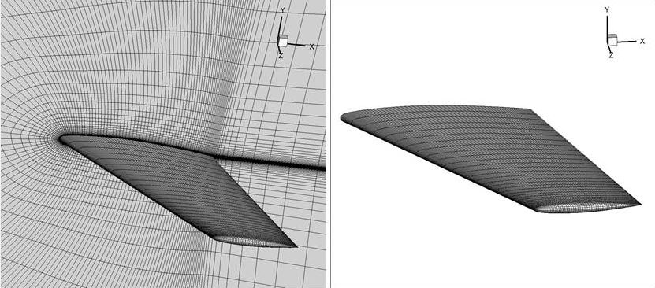<br>图 4-21 M6网格空间拓扑视图：（左）全局网格，（右）壁面网格</div>
&ensp;&ensp;&ensp;&ensp;网格转换过程：
1. 修改总控文件key.hypara，设置任务类型为网格转换：
```c++
string title       		 =   "PHengLEI Main Parameter Control File";
string defaultParaFile   =   "./bin/cfd_para.hypara";
int  ndim         =   3;
int  nparafile    =   1;
int    nsimutask          =   1;
string parafilename       =   "./bin/grid_para.hypara";
int  numberOfGridProcessor=   0;
string parafilename1      =   ""
string parafilename2      =   "";
```
2. 修改网格控制文件grid_para.hypara，设置网格转换参数：
```c++
int gridtype              =   1;
int axisup                =   2;
int from_gtype            =   2;
string from_gfile   =   "./grid/m6_str.cgns";
string out_gfile    =   "./grid/m6_str.fts";
```
3. 工程目录下串行运行执行程序
- 双击运行PHengLEIv3d0.exe
- cmd进入工程目录，输入命令：mpiexec -n 1 ./PHengLEIv3d0.exe
4. 运行成功后得到转换后的网格文件
- 转换后的网格文件会自动加上当前的进程号，因为网格转换是串行，单进程，所以文件会自动加```_0```；
- 因为程序中自动加上当前进程号（```_0```），所以在参数设置的过程中不需要考虑进程的问题，只需要根据源网格文件的名称和路径设置参数即可。
<div align=center>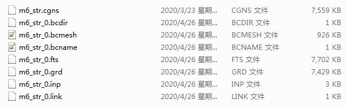<br>图 4-22 转换后的网格文件</div><br>
####  4.2.2.2  边界条件

&ensp;&ensp;&ensp;&ensp;网格生成完毕，用户可以通过boundary_condition.hypara文件查看M6算例网格的边界条件信息。
```c++
int nBoundaryConditons = 4;
string bcName = "downwall";
{
  string bodyName = "body";
  int bcType = 2;
}
string bcName = "upwall";
{
  string bodyName = "body";
  int bcType = 2;
}
string bcName = "Symmetry";
{
  int bcType = 3;
}
string bcName = "Farfield";
{
  int bcType = 4;
}
```

### 4.2.3  运行算例

&ensp;&ensp;&ensp;&ensp;M6三维机翼跨声速绕流在计算前需要对解算器参数进行设置，计算条件如下：
|              参数              |   值    |
| :----------------------------: | :-----: |
|             马赫数             | 0.8395  |
| 单位长度雷诺数(m<sup>-1</sup>) | 1.171e7 |
|            攻角(°)             |  3.06   |
|           侧滑角(°)            |   0.0   |
|          来流温度(K)           | 288.15  |
|            壁温(K)             | 绝热壁  |
|          参考长度(m)           |   1.0   |
|    参考面积(m<sup>2</sup>)     |   1.0   |
|             参考点             | (0,0,0) |
1. 修改总控文件key.hypara，设置任务类型为数值计算：
```c++
string title       		=   "PHengLEI Main Parameter Control File";
string defaultParaFile  =   "./bin/cfd_para.hypara";
int  ndim         =   3;
int  nparafile    =   1;
int    nsimutask          =   0;
string parafilename       =   "./bin/cfd_para_transonic.hypara";
int  numberOfGridProcessor=   0;
string parafilename1      =   ""
string parafilename2      =   "";
```
2. 修改解算器文件cfd_para_transonic.hypara：
- 基本参数设置：
```c++
int    intervalStepFlow   	=   1000;
int    maxSimuStep    		=   50000;
int    intervalStepPlot     =   1000;
int    intervalStepForce    =   50;
int    intervalStepRes    	=   10;
int    ifLowSpeedPrecon     =   0;
```
- 来流条件参数设置：
```c++
double refMachNumber    = 0.8395;
double attackd        	= 3.06;
double angleSlide    	= 0.00;
int    inflowParaType   = 0;
double refReNumber     	= 1.171e7;
double refDimensionalTemperature    = 288.15;
```
- 网格相关参数设置：
```c++
double gridScaleFactor              =   0;
double forceReferenceLength         =   1.0;
double forceReferenceLengthSpanWise =   1.0;
double forceReferenceArea           =   1.0;
double TorqueRefX          =   0.0;
double TorqueRefY          =   0.0;
double TorqueRefZ          =   0.0;
```
- 粘性模型设置：
```c++
int    viscousType     = 3;
string viscousName   = "1eq-sa";
```
- 空间离散设置：
```c++
int roeEntropyFixMethod  		= 3;
double roeEntropyScale   		= 1.0;
string inviscidSchemeName     	= "roe";
string str_limiter_name    		= "smooth";
```
- 时间离散设置：
```c++
//! 默认LUSGS隐式时间离散
int    iunsteady     	= 0;
double CFLEnd       	= 0.5;
int    nLUSGSSweeps     = 1;
```
- 多重网格设置：
```c++
int nMGLevel       = 2;
int flowInitStep   = 100;
```
- 计算网格路径设置：
```c++
string gridfile    = "./grid/m6_str.fts";
```
- 可视化输出设置：
```c++
int    plotFieldType        = 0;
int    nVisualVariables     = 8;
int    visualVariables[]  	= [0, 1, 2, 3, 4, 5, 6, 15];
```
- 其他限制参数设置：
```c++
int reconmeth            = 1;
int limitVariables       = 0;
int limitVector          = 0;
```
3. 修改boundary_condition.hypara文件，设置局部坐标参考量，计算铰链力矩：

- 铰链力矩参数设置（局部坐标轴参考量设置）：

```c++
int nBoundaryConditons = 4;
string bcName = "Farfield";
{
	int bcType = 4;
	int inflowParaType = 0;
	double attackd = 3.06;
	double refMachNumber = 0.8395;
	double refDimensionalTemperature = 288;
	double refReNumber = 1.171e7;
	double angleSlide = 0;
}
string bcName = "Symmetry";
{
	int bcType = 3;
}
string bcName = "downwall";
{
    string bodyName = "body";
	int bcType = 2;
	int dumpHingeMoment = 1;             //! 是否计算输出铰链力矩： 0：否 1：是   
	double localCoordAxis0[3] = [0 0 0];
	double localCoordAxis1[3] = [0 0 1];
	double wallTemperature = -1.0;
}
string bcName = "upwall";
{
    string bodyName = "body";
	int bcType = 2;
	int dumpHingeMoment = 1;
	double localCoordAxis0[3] = [0 0 0];
	double localCoordAxis1[3] = [0 0 1];
	double wallTemperature = -1.0;
}
```
4. 工程目录下串行运行执行程序
- cmd进入工程目录，输入命令：mpiexec -n 1 ./PHengLEIv3d0.exe
5. 计算完成后得到结果文件
<div align=center>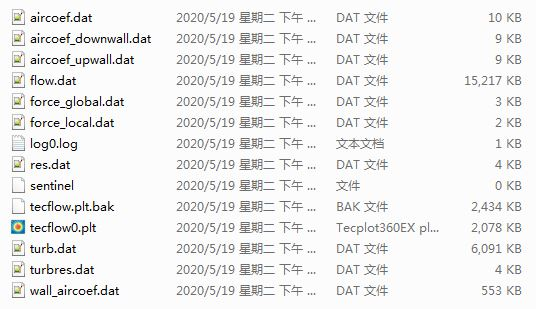<br>图 4-23 M6计算完成后的结果文件</div><br>
### 4.2.4  数据后处理

&ensp;&ensp;&ensp;&ensp;可采用Tecplot对计算结果进行后处理，载入工程文件夹results中相应的结果文件，绘制残差、气动力收敛曲线和流场图。

#### 4.2.4.1  残差收敛过程

&ensp;&ensp;&ensp;&ensp;载入工程文件夹ThreeD_M6_Str的子目录results中相应的结果文件res.dat，绘制残差收敛曲线。
<div align=center><br>图 4-24 残差收敛曲线</div><br>
#### 4.2.4.2  气动力系数收敛过程

&ensp;&ensp;&ensp;&ensp;载入工程文件夹ThreeD_M6_Str的子目录results中相应的结果文件aircoef.dat，绘制气动力系数收敛曲线。
<div align=center>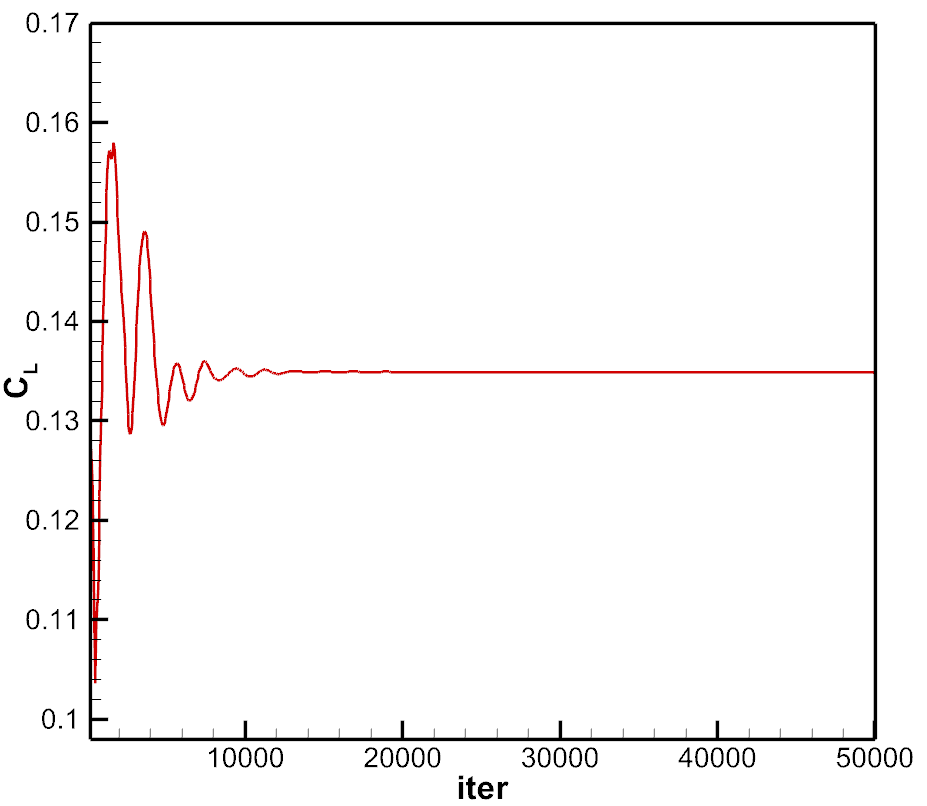<br>图 4-25 升力系数收敛曲线</div>
<div align=center>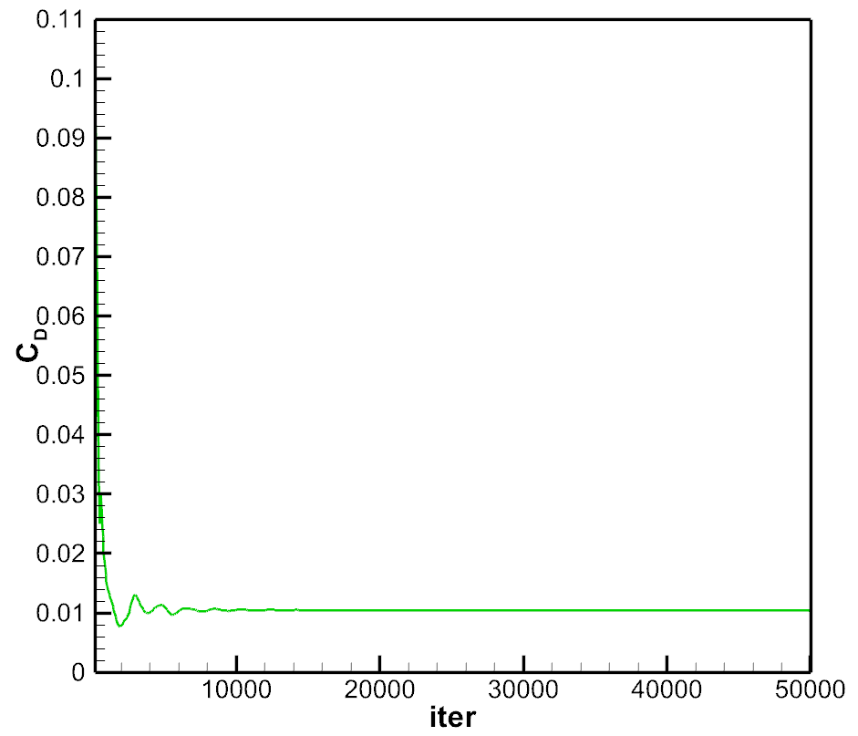<br>图 4-26 阻力系数收敛曲线</div><br>
#### 4.2.4.3  流场结果

&ensp;&ensp;&ensp;&ensp;载入工程文件夹ThreeD_M6_Str的子目录results中相应的结果文件tecflow0.plt，绘制壁面压力系数分布等值线图。
<div align=center>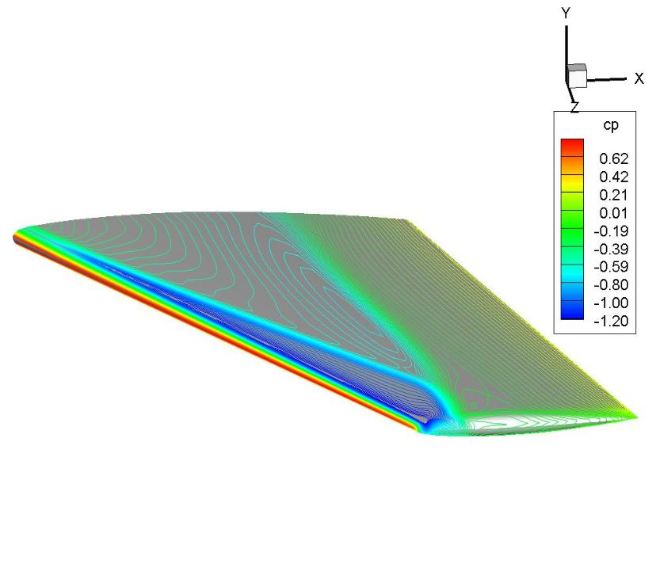<br>图 4-27 物面压力系数等值线</div><br>
#### 4.2.4.4  壁面压力系数

&ensp;&ensp;&ensp;&ensp;载入工程文件夹ThreeD_M6_Str的子目录results中相应的结果文件wall_aircoef.dat，绘制切片截面壁面压力分布。
<div align=center>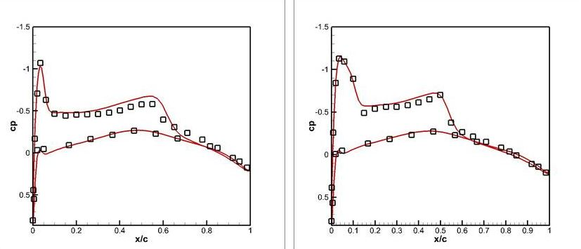<br>图 4-28 壁面压力系数分布对比：(左) z=0.2，（右）z=0.44</div>
<div align=center>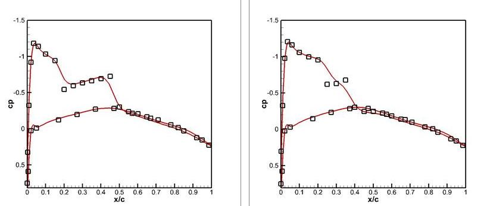<br>图 4-29 壁面压力系数分布对比：(左) z=0.65，（右）z=0.8</div><br>
#### 4.2.4.5  铰链力矩

| 解算器   | 铰链力矩  |
| :--------: | :---------: |
| Reference_data | 5.1712e-2 |
| PHengLEI | 5.2520e-2 |
| 相对误差 | 1.56%     |

## 4.3  高速球头绕流

&ensp;&ensp;&ensp;&ensp;高速球头绕流问题，主要考察非结构解算器对热流的预测能力。本节主要讲述如何对高速球头层流绕流算例进行前处理、运行、以及后处理的过程。
<div align=center>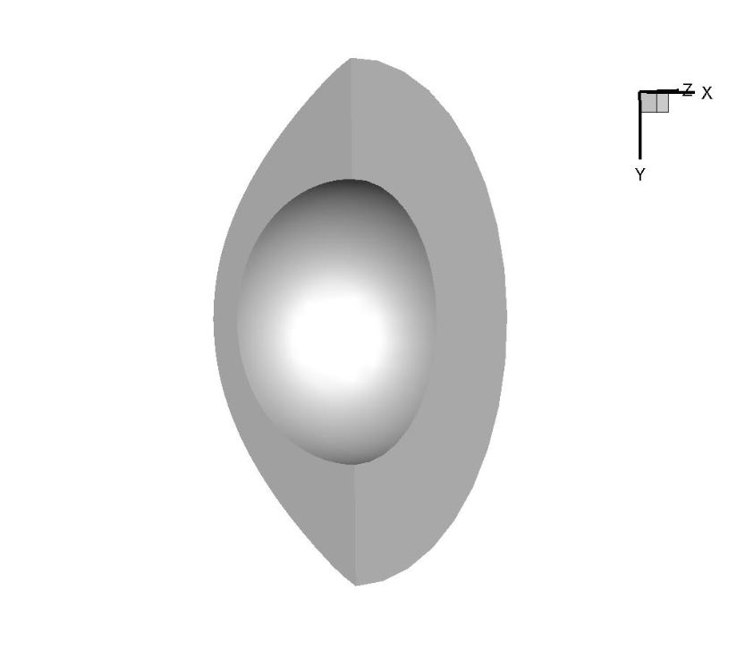<br>图4-30 三维球头几何外形</div><br>
###  4.3.1  新建工程

1. 建立工程目录，取名为ThreeD_Sphere_Laminar_Unstr；
2. 拷贝bin文件夹到工程目录；
3. 建立grid目录并且拷贝网格文件到grid（grid目录没有相对位置的要求，可放在任意路径，只需要在参数文件设置时，对网格路径能够正确指定即可）；
4. 拷贝已经编译好的PHengLEI可执行程序到工程目录，通常使用Release编译生成的可执行程序进行计算（PHengLEI\build\PHengLEIv3d0\Release\PHengLEIv3d0.exe）。

###  4.3.2  前处理

####  4.3.2.1  网格转换

&ensp;&ensp;&ensp;&ensp;在本算例非结构球头网格采用Fluent格式（.cas）的网格，首先需要将Fluent格式网格转换成风雷自定义的fts网格格式。

&ensp;&ensp;&ensp;&ensp;高速球头的计算网格采用图4-31所示结构网格输出的非结构类型网格。粘性球头为81×61×19（流向×周向×法向），流向和周向网格均匀分布，法向网格在壁面附近适当加密，网格雷诺数Ren=10。
<div align=center>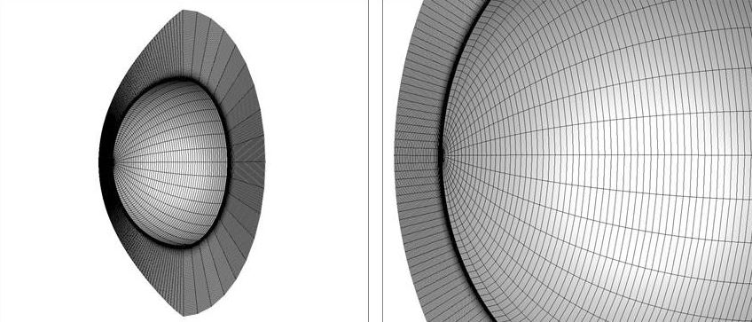<br>图4-31 球头网格空间拓扑示意图及局部放大图</div><br>
&ensp;&ensp;&ensp;&ensp;网格转换过程：
1. 修改总控文件key.hypara，设置任务类型为网格转换：
```c++
string title       		 =   "PHengLEI Main Parameter Control File";
string defaultParaFile   =   "./bin/cfd_para.hypara";
int  ndim         =   3;
int  nparafile    =   1;
int    nsimutask          =   1;
string parafilename       =   "./bin/grid_para.hypara";
int  numberOfGridProcessor=   0;
string parafilename1      =   ""
string parafilename2      =   "";
```
2. 修改网格控制文件grid_para.hypara，设置网格转换参数：
```c++
int gridtype              =   0;
int axisup                =   1;
int from_gtype            =   5;
string from_gfile   =   "./grid/sphere_m10.cas";
string out_gfile    =   "./grid/sphere_m10.fts";
```
3. 工程目录下串行运行执行程序
- 双击运行PHengLEIv3d0.exe
- cmd进入工程目录，输入命令：mpiexec -n 1 ./PHengLEIv3d0.exe
4. 运行成功后得到转换后的网格文件
- 转换后的网格文件会自动加上当前的进程号，因为网格转换是串行，单进程，所以文件会自动加```_0```；
- 因为程序中自动加上当前进程号（```_0```），所以在参数设置的过程中不需要考虑进程的问题，只需要根据源网格文件的名称和路径设置参数即可。
<div align=center>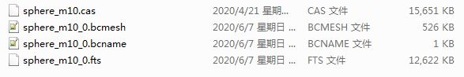<br>图 4-32 转换后的网格文件</div><br>
####  4.3.2.2  边界条件

&ensp;&ensp;&ensp;&ensp;网格生成完毕，用户可以查看这个算例网格的边界条件信息boundary_condition.hypara。
```c++
int nBoundaryConditons = 4;
string bcName = "wall";
{
  string bodyName = "body";
  int bcType = 2;
}
string bcName = "symmetry";
{
  int bcType = 3;
}
string bcName = "pressure-inlet";
{
  int bcType = 5;
}
string bcName = "outflow";
{
  int bcType = 6;
}
```

###  4.3.3  网格分区

&ensp;&ensp;&ensp;&ensp;采用并行计算，需要对转换后的网格进行分区。对于非结构网格，网格量在千万量级时，通常采用串行分区；当网格量很大，达到十亿乃至上百亿量级，串行分区效率大大降低，此时宜采用并行分区。关于并行分区的内容详见第11章中11.1.1.3小节的内容，此处只是简单地介绍一下并行分区的过程。

#### 4.3.3.1  串行分区过程

1. 修改总控文件key.hypara，设置任务类型网格分区：
```c++
string title       =   "PHengLEI Main Parameter Control File";
string defaultParaFile   =   "./bin/cfd_para.hypara";
int  ndim         =   3;
int  nparafile    =   1;
int    nsimutask          =   3;
string parafilename       =   "./bin/partition.hypara";
int  numberOfGridProcessor=   0;
string parafilename1      =   ""
string parafilename2      =   "";
```
2. 修改分区文件partition.hypara，设置网格分区参数：
```c++
int pgridtype 		=  0;
int maxproc         =  4;
string original_grid_file  	=  "./grid/sphere_m10.fts";
string partition_grid_file  =  "./grid/sphere_m10__4.fts";
int numberOfMultigrid =  1;
```
3. 工程目录下串行运行程序
- 双击运行PHengLEIv3d0.exe
- cmd进入工程目录，输入命令：mpiexec -n 1 ./PHengLEIv3d0.exe
4. 运行成功后得到分区后的网格文件
- 分区后的网格文件名除了添加分区标识（```__4```）之外，会自动加上当前的进程号，因为此处的结构网格分区是串行，单进程，所以文件会自动加```_0```；
- 因为程序中自动加上当前进程号（```_0```），所以在参数设置的过程中不需要考虑进程的问题，只需要根据网格文件的名称和路径以及分区数设置参数即可。
<div align=center>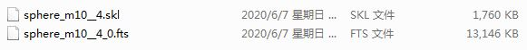<br>图 4-33 分区后的网格文件</div><br>
#### 4.3.3.2  并行分区过程

&ensp;&ensp;&ensp;&ensp;目前，非结构网格支持并行分区，而且实际高速球头的网格量很小，不需要并行分区。此处按照“1分2，2分4‘’的并行分区过程仅作为用法参考。
1.修改总控文件key.hypara，设置任务类型网格分区：
```c++
string title       		 =   "PHengLEI Main Parameter Control File";
string defaultParaFile   =   "./bin/cfd_para.hypara";
int  ndim         =   3;
int  nparafile    =   1;
int    nsimutask          =   3;
string parafilename       =   "./bin/partition.hypara";
int  numberOfGridProcessor=   0;
string parafilename1      =   ""
string parafilename2      =   "";
```
2. 修改分区文件partition.hypara，设置网格分区参数：
```c++
int pgridtype 		=  0;
int maxproc         =   2;
string original_grid_file  	=  "./grid/sphere_m10.fts";
string partition_grid_file  =  "./grid/sphere_m10__2.fts";
int numberOfMultigrid 	=  1;
```
3. 工程目录下串行运行执行程序（注意首次“1分2”是串行执行程序）
- 双击运行PHengLEIv3d0.exe
- cmd进入工程目录，输入命令：mpiexec -n 1 ./PHengLEIv3d0.exe
4. 再次修改分区文件partition.hypara，设置网格分区参数：
```c++
int pgridtype 		=  0;
int maxproc         =   4;
string original_grid_file  	=  "./grid/sphere_m10__2.fts";
string partition_grid_file  =  "./grid/sphere_m10__4.fts";
int numberOfMultigrid =  1;
```
5. 工程目录下并行执行程序
-  cmd进入工程目录，输入命令：mpiexec -n 2 ./PHengLEIv3d0.exe
6. 运行成功后得到分区后的网格文件
- 分区后的网格文件名除了添加分区标识之外，会自动加上当前的进程号，因为第一次执行网格分区是串行，单进程，分成两个区，分区标识（```__2```）并且会自动加```_0```。第二次执行网格分区是并行，两个进程，两个区分成四个区，所以并行得到网格分区文件有两个，分区标识（```__4```）并且会自动加```_0```和```_1```，分别代表每个进程（process0和process1）中各自输出的4分区网格文件，计算时自动将所有进程中的网格分区文件读取进来；
- 因为程序中自动加上当前进程号，所以在设置的过程中不需要考虑进程的问题，只需要根据网格文件的名称和路径以及分区数设置参数即可。
<div align=center>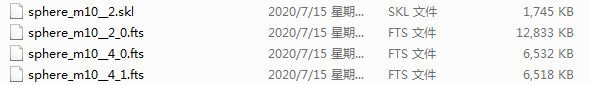<br>图 4-34 分区后的网格文件</div><br>
### 4.3.4  运行算例

&ensp;&ensp;&ensp;&ensp;高速球头绕流在计算前需要对解算器参数进行设置，计算条件如下：
|              参数              |   值    |
| :----------------------------: | :-----: |
|             马赫数             |   10    |
| 单位长度雷诺数(m<sup>-1</sup>) |  1.0e5  |
|            攻角(°)             |   0.0   |
|           侧滑角(°)            |   0.0   |
|          来流温度(K)           |   79    |
|            壁温(K)             |   294   |
|          参考长度(m)           |   1.0   |
|    参考面积(m<sup>2</sup>)     |   1.0   |
|             参考点             | (0,0,0) |
1. 修改总控文件key.hypara，设置任务类型为数值计算：
```c++
string title       		 =   "PHengLEI Main Parameter Control File";
string defaultParaFile   =   "./bin/cfd_para.hypara";
int  ndim         =   3;
int  nparafile    =   1;
int    nsimutask          =   0;
string parafilename       =   "./bin/cfd_para_hypersonic.hypara";
int  numberOfGridProcessor=   0;
string parafilename1      =   ""
string parafilename2      =   "";
```
2. 修改解算器文件cfd_para_hypersonic.hypara：
- 基本参数设置：
```c++
int    intervalStepFlow     =   2000;
int    maxSimuStep    		=   50000;
int    intervalStepPlot     =   500;
int    intervalStepForce    =   100;
int    intervalStepRes      =   10;
int    ifLowSpeedPrecon     =   0;
```
- 来流条件参数设置：
```c++
double refMachNumber    = 10;
double attackd         	= 0;
double angleSlide      	= 0.00;
double wallTemperature  = 294 ;
int    dump_Q       	= 0;
int    inflowParaType 	= 0;
double refReNumber     	= 1e5;
double refDimensionalTemperature    = 79;
```
- 网格相关参数设置：
```c++
double gridScaleFactor              =   0;
double forceReferenceLength         =   1.0;
double forceReferenceLengthSpanWise =   1.0;
double forceReferenceArea           =   1.0;
double TorqueRefX          =   0.0;
double TorqueRefY          =   0.0;
double TorqueRefZ          =   0.0;
```
- 粘性模型设置：
```c++
int    viscousType          = 1;
string viscousName    	 = "laminar"
```
- 空间离散设置：
```c++
//! 低速默认推荐Roe格式
int roeEntropyFixMethod  = 3;
double roeEntropyScale   = 1.0;
string uns_scheme_name   = "steger";
string uns_limiter_name  = "vencat";
double venkatCoeff        = 0.5;
```
- 时间离散设置：
```c++
//! 默认LUSGS隐式时间离散
int    iunsteady     = 0;
double CFLEnd        = 1.0;
int    nLUSGSSweeps  = 1;
```
- 多重网格设置：
```c++
int nMGLevel          = 1;
int flowInitStep      = 100;
```
- 计算网格路径设置：
```c++
string gridfile    = "./grid/sphere_m10__4.fts";
```
- 可视化输出设置：
```c++
int    plotFieldType      = 0;
int    nVisualVariables   = 8;
int    visualVariables[]  = [0, 1, 2, 3, 4, 5, 6, 15];
```
- 其他限制参数设置：
```c++
int reconmeth            = 0;
int limitVariables       = 0;
int limitVector          = 1;
```
3. 工程目录下并行运行程序
- cmd进入工程目录，输入命令：mpiexec -n 4 ./PHengLEIv3d0.exe
4. 计算完成后得到结果文件
<div align=center>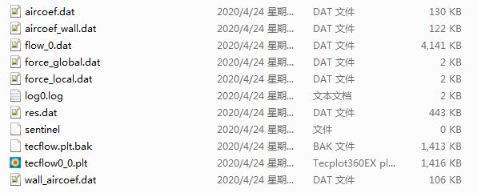<br>图 4-35 计算完成后的结果文件</div><br>
### 4.3.5  数据后处理

&ensp;&ensp;&ensp;&ensp;可采用Tecplot对计算结果进行后处理，载入工程文件夹子目录results中相应的结果文件，绘制残差、气动力收敛曲线和流场图。

#### 4.3.5.1  残差收敛过程

&ensp;&ensp;&ensp;&ensp;载入工程文件夹ThreeD_Sphere_Laminar_Unstr的子目录results中相应的结果文件res.dat，绘制残差收敛曲线。
<div align=center>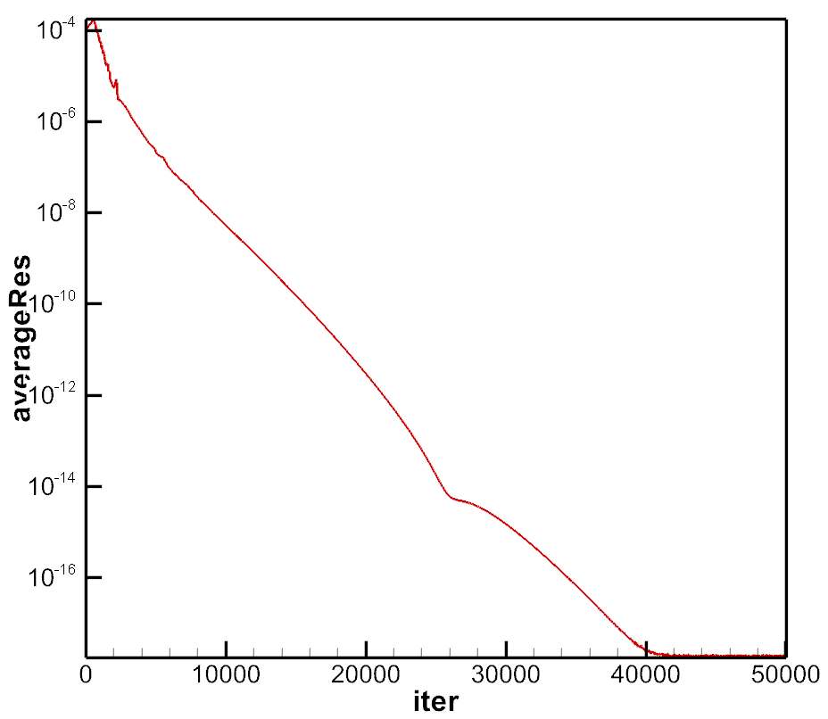<br>图 4-36 残差收敛曲线</div><br>
#### 4.3.5.2  气动力系数收敛过程

&ensp;&ensp;&ensp;&ensp;载入工程文件夹ThreeD_Sphere_Laminar_Unstr的子目录results中相应的结果文件aircoef.dat，绘制气动力系数收敛曲线。
<div align=center>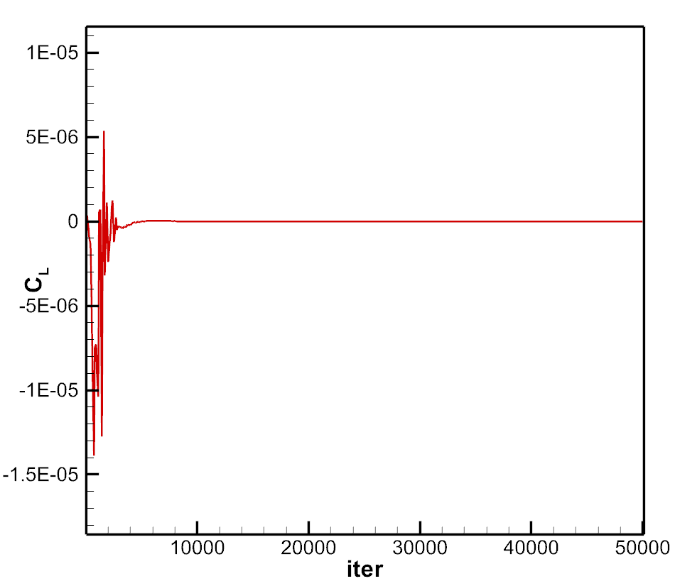<br>图 4-37 升力系数收敛曲线</div>
<div align=center>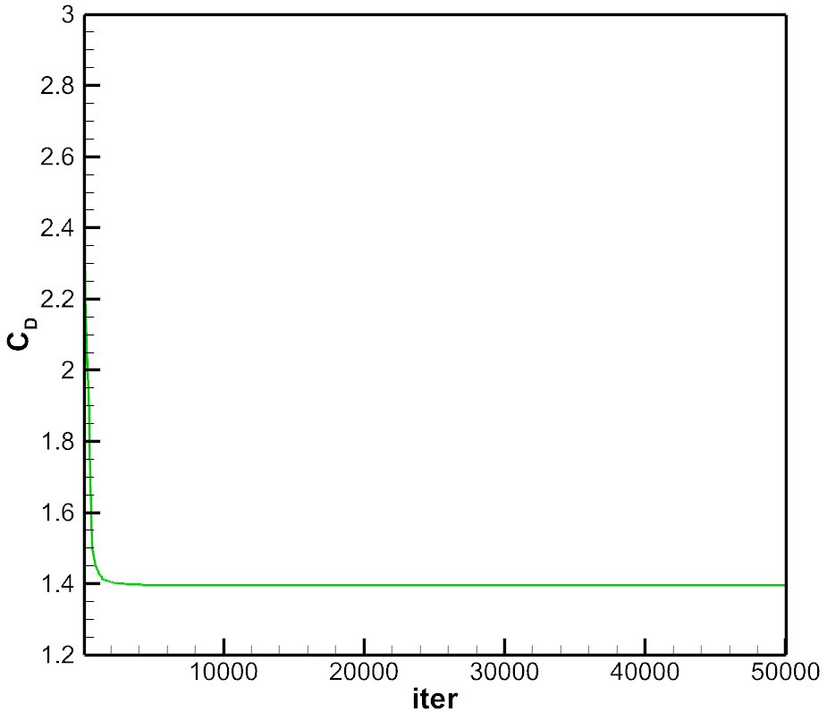<br>图 4-38 阻力系数收敛曲线</div><br>
#### 4.3.5.3  流场结果

&ensp;&ensp;&ensp;&ensp;载入工程文件夹ThreeD_Sphere_Laminar_Unstr的子目录results中相应的结果文件tecflow0.plt，绘制流场分布等值线图。
<div align=center>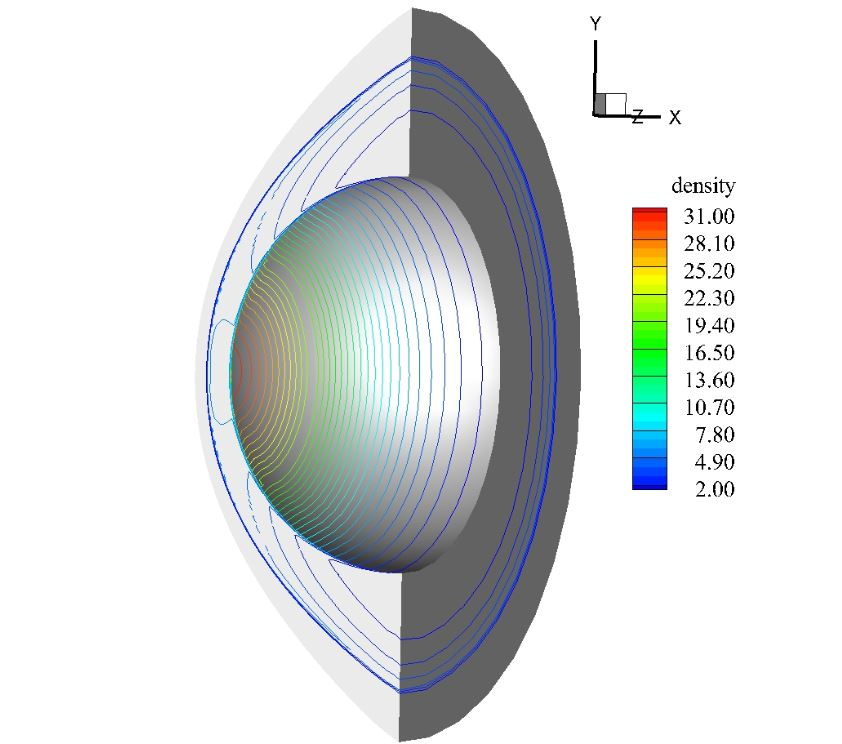<br>图 4-39 密度等值线</div>
<div align=center>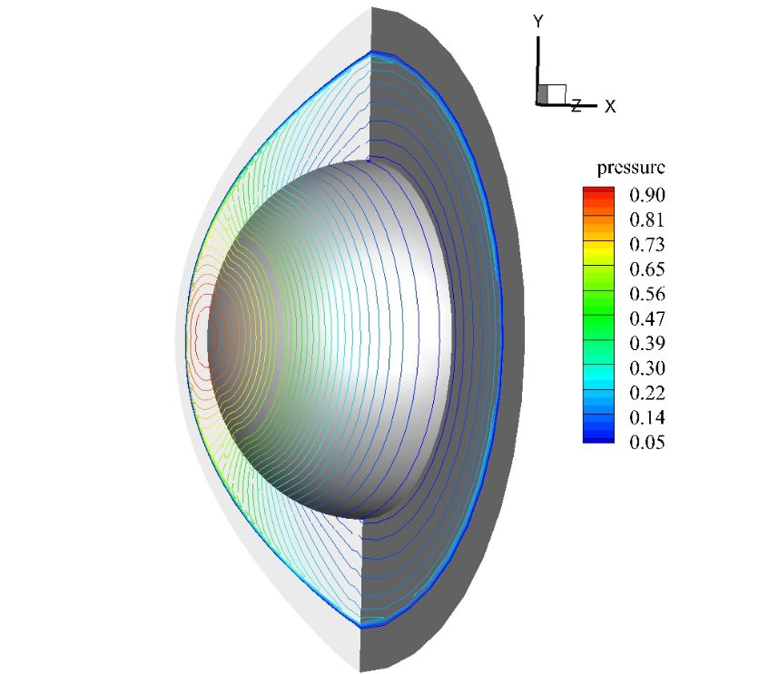<br>图 4-40 压力等值线</div>
<div align=center>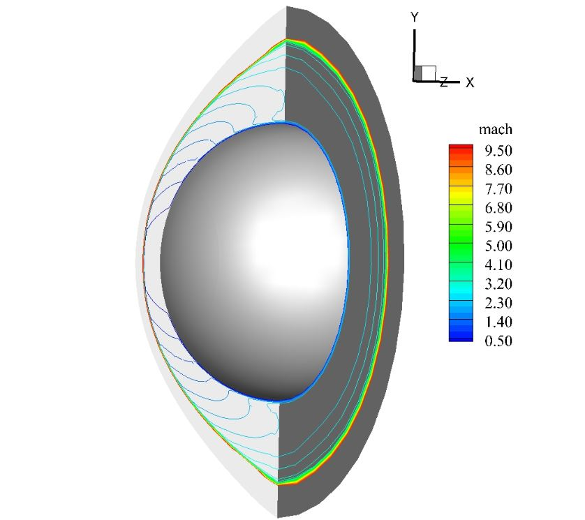<br>图 4-41 马赫数等值线</div>
<div align=center>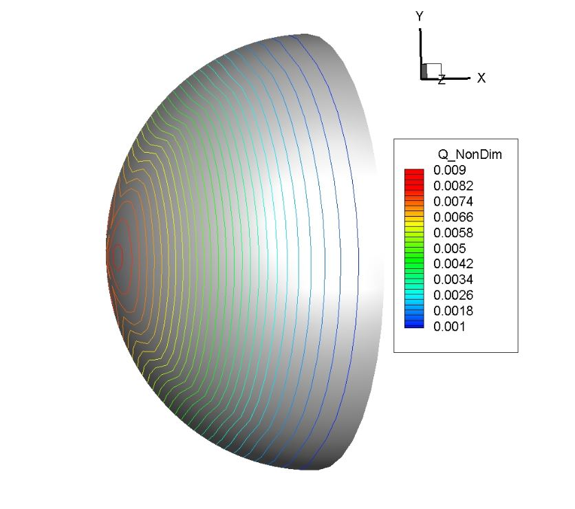<br>图 4-42 物面热流分布等值线</div><br>
#### 4.3.5.4  壁面数据

&ensp;&ensp;&ensp;&ensp;载入工程文件夹ThreeD_Sphere_Laminar_Unstr的子目录results中相应的结果文件wall_aircoef.dat，绘制切片截面壁面压力和热流分布。
<div align=center>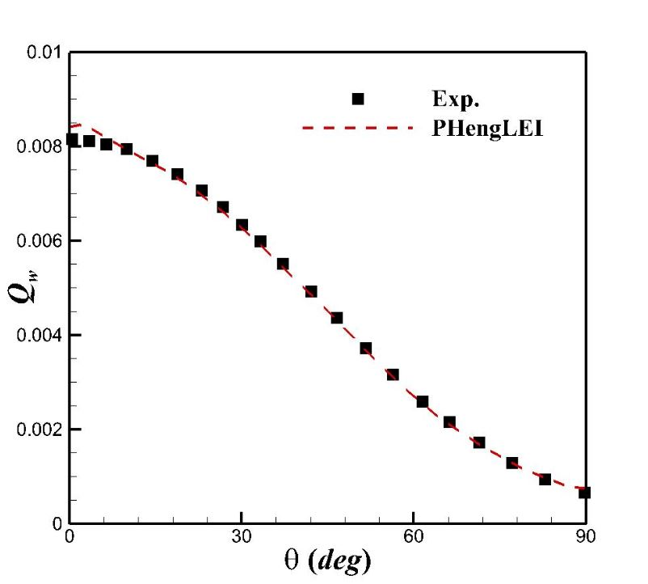<br>图 4-43 物面热流分布</div>
<div align=center>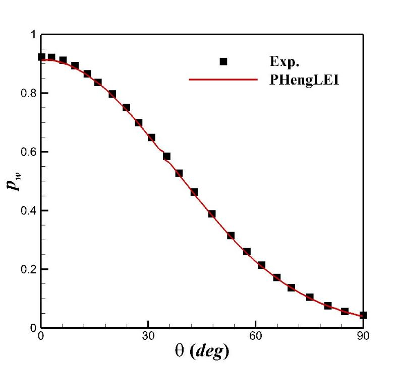<br>图 4-44 物面压力分布</div><br>
<br/>
<br/>
<div STYLE="page-break-after: always;"></div> 
# <center>第Ⅱ部分    理论与方法</center>


# 第5章  风雷软件架构

&ensp;&ensp;&ensp;&ensp;风雷程序中的库主要有以下几种类型：
1. API   ：基础类库，根据不同的功能分类封装了常用的工具、网格、数据结构、前后处理等；
2. CFD  ：各种流场求解器，用来求解特定的问题；
3. Main：主程序入口，执行风雷软件的Simulation流程；
4. Mesh &3rdparty库：网格库以及风雷中用到的第三方开源库。

&ensp;&ensp;&ensp;&ensp;这一章节我们简要介绍一下这些库。

## 5.1  面向对象编程

&ensp;&ensp;&ensp;&ensp;风雷源代码采用C++语言编写，想要读懂风雷软件的代码，必须要对C++有一定的了解，我们简单概述一下面向对象编程的优势和C++语言。面向对象编程语言，将数据及对数据的操作方法放在一起作为一个相互依存不可分离的整体——**对象**。对同类型的对象抽象出其共性，形成**类**。类通过一个简单的外部接口与外界发生关系，对象与对象之间通过信息进行通信。创建这种可以使用代码中所有结构的类分层使得代码管理更容易。新的类可以从其它的类上继承，大大简化了重复代码并且使得整体的代码结构更加清晰。

### 5.1.1  面向对象和面向过程的区别

&ensp;&ensp;&ensp;&ensp;下面通过结构网格为例，来说明一下两者的区别。
- 面向过程，网格块含以下信息：
&ensp;&ensp;x/y/z三方向的点数： ni, nj, nk；
&ensp;&ensp;x/y/z三方向点坐标：*x, *y, *z；
&ensp;&ensp;相邻块对接关系；
&ensp;&ensp;函数function(ni, nj, nk, x, y, z, …, )。

&ensp;&ensp;&ensp;&ensp;面向过程编程最大的问题是参数多，很容易混淆。

- 面向对象，将网格块信息封装为类StructGrid：
&ensp;&ensp;点信息： ni, nj, nk， *x, *y, *z；
&ensp;&ensp;面信息；
&ensp;&ensp;对接关系；
&ensp;&ensp;函数function(StructGrid *grid)。

&ensp;&ensp;&ensp;&ensp;其中，关于点的信息可以抽象出：
```c++
class StructGrid : 
{
private:
    //! 1: The dimention of three direction (ni, nj ,nk).
    //! 2: The node coordinates array of three direction (structx, structy, structz).
    int ni, nj, nk;
    RDouble3D *structx, *structy, *structz;
public:
    StructGrid();
    ~StructGrid();
public:
    //! Returns the node dimension of I direction (ni).
    int  GetNI() const;

    //! Returns the node dimension of J direction (nj).
    int  GetNJ() const;

    //! Returns the node dimension of K direction (nk).
    int  GetNK() const;
    //! Returns the node's x coordinates array (structx) pointer.
    RDouble3D * GetStructX() const;

    //! Returns the node's y coordinates array (structx) pointer.
    RDouble3D * GetStructY() const;

    //! Returns the node's z coordinates array (structx) pointer.
    RDouble3D * GetStructZ() const;
};

int  StructGrid::GetNI() const
{
	return ni;
}

int  StructGrid::GetNJ() const
{
	return nj;
}

int  StructGrid::GetNK() const
{
	return nk;
}

 RDouble3D * StructGrid::GetStructX() const
{
	return structx;
}
 RDouble3D * StructGrid::GetStructY() const
{
	return structy;
}
RDouble3D * StructGrid::GetStructZ() const
{
	return structz;
}

int main()
{
    StructGrid *grid = new StructGrid ;      //! 定义StructGrid类型的指针grid
    int ni = grid->GetNI();                  //! 指针访问成员
    int nj = grid->GetNJ(); 
    int nk = grid->GetNK();   
    RDouble3D &xx = * grid->GetStructX();
    RDouble3D &yy = * grid->GetStructY();
    RDouble3D &zz = * grid->GetStructZ();
}
```

&ensp;&ensp;&ensp;&ensp;在风雷程序源代码上进行算法修改或二次开发必须要遵循风雷软件的C++编写规范，保证代码在高质量完成需求的同时也具备良好的可读性、可维护性。具体内容详见第16章的风雷软件编程规范。

&ensp;&ensp;&ensp;&ensp;风雷的求解器代码是遵循一定的步骤流程，求解器实际上就是算法和方程的求解过程，求解过程是按步骤进行的。用户如果有自己开发求解器的需要，并且对C++编程语言有一定的了解，可以以某个求解器为模板按照相应模型和步骤来编写。

### 5.1.2  继承

&ensp;&ensp;&ensp;&ensp;继承是代码复用方式之一，风雷代码中主要的类均采用了继承的方式实现代码的复用。图5-1中B类和C类都需要用到```print()```函数，而A类中刚好有一个```print()```函数，那么B类和C类就可以继承A类，便能同时完成代码的复用
<div align=center>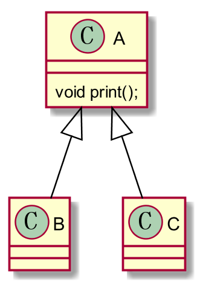<br>图 5-1 继承关系图</div>
&ensp;&ensp;&ensp;&ensp;风雷代码中也使用到了很多继承关系，例如最主要的两大类：Solver类和Grid类，如图5-2和5-3所示。
<div align=center>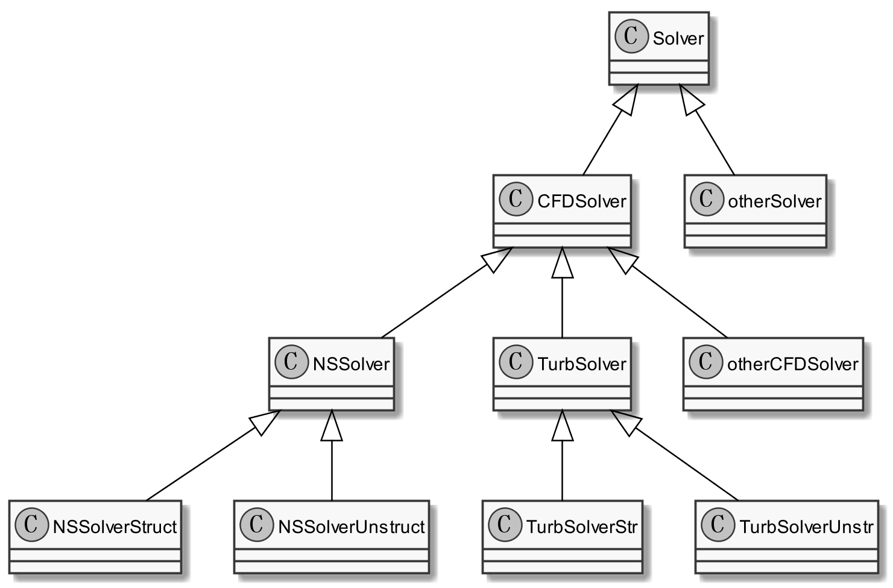<br>图 5-2 Solver类图</div>
<div align=center>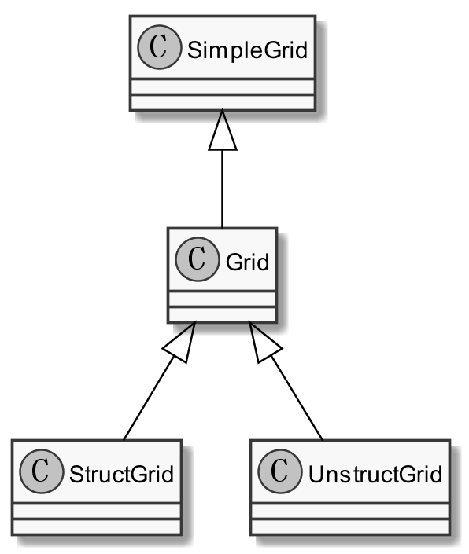<br>图 5-3 Grid类图</div><br>
### 5.1.3  组合模式

&ensp;&ensp;&ensp;&ensp;组合模式也是代码复用的重要途径，组合是指一个类对另外一个类的对象具有包含关系。如图5-4所示，B类和C类都包含A类的对象a，这样B类和C类就可以通过对象a来调用函数```print()```了。
<div align=center>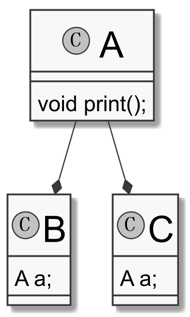<br>图 5-4 组合关系图</div>
&ensp;&ensp;&ensp;&ensp;风雷代码中也大量使用到了组合关系，例如Grid类中的拓扑关系和度量关系中均使用到组合模式，如图5-5所示。
<div align=center><br>图 5-5 Grid类组合关系图</div><br>
### 5.1.4  适配器模式

&ensp;&ensp;&ensp;&ensp;适配器模式是指在不改变原有程序接口的情况下，可以适应更多种情况的变化。如图5-6所示，有一个求圆面积的函数，输入参数为半径r，但是第三方经常提供的输入参数是直径D，可以写一个函数```Diameter2Radius```将D转换为r，然后就可以使用已有的函数接口了。
<div align=center>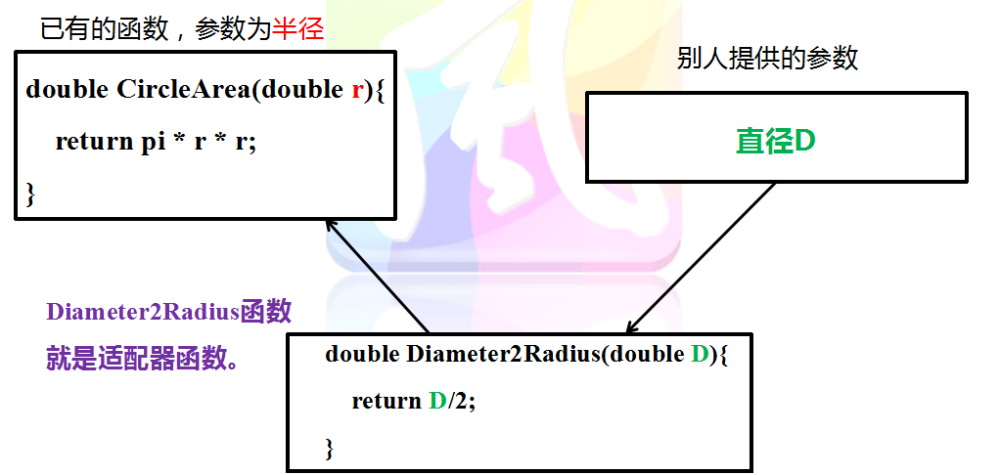<br>图 5-6 适配器示意图</div>
&ensp;&ensp;&ensp;&ensp;风雷代码中也大量使用了适配器模式，例如：网格转化过程——将其它常用类型的格式转换为风雷可读取的格式就是采用了适配器模式，风雷代码中为了统一结构和非结构网格的接口而出现的类，如FieldProxy等都是适配器模式。
<div align=center>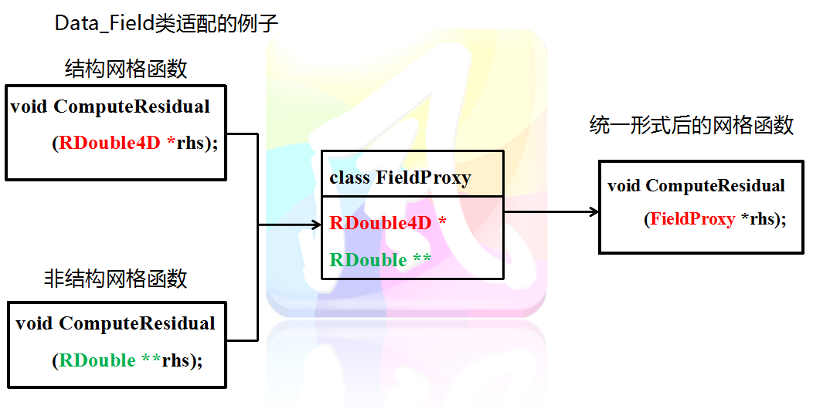<br>图 5-7 FieldProxy类适配器示意图</div><br>
## 5.2  具体类解析

&ensp;&ensp;&ensp;&ensp;风雷代码中包含了许许多多的类，下面将简单介绍与计算相关的一些主要类。

### 5.2.1  Simulation类

&ensp;&ensp;&ensp;&ensp;Simulation类包括不同的模拟过程，例如网格转换、网格分区和CFD迭代过程均属于不同的Simulation过程。一个模拟过程可能在多个进程上进行，进程之间可能相互通信。
<div align=center>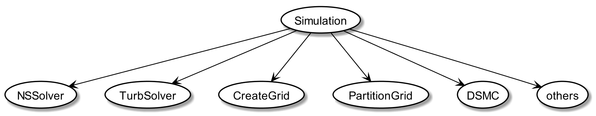<br>图 5-8 Simulation类行为</div>
<div align=center>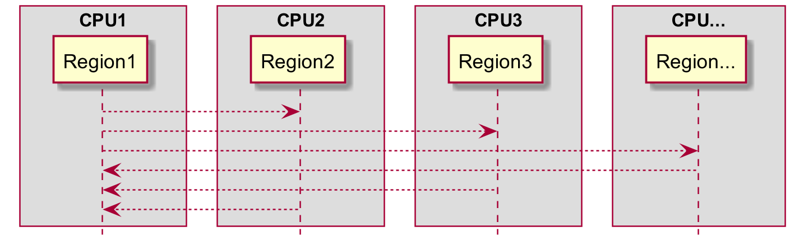<br>图 5-9 Simulation类多核计算过程</div><br>
### 5.2.2  Zone类

&ensp;&ensp;&ensp;&ensp;CFD模拟过程一般需要并行计算，则需要对网格进行分区，风雷代码中每个分区之后的基本块为一个Zone，每个Zone中都包含计算过程中所有的数据和算法。计算数据存储于Grid类中，算法存储于Solver类中。
<div align=center>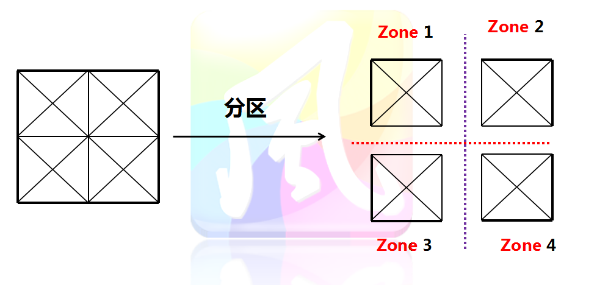<br>图 5-10 Zone类概念</div>
<div align=center>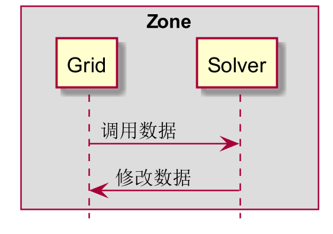<br>图 5-11 Zone类包含属性</div><br>
### 5.2.3  Region类

&ensp;&ensp;&ensp;&ensp;网格分为4个区之后，可能由于进程数限制等原因不一定在4个进程上计算，例如在2个进程上计算，那么每个进程中将包含2个Zone，每个进程上包含的所有Zone称为Region。一个Region如果包含多个Zone，那么Region内所有的Zone之间也需要在进程内进行通信。
<div align=center>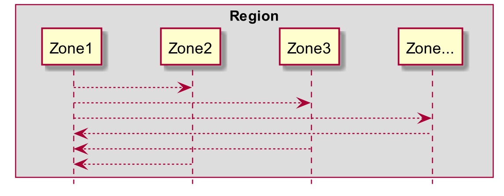<br>图 5-12 Region类</div><br>
### 5.2.4  Grid类

&ensp;&ensp;&ensp;&ensp;PHengLEI软件目前只支持结构网格和非结构网格，两种网格均继承于Grid类，继承关系如图5-13所示。
<div align=center>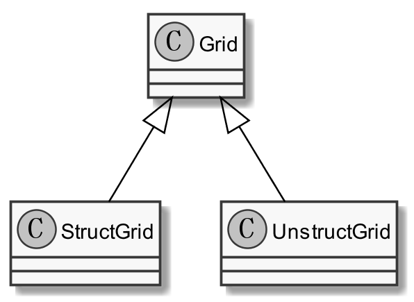<br>图 5-13 Grid系列类</div>
&ensp;&ensp;&ensp;&ensp;Grid类中包含的属性有：维度dimension、类型type、总面数nTotalFace和总单元数nTotalCell，场数据类Data_Field类，交界面信息类InterfaceInfo类，交界点信息类InterpointInfo类，交界面场数据类InterfaceFields类等。
<div align=center>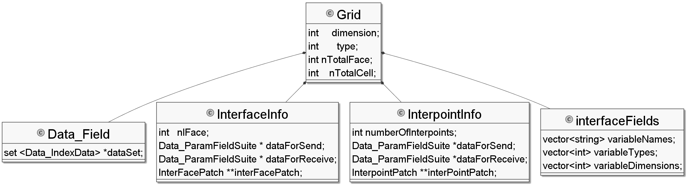<br>图 5-14 Grid类属性</div>
&ensp;&ensp;&ensp;&ensp;StructGrid类包含的属性有格点信息类Geo_NodeTopo_Struct类，面元信息Geo_FaceMetrics_Struct类，单元信息类Geo_CellMetrics_Struct类，边界信息类CompositeBCRegion类。
<div align=center>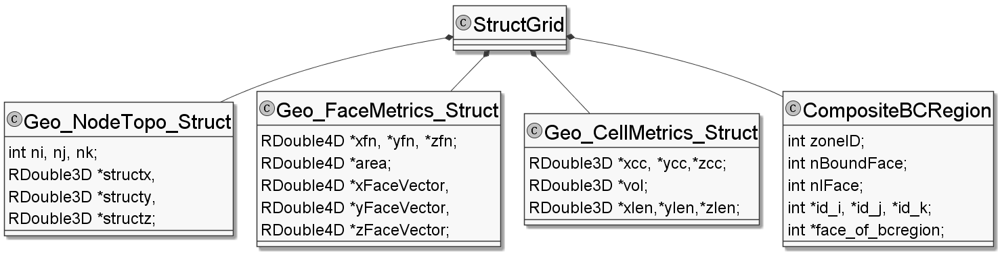<br>图 5-15 StructGrid类属性</div>
&ensp;&ensp;&ensp;&ensp;UnstructGrid类中包含的属性有格点拓扑关系类Geo_NodeTopo_Unstruct类，面元拓扑关系Geo_FaceTopo_Unstruct类，面元度量信息类Geo_FaceMetrics_Unstruct类，单元拓扑关系类Geo_CellTopo_Unstruct类，单元度量信息类Geo_CellMetrics_Unstruct，边界信息类BCRecord类。
<div align=center>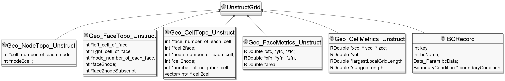<br>图 5-16 UnstructGrid类属性</div><br>
### 5.2.5  Solver类

&ensp;&ensp;&ensp;&ensp;Solver类中存储着计算过程所需要的所有算法，Solver类中的属性只有算法相关的参数。PHengLEI软件同时支持结构网格和非结构网格，并且采用紧耦合的方式组成。NSSolverStruct类和TurbSolverStr类存储结构网格算法，NSSolverUnstruct类和TurbSolverUnstr类存储非结构网格算法。同时PHengLEI软件也支持其它求解器的拓展。
<div align=center><br>图 5-17 Solver类</div><br>
### 5.2.6  Param_CFDSolver类

&ensp;&ensp;&ensp;&ensp;算法计算过程需要一些参数，为了存取方便且提高效率，PHengLEI软件中为不同的Solver封装了参数类，类结构如图5-18所示。
<div align=center>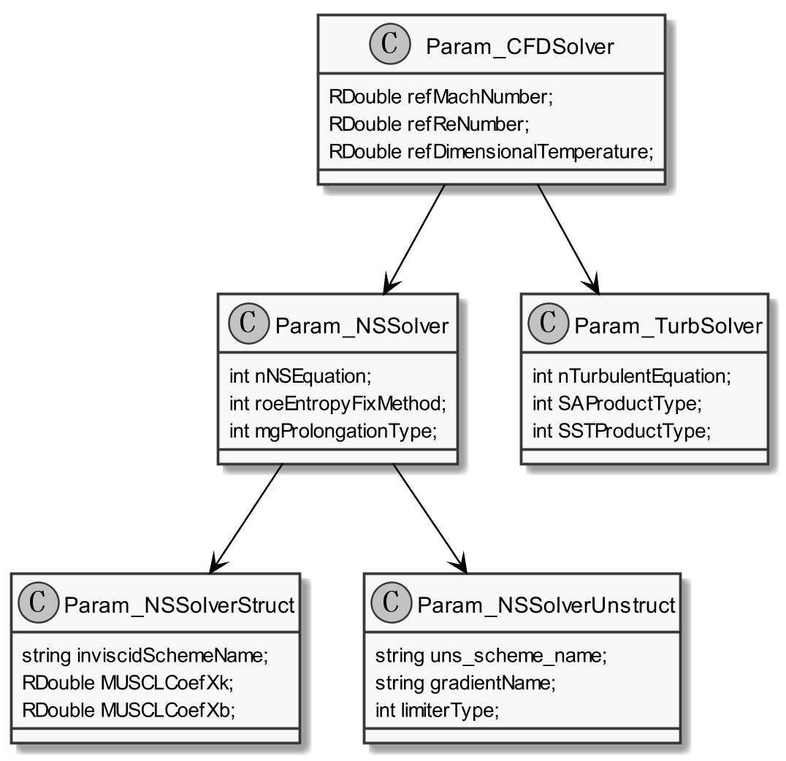<br>图 5-18 Param_CFDSolver类</div><br>
### 5.2.7  其它相关类

&ensp;&ensp;&ensp;&ensp;除了上面主要的相关类之外，还有Solver控制类Controller类，异常处理相关类TK_Exit类，全局数据存储类GlobalDataBase类，以及并行传值等许多相关类，在此不做详细介绍。

## 5.3  API标准库

&ensp;&ensp;&ensp;&ensp;PHengLEI软件的底层接口库API库中提供CFD基础计算的数据结构，网格接口，IO和并行传值等多种类型的接口。API中库的关系和具体每个库的功能如图5-19所示
<div align=center>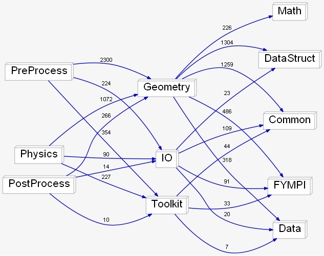<br>图 5-19 API库</div>
- Common：内容包括常量、类型定义、通用全局函数。
- PreProcess：前处理，包括网格转换、分区、细化、镜像，壁面距离计算等。
- PostProcess：后处理，包括可视化后处理接口、直接读取风雷数据的tecplot 库，以及数据后处理等。
- Data：数据库，包括参数数据、流场数据等。
- DataStruct：数据结构，包括参数数据结构、流场数据结构、结构/非结构几何数据结构、多维数组等。
- FYMPI：并行计算，包括MPI通信、数据通信。
- Geometry：几何库，包括结构/非结构几何数据。
- IO：输入输出。
- Math：数学函数库，包括基础数学函数和限制器函数等。
- Physics：这个库相对复杂，目前功能不够清晰，后面会持续进行优化。
- Toolkit：工具库，包括退出、计时、日志等工具。

## 5.4  标准求解器

&ensp;&ensp;&ensp;&ensp;风雷的求解器代码遵循一定的步骤流程，求解器实际上就是算法和方程的求解过程，求解过程是按步骤进行。用户如果有自己开发求解器的需求，并且对C++编程语言有一定的了解，可以以某个求解器为模板并按照相应模型和求解步骤来编写相应的代码。
1. 基本求解器（全部开放）：
- Solver：求解器基类（CFDSolver）和控制器类（Controller），控制器将自动依次取出不同求解器，按照预定义的流程求解。
- NSSolver：结构/非结构NS方程可压缩求解器，继承自CFDSolver。
- TurbSolver：结构/非结构湍流求解器，集成的湍流模型有：一方程SA模型，两方程k-w模型及其变种，Menter’s SST模型。
2. 集成求解器（其他软件集成到风雷平台上的求解器）：
- IncompSolver：结构/非结构不可压缩求解器。
- DSMCSolver：直接模拟蒙特卡罗方法求解器。
- UGKSSolver：统一气体动理学格式求解器。
- HelicopterModule：直升机模型求解器。

## 5.5  Mesh库和三方库

- Mesh库是PHengLEI软件中对网格进行高级操作的库，在一般流动问题中并不需要，其主要包括网格加密、重叠网格、自适应、网格变形的相关文件。
- 3rdparty库是PHengLEI调用的第三方开源库。PHengLEI软件中使用到的三方库包括hdf5库，metis/parmetis库，cgns库，Gmesh库和blitz库，其中blitz库的部分代码已经被嵌入到程序内部。


# 第6章  数据结构

&ensp;&ensp;&ensp;&ensp;本章主要介绍PHengLEI软件的数据结构，而所谓CFD软件数据结构，就是指存储计算网格、流场变量的数据结构。

## 6.1  网格描述

### 6.1.1  几何网格规范

1. 网格节点（Node）：网格节点是由空间中的位置坐标来定义。不能在一个相同的物理位置定义两个不同的点，每个点有自己的编号顺序。
2. 网格面（Face）：有限体积法中，控制体上的积分需要用到流通面的信息，如法向量、流通面积等。在几何上，面是排列有序的点集，点由其编号来表示。每个点按指定顺序相连构成控制体的各包围面，即为流通面。采用右手定理定义面法向矢量，流通面的流动参数定义在几何边的中点或者几何面的中心。
3. 网格单元（Cell）：在有限体积法中，网格单元被定义为控制体，其质心表示流动质量平均的位置。在几何上，网格单元是面的集合。所有的网格单元必须完整的覆盖计算域且不能重合，每个网格单元必须是封闭的，网格单元的中心必须在网格内。
4. 网格边界（Boundary）：边界是一系列面的集合，这些面只包含边界面并且不能是内部面，边界必须是封闭的，每个边界对应一个边界条件。
5. 虚拟网格单元（ghostCell）：在进行数值计算时，为方便边界条件的应用，以及块网格间的数据传递，通常需要用到虚网格，将各边界网格节点向外延续一或两层即可得到虚网格单元。

### 6.1.2  结构网格

&ensp;&ensp;&ensp;&ensp;结构网格的网格节点、流通面、控制体等信息的排列是有序的。本节简要介绍风雷软件中结构网格的几何拓扑与数据结构的对应关系。

#### 6.1.2.1  网格节点

&ensp;&ensp;&ensp;&ensp;图6-1为二维结构网格节点存储示意图。其中，*I*、*J*分别表示计算空间的坐标方向，*ni*、*nj*分别表示*I*方向和*J*方向的网格节点个数。代码最底层的设计中采用一维数组存储网格节点（见变量定义```typedef FYArray<RDouble ,3> RDouble3D```），并按图 6-1 中虚箭头指示的方向和顺序依次编号和存取。
<div align=center><br>图 6-1 二维结构网格节点存储示意图</div>
&ensp;&ensp;&ensp;&ensp;在三维网格中将增加一个K方向，对于该方向的每一层网格，其网格节点仍按图6-1二维的顺序排列，因而形成如图6-2所示的三维网格节点的存储顺序。程序中通常采用(i, j, k)的序列组合来表示网格节点在计算空间的坐标（或表示在单个网格中的位置）。若以nk表示K方向的节点个数，则结构网格的总节点个数由```nTotalNode=ni×nj×nk```计算，而任一网格节点的序列编号可按```(k-1)×(ni×nj) + (j-1)×ni + i-1```计算得到。
<div align=center><br>图 6-2 三维结构网格节点存储示意图</div>
&ensp;&ensp;&ensp;&ensp;为方便编写程序，风雷代码采用三维数组的形式来读取网格节点的信息。如图6-3所示，在笛卡尔坐标系中，已知某节点P的坐标(xi, yj, zk)，可通过排列序号i、j、k的移动寻到其相邻的节点，如A(xi-1, yj, zk)、B(xi+1, yj, zk)、C(xi, yj-1, zk)、D(xi, yj+1, zk)等均为其相邻节点。在```Geo_NodeTopo_Struct```类定义中（详见```Geo_NodeTopo_Struct.h```头文件），分别使用数组```structx```、```structy```、```structz```存储节点在笛卡尔坐标系中的坐标分量x、y和z，故(i, j, k)处节点坐标分量的读取形式为```x=structx(i, j, k)```、```y=structy(i, j, k)```、```z=structz(i, j, k)```，其中 i、j、k的取值范围是$\left( {i,j,k} \right) \in \left\{ i \right\}_{i = 1}^{ni} \times \left\{ j \right\}_{j = 1}^{nj} \times \left\{ k \right\}_{k = 1}^{nk}$。另外，成员变量ni、nj、nk分别记录单块网格I、J、K方向的节点个数，以便控制存储数组的大小。ni、nj、nk由函数```SetNI()```、```SetNJ()```、```SetNK()```进行设置，由函数```GetNI()```、```GetNJ()```、```GetNK()```进行获取。
<div align=center><br>图 6-3 网格节点的坐标及相邻关系的示意</div><br>
#### 6.1.2.2  网格单元（控制体）

&ensp;&ensp;&ensp;&ensp;在有限体积法中，网格单元被定义为控制体，其质心表示流动质量平均的位置。如图6-4网格单元*ABCD*表示(*i*, *j*)位置的控制体*Q*，其流动的平均密度*r*、温度*T*、速度分量*u*、*v*、*w*等参数都定义在*Q*点，网格单元*ABCD*的面积为控制体*Q*的体积。三维条件下同理，只是控制体为几何六面体，六面体的体积定义为控制体*Q*的体积。

&ensp;&ensp;&ensp;&ensp;在存储方式上，控制体的排列与网格节点相同。仍以图6-1所示二维网格为例，*I*、*J* 方向的控制体个数分别为*ni*-1、*nj*-1，控制体总个数为```nTCell=(ni-1)×(nj-1)```。在三维网格中，*K*方向的控制体个数为*nk*-1，而控制体总个数为```nTCell=(ni-1)×(nj-1)×(nk-1)```。
<div align=center><br>图 6-4 控制体的示意图</div>
&ensp;&ensp;&ensp;&ensp;如图6-5所示，在笛卡尔坐标系中，已知控制体Q的质心坐标为(xi, yj, zk)，也可通过排列序号i、j、k的移动寻到其相邻控制体质心的坐标，如X1=(xi-1, yj, zk)、X2=(xi+1, yj, zk)、Y1=(xi, yj-1, zk)、Y2=(xi, yj+1, zk)等均为其相邻控制体。在```Geo_CellMetrics_Struct```类定义中（详见```Geo_CellMetrics_Struct.h```头文件），分别使用数组```xcc```、```ycc```、```zcc```存储控制体质心在笛卡尔坐标系中的坐标分量x、y和z，故(i, j, k)处控制体质心坐标分量的读取形式为```x=xcc(i, j, k)```、```y=ycc(i, j, k)```、```z=zcc(i, j, k)```。另外，数组```vol```用于记录控制体的体积，可通过```vol(i, j, k)```的形式存取(i, j, k)处控制体的体积。在考虑虚网格的数值计算中，控制体(i, j, k)的取值范围是$\left( {i,j,k} \right) \in \left\{ i \right\}_{i =  - 1}^{ni + 1} \times \left\{ j \right\}_{j =  - 1}^{nj + 1} \times \left\{ k \right\}_{k =  - 1}^{nk + 1}$。 其中，$\left( {i,j,k} \right) \in \left\{ i \right\}_{i = 1}^{ni - 1} \times \left\{ j \right\}_{j = 1}^{nj - 1} \times \left\{ k \right\}_{k = 1}^{nk - 1}$ 范围内的控制体是真正参与流场计算的控制体，该范围之外为虚网格单元。
<div align=center><br>图 6-5 控制体质心的坐标及相邻关系的示意</div><br>
#### 6.1.2.3  网格面（流通面）

&ensp;&ensp;&ensp;&ensp;有限体积法中，控制体上的积分需要用到流通面的信息，如法向量、流通面积等。在几何上，构成控制体的各包围面即定义为流通面（这是物理上的概念）。图6-4中的边*AB*、*AD*、*BC*、*CD*，以及面*ABCD*、*EFGH*、*AEHD*、*BFGC*、*ABFE*、*DCGH*均是各自控制体的流通面。流通面的流动参数定义在几何边的中点或者几何面的中心。

&ensp;&ensp;&ensp;&ensp;以图6-6所示网格为例，*I* 方向的每一行有```ni-1```条边，在*J*方向共有```nj```行， *J* 方向因此总计有```(ni-1)×nj```个流通面；*J* 方向的每一列有nj-1条边，在*I* 方向共有```ni```列， *I* 方向因此总计有```(nj-1)×ni```个流通面；故对于二维网格，总共有```nTFace=(ni-1)×nj+(nj-1)×ni```个流通面。以此类推，在三维网格中，流通面的总个数按下式计算
$$
{\rm{nTFace}} = \left( {ni - {\rm{1}}} \right) \times (nj - 1) \times nk + \left( {ni - {\rm{1}}} \right) \times (nk - 1) \times nj + \left( {nj - {\rm{1}}} \right) \times (nk - 1) \times ni\
$$
<div align=center><br>图 6-6 流通面存储的示意</div>
&ensp;&ensp;&ensp;&ensp;流通面的排列与存储也类似网格节点、控制体的处理方法，可通过四维数组访问到其相应的数据。已知流通面在计算坐标系的位置(i, j, k)，可通过坐标分量i、j、k的移动寻到其相邻流通面的位置坐标，如图6-6中(i-1, j, k, 1)、(i+1, j, k, 1)、(i, j-1, k, 1)、(i, j+1, k, 1)为I方向(i, j, k, 1)的相邻流通面，(i-1, j, k, 2)、(i+1, j, k, 2)、(i, j-1, k, 2)、(i, j+1, k, 2)为J方向(i, j, k, 2)的相邻流通面。

&ensp;&ensp;&ensp;&ensp;在```Geo_FaceMetrics_Struct```类定义中（详见```Geo_ FaceMetrics_Struct.h```头文件），成员变量xfn、yfn、zfn分别用于保存各流通面的法向量在笛卡尔坐标系中的投影分量x、y和z，数组area用于记录流通面的面积s，其读取形式分别为```x=xfn(i, j, k, l)```、```y=yfn(i, j, k, l)```、```z=zfn(i, j, k, l)```和```s=area(i, j, k, l)```。其中，(i, j, k)的序列组合代表流通面在计算坐标系中的坐标，l∈(1, 2, 3)代表流通面的排列方向，l=1、l=2、l=3分别表示I方向、J方向、K方向的流通面，如图6-6所示。故当l=1、l=2、l=3时，流通面(i, j, k)的取值范围分别是$\left( {i,j,k} \right) \in \left\{ i \right\}_{i = 1}^{ni} \times \left\{ j \right\}_{j = 1}^{nj - 1} \times \left\{ k \right\}_{k = 1}^{nk - 1}$  、$\left( {i,j,k} \right) \in \left\{ i \right\}_{i = 1}^{ni - 1} \times \left\{ j \right\}_{j = 1}^{nj} \times \left\{ k \right\}_{k = 1}^{nk - 1}$和 $\left( {i,j,k} \right) \in \left\{ i \right\}_{i = 1}^{ni - 1} \times \left\{ j \right\}_{j = 1}^{nj - 1} \times \left\{ k \right\}_{k = 1}^{nk}$。 

&ensp;&ensp;&ensp;&ensp;在同一个单块网格内，控制体的存储序列与流通面的序列有紧密的关联。如图6-4所示，当得知控制体*Q*在计算坐标系的位置坐标(*i*, *j*,*k*)时，也可通过该坐标访问相关流通面在其存储空间的位置(*i*, *j*,*k*, *l*)。对于控制体*Q*(*i*, *j*,*k*)，*l*=1可表示二维条件下*I*方向的第一条边*AD*或三维条件下*I*方向的第一个面*AEHD*，*l*=2可代表二维条件下*J*方向的第一条边*AB*或三维条件下*J*方向的第一个面*ABFE*，*l*=3可表示*K*方向的第一个面*ABCD*。因此，以图6-7所示的网格为例，对于控制体*Q*(*i*, *j*, *k*)，流通面*AD*、*AB*的法向量**n**<sub>i,1</sub>和**n**<sub>j,1</sub>可通过坐标(*i*, *j*,*k*, 1)、(*i*, *j*, *k*, 2)分别从流通面的存储空间直接获取。对于流通面*BC*和*CD*的法向量**n**<sub>q,g</sub>、**n**<sub>q,w</sub>，则先获取对应方向的相邻流通面(*i*+1, *j*,*k*, 1)和(*i*, *j*+1, *k*, 2)，从其存储空间获得法向量**n**<sub>i,2</sub>、**n**<sub>j,2</sub>后分别取反得到，即**n**<sub>q,g</sub> = -**n**<sub>i,2</sub>和**n**<sub>q,w</sub> = -**n**<sub>j,2</sub>。
<div align=center><br>图 6-7 控制体流通面的法向量示意</div><br>
#### 6.1.2.4  网格边界

&ensp;&ensp;&ensp;&ensp;对于单块的二维结构网格，边界面通常有4个，而三维的单块网格有6个。类似Gridgen软件Generic格式对边界条件的定义，风雷软件对这些边界面的处理进行了必要的格式转换。以图6-8所示的三维网格为例，每个边界面的定义如下：面ABCD、EFGH为交接面（边界面类型编号为-1），面CGHD为远场，面AEHD、ABFE、BFGC为物面。边界面的定义由7个变量构成一组条目，形式为“i<sub>min</sub> i<sub>max</sub> j<sub>min</sub> j<sub>max</sub> k<sub>min</sub> k<sub>max</sub> ntarget”。其中，下标min和max表示相应方向的坐标最小和最大值，ntarget指明边界面的类型或相接的目标网格的序号。当i<sub>min</sub>=i<sub>max</sub>=const时，该边界面指的是I方向的截面。同理，j<sub>min</sub>= j<sub>max</sub>=const、k<sub>min</sub>=k<sub>max</sub>=const分别指示J方向、K方向的截面。在一组条目中，只有一对变量的值相同（除二维网格），即i<sub>min</sub>=i<sub>max</sub>=const、j<sub>min</sub>=j<sub>max</sub>=const、k<sub>min</sub>=k<sub>max</sub>=const不能同时成立。当一对变量指示对应方向的截面以后，另两对变量则指示该面上的节点排列情况。
<div align=center><br>图 6-8 单块网格边界面定义的示意</div>
&ensp;&ensp;&ensp;&ensp;Generic格式的条目中代表某个方向的一对变量，并不一定是第一个值小于第二个值，这将由划分网格时的操作决定。但通过PHengLEI软件的网格转换，保证了代表某个方向的一对变量一定是从小到大的排列。见图6-8中面CGHD、ABFE的节点存储序列。其中，边界面CGHD的记录条目为“1 4 4 4 1 3 4”，它表示j=4的远场边界面（ntarget=4），该面上网格节点在计算空间的坐标取值范围是$\left( {i,j,k} \right) \in \left\{ i \right\}_{i = 1}^4 \times \left\{ j \right\}_{j = 4}^4 \times \left\{ k \right\}_{k = 1}^3$ 。同理，物面ABFE的记录条目为“1 4 1 1 1 3 2”，它表示j=1的物面（ntarget=2），该面上网格节点在计算空间的坐标取值范围是$\left( {i,j,k} \right) \in \left\{ i \right\}_{i = 1}^4 \times \left\{ j \right\}_{j = 1}^1 \times \left\{ k \right\}_{k = 1}^3$ 。交接面的记录条目类似，但稍复杂，这里暂不做介绍，请参考6.1.2.7小节的说明。

&ensp;&ensp;&ensp;&ensp;风雷软件中每个边界面的记录条目由```BCRegion```类进行定义和封装，而单块网格的所有边界面通过```CompositeBCRegion```类来描述和封装，每个边界面条目存于向量数组bcregions中（见定义```vector<BCRegion * > *bcregions```）。类的变量与上述条目的对应关系将在6.1.2.7节中详细介绍。

#### 6.1.2.5  虚网格

&ensp;&ensp;&ensp;&ensp;数值计算时，为方便边界条件的应用，以及块网格间的数据传递，通常需要用到虚网格。由于湍流模拟中某些边界条件的计算需要用到两层虚网格单元的参数，因此在结构网格中需设置两层虚网格，如图6-9所示，将各边界网格节点向外延续两层即可得到虚网格单元。
<div align=center><br>图 6-9 虚网格的示意图</div>
&ensp;&ensp;&ensp;&ensp;虚网格并非真实计算域的网格，它是数值计算的一种处理，起到临时存储边界位置的数据，方便边界条件设置和数据交换的作用，例如对边界单元（存在流通面位于网格边界的控制体）的流动参数计算需要用到相邻虚网格单元的数据。如图6-10所示，控制体*Q*的流通面*CD*位于网格边界。因*CD*为物面，则控制体*Q*和*W*<sub>1</sub>、*W*<sub>2</sub>的流动参数应满足一定的条件，从而可联合起来求解。换言之，控制体*Q*的流动参数设置需要控制体*W*<sub>1</sub>和*W*<sub>2</sub>提供参数支持。在流通面*BC*上，控制体*Q*的流动参数计算也需要控制体*R*<sub>1</sub>和*R*<sub>2</sub>的数据参与。
<div align=center><br>图 6-10 虚网格的应用示意</div>
&ensp;&ensp;&ensp;&ensp;在风雷软件的程序设计中，只需存储虚网格单元的信息，不需要存储虚网格节点，因此控制体（虚网格单元）的存储范围是$\left( {i,j,k} \right) \in \left\{ i \right\}_{i =  - 1}^{ni + 1} \times \left\{ j \right\}_{j =  - 1}^{nj + 1} \times \left\{ k \right\}_{k =  - 1}^{nk + 1}$ ，其中ni、nj、nk分别为I、J、K方向网格节点个数，$\left( {i,j,k} \right) \in \left\{ i \right\}_{i = 1}^{ni - 1} \times \left\{ j \right\}_{j = 1}^{nj - 1} \times \left\{ k \right\}_{k = 1}^{nk - 1}$ 范围内的控制体是真实计算域的控制体，该范围之外为虚网格单元。由于虚网格单元不参与流场计算，因此网格节点的存储空间仍是$\left( {i,j,k} \right) \in \left\{ i \right\}_{i = 1}^{ni} \times \left\{ j \right\}_{j = 1}^{nj} \times \left\{ k \right\}_{k = 1}^{nk}$ ，I、J、K方向流通面的存储范围仍然分别是$\left( {i,j,k} \right) \in \left\{ i \right\}_{i = 1}^{ni} \times \left\{ j \right\}_{j = 1}^{nj - 1} \times \left\{ k \right\}_{k = 1}^{nk - 1}$ 、$\left( {i,j,k} \right) \in \left\{ i \right\}_{i = 1}^{ni - 1} \times \left\{ j \right\}_{j = 1}^{nj} \times \left\{ k \right\}_{k = 1}^{nk - 1}$ 和$\left( {i,j,k} \right) \in \left\{ i \right\}_{i = 1}^{ni - 1} \times \left\{ j \right\}_{j = 1}^{nj - 1} \times \left\{ k \right\}_{k = 1}^{nk}$ 。

#### 6.1.2.6  单块网格的存储

&ensp;&ensp;&ensp;&ensp;单块网格的存储即包括上述6.1.2.1-6.1.2.5节等内容的描述。在结构网格StructGrid类的定义中（详见```Geo_StructGrid.h```头文件），成员变量```nodeTopology```、```cellMetrics```、```faceMetrics```、```composite_bcregion```分别用于存储单块结构网格的节点、控制体、流通面以及边界条件等基本信息。

#### 6.1.2.7  多块网格的链接

&ensp;&ensp;&ensp;&ensp;单块网格的存储如上节所述，多块网格则采用指针数组的方式存于```StructGrid *grid```变量中，此时必须说明不同单块网格之间的链接关系，以方便数值计算时不同网格之间的数据交换。

&ensp;&ensp;&ensp;&ensp;不同单块网格之间的链接是通过交接面来实现的。如6.1.2.4节所述，交接面的记录条目也是由7个变量构成，形式如“i~min~ i~max~ j~min~ j~max~ k~min~ k~max~ ntarget”。此时，ntarget=-1，同时紧接着的一条记录条目指明与之对应的另一个单块网格的边界面信息，其形式也为“i~min~ i~max~ j~min~ j~max~ k~min~ k~max~ nbt”，只是nbt的值代表该条目所属单块网格在网格集合中的序号。另外，为了相接处网格节点排列的匹配，两个条目中会有一对变量是负数。以下图6-11为例，假设网格G~1~（序号为s~1~）与网格G~2~（序号为s~2~）相接，交接面分别为ABCD和abcd。
<div align=center><br>图 6-11 交接面的示意图</div>
&ensp;&ensp;&ensp;&ensp;在网格G1中，交接面ABCD的条目记录为

&ensp;&ensp;&ensp;&ensp;21    21    -1    -15     1     11    -1
&ensp;&ensp;&ensp;&ensp;1      1       1      11    -1   -15    s2

&ensp;&ensp;&ensp;&ensp;对应地，网格G2的交接面abcd的条目记录为

&ensp;&ensp;&ensp;&ensp;1      1       1      11    -1   -15    -1
&ensp;&ensp;&ensp;&ensp;21    21    -1    -15     1     11   s1

&ensp;&ensp;&ensp;&ensp;在此例中，交接面ABCD记录条目中j<sub>min</sub>、j<sub>max</sub>是负数，而对应的abcd交接面中k<sub>min</sub>、k<sub>max</sub>是负数，表明网格G<sub>1</sub>中J方向的节点排列与网格G<sub>2</sub>中K方向的节点排列匹配。同样地，网格G<sub>1</sub>中K方向的节点排列与网格G<sub>2</sub>中J方向的节点排列匹配。
&ensp;&ensp;&ensp;&ensp;在风雷软件的程序设计中，```StructGrid```类用于抽象和封装单块结构网格的信息，其```nodeTopology```、```cellMetrics```、```faceMetrics```、```composite_bcregion```等成员变量分别用于存储单块结构网格的节点、控制体、流通面以及边界面等基本信息。其中，```composite_bcregion```的类型为```CompositeBCRegion```类，其成员变量nb用于记录该单块网格在网格集合中的序号，即图6-11中s<sub>1</sub>和s<sub>2</sub>。成员变量```nBFace```表示所有位于边界上的流通面个数，```nIFace```表示所有位于交接面边界上的流通面个数。而各边界面的记录条目存于向量数组```bcregions```中，```bcregions```的类型为```BCRegion```类，其负责对边界面的记录条目进行定义和封装。

&ensp;&ensp;&ensp;&ensp;在```BCRegion```类中，我们可以寻到```bctype```、```s_st[3]```、```s_ed[3]```、```nbt```、```t_st[3]```、```t_ed[3]```等重点变量。其中，bctype就是前述的ntype变量，用于指明边界面的类型。```s_st[3]={imin, jmin, kmin}```、```s_ed[3]={imax, jmax, kmax}```分别存储边界面的最小、最大坐标分量信息。当```bctype=-1```（交接面）时，```nbt```、```t_st[3]```、```t_ed[3]```等变量被启用，```nbt```记录对应交接面所属目标单块网格的序号，```t_st[3]```、```t_ed[3]```分别存储对应交接面的最小、最大坐标分量信息。结合图6-11中ABCD交接面来看，其记录条目的存储便为```bctype=-1```，```s_st[3]={21, -1, 1}```，```s_ed [3]={21, -15, 11}```，```nbt=s2```，```t_st[3]={1, 1, -1}```，```t_ed [3]={1, 11, -15}```。

### 6.1.3  非结构网格

#### 6.1.3.1  单块非结构网格

&ensp;&ensp;&ensp;&ensp;如图6-12所示，这里给出一个简单的二维非结构网格。
<div align=center><br>图 6-12 二维非结构网格的示意图</div>
&ensp;&ensp;&ensp;&ensp;根据上图所示的非结构网格，拓扑信息有：
- 节点的总数：```nTotalNode```=4		（1, 2, 3, 4）
- 单元的总数：```nTotalCell```=2			（①, ②）
- 面的总数：	```nTotalFace```=5		（A, B, C, D, E）
- 每个面上的点的数量：```node_number_of_each_face```=(2, 2, 2, 2, 2)
- 每个面上的点的编号：```face2node```=(1, 2, 2, 3, 3, 1, 2, 4, 4, 3)
- 每个面的左边单元的编号：```left_cell_of_face```=(①, ①, ①, ②, ②)
- 每个面的右边单元的编号：```right_cell_of_face```=(-1, ②, -1, -1, -1)
- 每个单元上点的数量：```node_number_of_each_cell```=(3, 3)
- 每个单元上点的编号：```cell2node```=(1, 2, 3, 2, 4, 3)

#### 6.1.3.2  具有边界条件的单块非结构网格

&ensp;&ensp;&ensp;&ensp;利用上一小节中的非结构网格，在网格中加入边界条件，说明非结构网格中边界条件的应用，如图6-13所示。
<div align=center><br>图 6-13 单块非结构网格的边界面</div>
&ensp;&ensp;&ensp;&ensp;网格中共设有四个边界条件:
- 边界面的总数：```nBoundFace```=4
- 边界类型：```iBFace``` =1, key=6（Outflow）
&ensp;&ensp;&ensp;&ensp;&ensp;&ensp;&ensp;&ensp;&ensp;&ensp;```iBFace``` =2, key=2（Solid_surface）
&ensp;&ensp;&ensp;&ensp;&ensp;&ensp;&ensp;&ensp;&ensp;&ensp;```iBFace``` =3, key=2（Solid_surface）
&ensp;&ensp;&ensp;&ensp;&ensp;&ensp;&ensp;&ensp;&ensp;&ensp;```iBFace``` =4, key=5（Inflow）

#### 6.1.3.3  多块非结构网格

&ensp;&ensp;&ensp;&ensp;如图6-14所示，当网格为多块非结构网格时，每块网格的处理方式和前面讲述的一样，但是网格之间存在交界面，需要对交界面信息进行处理。
<div align=center><br>图 6-14 多块非结构网格的连接关系</div>
&ensp;&ensp;&ensp;&ensp;在网格I中，边界信息为：
- 边界面的总数：```nBoundFace```=4
- 边界类型：```iBFace``` =1, ```key```=6（Outflow）
&ensp;&ensp;&ensp;&ensp;&ensp;&ensp;&ensp;&ensp;&ensp;&ensp;```iBFace``` =2, ```key```=2（Solid_surface）
&ensp;&ensp;&ensp;&ensp;&ensp;&ensp;&ensp;&ensp;&ensp;&ensp;```iBFace``` =3, ```key```= -1（Interface）
&ensp;&ensp;&ensp;&ensp;&ensp;&ensp;&ensp;&ensp;&ensp;&ensp;```iBFace``` =4, ```key```=5（Inflow）

&ensp;&ensp;&ensp;&ensp;在网格II中，边界信息为：
- 边界面的总数：```nBoundFace```=4
- 边界类型：```iBFace``` =1, ```key```=6（Outflow）
&ensp;&ensp;&ensp;&ensp;&ensp;&ensp;&ensp;&ensp;&ensp;&ensp;```iBFace``` =2, ```key```= -1（Interface）
&ensp;&ensp;&ensp;&ensp;&ensp;&ensp;&ensp;&ensp;&ensp;&ensp;```iBFace``` =3, ```key```=2（Solid_surface）
&ensp;&ensp;&ensp;&ensp;&ensp;&ensp;&ensp;&ensp;&ensp;&ensp;```iBFace``` =4, ```key```=5（Inflow）

&ensp;&ensp;&ensp;&ensp;根据以上的边界信息，网格I中的交界面信息为：
- 交界面的总数：```nIFace```=1
- 相邻块的数量：```numberOfNeighbor```=1
对于交界面```iIFace```=1：
- 交界面对应的相邻块的编号：```interFace2ZoneID```=2
- 交界面对应的相邻块中的交界面的编号：```interFace2InterFaceID```=1
- 交界面对应的本块网格中边界面的编号：```interFace2BoundaryFace```=2

&ensp;&ensp;&ensp;&ensp;网格II中的交界面信息为：
- 交界面的总数：```nIFace```=1
- 相邻块的数量：```numberOfNeighbor```=1
对于交界面```iIFace```=1：
- 交界面对应的相邻块的编号：```interFace2ZoneID```=1
- 交界面对应的相邻块中的交界面的编号：```interFace2InterFaceID```=1
- 交界面对应的本块网格中边界面的编号：```interFace2BoundaryFace```=3

## 6.2 类的简介

&ensp;&ensp;&ensp;&ensp;在第5章内容中，已经对一些类做了简单的介绍，让开发者对PHengLEI代码中的类有了相应的认识，而本节内容中，为了较为清晰的说明网格的数据结构，将对结构与非结构网格中的一些类做进一步介绍。
<div align=center><br>图 6-15 结构关系</div><br>
### 6.2.1 结构网格的类

 &ensp;&ensp;&ensp;&ensp;如上节内容所讲，结构网格的数据信息主要由：点、面、单元与边界信息构成。
<div align=center><br>图 6-16 结构网格类关系</div>
1. 点信息：```Geo_NodeTopo_Struct```类，主要用于存储结构网格中三个方向的点数：```ni,nj,nk```，也存储三个方向的坐标信息：```structx,structy,structz```。
2. 面信息：```Geo_FaceMetrics_Struct```类，主要用于存储结构网格中面的法向单位矢量：```xfn,yfn,zfn```，也存储面的面积：```area```。
3. 单元信息：```Geo_CellMetrics_Struct```类，主要用于存储结构网格中格心的坐标信息：```xcc, ycc, zcc```，也存储单元的体积值：```vol```。
4. 边界信息：```CompositeBCRegion```类中存储的```BCRegion```对象的数组，即为一系列边界信息，而```BCRegion```类中存储某一类边界信息，比如边界类型和边界名称等信息。

&ensp;&ensp;&ensp;&ensp;风雷代码中结构网格使用边界示例：
```c++
//获取所有的边界信息
CompositeBCRegion *compositeBCRegion = StructGrid->GetCompositeBCRegion();

//获取总的边界类型数
int nBCRegion = compositeBCRegion->GetnBCRegion();

for (int iBCRegion < nBCRegion)
{
   //获取第iBCRegion类的边界信息
    BCRegion *BCRegion = compositeBCRegion->GetBCRegion(iBCRegion);

   //获取某一类型的边界类型和I, J, K范围
    BCType = BCRegion->GetBCType();
	BCRegion->GetIJKRegion(ist, ied, jst, jed, kst, ked);

}
```

### 6.2.2 非结构网格的类

&ensp;&ensp;&ensp;&ensp;非结构网格的数据信息主要由：点的度量和拓扑、面的度量和拓扑、单元的度量和拓扑和边界信息。
<div align=center><br>图 6-17 非结构网格类关系</div>
1. 点的度量和拓扑信息:```Geo_NodeTopo_Unstruct```类，主要存储非结构网格中点与单元的对应关系，如：点周围的单元数，单元编号等。
2. 面的度量和拓扑信息：```Geo_FaceMetrics_Unstruct```类，主要用于存储非结构网格中面心的坐标信息：```xfc, yfc, zfc```，面的单元法向矢量：```xfn, yfn, zfn```，面的面积：```area```；```Geo_FaceMetrics_Unstruct```类，主要存储面的拓扑信息，如：面的左右单元关系，面与点的关系等。
3. 单元的度量和拓扑信息：```Geo_CellMetrics_Unstruct```类，主要用于存储非结构网格中格心的坐标信息：```xcc, ycc, zcc```，也存储单元的体积值：```vol```；```Geo_CellTopo_Unstruct```类，主要存储非结构网格中单元与点、面的对应关系，单元与单元的对应关系，如：单元含有的点数，单元含有的面数、单元周围的单元数。
4. 边界信息：```BCRecord```类，主要用于存储非结构网格的边界信息，如：边界类型，边界名称，边界参数```bcParam```(边界中任意的计算参数)。


# 第7章  网格和相应变化（前处理）

&ensp;&ensp;&ensp;&ensp;本章节主要介绍风雷是如何处理网格。网格是数学求解的主要部分，必须满足某些标准以确保求解的有效性和准确性

## 7.1  网格生成

&ensp;&ensp;&ensp;&ensp;风雷软件提供生成网格的功能，如一些典型算例网格，包括圆柱、平板。网格可以生成非结构和结构网格，二维、三维网格均适用。
```c++
  RunPHengLEI();                       //! 进入风雷程序
    simulation->Start();               //! 开始模拟
      FYSPACE::CreateGrid();       //! 根据任务类型（nsimutask=1），进入网格相关操作
        case FYSPACE::GRID_CREATION:   //! 根据网格处理类型（gridobj=0）网格生成
          GeneGridFromDataBase();      //! 进入网格生成过程
            //! 以低速层流平板为例：LAMINAR_FLAT_PLATE_SUBSONIC
            GenDataBaseGrid(outGridFile, GeneFlatPlateGrid, GetPlateRect2Part,
                            gridType);
            { 
                //! 具体过程如下：
                //! 生成网格
                Grid **structgrids;
                GeneGridgen(structgrids, nBlocks, generateSimpleGrid, 
                            mesh2dgen);
                if (gridType == UNSTRUCTGRID)     //! 网格类型为非结构网格
                {
                    //! 结构网格转换成非结构，并写到grid类
                    StrGridToUnsGrid(structgrids, nBlocks, 
                                     UnstructGridCast(grid));
                }
                else       //! 网格类型为结构网格
                {
                    //! 直接拷贝结构网格，并写到grid类
                    StructGridCast(grid)
                        ->CopyGrid(StructGridCast(structgrids[nb]));
                    grid->ProcessBCInfo();
                }
                //! 构建网格交界面链接信息
                ConstructGlobalInterfaceLink(grids, numberOfBlocks);
                //! 网格几何信息写入文件（.fts）
                DumpGrid(gridFile, grids, numberOfBlocks);
            } 
            ......      //! 其他标准网格生成过程不在此处赘述
```

## 7.2  网格转换

&ensp;&ensp;&ensp;&ensp;用户可以通过风雷软件将第三方软件（Pointwise、Gridgen等）生成的网格转换成为风雷可识别的格式（自定义）。

### 7.2.1  网格输出接口

#### 7.2.1.1 Pointwise网格输出

##### 7.2.1.1.1 输出CGNS格式文件

1. Pointwise生成网格，或导入网格文件，File→import→grid。
（1）坐标系：x正向为来流方向，y朝上，z为右手系确定。
（2）生成面网格。
（3）生成体网格。

注意：在生成或导入网格后，需通过Edit-Orient检查网格坐标系方向是否满足右手定则，若不满足，需调整坐标轴方向直到满足右手定则。
<div align=center><br>图 7-1 Pointwise网格</div>
2. 设置边界条件
（1）CAE→set solver，选择CGNS求解器。
（2）CAE→set boundary conditions。
点击New新建边界条件。选择需要设置的边界，在CAE Type中设置边界类型，依次设置好所有边界后点击close。风雷主要提供七种边界条件，物面（Wall）、对称面（Symmetry），远场（Pressurefarfield）、Inflow（入流）、Outflow（出流），极性轴边界条件、外插边界。
3. 输出CGNS格式文件
选中block，点击File→Export→CAE，保持默认设置，点击OK，网格输出完成。
说明：
（1）对于非结构网格输出前如果网格是多块的需合并成一整块，操作为选中所有block→ctrl+j。
（2）此处需输出CAE下的cgns文件，不可输出grid下的cgns文件。
（3）PHengLEI为结构/非结构都能计算的软件，网格类型是结构还是非结构，是由导出的网格格式决定，即使生成的是结构网格，如果导出的是非结构的类型，则网格类型也不是结构的。  
（4）若生成的是结构网格，Pointwise默认设置导出的是结构类型网格。
（5）若生成结构网格，需导出非结构形式，操作为File→Export→CAE选中Treat Structured as Unstructured，其余保持默认设置。  

##### 7.2.1.1.2 输出Fluent格式文件

&ensp;&ensp;&ensp;&ensp;Fluent网格文件输出步骤与CGNS输出步骤基本相同，只是在选择求解器时需选择Ansys Fluent。说明：选择Fluent求解器后只能导出非结构类型网格。

#### 7.2.1.2 ICEM网格输出

##### 7.2.1.2.1 输出CGNS格式文件

1. ICEM生成网格，或导入网格，File→Mesh→Open mesh。
（1）坐标系：x正向为来流方向，y朝上，z为右手系确定。
<div align=center><br>图 7-2 ICEM网格</div>
&ensp;&ensp;&ensp;&ensp;（2） 生成面网格。
&ensp;&ensp;&ensp;&ensp;（3） 生成体网格。
2. 设置边界条件
（1）点击Output mesh→select solver，在Output solver 下拉列表中选择CGNS。
（2）点击Output mesh→Boundry condition→在surface /or mixedunknown下拉列表下→ 分别选择用户自行设置的边界SYMMETRY/or FARFIELD/or WALL…→creatnew→BCT Type，最后在BCT Type下拉列表中选择边界类型BCSymmetry Plane/or BCFarfield/ or BCWall…。
风雷主要提供七种边界条件：物面（Wall）、远场（Farfield）、对称面（Symmetry plane）、Inflow（入流）、Outflow（出流），极性轴边界条件、外插边界条件，设置好所有边界后点击Accept。
3. 输出CGNS文件
（1）若生成Block后需导出结构类型网格，在树节点Pre-mesh上单击鼠标右键，在弹出的菜单中选择Convert to MultiBlock Mesh，将块网格输出成分块结构网格。
（2）若生成Block后需导出非结构类型网格，File→Mesh→Loard from Blocking，后在树节点Pre-mesh上单击鼠标右键，在弹出的菜单中选择Convert to Unstruct Mesh。
（3）若生成的是非结构网格则无需前两步操作，ICEM默认导出非结构类型网格。
（4）最后一步，Output mesh→Write input→save the project（Yes/No，此处选择Yes），打开保存的Project（或Block）文件，保持默认设置，点击Done。

&ensp;&ensp;&ensp;&ensp;说明：PHengLEI为结构/非结构都能计算的软件，网格类型是结构还是非结构，是由导出的网格格式决定，即使生成的是结构网格，如果导出的是非结构的类型，则网格类型也不是结构的，若不对生成的网格进行任何转换（Convert to MultiBlock Mesh/or Convert to Unstruct Mesh），ICEM中默认导出的网格类型是非结构的。

##### 7.2.1.2.2 输出Fluent格式文件

1. ICEM生成网格，此步骤与输出CGNS内容一致，这里不再赘述。
2. Output mesh→select solver，在Output solver 下拉列表中选择ANSYS Fluent，点击Ok确定。
3. 设置单位，Settings—Model units，选择网格单位（此处若选择米m，表示不对网格进行缩放）后点击Ok。
4. 设置边界条件，此步骤与输出CGNS内容一致，这里也不再赘述。
5. 输出msh文件
Output mesh→Write input→save the project（Yes/No，此处选择Yes），打开保存的Project，保持默认设置，点击Done。

&ensp;&ensp;&ensp;&ensp;说明：
&ensp;&ensp;&ensp;&ensp;（1）选择Fluent求解器后只能导出非结构类型网格。
&ensp;&ensp;&ensp;&ensp;（2）若生成Block后需导出非结构类型网格，File→Mesh→Loard from Blocking，后在树节点Pre-mesh上单击鼠标右键，在弹出的菜单中选择Convert to Unstruct Mesh。

### 7.2.2  网格转换相关类

&ensp;&ensp;&ensp;&ensp;下面我们列举了可用的网格转换类。这一章节我们讨论如何使用下面这些类：
- Pre_GridConversion：基类，其他网格格式转换为风雷可识别的网格格式.fts。
- Pre_CGNSToPHengLEI_Unstruct：继承自Pre_GridConversion，CGNS非结构网格转换成风雷自定义的网格格式.fts。
- Pre_FieldViewToPHengLEI_Unstruct：继承自Pre_GridConversion，FieldView非结构网格转换成风雷自定义的网格格式.fts。
- Pre_FluentToPHengLEI_Unstruct：继承自Pre_GridConversion，Fluent非结构网格转换成风雷自定义的网格格式.fts。
- Pre_CGNSToPlot3D_Struct：CGNS结构网格转换成Plot3D格式。

### 7.2.3  网格转换过程

&ensp;&ensp;&ensp;&ensp;PHengLEI网格转换过程：总控文件中设定任务类型为网格相关功能（nsimutask=1）并设置网格转换的参数文件，执行风雷程序，进行网格转换。
```c++
  RunPHengLEI();                       //! 进入风雷程序
    simulation->Start();               //! 开始模拟
      PHSPACE::CreateGrid();       //! 根据任务类型（nsimutask=1），进入网格相关操作 
        case PHSPACE::GRID_CONVERSION: //! 根据网格处理类型（当前默认gridobj=1）
          ConvertGrid();               //! 进入网格转换过程
```

#### 7.2.3.1  Plot3D网格转换

&ensp;&ensp;&ensp;&ensp;Plot3D格式网格转换：针对结构网格Plot3D格式（.grd）转换成风雷可识别的网格格式（.fts），二维、三维网格均适用。
1. 读取Plot3D.grd网格文件和Plot3D.inp边界条件文件；
2. 转换成风雷的Plot3D.fts网格文件。
```c++
  case GRIDGEN_TYPE:        //! 源网格为Plot3D格式
    GridgenGridProcess();   //! 进入到Plot3D网格转换过程
      GridgenToStr();       //! 根据参数gridtype判断网格类型，进入结构网格转换流程
      {   
          //! 具体过程如下：
          //! 读取源网格文件和边界条件 
          Grid **structgrids;
          ReadGridgen(structgrids, numberOfBlocks, fromGridFile, boundaryFile);  
          {
              int fileFormat = GlobalDataBase::GetIntParaFromDB("fileformat");
              if (fileFormat == 1)
              {
                  //! 读取网格坐标信息（ASCII文件格式）
                  ReadGridgenCoorASCII(gridgenFile, numberOfBlocks,
                                       structGrids);
              }
              else if (fileFormat == 0)
              {
                  //! 读取网格坐标信息（二进制文件格式）
                  ReadGridgenCoor(gridgenFile, numberOfBlocks, structGrids);
              }
              //! 读取网格边界条件信息
              ReadGridgenBC(structGrids, numberOfBlocks, BCFile);
          }
          if (ndim == TWO_D)    //! 根据参数ndim判断网格维数
          {
              for (int iZone = 0; iZone < numberOfBlocks; ++ iZone)
              {
                  //! 复制源网格几何信息，并写到grid类里
                  StructGridCast(grid)->
                      CopyGrid(StructGridCast(structgrids[iZone]));     
                  //! 设置边界条件信息
                  grid->ProcessBCInfo();  
              }
              //! 构建重叠网格信息
              ConstructOverlappingInfo(grids, numberOfBlocks, isOverlap)
              //! 构建网格的交界面链接信息
              ConstructGlobalInterfaceLink(grids,numberOfBlocks); 
              //! 二维网格几何信息写入文件（.fts）
              DumpGrid(outGridFile, grids, numberOfBlocks);   
              //! 二维网格边界条件对接关系输出写入文件(.link)，用于结构网格分区
              WriteLnkFile(outGridFile, structgrids, numberOfBlocks);
              //! 二维网格边界信息写入文件(.bcname)
              WriteToBcname(outGridFile, grids, numberOfBlocks);
              //! 二维网格和特征边界信息写入文件(.bcmesh），用于界面画网格功能
              DumpCharacteristicBoundary(outGridFile, grids, numberOfBlocks);
          }
          else
          { 
              //! 三维网格边界条件对接关系输出写入文件(.link)，用于结构网格分区
              WriteLnkFile(outGridFile, structgrids, numberOfBlocks);
              //! 检查多重网格有效重数（最高）
              CheckMeshMultigrid(structgrids, numberOfBlocks);
              //! 三维网格转化器，并将网格几何信息写入文件（.fts）
              gridTranslator->Run();
              {
                  //! 边界条件处理
                  ProcessBoundaryCondition();
                  //! 生成、标记对接关系的面群
                  GenerateStructFaceGroup();
                  ColorateStructFaceGroup();   
                  //! 构建交界面信息
                  CollectInterfaceInformation();
                  //! 网格几何信息输出(.fts)
                  OutputGrid();
                  //! 重叠网格的处理
                  ProcessOversetGrid();   
              }
              //! 三维网格用于风工程的边界信息写入文件（.bcdir）              
              WriteBcDirFile(outGridFile, structgrids, numberOfBlocks);
              //! 三维网格边界条件信息写入文件(.bcname)
              WriteToBcname(outGridFile, structgrids, numberOfBlocks);
              //! 三维网格和特征边界信息写入文件(.bcmesh），用于界面画网格功能
              DumpCharacteristicBoundary(outGridFile, structgrids, 
                                         numberOfBlocks);
          }
      }
```

#### 7.2.3.2  CGNS网格转换

&ensp;&ensp;&ensp;&ensp;CGNS格式网格转换：针对结构和非结构网格CGNS格式（.cgns）转换成风雷可识别的网格格式（.fts），二维、三维网格均适用。
- 结构CGNS网格转换：
1. 先将CGNS.cgns网格文件转换为Plot3D格式网格文件；
2. 然后读取CGNS.grd网格文件和CGNS.inp边界条件文件；
3. 转换成风雷的CGNS.fts网格文件。
```c++
  case CGNS_TYPE:        //! 源网格为CGNS格式
    CGNSGridProcess();   //! 进入到CGNS网格转换过程
      CGNS2StructGrid(); //! 根据参数gridtype判断网格类型，直接进入结构CGNS网格转换
      {   
          //! 具体过程如下：
          //! CGNS格式转换Plot3D格式网格文件，详见Pre_CGNSToPlot3D_Struct类
          cgnsGridConversion.Run();     
          {
              ReadCGNSGrid();           //! 读取源网格文件和边界条件
              WriteToGrd();             //! 网格几何信息写入文件（.grd）
              WriteToInp();             //! 网格边界条件信息写入文件（.inp）
          }
          //! 再进入到Plot3D网格转换过程
          GridgenGridProcess();         
            GridgenToStr();   
              {
                  //! 具体过程详见6.3.2.1节的Plot3D网格转换过程，此处不再赘述
                  ......;  
              }
      }
```
- 非结构CGNS网格转换：
1. 读取CGNS.cgns网格几何网格信息和边界条件信息；
2. 转换成风雷的非结构CGNS.fts网格文件。
```c++
case CGNS_TYPE:        //! 源网格为CGNS格式
  CGNSGridProcess();   //! 进入到CGNS网格转换过程
    CGNS2UnstructGrid(); //! 根据参数gridtype判断网格类型，直接进入非结构CGNS网格转换
      {   
          //! 具体过程如下：
          //! CGNS格式转PHengLEI格式网格文件，详见Pre_CGNSToPHengLEI_Unstruct类
          cgnsGridConversion.Run();     
          {
              ReadGrid();               //! 读取源网格
              {   
                  //! 读取网格块数
                  cg_nzones(fileid, baseid, &nBlocks);   
                  for (int izone = 1; izone <= nBlocks; ++ izone)           
                  {    
                      //! 检查网格块的类型
                      cg_zone_type(fileid, baseid, izone, &zoneType);
                      //! 读取网格点和单元数
                      cg_zone_read(fileid, baseid, izone, zonename,isize[0]);
                      //! 读取网格坐标信息
                      cg_ncoords(fileid, baseid, izone, &nCoords);
                      cg_nsections(fileid, baseid, izone, &nSections);    
                      //! 读取网格边界条件信息
                      cg_nbocos(fileid, baseid, izone, &nBCRegions);     
                      ......
                  }
              }
              Conversion();             //! 开始转换过程
              {
                  //! CGNS格式网格向PHengLEI格式网格转换
                  factory_cgns->ConvertGrid2Fantasy(); 
                  {
                      //! 按照块循环
                      for (int izone = 0; izone < nBlocks; ++ izone)         
                      {     
                          ComputeGridConn(this->GetCGNSBase(izone),
                                          base_conn[izone]);     
                          {         
                              cgnsgrid->ComputeGridConn(gconn, this->base_elem);       
                              {   
                                  //! 网格单元、点、边界面重新编号
                                  PreProcess(gconn, base_elem);
                                  //! 单元面重构（所有单元面）          
                                  ComputeElemFace(gconn, base_elem);
                                  //! 边界面重构       
                                  ComputeBCFace(gconn, base_elem);   
                                  //! 网格单元对点的连接方式（c2n） 
                                  ComputeCellToNode(gconn, base_elem); 
                                  //! 单元面重排序
                                  PostProcess(gconn);     
                              }        
                          }    
                      }
                  }
                  for (int izone = 0; izone < nBlocks; ++ izone)
                  {
                      //! 风雷非结构网格对应的拓扑关系和边界条件写到grid类里面
                      CGNS2UnsGrid(factory_cgns, izone, UnstructGridCast(grid));
                  }
              }
              //! Get参数numberOfBlocks的值，判断网格是多块还是单块    
              int numberOfBlocks = cgnsGridConversion.GetNumberofBlocks();
              Grid **grids = cgnsGridConversion.GetGrids();
              //! 构建重叠网格信息
              ConstructOverlappingInfo(grids, numberOfBlocks, isOverlap);
              //! 构建网格的交界面链接信息
              ConstructGlobalInterfaceLink(grids,numberOfBlocks);
              if (numberOfBlocks > 1)    //! 多块网格
              {
                  //! 多块网格合并成单块
                  combinedGrid->RunCombinGrid();
                  //! 多块网格合并成单块后将非结构网格几何信息写入文件（.fts）
                  DumpGrid(outGridFile, gridMerged, 1);
              }
              else    //! 单块网格
              {
                  //! 单块网格直接将非结构网格几何信息写入文件（.fts）
                  DumpGrid(outGridFile, grids, numberOfBlocks);
              }   
              //! 非结构网格边界条件信息写入文件(.bcname)
              cgnsGridConversion.WriteAdditionalInformation(outGridFile, grids);
              //! 非结构网格和特征边界信息写入文件(.bcmesh），用于界面画网格功能
              DumpCharacteristicBoundary(outGridFile, grids, numberOfBlocks);
          }
```

#### 7.2.3.3  FieldView网格转换

&ensp;&ensp;&ensp;&ensp;FieldView格式网格转换：针对非结构网格FieldView格式（.uns/.dat/.inp）转换成风雷可识别的网格格式（.fts），仅三维网格适用。
1. 读取FieldView.uns网格的几何网格信息和边界条件信息；
2. 转换成风雷的非结构FieldView.fts网格文件。
```c++
case FIELDVIEW_TYPE:       //! 源网格为FieldView格式
  FieldViewGridProcess();  //! 进入到FieldView网格转换过程
    FieldView2Fantasy();   //! 直接进入非结构FieldView网格转换
      {   
          //! 具体过程如下：
          //! FieldView格式转换风雷格式网格，详见Pre_FieldViewToPHengLEI_Unstruct类
          fieldViewGridConversion.Run();
          {
              ReadGrid();        //! 读取源网格
              {
                  //! 读取网格块数
                  GetFieldViewNBlocks(file, nversion);
                  //! 读取网格边界类型
                  GetFieldViewNBCType(file, nversion, nBCType); 
                  //! 获取边界条件名称列表
                  GetFieldViewBCNameTable(file, nversion, nBCType, 
                                          bctype_name_list);
                  //! 获取边界条件类型列表
                  GetFieldViewBCTypeTable(nBCType,nversion, bctype_name_list, 
                                          bctype_list);
                  //! 获取对应风雷的边界条件类型列表
                  Gridgen2CGNSBCTypeTable(nBCType, bctype_list);
                  for (int izone = 0; izone < nBlocks; ++ izone)
                  {
                      //! 读取所有网格点
                      GetFieldViewNTNode(file, nversion, nTotalNode);
                      //! 读取网格坐标信息
                      ReadFieldViewCoor(file, nversion, nTotalNode, x, y, z);
                      //! 读取网格边界面信息
                      GetFieldViewNBFace(file, nversion, nBoundFace);
                      //! 读取网格边界单元信息                    
                      GetFieldViewBCCell(file, nversion, nBoundFace, nBCType, 
                                         bctype_list, nBC_Sections, 
                                         bc_elem_type, bc_istart, bc_iend, 
                                         bc_elem_conn_list, nBCRegions,
                                         bc_conn_list, nBCElem, bc_type);
                      //! 读取网格内部单元信息
                      GetFieldViewMainCell(file, nversion, nTotalCell, 
                                           nElem_Sections,  elem_type, 
                                           elem_istart, elem_iend,
                                           elem_conn_list);
                  }
              }
              Conversion();      //! 开始转换过程，调用CGNS函数，详细过程参见6.3.2.2节
              {
                  //! FieldView格式网格向风雷网格转换 
                  factory_cgns->ConvertGrid2Fantasy(); 
                  for (int izone = 0; izone < nBlocks; ++ izone)
                  {
                      //! 风雷非结构网格对应的拓扑关系和边界条件写到grid类里面
                      CGNS2UnsGrid(factory_cgns, izone, UnstructGridCast(grid));
                  }
              }
          }                
          //! 构建重叠网格信息
          ConstructOverlappingInfo(grids, numberOfBlocks, isOverlap);  
          //! 构建网格的交界面链接信息
          ConstructGlobalInterfaceLink(grids, numberOfBlocks);
          //! 非结构网格几何信息写入文件（.fts）       
          DumpGrid(outGridFile, grids, numberOfBlocks);  
          //! 非结构网格边界条件信息写入文件(.bcname)  
          fieldViewGridConversion.WriteAdditionalInformation(outGridFile,
                                                             grids);      
          //! 非结构网格和特征边界信息写入文件(.bcmesh），用于界面画网格功能         
          DumpCharacteristicBoundary(outGridFile, grids, numberOfBlocks);
      }
```

#### 7.2.3.4  Fluent网格转换

&ensp;&ensp;&ensp;&ensp;Fluent格式网格转换：针对非结构网格Fluent格式（.cas/.msh）转换成风雷可识别的网格格式（.fts），二维、三维网格均适用。
1. 读取Fluent.cas网格几何网格信息和边界条件信息；
2. 转换成风雷的非结构Fluent.fts网格文件。
```c++
case FLUENT_TYPE:       //! 源网格为Fluent格式
  FluentGridProcess();  //! 进入到Fluent网格转换过程
    Fluent2PHengLEI();  //! 直接进入非结构Fluent网格转换流程
    {   
        //! 具体过程如下：
        //! Fluent格式转换风雷格式网格文件，详见Pre_FluentToPHengLEI_Unstruct类    
        fluentGridConversion.Run();
        {
            ReadGrid();               //! 读取源网格
            {
                //! 读取网格几何信息和边界条件	
                ReadFluent(fluent_factory, nBlocks, gridFileName);
                fluent_factory->DumpSelfDefinePartInformation();
            }
            Conversion();             //! 开始转换过程  
            {
                //! Fluent格式网格转换向风雷网格转换
                fluent_factory->DumpSelfDefinePartInformation();      
                for (int izone = 0; izone < nBlocks; ++ izone)   
                { 
                    //! 风雷非结构网格对应的拓扑关系和边界条件写到grid类里面       
                    fluent_factory->Convert2UnsGrid(izone, 
                                                    UnstructGridCast(grid));
                }
            }   
        }       
        //! 构建重叠网格信息    
        ConstructOverlappingInfo(grids, numberOfBlocks, isOverlap);
        //! 构建网格的交界面链接信息           
        ConstructGlobalInterfaceLink(grids, numberOfBlocks);
        //! 非结构网格几何信息写入文件（.fts）    
        DumpGrid(outGridFile, grids, numberOfBlocks);
        //! 非结构网格边界条件信息写入文件(.bcname)
        fluentGridConversion.WriteAdditionalInformation(outGridFile);
        //! 非结构网格和特征边界信息写入文件(.bcmesh），用于界面画网格功能
        DumpCharacteristicBoundary(outGridFile, grids, numberOfBlocks);
    }
```

## 7.3  网格细化

&ensp;&ensp;&ensp;&ensp;当进行CFD计算时所采用的网格比较粗糙时，很多情况下不可能或者不方便重新用第三方网格软件重新加密网格，但是计算精度达不到预期。风雷中提供了网格细化（加密）功能。在原网格的基础上进行加密，得到比较合适的网格，然后再进行计算。网格细化针对结构网格，二维/三维网格均适用。
```c++
  RunPHengLEI();                       //! 进入风雷程序
    simulation->Start();               //! 开始模拟
      PHSPACE::CreateGrid();       //! 根据任务类型（nsimutask=1），进入网格相关操作
        case PHSPACE::GRID_ADAPTATION: //! 根据网格处理类型（gridobj=2）网格细化（加密）
          ReconstructGrid();           //! 进入结构网格细化（加密）过程
          { 
              //! 具体过程如下：
              //! 结构网格细化（加密），详见Pre_GridRefine类
              GridRefine.Run();    
              { 
                  //! 读取原来的结构网格几何信息（.fts） 
                  region->ReadGrid();   
                  RefineGrid();       //! 细化（加密）原来的结构网格
                  {   
                      //! 按照块循环,细化（加密）结构网格
                      for (int izone = 0; izone < numberOfBlocks; izone ++)  
                      {  
                          //! 细化（加密）结构网格
                          RefineGridStr(izone, grid);   
                      }
                  }
                  //! 细化（加密）边界区域
                  RefineBCRegion();   
                  //! 构建网格的交界面链接信息 
                  ConstructGlobalInterfaceLink(NewGrids, numberOfBlocks);
                  //! 将细化（加密）的结构网格几何信息写入文件（.fts） 
                  DumpGrid(out_gfile, NewGrids, numberOfBlocks);    
              }
          }
```

## 7.4  网格合并

&ensp;&ensp;&ensp;&ensp;风雷软件中提供了网格合并功能。在原网格的基础上进行合并，将两块网格合并成一块网格后输出。网格合并只针对非结构网格，且二维/三维网格均适用。
```c++
  RunPHengLEI();                       //! 进入风雷程序
    simulation->Start();               //! 开始模拟
      case CREATE_GRID: 			   //! 根据任务类型（nsimutask=1），进入网格相关操作
	   PHSPACE::CreateGrid();          //! 进入网格处理过程
        case PHSPACE::GRID_MERGING:    //! 根据网格处理类型（gridobj=3）网格合并
          CombinationGrid();           //! 进入网格合并过程
          { 
              //! 具体过程如下：
              //! 读取原来的网格几何信息（.fts）  
              region->ReadGrid();  
              //! 建立多块网格连接关系            
              region->SetupMultiBlockRelationship();
              //! 进入网格合并过程
              combinedGrid->RunCombinGrid();
              {           
                  //! 合并重置坐标系 
                  ResetCoordinate();   
                  //! 设置每个面上的点的数量
                  ResetNodeNumberOfEachFace();
                  //! 设置面对点的连接方式
                  ResetFace2Node();
                  //! 设置面对左右单元的连接方式
                  ResetLeftRightCell();
                  //! 合并单元对点的连接方式
                  MergeCell2Node();   
                  //! 合并边界条件    
                  MergeBCType(); 
                  //! 交界面数据交换
                  SwapInterfaceData()       
              } 
              DumpGrid(outGridFile, combinedGrid->GetGridAll(), 1);
              {
                  //! 将合并后非结构网格几何信息写入文件（.fts）   
                  DumpMergedGridP2P(gridFileName, grids, nBlocks);
              }
          }
```

## 7.5  网格镜像

&ensp;&ensp;&ensp;&ensp;当采用第三方网格软件画网格时，很多情况下由于外形本身是对称结构，通常为了节省大量的时间和精力只画出半场网格。如果需要进行全场的数值模拟计算和分析，风雷软件中提供了网格镜像功能。在原网格的基础上进行镜像，形成对称的网格构成全场网格，值得注意的是镜像后的全场网格块数是原来的两倍。网格镜像操作对结构/非结构网格，二维/三维网格均适用。
```c++
  RunPHengLEI();                       //! 进入风雷程序
    simulation->Start();               //! 开始模拟
      PHSPACE::CreateGrid();           //! 根据任务类型（nsimutask=1），进入网格相关操作
        case PHSPACE::GRID_MIRROR:     //! 根据网格处理类型（gridobj=6）网格镜像
          MirrorGrid();                //! 进入网格镜像过程
          {  
              //! 具体过程如下：
              //! 网格细化加密，详见Pre_GridMirror类            
              GridMirror.Run();    
              { 
                  //! 读取原来的结构网格几何信息（.fts）   
                  region->ReadOrdinaryGrid(gridFileName);
                  //! 只针对结构网格
                  RevertBCInfo();
                  //! 计算镜像后的网格总块数
                  CalBlocksNumberOfMirrorGrid(); 
                  GridMirror();       //! 镜像原来的网格
                  { 
                      //! 按照块循环
                      for (int izone = 0; izone < BlockofEachProc; izone ++)
                      {
                          if (gridtype == STRUCTGRID)    //! 结构网格类型
                          {
                              StructGrid * grid = 
                                  StructGridCast(OrdinaryGrid[izone]);
                              //! 结构网格镜像
                              MirrorGridStr(izone, grid);
                          }
                          else                             //! 非结构网格类型
                          {
                              UnstructGrid *grid = 
                                  UnstructGridCast(OrdinaryGrid[izone]);
                               //! 非结构网格镜像
                              MirrorGridUnstr(izone, grid);
                          }
                      }
                  }  
                  MirrorBCRegion();    //! 镜像边界区域
                  if (gridtype == STRUCTGRID)     //! 结构网格类型
                  {
                        DumpStrGrid(out_gfile);
                        {
                            //! 构建网格的交界面链接信息
                            ConstructGlobalInterfaceLink(grids, nZones);
                            //! 镜像后的结构网格几何信息写入文件（.fts）
                            DumpGrid(out_gfile, grids, nZones);
                        }
                  }              
                  else                          //! 非结构网格类型
                  {
                      DumpUnstrGrid(out_gfile);  
                      {  
                          //! 镜像后的非结构网格几何信息写入文件（.fts）            
                          DumpGrid(out_gfile, grids, nZones);  
                      }
                  }      
              }
          }
```

## 7.5  网格变形

### 7.5.1 非结构网格变形

&ensp;&ensp;&ensp;&ensp;风雷软件提供非结构网格的网格变形计算，支持弹簧法和RBF方法两种网格变形算法。代码中提供了鸟类扑翼运动的网格变形功能，用户如果需要添加新的运动加载方式，可以通过修改物面运动加载函数SurfaceGridMove()来实现。

### 7.5.1.1 基本设计

&ensp;&ensp;&ensp;&ensp;非结构网格变形的基本设计，以RBF算法为例进行说明：
```c++
  RunPHengLEI();                        //! 进入风雷程序
    simulation->Start();                //! 开始模拟
      FYSPACE::CreateGrid();            //! 根据任务类型（nsimutask=1），进入网格相关操作
        case FYSPACE::GRID_DEFORMATION: //! 根据网格处理类型（gridobj=4）网格变形
          DeformGrid();                 //! 进入网格变形过程
            //! 读取网格文件
            Region *gridHandler = new Region();
            gridHandler->ReadGrid();

			//! 根据参数文件设置的网格变形算法，建立网格变形类
            GridDeformation *gridDeformation = 0;
            gridDeformation->SetDeformParameter();
            gridDeformation->Run();
				TransformGrid();         	//! 将原网格转换为动网格
				MatchControlPoints();	 	//! 匹配运动点
				Deforming();			 	//! 网格变形计算
					SurfaceGridMove();		//! 设置物面点运动位移
					RBFDeformingKernel();	//! 计算空间点变形
					PostVisual();			//! 结果可视化输出

```
### 7.5.1.2 操作流程

以三维Brid非结构网格为例，具体的网格变形操作过程如下：
1. 修改总控文件key.hypara，设置任务类型为网格变形：
```c++
string title       		 =   "PHengLEI Main Parameter Control File";
string defaultParaFile   =   "./bin/cfd_para.hypara";
int  ndim         =   3;
int  nparafile    =   1;
int    nsimutask          =   1;
string parafilename       =   "./bin/grid_deform_para.hypara";
int  numberOfGridProcessor=   0;
string parafilename1      =   ""
string parafilename2      =   "";
```
2. 修改网格变形参数文件grid_deform_para.hypara：
```c++
int    gridobj       = 4;
int    nDeformStep   = 40;
double flapAngle     = 10.0;
double rotatePostionZ= 4.00003;
double rotatePostionY= 3.05;

int    deformationMethod = 2;
string stationalGridFile = "./grid/Segment2Brid.fts";
string visualFileName    = "./results/deformedGrid.dat"

int    gridSlice     = 1;
int    sliceAxis     = 1;
double slicePosition = 13;

int numberOfReferenceCP = 40;
double influencePara = 25.0;
```
3. 串行运行可执行程序，进行网格变形任务
- 双击运行PHengLEIv3d0.exe
- cmd进入工程目录，输入命令：mpiexec -n 1 ./PHengLEIv3d0.exe
4. 计算结果输出
根据参数文件设定的可视化文件名，将每步迭代变形后的网格输出到tecplot可视化文件中。
<div align=center><br>图 7-3 变形前网格</div>
<div align=center><br>图 7-4 变形后网格</div><br>
# 第8章  CFD控制方程

&ensp;&ensp;&ensp;&ensp;本章节介绍在CFD计算中所涉及的N-S方程，除此之外，风雷软件集成的湍流模型主要包括：一方程SA模型，两方程$k-\omega $模型及其变种，Menter’s SST模型。

## 8.1 雷诺平均N-S方程

&ensp;&ensp;&ensp;&ensp;此处介绍N-S方程的微分形式和积分形式，软件采用的是积分形式的雷诺平均N-S方程。

### 8.1.1 微分形式

&ensp;&ensp;&ensp;&ensp;在三维直角坐标系下，可压、非定常N-S方程可以写成如下微分形式：
$$
\frac{{\partial {\bf{Q}}}}{{\partial t}} + \frac{{\partial {\bf{f}}}}{{\partial x}} + \frac{{\partial {\bf{g}}}}{{\partial y}} + \frac{{\partial {\bf{h}}}}{{\partial z}} = \frac{{\partial {{\bf{f}}_v}}}{{\partial x}} + \frac{{\partial {{\bf{g}}_v}}}{{\partial y}} + \frac{{\partial {{\bf{h}}_v}}}{{\partial z}}
$$
&ensp;&ensp;&ensp;&ensp;其中，$Q$为守恒量向量,$f$、$g$、$h$、$fv$、$gv$、$hv$分别是$x$*、*$y$、$z$方向的对流（无粘）通量和粘性通量：
$$
{\bf{Q}} = \left[ \begin{array}{l}
\rho \\
\rho u\\
\rho v\\
\rho w\\
\rho E
\end{array} \right]
,{\bf{f}} = \left[ \begin{array}{l}
\rho u\\
\rho {u^2} + p\\
\rho uv\\
\rho uw\\
\left( {\rho E + p} \right)u
\end{array} \right]
,{\bf{g}} = \left[ \begin{array}{l}
\rho v\\
\rho vu\\
\rho {v^2} + p\\
\rho vw\\
\left( {\rho E + p} \right)v
\end{array} \right]
,{\bf{h}} = \left[ \begin{array}{l}
\rho w\\
\rho wu\\
\rho wv\\
\rho {w^2} + p\\
\left( {\rho E + p} \right)w
\end{array} \right]
$$
$$
{{\bf{f}}_v} = \left[ \begin{array}{l}
0\\
{\tau _{xx}}\\
{\tau _{xy}}\\
{\tau _{xz}}\\
u{\tau _{xx}} + v{\tau _{xy}} + w{\tau _{xz}} + \kappa \frac{{\partial T}}{{\partial x}}
\end{array} \right]
,{{\bf{g}}_v} = \left[ \begin{array}{l}
0\\
{\tau _{yx}}\\
{\tau _{yy}}\\
{\tau _{yz}}\\
u{\tau _{yx}} + v{\tau _{yy}} + w{\tau _{yz}} + \kappa \frac{{\partial T}}{{\partial y}}
\end{array} \right]
$$
$$
{{\bf{h}}_v} = \left[ \begin{array}{l}
0\\
{\tau _{zx}}\\
{\tau _{zy}}\\
{\tau _{zz}}\\
u{\tau _{zx}} + v{\tau _{zy}} + w{\tau _{zz}} + \kappa \frac{{\partial T}}{{\partial z}}
\end{array} \right]
$$

### 8.1.2 积分形式

&ensp;&ensp;&ensp;&ensp;方程的积分形式写为：
$$
\frac{\partial }{{\partial t}}\int\limits_\Omega  {{\bf{Q}}dV}  =  - \int\limits_{\partial \Omega } {\left( {{\bf{F}} \cdot {\bf{n}}} \right)dS}  + \int\limits_{\partial \Omega } {\left( {{{\bf{F}}_v} \cdot {\bf{n}}} \right)dS}
$$
&ensp;&ensp;&ensp;&ensp;$F$和$Fv$分别代表对流（无粘）通量张量和粘性通量张量，表示如下：
$$
{\bf{Q}} = \left[ \begin{array}{l}
\rho \\
\rho u\\
\rho v\\
\rho w\\
\rho e
\end{array} \right]
,{\bf{F}} = \left( {{\bf{f}},{\bf{g}},{\bf{h}}} \right)
,{{\bf{F}}_v} = \left( {{{\bf{f}}_v},{{\bf{g}}_v},{{\bf{h}}_v}} \right)
$$
$$
{\bf{F}} = \left[ \begin{array}{l}
\rho V  \\
\rho uV + {n_x}p\\
\rho vV + {n_y}p\\
\rho wV + {n_z}p\\
\rho HV
\end{array} \right]
,{{\bf{F}}_v} = \left[ {\begin{array}{*{20}{c}}
0\\
{{n_x}{\tau _{xx}} + {n_y}{\tau _{xy}} + {n_z}{\tau _{xz}}}\\
{{n_x}{\tau _{yx}} + {n_y}{\tau _{yy}} + {n_z}{\tau _{yz}}}\\
{{n_x}{\tau _{zx}} + {n_y}{\tau _{zy}} + {n_z}{\tau _{zz}}}\\
{{n_x}{\Theta _x} + {n_y}{\Theta _y} + {n_z}{\Theta _z}}
\end{array}} \right]\
$$
&ensp;&ensp;&ensp;&ensp;其中：
$$
V \equiv \mathord{\buildrel{\lower3pt\hbox{$\scriptscriptstyle\rightharpoonup$}} 
\over v}  \cdot \mathord{\buildrel{\lower3pt\hbox{$\scriptscriptstyle\rightharpoonup$}} 
\over n}  = {n_x}u + {n_y}v + {n_z}w
$$
$$
H = h + \frac{{{{\left| {\mathord{\buildrel{\lower3pt\hbox{$\scriptscriptstyle\rightharpoonup$}} 
\over v} } \right|}^2}}}{2} = E + \frac{p}{\rho }
$$
$$
E = e + \frac{{{{\left| {\mathord{\buildrel{\lower3pt\hbox{$\scriptscriptstyle\rightharpoonup$}} 
\over v} } \right|}^2}}}{2} = e + \frac{{{u^2} + {v^2} + {w^2}}}{2}
$$
$$
\begin{array}{l}
{\Theta _x} = u{\tau _{xx}} + v{\tau _{xy}} + w{\tau _{xz}} + k\frac{{\partial T}}{{\partial x}}\\
{\Theta _y} = u{\tau _{yx}} + v{\tau _{yy}} + w{\tau _{yz}} + k\frac{{\partial T}}{{\partial y}}\\
{\Theta _z} = u{\tau _{zx}} + v{\tau _{zy}} + w{\tau _{zz}} + k\frac{{\partial T}}{{\partial z}}
\end{array}
$$
$$
\begin{array}{l}
{\tau _{xx}} = \lambda (\frac{{\partial u}}{{\partial x}} + \frac{{\partial v}}{{\partial y}} + \frac{{\partial w}}{{\partial z}}) + 2\mu \frac{{\partial u}}{{\partial x}}\\
{\tau _{yy}} = \lambda (\frac{{\partial u}}{{\partial x}} + \frac{{\partial v}}{{\partial y}} + \frac{{\partial w}}{{\partial z}}) + 2\mu \frac{{\partial v}}{{\partial y}}\\
{\tau _{zz}} = \lambda (\frac{{\partial u}}{{\partial x}} + \frac{{\partial v}}{{\partial y}} + \frac{{\partial w}}{{\partial z}}) + 2\mu \frac{{\partial w}}{{\partial z}}\\
{\tau _{xy}} = {\tau _{yx}} = \mu (\frac{{\partial u}}{{\partial y}} + \frac{{\partial v}}{{\partial x}})\\
{\tau _{xz}} = {\tau _{zx}} = \mu (\frac{{\partial u}}{{\partial z}} + \frac{{\partial w}}{{\partial x}})\\
{\tau _{yz}} = {\tau _{zy}} = \mu (\frac{{\partial v}}{{\partial z}} + \frac{{\partial w}}{{\partial y}})\\
\mu  = {\mu _l} + {\mu _t}
\end{array}
$$
&ensp;&ensp;&ensp;&ensp;这里，$(x,y,z)$为笛卡尔坐标系下的坐标分量，$(u,v,w)$为对应的速度分量，$({n_x},{n_y},{n_z})$是单元面的单位法向量在笛卡尔坐标系下的分量，$\rho $为密度，$p$为压力，$H$是总焓，$V$为逆变速度，$e$表示内能，$h$表示焓，$T$表示温度，$k$表示热传导系数，${\tau _{ij}}$是切向应力，$\mu $为动力学粘性系数，$\lambda $是运动学粘性系数。

&ensp;&ensp;&ensp;&ensp;湍流粘性系数${\mu _t}$由湍流模型方程求得，层流粘性系数${\mu _l}$由Sutherland公式得到：
$$
{\mu _l} = {\left( T \right)^{\frac{3}{2}}}\frac{{1 + S}}{{T + S}}
$$
&ensp;&ensp;&ensp;&ensp;对于完全气体，有以下关系：
$$
p = \rho RT
$$
$$
h = {c_p}T
$$
$$
e = {c_v}T
$$
$$
\begin{array}{l}
{C_p} = \frac{\gamma }{{\gamma  - 1}}R\\
{C_v} = \frac{1}{{\gamma  - 1}}R
\end{array}
$$
&ensp;&ensp;&ensp;&ensp;其中，$R$表示气体常数，${c_p}$是定压比热，${c_v}$是定容比热，$\gamma $为比热比。

## 8.2 无量纲雷诺平均N-S方程

### 8.2.1 无量纲参数

&ensp;&ensp;&ensp;&ensp;对方程无量纲化：以来流速$
{V_\infty }$、来流密度${\rho _\infty }$、来流温度${T_\infty }$、来流粘性系数$
{\mu _\infty }$和参考长度L进行无量纲。

&ensp;&ensp;&ensp;&ensp;无量纲方式定义如下：
$$
{x_i} = \frac{{{{\overline x }_i}}}{L},{\rm{ }}\rho  = \frac{{\overline \rho  }}{{{\rho _\infty }}},{\rm{ }}{u_i} = \frac{{{{\overline u }_i}}}{{{V_\infty }}},{\rm{ }}p = \frac{{\overline p }}{{{\rho _\infty }V_\infty ^2}},{\rm{ }}T = \frac{{\overline T }}{{{T_\infty }}},{\rm{ }}\mu  = \frac{{\overline \mu  }}{{{\mu _\infty }}}
$$
&ensp;&ensp;&ensp;&ensp;这里，下标“$\infty $ ”表示来流值，上标“—”代表有量纲量。

&ensp;&ensp;&ensp;&ensp;状态方程的无量纲：
$$
\begin{array}{l}
p = \rho RT\\
 =  > \bar p.{\rho _\infty }V_\infty ^2 = \bar \rho .{\rho _\infty }.R.\bar T.{T_\infty }\\
 =  > \bar p = \frac{{\bar \rho .\bar T.R.{T_\infty }}}{{V_\infty ^2}} = \frac{{\bar \rho .\bar T.R.{T_\infty }}}{{Ma_\infty ^2.c_\infty ^2}} = \frac{{\bar \rho .\bar T.R.{T_\infty }}}{{Ma_\infty ^2.\gamma R{T_\infty }}} = \frac{{\bar \rho .\bar T}}{{\gamma Ma_\infty ^2}}
\end{array}
$$
&ensp;&ensp;&ensp;&ensp;对来流参数进行无量纲：
$$
\begin{array}{l}
{{\bar \rho }_\infty } = \frac{{{\rho _\infty }}}{{{\rho _\infty }}} = 1\\
{{\bar V}_\infty } = \frac{{{V_\infty }}}{{{V_\infty }}} = 1\\
{{\bar p}_\infty } = \frac{{{p_\infty }}}{{{\rho _\infty }V_\infty ^2}} = \frac{{{p_\infty }}}{{{\rho _\infty }Ma_\infty ^2c_\infty ^2}} = \frac{{{p_\infty }}}{{{\rho _\infty }Ma_\infty ^2\gamma \frac{{{p_\infty }}}{{{\rho _\infty }}}}} = \frac{1}{{\gamma Ma_\infty ^2}}
\end{array}
$$
&ensp;&ensp;&ensp;&ensp;当地压力系数为：$%
{C_p} = \frac{{\bar p - {{\bar p}_\infty }}}{{\frac{1}{2}{{\bar \rho }_\infty }\bar V_\infty ^2}} = 2(\bar p - \frac{1}{{\gamma Ma_\infty ^2}})$

&ensp;&ensp;&ensp;&ensp;声速公式的无量纲：
$$
\begin{array}{l}
c = \sqrt {\gamma \frac{p}{\rho }} \\
 =  > \bar c.{V_\infty } = \sqrt {\gamma \frac{{\bar p.{\rho _\infty }V_\infty ^2}}{{\bar \rho .{\rho _\infty }}}} \\
 =  > \bar c = \sqrt {\gamma \frac{{\bar p}}{{\bar \rho }}} 
\end{array}
$$
&ensp;&ensp;&ensp;&ensp;无量纲化后的各种系数为：

&ensp;&ensp;&ensp;&ensp;定压比热: ${C_p} = \frac{{1.0}}{{(\gamma  - 1)M{a^2}}}$
$$
k = \frac{\mu }{{(\gamma  - 1)M{a^2}Pr}}
$$
$$
p = \frac{{1.0}}{{\gamma M{a^2}}}
$$
&ensp;&ensp;&ensp;&ensp;普拉特数Pr=0.72。

&ensp;&ensp;&ensp;&ensp;热流密度的无量纲过程：
$$
{q_w} =  - k\frac{{\partial T}}{{\partial n}}
$$
&ensp;&ensp;&ensp;&ensp;其中，导热系数$k = \frac{{\mu \gamma R}}{{(\gamma  - 1)\Pr }}$

&ensp;&ensp;&ensp;&ensp;热流密度${q_w}$用$\rho V_\infty ^3$无量纲化：
$$
\begin{array}{l}
{{\bar q}_w} \cdot \rho V_\infty ^3 =  - \frac{{\bar \mu {\mu _\infty } \cdot \gamma R}}{{(\gamma  - 1)\Pr }} \cdot \frac{{{T_\infty }}}{{{L_\infty }}} \cdot \frac{{\partial T}}{{\partial n}}\\
 \Rightarrow {{\bar q}_w} =  - \frac{{{\mu _\infty }}}{{\rho {V_\infty }{L_\infty }}} \cdot \frac{{\bar \mu }}{{\Pr }} \cdot \frac{1}{{(\gamma  - 1)}} \cdot \frac{{\gamma R{T_\infty }}}{{V_\infty ^2}} \cdot \frac{{\partial T}}{{\partial n}}\\
{\rm{        }} =  - \frac{1}{{{{{\mathop{\rm Re}\nolimits} }_\infty }}} \cdot \frac{{\bar \mu }}{{\Pr }} \cdot \frac{1}{{(\gamma  - 1)}} \cdot \frac{{\gamma {P_\infty }}}{{{\rho _\infty }}} \cdot \frac{1}{{V_\infty ^2}} \cdot \frac{{\partial T}}{{\partial n}}\\
{\rm{        }} =  - \frac{1}{{{{{\mathop{\rm Re}\nolimits} }_\infty }}} \cdot \frac{{\bar \mu }}{{\Pr }} \cdot \frac{1}{{(\gamma  - 1)}} \cdot \frac{{C_\infty ^2}}{{V_\infty ^2}} \cdot \frac{{\partial T}}{{\partial n}}\\
{\rm{        }} =  - \frac{1}{{{{{\mathop{\rm Re}\nolimits} }_\infty }}} \cdot \frac{{\bar \mu }}{{\Pr }} \cdot \frac{1}{{(\gamma  - 1)Ma_\infty ^2}} \cdot \frac{{\partial T}}{{\partial n}}
\end{array}
$$
&ensp;&ensp;&ensp;&ensp;将定义的${C_p}$和${C_v}$带入上式，化为PHengLEI中的使用方式：
$$
\begin{array}{l}{{\bar q}_w} =  - \frac{1}{{{{{\mathop{\rm Re}\nolimits} }_\infty }}} \cdot \frac{{\bar \mu }}{{\Pr }} \cdot \frac{1}{{(\gamma  - 1)Ma_\infty ^2}} \cdot \frac{{\partial T}}{{\partial n}}\\
 =  - \frac{1}{{{{{\mathop{\rm Re}\nolimits} }_\infty }}} \cdot \frac{{\bar \mu }}{{\Pr }} \cdot {C_p} \cdot \frac{{\partial T}}{{\partial n}}\\
 =  - \frac{1}{{{{{\mathop{\rm Re}\nolimits} }_\infty }}} \cdot \frac{{\bar \mu }}{{\Pr }} \cdot {C_v}\gamma  \cdot \frac{{\partial T}}{{\partial n}}
\end{array}
$$

### 8.2.2 无量纲雷诺平均N-S方程

&ensp;&ensp;&ensp;&ensp;按照上述无量纲方法，对方程无量纲化后得到：
$$
\frac{{\partial {\bf{Q}}}}{{\partial t}} + \frac{{\partial {{\bf{F}}_i}}}{{\partial {x_i}}} - \frac{{\partial {{\bf{F}}_{v,i}}}}{{\partial {x_i}}} = 0
$$
&ensp;&ensp;&ensp;&ensp;其中：
$$
{{\bf{F}}_i} = \left[ \begin{array}{l}
\rho {u_i}  \\
\rho {u_1}{u_i} + p{\delta _{i1}}\\
\rho {u_2}{u_i} + p{\delta _{i2}}\\
\rho {u_3}{u_i} + p{\delta _{i3}}\\
{u_i}(\rho E + p)
\end{array} \right],\quad {{\bf{F}}_{v,i}} = \frac{1}{{{{{\mathop{\rm Re}\nolimits} }_\infty }}}\left[ \begin{array}{l}
0  \\
{\tau _{i1}}\\
{\tau _{i2}}\\
{\tau _{i3}}\\
{\tau _{ij}}{u_j} - {q_i}
\end{array} \right]
$$
&ensp;&ensp;&ensp;&ensp;这里，采用张量记号，${\delta _{ij}}$是Kronecker记号，对同一项中含有相同标号的表示哑标求和。

## 8.3 湍流模型方程

### 8.3.1  一方程SA模型

&ensp;&ensp;&ensp;&ensp;风雷软件采用原始变量型的SA湍流模型方程，包含常用的原始型SA模型和其变种之一的Edward型模型，其中后者和前者只是源项有差异。

&ensp;&ensp;&ensp;&ensp;在一方程SA湍流模型中，湍流粘性系数由下式给出：
$$
{\mu _t} = \rho {\nu _t} = \rho \tilde \nu {f_{v1}}
$$
&ensp;&ensp;&ensp;&ensp;其中：
$$
{f_{v1}} = \frac{{{\chi ^3}}}{{{\chi ^3} + C_{v1}^3}}{\rm{,}}\chi  = \frac{{\tilde \nu }}{\nu }{\rm{,}}\nu  = \frac{{{\mu _l}}}{\rho }
$$
&ensp;&ensp;&ensp;&ensp;在上式中，$\tilde \nu $为SA湍流模型方程中所求变量，满足的方程形式为：

&ensp;&ensp;&ensp;&ensp;Langley Research Center:
- 原始型(Original)
$$
\frac{{\partial \tilde \nu }}{{\partial t}} + {u_j}\frac{{\partial \tilde \nu }}{{\partial {x_j}}} = {C_{b1}}(1 - {f_{t2}})\tilde S\tilde \nu  - [{C_{w1}}{f_w} - \frac{{{c_{b1}}}}{{{\kappa ^2}}}{f_{t2}}]{\left( {\frac{{\tilde \nu }}{d}} \right)^2} + \frac{1}{\sigma }\left[ {\frac{\partial }{{\partial {x_j}}}\left\{ {(\nu  + \tilde \nu )\frac{{\partial \tilde \nu }}{{\partial {x_j}}}} \right\} + {c_{b2}}\frac{{\partial \tilde \nu }}{{\partial {x_i}}}\frac{{\partial \tilde \nu }}{{\partial {x_i}}}} \right]
$$
&ensp;&ensp;&ensp;&ensp;上式中，当没有转捩预测时，${f_{t2}}$ =0 并且，
$$
\tilde S = \Omega  + \frac{{\tilde \nu }}{{{\kappa ^2}{d^2}}}{f_{v2}},{\rm{ }}\Omega  = \left| \omega  \right|{\rm{, }}{f_{v2}} = 1 - \frac{\chi }{{1 + \chi {f_{v1}}}}
$$
$$
\omega  = \left[ \begin{array}{l}
{u_y} - {v_x}\\
{v_z} - {w_y}\\
{w_x} - {u_z}
\end{array} \right]
$$
&ensp;&ensp;&ensp;&ensp;*S*为涡矢量的模，*d*为网格单元中心点到物面的最小距离。另外，方程中有关的函数定义为：
$$
{f_{v2}} = 1 - \frac{\chi }{{1 + \chi {f_{v1}}}}
$$
$$
{f_w} = g{\left[ {\frac{{1 + C_{w3}^6}}{{{g^6} + C_{w3}^6}}} \right]^{\frac{1}{6}}},g = r + {C_{w2}}\left( {{r^6} - r} \right),r = \min (\frac{{\tilde \nu }}{{\tilde S{\kappa ^2}{d^2}}},10)
$$
$$
\begin{array}{l}
{C_{b1}} = 0.1355,\quad \quad {C_{b2}} = 0.622,\quad \sigma  = \frac{2}{3},\quad \kappa  = 0.41\quad \quad \\
{C_{w1}} = \frac{{{C_{b1}}}}{{{\kappa ^2}}} + \frac{{1 + {C_{b2}}}}{\sigma },\quad {C_{w2}} = 0.3,\quad {C_{w3}} = 2,\quad {C_{v1}} = 7.1
\end{array}
$$
&ensp;&ensp;&ensp;&ensp;方程边界条件为：
$$
\begin{array}{l}
{{\tilde \nu }_{wall}} = 0\\
{{\tilde \nu }_{farfield}} = 3{{\tilde \nu }_\infty } \to 5{{\tilde \nu }_\infty }
\end{array}
$$
- Edward型(Edward)：

&ensp;&ensp;&ensp;&ensp;该模式和原始型的区别是源项中$\tilde S$ 的定义不同，定义为：
$$
\begin{array}{l}
\tilde S = \left[ {\frac{1}{\chi } + {f_{v1}}} \right]\sqrt {\left( {\frac{{\partial {u_i}}}{{\partial {x_j}}} + \frac{{\partial {u_j}}}{{\partial {x_i}}}} \right)\frac{{\partial {u_i}}}{{\partial {x_j}}} - \frac{2}{3}{{\left( {\frac{{\partial {u_k}}}{{\partial {x_k}}}} \right)}^2}} \\
r = \tanh \left( {\frac{{\tilde \nu }}{{\tilde S{\kappa ^2}{d^2}}}} \right)/\tanh \left( {1.0} \right)
\end{array}
$$
&ensp;&ensp;&ensp;&ensp;$\chi $限制为$ \chi  = MAX(\frac{{\tilde \nu }}{{{\nu _l}}},{10^{ - 16}})$ ，并且在计算$r$时，其中的$\tilde S$限制为$\tilde S = MAX(\tilde S,{10^{ - 16}})$ 。

### 8.3.2  两方程k-w模型

&ensp;&ensp;&ensp;&ensp;两方程$\kappa - \omega $模型的控制方程可以写为：
$$
\frac{\partial }{{\partial t}}\left( {\rho \kappa } \right) + \frac{\partial }{{\partial {x_i}}}\left( {\rho {u_i}\kappa } \right) = {P_\kappa } - \rho {\beta _\kappa }\kappa \omega  + \frac{\partial }{{\partial {x_i}}}\left[ {\left( {\mu  + \frac{{{\mu _t}}}{{{\sigma _\kappa }}}} \right)\frac{{\partial \kappa }}{{\partial {x_i}}}} \right]
$$
$$
\frac{\partial }{{\partial t}}\left( {\rho \omega } \right) + \frac{\partial }{{\partial {x_i}}}\left( {\rho {u_i}\omega } \right) = {P_\omega } - \rho {\beta _\omega }{\omega ^2} + \frac{\partial }{{\partial {x_i}}}\left[ {\left( {\mu  + \frac{{{\mu _t}}}{{{\sigma _\omega }}}} \right)\frac{{\partial \omega }}{{\partial {x_i}}}} \right]
$$
&ensp;&ensp;&ensp;&ensp;其中：
$$
{P_\kappa } = {\mu _t}{\Omega ^2},{P_\omega } = \gamma \rho {\Omega ^2}
$$
&ensp;&ensp;&ensp;&ensp;这里，$\Omega$为涡量。求解公式得$\kappa$、$ \omega$之后，即可求得湍流粘性系数：
$$
{\mu _t} = \frac{{\rho \kappa }}{\omega }
$$
&ensp;&ensp;&ensp;&ensp;模型常数分别为：
$$
\begin{array}{l}
{\beta _\kappa } = {C_\mu } = 0.09,\quad \gamma  = \frac{{{\beta _\omega }}}{{{C_\mu }}} - \frac{{{\kappa ^2}}}{{{\sigma _\omega }\sqrt {{C_\mu }} }}\quad \\
{C_\kappa } = \frac{1}{{0.5}}\quad {C_\omega } = \frac{1}{{0.5}},\quad {\beta _\kappa } = 0.075,\quad \kappa  = 0.41
\end{array}
$$
&ensp;&ensp;&ensp;&ensp;边界条件为：
$$
\begin{array}{l}
\frac{{{U_\infty }}}{L} < {\omega _{farfield}} < 10\frac{{{U_\infty }}}{L}\\
\frac{{{{10}^{ - 5}}{U_\infty }^2}}{{{{{\mathop{\rm Re}\nolimits} }_L}}} < {k_{farfield}} < \frac{{0.1{U_\infty }^2}}{{{{{\mathop{\rm Re}\nolimits} }_L}}}\\
{\omega _{wall}} = 10\frac{{6\nu }}{{{\beta _1}{{(\Delta {d_1})}^2}}}\\
{k_{wall}} = 0
\end{array}
$$

### 8.3.3  两方程Menter’s SST模型

&ensp;&ensp;&ensp;&ensp;两方程SST模型的控制方程（有量纲形式）可以写为：
$$
\frac{\partial }{{\partial t}}\left( {\rho \kappa } \right) + \frac{\partial }{{\partial {x_i}}}\left( {\rho {u_i}\kappa } \right) = P - {\beta ^*}\rho \omega \kappa  + \frac{\partial }{{\partial {x_i}}}\left[ {\left( {\mu  + {\sigma _\kappa }{\mu _t}} \right)\frac{{\partial \kappa }}{{\partial {x_i}}}} \right]
$$
$$
\frac{\partial }{{\partial t}}\left( {\rho \omega } \right) + \frac{\partial }{{\partial {x_i}}}\left( {\rho {u_i}\omega } \right) = \frac{\gamma }{{{\nu _t}}}P - \beta \rho {\omega ^2} + \frac{\partial }{{\partial {x_i}}}\left[ {\left( {\mu  + {\sigma _\omega }{\mu _t}} \right)\frac{{\partial \omega }}{{\partial {x_i}}}} \right] + 2\left( {1 - {F_1}} \right)\frac{{\rho {\sigma _{{\omega _2}}}}}{\omega }\frac{{\partial \kappa }}{{\partial {x_i}}}\frac{{\partial \omega }}{{\partial {x_i}}}
$$
&ensp;&ensp;&ensp;&ensp;*P*是生成项，表示为：
$$
\begin{array}{l}
P = {\tau _{ij}}\frac{{\partial {u_i}}}{{\partial {x_j}}}\\
{\tau _{ij}} = {\mu _t}(2{S_i}_j - \frac{2}{3}\frac{{\partial {u_k}}}{{\partial {x_k}}}{\delta _{ij}}) - \frac{2}{3}\rho k{\delta _{ij}}\\
{S_i}_j = \frac{1}{2}(\frac{{\partial {u_i}}}{{\partial {x_j}}} + \frac{{\partial {u_j}}}{{\partial {x_i}}})
\end{array}
$$
&ensp;&ensp;&ensp;&ensp;湍流粘性系数为：
$$
{\mu _t} = \frac{{\rho {a_1}\kappa }}{{\max ({a_1}\omega ,\Omega {F_2})}}
$$
&ensp;&ensp;&ensp;&ensp;公式中的常系数${\sigma _\kappa }$ 、${\sigma _\omega }$ 、$\beta $ 、$\gamma $均通过将$\kappa - \omega $和$\kappa  - \varepsilon $中的同名常数混合而得。利用下式加权求得（对于任意系数$\phi$）：
$$
\phi  = {F_1}{\phi _1} + \left( {1 - {F_1}} \right){\phi _2}
$$
&ensp;&ensp;&ensp;&ensp;相应的系数分别为：
$$
\begin{array}{l}
{\sigma _{{\kappa _1}}} = 0.85\quad \quad \quad \quad \quad \;{\sigma _{{\kappa _2}}} = 1.0\\
{\sigma _{{\omega _1}}} = 0.5\quad \quad \quad \quad \quad \;\;\;{\sigma _{{\omega _2}}} = 0.856\\
{\beta _1} = 0.075\quad \quad \quad \quad \;\;\;\;{\beta _2} = 0.0828\\
{\gamma _1} = \frac{{{\beta _1}}}{{{\beta ^*}}} - \frac{{{\sigma _{{\omega _1}}}{\kappa ^2}}}{{\sqrt {{\beta ^*}} }}\quad \quad \quad \;{\gamma _2} = \frac{{{\beta _2}}}{{{\beta ^*}}} - \frac{{{\sigma _{{\omega _2}}}{\kappa ^2}}}{{\sqrt {{\beta ^*}} }}\quad \quad 
\end{array}
$$
$$
\begin{array}{l}
{F_1} = \tanh (\arg _1^4)\\
{\arg _1} = \min [\max (\frac{{\sqrt k }}{{{\beta ^*}\omega d}},\frac{{500\nu }}{{{d^2}\omega }}),\frac{{4\rho {\sigma _{\omega 2}}k}}{{C{D_{k\omega }}{d^2}}}]\\
C{D_{\kappa \omega }} = \max \left( {2\rho {\sigma _{\omega 2}}\frac{1}{\omega }\frac{{\partial \kappa }}{{\partial {x_i}}}\frac{{\partial \omega }}{{\partial {x_i}}},{{10}^{ - 20}}} \right)\\
{F_2} = \tanh (\arg _2^2)\\
{\arg _2} = \max (2\frac{{\sqrt k }}{{{\beta ^*}\omega d}},\frac{{500\nu }}{{{d^2}\omega }})
\end{array}
$$
&ensp;&ensp;&ensp;&ensp;边界条件为：
$$
\begin{array}{l}
\frac{{{U_\infty }}}{L} < {\omega _{farfield}} < 10\frac{{{U_\infty }}}{L}\\
\frac{{{{10}^{ - 5}}{U_\infty }^2}}{{{{{\mathop{\rm Re}\nolimits} }_L}}} < {k_{farfield}} < \frac{{0.1{U_\infty }^2}}{{{{{\mathop{\rm Re}\nolimits} }_L}}}\\
{\omega _{wall}} = 10\frac{{6\nu }}{{{\beta _1}{{(\Delta {d_1})}^2}}}\\
{k_{wall}} = 0
\end{array}
$$

## 8.4 转捩模型方程

### 8.4.1  转捩模型$\gamma $-Re~θ~（Menter）

&ensp;&ensp;&ensp;&ensp;间歇因子输运方程的无量纲形式：
$$
\frac{{\partial (\rho \gamma )}}{{\partial t}} + \frac{{\partial (\rho {U_j}\gamma )}}{{\partial {x_j}}} = {P_\gamma } - {E_\gamma } + \frac{1}{{{{{\mathop{\rm Re}\nolimits} }_\infty }}}\frac{\partial }{{\partial {x_j}}}\left[ {(\mu  + \frac{{{\mu _t}}}{{{\sigma _f}}})\frac{{\partial \gamma }}{{\partial {x_j}}}} \right]
$$
&ensp;&ensp;&ensp;&ensp;上式中，生成项和破坏项为：
$$
{P_{\gamma 1}} = {F_{length}}{c_{a1}}\rho S{\left[ {\gamma {F_{onset}}} \right]^{0.5}}(1 - {c_{e1}}\gamma )
$$
$$
{E_\gamma } = {c_{a2}}\rho \Omega \gamma {F_{turb}}({c_{e2}}\gamma  - 1)
$$
&ensp;&ensp;&ensp;&ensp;生成项中阈函数_F_~onset~的求解：
$$
{{\mathop{\rm Re}\nolimits} _V} = \frac{{\rho {y^2}S}}{\mu }
$$
$$
{F_{onset1}} = \frac{{{{{\mathop{\rm Re}\nolimits} }_V}}}{{2.193 \cdot {{{\mathop{\rm Re}\nolimits} }_{\theta c}}}}
$$
$$
{F_{onset2}} = \min (max({F_{onset1,}}F_{onset1}^4),2.0)
$$
$$
{R_T} = \frac{{\rho k}}{{\mu \omega }}
$$
$$
{F_{onset3}} = \max \left( {1 - {{\left( {\frac{{{R_T}}}{{2.5}}} \right)}^3},0} \right)
$$
$$
{F_{onset}} = \max ({F_{onset2}} - {F_{onset3}},0)
$$
&ensp;&ensp;&ensp;&ensp;生成项中长度参数_F_~length~的求解：
$$
{F_{length}} = \left\{ {\begin{array}{*{20}{c}}
{\left[ {398.189 \cdot {{10}^{ - 1}} + ( - 119.270 \cdot {{10}^{ - 4}})\tilde R{e_{\theta t}} + ( - 132.567 \cdot {{10}^{ - 6}})\tilde Re_{\theta t}^2} \right],}&{\tilde R{e_{\theta t}} < 400}\\
{\left[ \begin{array}{l}
263.404 + ( - 123.939 \cdot {10^{ - 2}})\tilde R{e_{\theta t}} + (194.548 \cdot {10^{ - 5}})\tilde Re_{\theta t}^2\\
 + ( - 101.695 \cdot {10^{ - 8}})\tilde Re_{\theta t}^2
\end{array} \right],}&{400 \le \tilde R{e_{\theta t}} < 596}\\
{\left[ {0.5 - (\tilde R{e_{\theta t}} - 596.0) \cdot 3.0 \cdot {{10}^{ - 4}}} \right],}&{596 \le \tilde R{e_{\theta t}} < 1200}\\
{\left[ {0.3188} \right],}&{1200 \le \tilde R{e_{\theta t}}}
\end{array}} \right.
$$
&ensp;&ensp;&ensp;&ensp;上式中的参数是通过低速平板T3B、T3A和T3A-标定的；对于例如高雷诺数转捩等特定的算例，转捩动量厚度雷诺数 通常在转捩后的边界层内返回很小的值，使得 增大，使得间歇因子生成项增大，从而得到一个凸起（sharp increase）的壁面摩擦系数。为了避免这种非物理现象，通常将在粘性底层内将长度参数限制在其最大值40.0，如下述三个公式所示：
$$
{F_{{\rm{sublayer}}}} = {e^{ - {{\left( {\frac{{{R_\omega }}}{{0.4}}} \right)}^2}}}
$$
$$
{R_\omega } = \frac{{\rho {y^2}\omega }}{{500\mu }}
$$
$$
{F_{{\rm{length}}}}{\rm{ = }}{F_{{\rm{length}}}}(1 - {F_{{\rm{sublayer}}}}) + 40.0 \cdot {F_{{\rm{sublayer}}}}
$$
&ensp;&ensp;&ensp;&ensp;而在求解_F_~onset1~中的临界动量厚度雷诺数 Re~θc~的求解：
$$
R{e_{\theta c}} = \left\{ {\begin{array}{*{20}{c}}
\begin{array}{l}
[\tilde R{e_{\theta t}} - (396.035 \cdot {10^{ - 2}} + ( - 120.656 \cdot {10^{ - 4}})\tilde R{e_{\theta t}} + (868.230 \cdot {10^{ - 6}})\tilde Re_{\theta t}^2\\
 + ( - 696.506 \cdot {10^{ - 9}})\tilde Re_{\theta t}^3 + (174.105 \cdot {10^{ - 12}})\tilde Re_{\theta t}^4)],
\end{array}&{\tilde R{e_{\theta t}} \le 1870}\\
{[\tilde R{e_{\theta t}} - (593.11 + (\tilde R{e_{\theta t}} - 1870.0) \cdot 0.482)],}&{\tilde R{e_{\theta t}} > 1870}
\end{array}} \right.
$$
&ensp;&ensp;&ensp;&ensp;间歇因子公式中的常数（生成项、破坏项）为：
$$
{c_{e1}} = 1.0;{c_{a1}} = 2.0;{c_{e2}} = 50.0;{c_{a2}} = 0.06;{\sigma _f} = 1.0;
$$
&ensp;&ensp;&ensp;&ensp;转捩引起的分离，对间歇因子修正：
$$
{\gamma _{{\rm{sep}}}} = \min \left( {{s_1}\max \left[ {0,\left( {\frac{{{{{\mathop{\rm Re}\nolimits} }_v}}}{{3.235{{{\mathop{\rm Re}\nolimits} }_{\theta c}}}}} \right) - 1} \right]{F_{reattach}},2} \right){F_{\theta t}}
$$
$$
{F_{reattach}} = {e^{ - {{\left( {\frac{{{R_T}}}{{20}}} \right)}^4}}}
$$
$$
{\gamma _{eff}} = \max (\gamma ,{\gamma _{{\rm{sep}}}})
$$
$$
{s_1} = 2
$$
&ensp;&ensp;&ensp;&ensp;入口边界间歇因子$\gamma  = 1.0$保证原始湍流模型来流湍流衰减率。

&ensp;&ensp;&ensp;&ensp;转捩动量厚度雷诺数的$ \tilde{Re}$~θt~输运方程为：
$$
\frac{{\partial (\rho \tilde R{e_{\theta t}})}}{{\partial t}} + \frac{{\partial (\rho {U_j}\tilde R{e_{\theta t}})}}{{\partial {x_j}}} = {P_{\theta t}} + \frac{\partial }{{\partial {x_j}}}\left[ {{\sigma _{\theta t}}(\mu  + {\mu _t})\frac{{\partial \tilde R{e_{\theta t}}}}{{\partial {x_j}}}} \right]
$$
&ensp;&ensp;&ensp;&ensp;上式的的源项：
$$
{P_{\theta t}} = {c_{\theta t}}\frac{\rho }{t}\left( {R{e_{\theta t}} - \tilde R{e_{\theta t}}} \right)\left( {1.0 - {F_{\theta t}}} \right)
$$
$$
t = \frac{{500\mu }}{{\rho {U^2}}}
$$
&ensp;&ensp;&ensp;&ensp;t表示时间尺度。

&ensp;&ensp;&ensp;&ensp;公式中的F~θt~定义为：
$$
{F_{\theta t}} = \min \left( {\max \left( {{F_{wake}} \cdot {e^{ - {{\left( {\frac{y}{\delta }} \right)}^4}}},1.0 - \left( {\frac{{\gamma  - 1/{c_{e2}}}}{{1.0 - 1/{c_{e2}}}}} \right)} \right),1.0} \right)
$$
&ensp;&ensp;&ensp;&ensp;其中：
$$
{\theta _{{\rm{BL}}}}{\rm{ = }}\frac{{\tilde R{e_{\theta t}}\mu }}{{\rho U}};{\delta _{{\rm{BL}}}} = \frac{{15}}{2}{\theta _{{\rm{BL}}}}
$$
$$
\delta {\rm{ = }}\frac{{50\Omega y}}{U} \cdot {\delta _{{\rm{BL}}}}
$$
$$
{{{{\mathop{\rm Re}\nolimits} }_\omega } = \frac{{\rho \omega {y^2}}}{\mu }}
$$
$$
{{F_{{\rm{wake}}}} = {e^{ - {{\left( {\frac{{{{{\mathop{\rm Re}\nolimits} }_\omega }}}{{1E + 5}}} \right)}^2}}}}
$$
&ensp;&ensp;&ensp;&ensp;F~wake~保证了F~θt~在机翼或叶片下游区的wake region。

&ensp;&ensp;&ensp;&ensp;输运方程中的常数为：
$$
\begin{array}{*{20}{c}}
{{c_{\theta t}} = 0.03;}&{{\sigma _{\theta t}} = 2.0}
\end{array}
$$
&ensp;&ensp;&ensp;&ensp;转捩动量厚度雷诺数$ \tilde{Re}$~θt~的边界条件：（1）壁面$ \tilde{Re}$~θt~= 0;（2）入口使用经验公式计算。

&ensp;&ensp;&ensp;&ensp;经验计算公式为：
$$
{{\mathop{\rm Re}\nolimits} _{\theta t}} = \left\{ {\begin{array}{*{20}{c}}
{\left[ {1173.51 - 589.428Tu + \frac{{0.2196}}{{T{u^2}}}} \right]F\left( {{\lambda _\theta }} \right),}&{Tu \le 1.3}\\
{331.50{{\left[ {Tu - 0.5658} \right]}^{ - 0.671}}F\left( {{\lambda _\theta }} \right),}&{Tu > 1.3}
\end{array}} \right.
$$
$$
Tu = 100\frac{{\sqrt {2k/3} }}{U}
$$
$$
U = \left( {{u^2} + {v^2} + {w^2}} \right)
$$
&ensp;&ensp;&ensp;&ensp;其中：
$$
F({\lambda _\theta }) = \left\{ {\begin{array}{*{20}{c}}
{1 - \left[ { - 12.986{\lambda _\theta } - 123.66\lambda _\theta ^2 - 405.689\lambda _\theta ^3} \right]{e^{ - {{\left[ {\frac{{Tu}}{{1.5}}} \right]}^{1.5}}}},}&{{\lambda _\theta } \le 0}\\
{1 + 0.275\left[ {1 - {e^{\left[ { - 35.0{\lambda _\theta }} \right]}}} \right]{e^{\left[ {\frac{{ - Tu}}{{0.5}}} \right]}},}&{{\lambda _\theta } > 0}
\end{array}} \right.
$$
$$
{\lambda _\theta } = \frac{{\rho {\theta ^2}}}{\mu }\frac{{dU}}{{ds}}
$$
$$
\frac{{dU}}{{ds}} = (u/U)\frac{{dU}}{{dx}} + (v/U)\frac{{dU}}{{dy}} + (w/U)\frac{{dU}}{{dz}}
$$
&ensp;&ensp;&ensp;&ensp;为了计算的鲁棒性：
$$
- 0.1 \le {\lambda _\theta } \le 0.1,Tu \ge 0.027,{{\mathop{\rm Re}\nolimits} _{\theta t}} \ge 20
$$
&ensp;&ensp;&ensp;&ensp;将转捩模型加入到SST模型中：
$$
\frac{\partial }{{\partial t}}(\rho k) + \frac{\partial }{\partial }(\rho {u_j}k) = {\tilde P_k} - {\tilde D_k} + \frac{\partial }{{\partial {x_j}}}\left( {\left( {\mu  + {\sigma _k}{\mu _t}} \right)\frac{{\partial k}}{{\partial {x_j}}}} \right)
$$
&ensp;&ensp;&ensp;&ensp;其中，生成项和耗散项为：
$$
{{{\tilde P}_k} = {\gamma _{eff}}{P_k}}
$$
$$
{{{\tilde D}_k} = \min (max({\gamma _{eff}},0.1),1.0){D_k}}
$$

## 8.5 大涡模拟（LES）模型方程

&ensp;&ensp;&ensp;&ensp;在三维直角坐标系下，可压缩加权滤波后N-S方程可以写成如下微分形式：
$$
\frac{{\partial \bar \rho }}{{\partial t}} + \frac{{\partial \left( {\bar \rho {{\tilde u}_i}} \right)}}{{\partial {x_i}}} = 0
$$
$$
\frac{{\partial \left( {\bar \rho {{\tilde u}_i}} \right)}}{{\partial t}} + \frac{{\partial \left( {\bar \rho {{\tilde u}_i}{{\tilde u}_j}} \right)}}{{\partial {x_j}}} + \frac{{\partial \bar p}}{{\partial {x_i}}} - \frac{{\partial {{\tilde \tau }_{ij}}}}{{\partial {x_j}}} =  - \frac{{\partial \tau _{ij}^{SGS}}}{{\partial {x_j}}} + \frac{{\partial D_{ij}^{SGS}}}{{\partial {x_j}}}
$$
$$
\frac{{\partial \left( {\bar \rho \tilde E} \right)}}{{\partial t}} + \frac{{\partial \left( {\bar \rho \tilde E + \bar p} \right){{\tilde u}_i}}}{{\partial {x_i}}} - \frac{{\partial {{\tilde \tau }_{ij}}{{\tilde u}_j}}}{{\partial {x_i}}} + \frac{{\partial {{\tilde q}_i}}}{{\partial {x_i}}} = \frac{{\partial J_i^{SGS}}}{{\partial {x_i}}} - \frac{{\partial Q_i^{SGS}}}{{\partial {x_i}}} + \frac{{\partial \sigma _i^{SGS}}}{{\partial {x_i}}} - \frac{{\partial H_i^{SGS}}}{{\partial {x_i}}}
$$
&ensp;&ensp;&ensp;&ensp;需对上式中未封闭项$\tau _{ij}^{SGS}$、$D_{ij}^{SGS} $、$J_i^{SGS}$ 、$Q_i^{SGS} $、$ \sigma _i^{SGS}$ 和 $ H_i^{SGS}$进行封闭，粘性应力的非线性项 $D_{ij}^{SGS} $、SGS粘性扩散项$ \sigma _i^{SGS}$ 、热通量的非线性项 $Q_i^{SGS} $通常被忽略，则对应力张量$\tau _{ij}^{SGS}$和SGS热通量项 $ H_i^{SGS}$由亚格子模型封闭，湍流扩散项 $J_i^{SGS}$进行建模。

&ensp;&ensp;&ensp;&ensp;对$J_i^{SGS}$进行线化处理： 
$$
J_i^{SGS} = {\tilde u_j}\tau _{ij}^{SGS}
$$
&ensp;&ensp;&ensp;&ensp;对热通量项 $ H_i^{SGS}$进行处理： 
$$
H_i^{SGS} = {C_p}\left( {\bar \rho \widetilde {{u_i}T} - \bar \rho {{\tilde u}_i}\tilde T} \right) =  - \frac{{{\mu _t}{C_p}}}{{{{\Pr }_t}}}\frac{{\partial \tilde T}}{{\partial {x_i}}}
$$
&ensp;&ensp;&ensp;&ensp;则采用不同的亚格子模型对亚格子应力$\tau _{ij}^{SGS}$和亚格子粘性$\mu _t$进行求解。

### 8.5.1  常系数Smagorinsky模型

&ensp;&ensp;&ensp;&ensp;对亚格子应力求解：
$$
\tau _{ij}^{SGS} - \frac{1}{3}{\delta _{ij}}\tau _{kk}^{SGS} =  - 2{C_R}{{\bar \Delta }^2}\bar \rho \left| {\tilde S} \right|\left( {{{\tilde S}_{ij}} - \frac{1}{3}{\delta _{ij}}{{\tilde S}_{kk}}} \right)
$$
$$
\tau _{kk}^{SGS} = 2{C_I}{{\bar \Delta }^2}\bar \rho {\left| {\tilde S} \right|^2}
$$
&ensp;&ensp;&ensp;&ensp;其中，滤波后的剪应变的模和滤波宽度分别为：
$$
\left| {\tilde S} \right| = \sqrt {2{{\tilde S}_{ij}}{{\tilde S}_{ij}}} 
$$
$$
\bar \Delta  = {\left( {\Delta x\Delta y\Delta z} \right)^{1/3}}
$$
&ensp;&ensp;&ensp;&ensp;亚格子粘性系数求解：
$$
{\mu _t} = \bar \rho {C_R}{\bar \Delta ^2}\left| {\tilde S} \right|
$$

&ensp;&ensp;&ensp;&ensp;C~R~和C~I~为模型系数（常数）。

### 8.5.2  动态Smagorinsky模型

&ensp;&ensp;&ensp;&ensp;C~R~和C~I~为模型系数：
$$
{C_R} = \frac{{\left\langle {{L_{ij}}{M_{ij}}} \right\rangle }}{{\left\langle {{M_{kl}}{M_{kl}}} \right\rangle }} - \frac{1}{3}\frac{{\left\langle {{L_{mm}}{M_{nn}}} \right\rangle }}{{\left\langle {{M_{kl}}{M_{kl}}} \right\rangle }}
$$
$$
{C_I} = \frac{{\left\langle {{L_{kk}}} \right\rangle }}{{\left\langle {\beta  - \hat \alpha } \right\rangle }}
$$
&ensp;&ensp;&ensp;&ensp;其中，$\left\langle {} \right\rangle $表示平均操作，可以采用局部平均或者展向平均，用来提高数值计算的稳定性。

&ensp;&ensp;&ensp;&ensp;L~ij~和M~ij~分别为：
$$
{L_{ij}} = \widehat {{\bar \rho}{{\tilde u}_i}{{\tilde u}_j}} - {\hat {\bar \rho}} {{\tilde {\tilde u}}_i}{{\tilde {\tilde u}}_j}
$$
$$
{M_{ij}} = {\beta _{ij}} - {{\hat \alpha }_{ij}}
$$
&ensp;&ensp;&ensp;&ensp;“$\widehat {}$”表示二次滤波操作。

&ensp;&ensp;&ensp;&ensp;二次滤波中的Favre滤波定义为：
$$
{\tilde {\tilde f}} = \widehat {\overline {\rho f} }/\hat {\bar \rho }
$$
&ensp;&ensp;&ensp;&ensp;${\beta _{ij}}$、${\alpha _{ij}}$ 、$\beta $ 和 $\alpha $分别为：
$$
{\beta _{ij}} =  - 2{{\hat \Delta }^2}\hat {\bar \rho} \left| {\tilde {\tilde S}} \right|\left( {{{\tilde {\tilde S}}_{ij}} - \frac{1}{3}{\delta _{ij}}{{\tilde {\tilde S}}_{kk}}} \right)
$$
$$
{\alpha _{ij}} =  - 2{{\bar \Delta }^2}\bar \rho \left| {\tilde S} \right|\left( {{{\tilde S}_{ij}} - \frac{1}{3}{\delta _{ij}}{{\tilde S}_{kk}}} \right)
$$
$$
\beta  = 2{{\hat \Delta }^2}\hat {\bar \rho} {\left| {\tilde {\tilde S}} \right|^2}
$$
$$
\alpha  = 2{{\bar \Delta }^2}\bar \rho {\left| {\tilde S} \right|^2}
$$
&ensp;&ensp;&ensp;&ensp;湍流Prandtl数的求解：
$$
{\Pr_t} = \frac{{{C_R}\left\langle {{K_j}{K_j}} \right\rangle }}{{\left\langle {{N_i}{K_i}} \right\rangle }}
$$
$$
{N_i} = \widehat {{\bar \rho} {{\tilde u}_i}\tilde T}- \hat {\bar \rho} {{\tilde {\tilde u}}_i}\tilde {\tilde T}
$$
$$
{K_i} = {{\bar \Delta }^2}\widehat {\bar \rho \left| {\tilde S} \right|\frac{{\partial \tilde T}}{{\partial {x_i}}}} - {{\hat \Delta }^2}\hat {\bar \rho} \left| {\tilde {\tilde S}} \right|\frac{{\partial {\tilde {\tilde T}}}}{{\partial {x_i}}}
$$

### 8.5.3  WALE模型

&ensp;&ensp;&ensp;&ensp;Nicoud等在1999年提出了壁面自适应的WALE模型：
$$
\tau _{ij}^{SGS} = 2{\mu _t}\left( {{{\tilde S}_{ij}} - \frac{1}{3}{{\tilde S}_{mm}}{\delta _{ij}}} \right) - \frac{2}{3}\frac{{{{C'}_I}}}{{\bar \rho }}{\left( {\frac{{{\mu _t}}}{\Delta }} \right)^2}{\delta _{ij}}
$$
$$
{\mu _t} = \bar \rho {\left( {{C_w}\Delta } \right)^2}\frac{{{{\left( {S_{ij}^dS_{ij}^d} \right)}^{3/2}}}}{{{{\left( {{{\tilde S}_{ij}}{{\tilde S}_{ij}}} \right)}^{5/2}} + {{\left( {S_{ij}^dS_{ij}^d} \right)}^{5/4}}}}
$$
$$
S_{ij}^d = {{\tilde S}_{ik}}{{\tilde S}_{kj}} + {{\tilde \Omega }_{ik}}{{\tilde \Omega }_{kj}} - \frac{1}{3}{\delta _{ij}}\left( {{{\tilde S}_{mn}}{{\tilde S}_{mn}} - {{\tilde \Omega }_{mn}}{{\tilde \Omega }_{mn}}} \right)
$$

### 8.5.4  $\sigma $模型

&ensp;&ensp;&ensp;&ensp;Nicoud于2011年提出的$\sigma $模型：
$$
{\mu _{SGS}} = {\left( {{C_\sigma }\Delta } \right)^2}{D_\sigma }
$$
$$
{D_\sigma } = \frac{{{\sigma _3}\left( {{\sigma _1} - {\sigma _2}} \right)\left( {{\sigma _2} - {\sigma _3}} \right)}}{{\sigma _1^2}}
$$
&ensp;&ensp;&ensp;&ensp;其中，${\sigma _{1,2,3}}$为速度梯度张量${\sigma _1} \ge {\sigma _2} \ge {\sigma _3}$的奇异值，并且 ，具体求法可参考Nicoud的文章。


# 第9章  边界条件

&ensp;&ensp;&ensp;&ensp;本章节主要讨论的是风雷程序的边界条件，边界条件是边界求解和数值运算的一部分。风雷采用格心型有限体积法离散NS方程，在边界面外虚拟出边界单元。即，若共有NBFace个边界面，则在每个面的流场外一侧虚拟出NBFace个单元，以存储边界值。

## 9.1  几何边界类型

&ensp;&ensp;&ensp;&ensp;本节概括风雷中主要的几何边界类型。完整的几何边界类型参考源码```API/Geometry/include/Geo_SimpleBC.h```
| 边界类型              | 参数          | 描述             |
| --------------------- | ------------- | ---------------- |
| INTERFACE              | bcType = -1   | 交接面边界       |
| NO_BOUNDARY_CONDITION | bcType =  0   | 无边界           |
| SOLID_SURFACE         | bcType =  2   | 壁面边界         |
| SYMMETRY              | bcType =  3   | 对称面边界       |
| FARFIELD              | bcType =  4   | 远场边界         |
| INFLOW                | bcType =  5   | 超声速入口边界   |
| OUTFLOW               | bcType =  6   | 超声速出口边界   |
| PRESSURE_INLET        | bcType =  52  | 亚声速入口边界   |
| PRESSURE_OUTLET       | bcType =  62  | 亚声速出口边界   |
| MASS_FLOW_INLET       | bcType =  53  | 质量流量入口边界 |
| MASS_FLOW_OUTLET      | bcType =  63  | 质量流量出口边界 |
| POLE                  | bcType =  7   | 极性轴           |
| INTERIOR              | bcType =  100 | 内部             |

## 9.2  基本边界类型

### 9.2.1  物面边界条件

&ensp;&ensp;&ensp;&ensp;无粘流物面满足无穿透条件：物面流动的法向速度为零：
$$
{\mathord{\buildrel{\lower3pt\hbox{$\scriptscriptstyle\rightharpoonup$}} 
\over v} _f} \cdot {\mathord{\buildrel{\lower3pt\hbox{$\scriptscriptstyle\rightharpoonup$}} 
\over n} _f} = 0
$$
&ensp;&ensp;&ensp;&ensp;${\mathord{\buildrel{\lower3pt\hbox{$\scriptscriptstyle\rightharpoonup$}} 
\over v} _f}$ 表示物面流体流动速度，${\mathord{\buildrel{\lower3pt\hbox{$\scriptscriptstyle\rightharpoonup$}} 
\over n} _f}$ 表示物面单元面的法向单位矢量。

&ensp;&ensp;&ensp;&ensp;设${c1},{c2}$分别是物面两侧的单元，其中${c1}$位于流场内， ${c2}$是对应的虚拟单元，则虚拟单元的速度、密度、压力为：
$$
\begin{array}{l}
{{\mathord{\buildrel{\lower3pt\hbox{$\scriptscriptstyle\rightharpoonup$}} 
\over v} }_{c2}} = {{\mathord{\buildrel{\lower3pt\hbox{$\scriptscriptstyle\rightharpoonup$}} 
\over v} }_{c1}} - 2({{\mathord{\buildrel{\lower3pt\hbox{$\scriptscriptstyle\rightharpoonup$}} 
\over v} }_{c1}} \cdot {{\mathord{\buildrel{\lower3pt\hbox{$\scriptscriptstyle\rightharpoonup$}} 
\over n} }_f}){{\mathord{\buildrel{\lower3pt\hbox{$\scriptscriptstyle\rightharpoonup$}} 
\over n} }_f}\\
{p_{c2}} = {p_{c1}}\\
{\rho _{c2}} = {\rho _{c1}}
\end{array}
$$
&ensp;&ensp;&ensp;&ensp;粘流壁面流动满足无滑移条件：
$$
{\mathord{\buildrel{\lower3pt\hbox{$\scriptscriptstyle\rightharpoonup$}} 
\over v} _f} = 0
$$
&ensp;&ensp;&ensp;&ensp;故，虚拟单元中心的速度给定为：
$$
\begin{array}{l}
{{\mathord{\buildrel{\lower3pt\hbox{$\scriptscriptstyle\rightharpoonup$}} 
\over v} }_{c2}} =  - {{\mathord{\buildrel{\lower3pt\hbox{$\scriptscriptstyle\rightharpoonup$}} 
\over v} }_{c1}}\\
{p_{c2}} = {p_{c1}}\\
{\rho _f} = \frac{{{p_f}}}{{R{T_f}}}
\end{array}
$$
&ensp;&ensp;&ensp;&ensp;绝热壁物面的法向温度梯度为0：
$$
\frac{{\partial T}}{{\partial n}}{|_{wall}} = 0
$$
&ensp;&ensp;&ensp;&ensp;等温壁面虚拟单元中心的温度由插值得到：
$$
{T_{C2}} = 2{T_{C1}} - {T_{wall}}
$$

&ensp;&ensp;&ensp;&ensp;风雷程序对应的代码为：
```c++
void NSSolverUnstruct::Boundary(Grid *gridIn)
{	   
    for (int iBCRegionUnstruct = 0; iBCRegionUnstruct < nBCRegionUnstruct; iBCRegionUnstruct ++)
    {
        ......
        else if (IsWall(bcType))       //! 判断类型是否为壁面边界条件
        {
            if (!isViscous)  
            {
                //! 非结构NS求解器无粘流动壁面边界条件
                SymmetryBCRegion(grid, bcRegionUnstruct[iBCRegionUnstruct]);
            }
            else if (wallTemperature <= 0.0)  
            {
                //! 非结构NS求解器粘流绝热壁边界条件
                ViscousAdiabaticWallBCRegion(gridIn, bcRegionUnstruct[iBCRegionUnstruct]);
            }			
            else		
            {		
                //! 非结构NS求解器粘流等温壁边界条件
               ViscousIsotropicWallBCRegion(grid, bcRegionUnstruct[iBCRegionUnstruct]);
            }
        }
    }
}

void NSSolverStruct::Boundary(Grid *gridIn) 
{ 
    for (int iBCRegion = 0; iBCRegion < nBCRegion; ++ iBCRegion)
    {
        StructBC *structBC = compositeBCRegion->GetBCRegion(iBCRegion);
        ......              
        else if (IsWall(BCType))       //! 判断类型是否为壁面边界条件
        {
            if (viscousType == INVISCID)  
            {
                //! 结构NS求解器无粘流动壁面边界条件
                SymmetryBC3D(grid, BCRegion);
            }
            else if (wallTemperature <= 0.0)
            {
                //! 结构NS求解器粘流绝热壁边界条件
                ViscousAdiabaticWall(grid, structBC);
            }
            else
            {
                //! 结构NS求解器粘流等温壁边界条件 
                ViscousIsotropicWall(grid, structBC, iWallBC);
            }
        }
    }
}
```

### 9.2.2  远场边界条件

&ensp;&ensp;&ensp;&ensp;采用基于特征关系式的局部一维Riemann不变量方法的无反射远场边界条件。Riemann不变量以法向速度分量形式给出：
$$
{R^ \pm } \equiv V \pm \frac{2}{{\gamma  - 1}}c
$$
&ensp;&ensp;&ensp;&ensp;这里，*V*为外法向速度，$c$为当地声速。由此得到：
$$
\begin{array}{l}
{R^ + } = {V_{c1}} + \frac{{2{c_{c1}}}}{{\gamma  - 1}}\\
{R^ - } = {V_\infty } - \frac{{2{c_\infty }}}{{\gamma  - 1}}
\end{array}
$$
&ensp;&ensp;&ensp;&ensp;同上，这里$c1$表示边界面位于流场内一侧的单元。

&ensp;&ensp;&ensp;&ensp;由此得到远场边界的速度和声速：
$$
\begin{array}{l}
{V_{far}} = \frac{{({R^ + } + {R^ - })}}{2}\\
{c_{far}} = \frac{{\gamma  - 1}}{4}({R^ + } - {R^ - })\\
M{a_{far}} = \frac{{{V_{far}}}}{{{c_{far}}}}
\end{array}
$$

&ensp;&ensp;&ensp;&ensp;风雷程序对应的代码为：
```c++
void NSSolverUnstruct::Boundary(Grid *gridIn)
{
   for (int iBCRegionUnstruct = 0; iBCRegionUnstruct < nBCRegionUnstruct; iBCRegionUnstruct ++)
    {
        ......
        else if (bcType == FARFIELD)       //! 判断类型是否为远场边界条件
        {
			if (ifLowSpeedPrecon == 0)
			{
                //! 非结构NS求解器远场边界条件 
				FarfieldBCRegion(grid, bcRegionUnstruct[iBCRegionUnstruct]);
			}
			else
			{
                //! 非结构NS求解器低速预处理远场边界条件 
				PreconFarfieldBCRegion(grid, bcRegionUnstruct[iBCRegionUnstruct]);
			}
        }
    }
}

void NSSolverStruct::Boundary(Grid *gridIn) 
{   
    for (int iBCRegion = 0; iBCRegion < nBCRegion; ++ iBCRegion)
    {
        StructBC *structBC = compositeBCRegion->GetBCRegion(iBCRegion);
        ......      
        else if (BCType == FARFIELD)       //! 判断类型是否为远场边界条件
        {
            if (ifLowSpeedPrecon == 0)
            {  
                //! 结构NS求解器远场边界条件
                FarFieldRiemannInvariants(grid, structBC);
            }
            else
            {
                //! 结构NS求解器低速预处理远场边界条件
                PreconFarfieldBC(grid, structBC);
            }
        }
    }
}
```

### 9.2.3  超声速入口边界条件

&ensp;&ensp;&ensp;&ensp;入口边界条件将变量取为自由来流值：
$$
\begin{array}{l}
{V_{in}} = {V_\infty }\\
{\rho _{in}} = {\rho _\infty }\\
{p_{in}} = {p_\infty }
\end{array}
$$

&ensp;&ensp;&ensp;&ensp;风雷程序对应的代码为：
```c++
void NSSolverUnstruct::Boundary(Grid *gridIn)
{  
    for (int iBCRegionUnstruct = 0; iBCRegionUnstruct < nBCRegionUnstruct; iBCRegionUnstruct++)
    {
        ......    
        else if (bcType == INFLOW)       //! 判断类型是否为入口边界条件    
        {
            //! 非结构NS求解入口边界条件
             InflowBCRegion(gridIn, bcRegionUnstruct[iBCRegionUnstruct]);
        }
    }
}

void NSSolverStruct::Boundary(Grid *gridIn) 
{ 
    for (int iBCRegion = 0; iBCRegion < nBCRegion; ++ iBCRegion)
    {   
        StructBC *structBC = compositeBCRegion->GetBCRegion(iBCRegion);
        ......
        else if (BCType == INFLOW)       //! 判断类型是否为入口边界条件
        {  
            //! 结构NS求解器入口边界条件
            InFlowBC3D(grid, structBC);
        }  
    }
}
```

### 9.2.4  超声速出口边界条件

&ensp;&ensp;&ensp;&ensp;出口边界条件由内场外推得到：
$$
\frac{{\partial V}}{{\partial n}}{|_{out}} = 0
$$
&ensp;&ensp;&ensp;&ensp;一阶外推，则：
$$
\begin{array}{l}
{V_{out}} = {V_{c1}}\\
{\rho _{out}} = {\rho _{c1}}\\
{p_{out}} = {p_{c1}}
\end{array}
$$
&ensp;&ensp;&ensp;&ensp;$c1$表示边界面位于流场内一侧的单元，也可以采用高于一阶的外推。

&ensp;&ensp;&ensp;&ensp;风雷程序对应的代码为：
```c++
void NSSolverUnstruct::Boundary(Grid *gridIn)
{ 
   for (int iBCRegionUnstruct = 0; iBCRegionUnstruct < nBCRegionUnstruct; iBCRegionUnstruct ++)
    {
        ......    
        else if (bcType == OUTFLOW)       //! 判断类型是否为出口边界条件    
        {
            //! 非结构NS求解器出口边界条件
            OutflowBCRegion(gridIn, bcRegionUnstruct[iBCRegionUnstruct]);
        }
    }
}

void NSSolverStruct::Boundary(Grid *gridIn) 
{  
    for (int iBCRegion = 0; iBCRegion < nBCRegion; ++ iBCRegion)
    {   
        StructBC *structBC = compositeBCRegion->GetBCRegion(iBCRegion);
        ......
        else if (BCType == OUTFLOW)       //! 判断类型是否为出口边界条件  
        {  
            //! 结构NS求解器出口边界条件
            OutFlowBC3D(grid, structBC);
        }  
    }
}
```

### 9.2.5  亚声速入口边界条件

&ensp;&ensp;&ensp;&ensp;亚声速入口边界条件采用总温总压边界条件，在boundary_condition.hypara文件中进行参数设置：
```c++
string bcName = "Inflow";
{
  int bcType = 52;
  double totalPressure = 118309.784;
  double totalTemperature = 302.4;
  double direction_inlet[] = 1, 0, 0;
}
```
&ensp;&ensp;&ensp;&ensp;其中，边界类型的数值设置为52，总温的单位为K，总压的单位为Pa，入口方向为direction_inlet，采用直角坐标系下的三个方向。

&ensp;&ensp;&ensp;&ensp;风雷程序对应的代码为：
```c++
void NSSolverUnstruct::Boundary(Grid *gridIn)
{ 
   for (int iBCRegionUnstruct = 0; iBCRegionUnstruct < nBCRegionUnstruct; iBCRegionUnstruct ++)
    {
        ......    
        else if (bcType == PRESSURE_INLET)       //! 判断类型是否为亚声速入口边界条件    
        {
            //! 非结构NS求解器亚声速入口边界条件
            PressureInletBCRiemannRegion(gridIn, bcRegionUnstruct[iBCRegionUnstruct]);
        }
    }
}

void NSSolverStruct::Boundary(Grid *gridIn) 
{  
    for (int iBCRegion = 0; iBCRegion < nBCRegion; ++ iBCRegion)
    {   
        StructBC *structBC = compositeBCRegion->GetBCRegion(iBCRegion);
        ......
        else if (BCType == PRESSURE_INLET)       //! 判断类型是否为亚声速入口边界条件  
        {  
            //! 结构NS求解器亚声速入口边界条件
            PressureInletBCRiemann(grid, structBC);
        }  
    }
}
```

### 9.2.6  亚声速出口边界条件

&ensp;&ensp;&ensp;&ensp;亚声速出口边界条件采用静压出口边界条件，在boundary_condition.hypara文件中进行参数设置：
```c++
string bcName = "Outflow";
{
  int bcType = 62;
  double staticPressure = 115056.0;
}
```
&ensp;&ensp;&ensp;&ensp;其中，边界类型的数值设置为62，静压的单位为Pa。

&ensp;&ensp;&ensp;&ensp;风雷程序对应的代码为：
```c++
void NSSolverUnstruct::Boundary(Grid *gridIn)
{ 
    for (int iBCRegionUnstruct = 0; iBCRegionUnstruct < nBCRegionUnstruct; iBCRegionUnstruct ++)
    {
        ......    
        else if (bcType == PRESSURE_OUTLET)       //! 判断类型是否为亚声速出口边界条件    
        {
            //! 非结构NS求解器亚声速出口边界条件
            PressureOutletBC(gridIn, bcRegionUnstruct[iBCRegionUnstruct]);
        }
    }
}

void NSSolverStruct::Boundary(Grid *gridIn) 
{  
    for (int iBCRegion = 0; iBCRegion < nBCRegion; ++ iBCRegion)
    {   
        StructBC *structBC = compositeBCRegion->GetBCRegion(iBCRegion);
        ......
        else if (BCType == PRESSURE_OUTLET)       //! 判断类型是否为亚声速出口边界条件  
        {  
            //! 结构NS求解器亚声速出口边界条件
            PressureOutletBC(grid, structBC);
        }  
    }
}
```

### 9.2.7  质量流量入口边界条件

&ensp;&ensp;&ensp;&ensp;质量流量入口边界条件采用总温、质量流量边界条件，在boundary_condition.hypara文件中进行参数设置：
```c++
string bcName = "Inflow";
{
  int bcType = 53;
  double massFlow = 0.70666;
  double totalTemperature = 216.6666667;
  double direction_inlet[] = [1.0, 0.0, 0.0];
}
```
&ensp;&ensp;&ensp;&ensp;其中，边界类型的数值设置为53，总温的单位为K，质量流量的单位为kg/s，入口方向为direction_inlet，采用直角坐标系下的三个方向。

&ensp;&ensp;&ensp;&ensp;风雷程序对应的代码为：

```c++
void NSSolverUnstruct::Boundary(Grid *gridIn)
{ 
   for (int iBCRegionUnstruct = 0; iBCRegionUnstruct < nBCRegionUnstruct; iBCRegionUnstruct ++)
    {
        ......    
        else if (bcType == MASS_FLOW_INLET)       //! 判断类型是否为质量流量入口边界条件    
        {
            //! 非结构NS求解器质量流量入口边界条件
            MassFlowInletBCRegion(gridIn, bcRegionUnstruct[iBCRegionUnstruct]);
        }
    }
}

void NSSolverStruct::Boundary(Grid *gridIn) 
{  
    for (int iBCRegion = 0; iBCRegion < nBCRegion; ++ iBCRegion)
    {   
        StructBC *structBC = compositeBCRegion->GetBCRegion(iBCRegion);
        ......
        else if (BCType == MASS_FLOW_INLET)       //! 判断类型是否为质量流量入口边界条件  
        {  
            //! 结构NS求解器质量流量入口边界条件
            MassFlowInletBC(grid, structBC);
        }  
    }
}
```

### 9.2.8  质量流量出口边界条件

&ensp;&ensp;&ensp;&ensp;质量流量出口边界条件采用静压出口边界条件，在boundary_condition.hypara文件中进行参数设置：
```c++
string bcName = "Outflow";
{
  int bcType = 63;
  double massFlow = 0.500;
}
```
&ensp;&ensp;&ensp;&ensp;其中，边界类型的数值设置为63，质量流量的单位为kg/s。

&ensp;&ensp;&ensp;&ensp;风雷程序对应的代码为：
```c++
void NSSolverUnstruct::Boundary(Grid *gridIn)
{ 
   for (int iBCRegionUnstruct = 0; iBCRegionUnstruct < nBCRegionUnstruct; iBCRegionUnstruct ++)
    {
        ......    
        else if (bcType == MASS_FLOW_OUTLET)       //! 判断类型是否为质量流量出口边界条件    
        {
            //! 非结构NS求解器质量流量出口边界条件
            MassFlowOutletBCRegion(gridIn, bcRegionUnstruct[iBCRegionUnstruct]);
        }
    }
}

void NSSolverStruct::Boundary(Grid *gridIn) 
{  
    for (int iBCRegion = 0; iBCRegion < nBCRegion; ++ iBCRegion)
    {   
        StructBC *structBC = compositeBCRegion->GetBCRegion(iBCRegion);
        ......
        else if (BCType == MASS_FLOW_OUTLET)       //! 判断类型是否为质量流量出口边界条件  
        {  
            //! 结构NS求解器质量流量出口边界条件
            MassFlowOutletBC(grid, structBC);
        }  
    }
}
```

### 9.2.9  对称边界条件

&ensp;&ensp;&ensp;&ensp;在对称面上通量为零，采用速度对称关系，密度和压力相等。对称面上切向、法向速度梯度在对称面的切向、法向分量为零：
$$
\left\{ \begin{array}{l}
{p_g} = {p_i}\\
{\rho _g} = {\rho _i}\\
{u_g} = {u_{\rm{i}}} - 2{n_x}{{\bar U}_i}\\
{v_g} = {v_{\rm{i}}} - 2{n_y}{{\bar U}_i}\\
{w_g} = {w_{\rm{i}}} - 2{n_z}{{\bar U}_i}
\end{array} \right.
$$
$$
\bar U = u{n_x} + v{n_y} + w{n_z}
$$
&ensp;&ensp;&ensp;&ensp;下标“i”表示内点，“g”表示虚拟单元。

&ensp;&ensp;&ensp;&ensp;风雷程序对应的代码为：
```c++
void NSSolverUnstruct::Boundary(Grid *gridIn)
{   
    for (int iBCRegionUnstruct = 0; iBCRegionUnstruct < nBCRegionUnstruct; iBCRegionUnstruct ++)
    {
        ......    
        else if (bcType == SYMMETRY)       //! 判断类型是否为对称边界条件      
        {
            //! 非结构NS求解器对称边界条件
            SymmetryBCRegion(grid, bcRegionUnstruct[iBCRegionUnstruct]);
        }
    }
}

void NSSolverStruct::Boundary(Grid *gridIn) 
{
    for (int iBCRegion = 0; iBCRegion < nBCRegion; ++ iBCRegion)
    {   
        StructBC *structBC = compositeBCRegion->GetBCRegion(iBCRegion);
        ......
        else if (BCType == SYMMETRY)       //! 判断类型是否为对称边界条件 
        {  
            //! 结构NS求解器对称边界条件
            SymmetryBC3D(grid, structBC);
        }  
    }
}
```

### 9.2.10  周期边界条件

&ensp;&ensp;&ensp;&ensp;当流场关于一个或多个坐标轴具有周期性时，存在多种实用的周期性边界条件。在上述情况中，仅模拟一个流场重复区域即可，该重复区域与剩余物理区域的相互作用关系可通过施加适当的周期性边界条件来处理。本文分两种不同类型的周期性边界。一种是平移周期性（Translational periodicity），即一个周期边界可仅仅通过坐标平移来转换成另一个周期边界；另一种是旋转周期性（Rotational periodicity），即通过坐标旋转而形成的周期边界。针对格心型有限体积法，基于虚拟网格单元的概念，上述周期性边界条件的实施如下：
1. 平移型周期性边界条件
&ensp;&ensp;假设某个二维几何模型其外形结构在水平方向上具有平移周期性，如图9-1所示：计算单元1和2分别位于上周期边界（Periodic_up）和下周期边界（Periodic_down），下周期边界是由上周期边界通过坐标变换得到。由于周期性边界条件，Periodic_up的第一层虚拟单元2'， 对应于Periodic_down的第一层计算单元2，Periodic_up第二层计算单元3与对应Periodic_down的第二层虚拟单元3'通信。
<div align=center><br>图 9-1 平移型周期性边界条件示意图</div>
&ensp;&ensp;&ensp;&ensp;因此，虚拟单元中的所有标量（如密度、压力等）可直接由对应的计算单元获取：
$$
\begin{array}{l}{U_{1'}} = {U_1}\\{U_{2'}} = {U_2}\end{array}
$$
&ensp;&ensp;&ensp;&ensp;在平移型周期性边界条件中，对于矢量（如速度、标量的梯度等）的处理方式和上述对于标量的处理方式相同，而对于具有旋转周期性的边界条件需要对矢量进行修正。
2. 旋转型周期性边界条件
&ensp;&ensp;基于坐标系统的旋转而形成的，所有矢量（如速度、标量的梯度等）需要做对应的旋转变换，而标量（如压力、密度等）随着坐标的旋转则保持不变。假设旋转轴为X轴，如图9-2所示：
<div align=center><br>图 9-2 旋转型周期性边界条件示意图</div>
&ensp;&ensp;&ensp;&ensp;则旋转变换矩阵的表达式如下：
$$
{{\bf{R}}} = \left[ \begin{array}{l}{1}\\{0}\\{0}\\\end{array}\begin{array}{l}{0}\\{cosA}\\{sinA}\\\end{array}\begin{array}{l}{0}\\{-sinA}\\{cosA}\\\end{array}\right]
$$
&ensp;&ensp;&ensp;&ensp;其中，A是周期边界Periodic_up和周期边界Periodic_down的夹角，单位是角度制中的度，其符号为°，其正方向的规定符合右手坐标系，即拇指指向X轴正方向，食指指向Y轴正方向，中指指向Z轴正方向，无名指和小指弯曲的方向为夹角的正方向。因此，对于速度从边界面Periodic_up转换到边界面Periodic_down的虚拟单元（类似图9-1的虚拟单元1'和2’）的关系式为：
$$
\begin{array}{l}{\bf{v}}_{down} = {\bf{R}}{\bf{v}}_{up}\end{array}
$$
&ensp;&ensp;&ensp;&ensp;显然，速度在X轴方向的分速度在旋转过程中并未发生变化。类似地，所有流动变量的梯度也遵循相同的转换法则。

### 9.2.11  自定义边界条件

&ensp;&ensp;&ensp;&ensp;风雷软件为用户提供了多种自定义边界条件接口。网格转换操作完成后，用户通过修改bin文件夹中新生成boundary_condition.hypara文件的相关参数调用相应接口即可实现边界条件自定义。详细的自定义边界类型及参数设置说明参见PHengLEI\examples\bin中的boundary_condition.hypara文件。

&ensp;&ensp;&ensp;&ensp;以喷流边界条件为例，喷口处采用完全给定均匀分布边界，整个边界内所有虚拟点赋以相同的喷流速度、密度及出口静压力：
$$
\begin{array}{l}
{V_g} = {V_j}\\
{\rho _g} = {\rho _j}\\
{p_g} = {p_j}
\end{array}
$$
&ensp;&ensp;&ensp;&ensp;下标“j”表示喷流参数，“g”表示虚拟单元。

&ensp;&ensp;&ensp;&ensp;喷流自定义入口边界采用原始变量输入，在boundary_condition.hypara文件中进行参数设置：
```c++
string bcName = "jet";
{
  string bodyName = "body";
  int bcType = 5;
  int inflowParaType = 9;
  double primDensity = 41.45637;
  double primU = 0.0;
  double primV = 0.543918;
  double primW = 0.0;
  double primPressure = 8.76743560;
}
```
&ensp;&ensp;&ensp;&ensp;其中，边界类型的数值设置为5，来流参数类型设置为9，原始变量类型的密度、速度、压力均为无量纲参数。


# 第10章 数值算法

&ensp;&ensp;&ensp;&ensp;数值算法是一种研究并解决数学问题的数值近似解的方法。风雷软件中主要指空间离散、时间离散等过程的微分方程、常微分方程、线性方程组的求解。对数值算法感兴趣的读者可以通过各类专业书籍学习，在本章节仅对部分数值方法进行简单的介绍。

## 10.1 Runge-Kutta方法

&ensp;&ensp;&ensp;&ensp;龙格—库塔法（Runge-Kutta methods）是用于求解非线性常微分方程的重要一类显式迭代方法，是一种在工程上应用广泛的高精度单步算法。

&ensp;&ensp;&ensp;&ensp;在空间离散完成后，从n时刻的右端项，时间积分得到n+1时刻的过程，如下所示：
$$
\frac{\partial }{{\partial t}}\int\limits_\Omega  {{\bf{Q}}dV}  = {-R_i}
$$
&ensp;&ensp;&ensp;&ensp;同时，又因为有：
$$
\Delta{{\bf{Q}}_i^n}={{\bf{Q}}_i^{n+1}} - {{\bf{Q}}_i^n}
$$
&ensp;&ensp;&ensp;&ensp;所以，可得：
$$
\frac{V_i}{\Delta{t}}{\Delta}{{\bf{Q}}_i^n}=-{(\theta{{\bf{R}}^{n+1}}+(1-\theta+\phi){{\bf{R}}^n}-\phi{{\bf{R}}^{n-1}})}_i
$$
&ensp;&ensp;&ensp;&ensp;如果表示为显式的格式，那么可得：
$$
{\Delta}{{\bf{Q}}_i^n}=-{\Delta{t}\over{{V_i}}}{\Delta}{{\bf{R}}_i^n}
$$
&ensp;&ensp;&ensp;&ensp;在实际工程中应用最多的显式方法是多步（或者“多级”）Runge-Kutta方法，即在一个时间步内，通过将原时间积分分解为多个计算步骤，如下所示：
$$
{{\bf{Q}}_i^0}={{\bf{Q}}_i^n}
$$
$$
{{\bf{Q}}_i^1}={{\bf{Q}}_i^0}-{\alpha_1}{\Delta{t_i}\over{{V_i}}}{{\bf{R}}({{\bf{Q}}_i^0})}
$$
$$
{{\bf{Q}}_i^2}={{\bf{Q}}_i^0}-{\alpha_2}{\Delta{t_i}\over{{V_i}}}{{\bf{R}}({{\bf{Q}}_i^1})}
$$
$$
.
.
.
$$
$$
{{\bf{Q}}_i^{n+1}}={{\bf{Q}}_i^m}={{\bf{Q}}_i^0}-{\alpha_m}{\Delta{t_i}\over{{V_i}}}{{\bf{R}}({{\bf{Q}}_i^{m-1}})}
$$
<div align=center><br>图 10-1 时间推进示意图</div>
&ensp;&ensp;&ensp;&ensp;风雷程序中对应的代码为：
```c++
void CFDSolver::RungeKutta(Grid *grid, FieldProxy *rhsProxy)
{
    //! Explicit multi-stage time marching method.
    int RKStage = GlobalDataBase::GetIntParaFromDB("RKStage");

    RDouble *lamda = new RDouble [RKStage];
    GlobalDataBase::GetData("lamda", lamda, PHDOUBLE, RKStage);
     
    for (int iStage = 0; iStage < RKStage; ++ iStage)
    {
        LoadResiduals(grid, rhsProxy);

        UpdateResiduals(grid);

        FillField(grid, resRK, resProxy);

        //! Compute the DQ: (Dt * Res / vol).
        RungeKuttaResidual(grid, resRK, lamda[iStage]);

        //! Give the back-up Q0 back to Q, in order to compute new Q.
        FillField(grid, qProxy, q0ProxyTemp);

        //! Q = Q0 - DQ.
        //! Warning: the targets are qProxy and grid-q in NS and turbulence solver, respectively.
        UpdateFlowField(grid, qProxy, resRK);
    }
}
```
&ensp;&ensp;&ensp;&ensp;对于Runge-Kutta方法而言，级数越多，收敛越快，其优点主要是：（1）程序简单，编写容易；（2）对非定常条件求解时，其效率接近隐式方法。但是，Runge-Kutta方法的缺点在于：（1）受到稳定性的限制，求解过程中CFL数取值较小，通常小于1；（2）迭代步数较多，计算的时间较长。

## 10.2 LU-SGS方法

&ensp;&ensp;&ensp;&ensp;Yoon和Jameson提出的LU-SGS格式，由于具备计算效率高、鲁棒性好的优点，而成为CFD计算中应用最广泛的隐式方法之一。

&ensp;&ensp;&ensp;&ensp;对于隐式格式而言，根据n时刻的值，直接计算出n+1时刻的值，然而，n+1时刻许多值都是未知的，因此需要联立求解。
<div align=center><br>图 10-2 时间推进示意图</div>
&ensp;&ensp;&ensp;&ensp;已知隐式格式的表达式为：
$$
{{{V_i}}\over\Delta{t}}{\Delta}{{\bf{Q}}_i^n}={{\bf{R}}^{n+1}}=-{\sum_{j{\in}N(i)}}{{\bf{F}}{_{ij}^{n+1}}}.{{\bf{S}}{_{ij}}}+{\sum_{j{\in}N(i)}}{{\bf{F}}{_{v,ij}^{n+1}}}.{{\bf{S}}{_{ij}}}
$$
$$
\begin{array}{l}
{\Delta}{{\bf{Q}}_i^n}={{\bf{Q}}_i^{n+1}}-{{\bf{Q}}_i^n}
\end{array}
$$
&ensp;&ensp;&ensp;&ensp;其中：
$$
\begin{array}{l}
{\Delta}{{\bf{F}}_{ij}^{n}}={{\bf{F}}_{ij}^{n+1}}-{{\bf{F}}_{ij}^{n}}\\
={\bf{F}}({{\bf{Q}}_i^{n+1}},{{\bf{Q}}_j^{n+1}})-{\bf{F}}({{\bf{Q}}_i^{n}},{{\bf{Q}}_j^{n}})\\
=[{\bf{F}}({{\bf{Q}}_i^{n+1}},{{\bf{Q}}_j^{n+1}})-{\bf{F}}({{\bf{Q}}_i^{n}},{{\bf{Q}}_j^{n+1}})]-[{\bf{F}}({{\bf{Q}}_i^{n}},{{\bf{Q}}_j^{n+1}})-{\bf{F}}({{\bf{Q}}_i^{n}},{{\bf{Q}}_j^{n}})]
\end{array}
$$
&ensp;&ensp;&ensp;&ensp;推导后可得：
$$
({{{V_i}}\over\Delta{t}}+{1\over2}\sum_{j\in{N(i)}}r_{ij}\cdot{{\bf{S}}_{ij}})^{n}\cdot{\Delta{\bf{Q}}_i^n}\\
+{1\over2}{\sum_{j{\in}L(i)}}[{{\bf{F}}({\bf{Q}}_j^{n}+\Delta{{\bf{Q}}_j^{n}})}-{{\bf{F}}({\bf{Q}}_j^{n})}-r_{ij}\cdot{\Delta{\bf{Q}}_j^{n}}].{{\bf{S}}{_{ij}}}\\
+{1\over2}{\sum_{j{\in}U(i)}}[{{\bf{F}}({\bf{Q}}_j^{n}+\Delta{{\bf{Q}}_j^{n}})}-{{\bf{F}}({\bf{Q}}_j^{n})}-r_{ij}\cdot{\Delta{\bf{Q}}_j^{n}}].{{\bf{S}}{_{ij}}}={{\bf{Res}}_i^{n}}
$$
&ensp;&ensp;&ensp;&ensp;其中：

&ensp;&ensp;&ensp;&ensp;&ensp;&ensp;$({{{V_i}}\over\Delta{t}}{\Delta}+{1\over2}\sum_{j\in{N(i)}}r_{ij}\cdot{{\bf{S}}_{ij}})^{n}\cdot{\Delta{\bf{Q}}_i^n}$表示为DX；

&ensp;&ensp;&ensp;&ensp;&ensp;&ensp;${1\over2}{\sum_{j{\in}L(i)}}[{{\bf{F}}({\bf{Q}}_j^{n}+\Delta{{\bf{Q}}_j^{n}})}-{{\bf{F}}({\bf{Q}}_j^{n})}-r_{ij}\cdot{\Delta{\bf{Q}}_j^{n}}].{{\bf{S}}{_{ij}}}$表示为LX^*^；

&ensp;&ensp;&ensp;&ensp;&ensp;&ensp;${1\over2}{\sum_{j{\in}U(i)}}[{{\bf{F}}({\bf{Q}}_j^{n}+\Delta{{\bf{Q}}_j^{n}})}-{{\bf{F}}({\bf{Q}}_j^{n})}-r_{ij}\cdot{\Delta{\bf{Q}}_j^{n}}].{{\bf{S}}{_{ij}}}$表示为UX^*^；

&ensp;&ensp;&ensp;&ensp;&ensp;&ensp;${{\bf{Res}}_i^{n}}$表示为B。

&ensp;&ensp;&ensp;&ensp;因此，原表达式可以简化为：
$$
{\bf(L+D+U)\cdot{\Delta{Q^n}}}=RHS^n\\
{\bf(L+D)\cdot{D^{-1}}}\cdot{\bf(D+U)\cdot{\Delta{Q^n}}}=RHS^n
$$
&ensp;&ensp;&ensp;&ensp;其中，向前扫描为：
$$
\bf(D+L)x^*=b-Ux^m
$$
&ensp;&ensp;&ensp;&ensp;向后扫描为：
$$
\bf(D+U)x^{m+1}=b-Lx^m
$$

&ensp;&ensp;&ensp;&ensp;风雷程序中对应的代码为：
```c++
void Controller::LUSGS(int iSolver, int level)
{
   LUSGSInitialization(iSolver, level, nLUSGSSweeps, dqProxy, LUplusDQ);

    RDouble sweepNormalInit, sweepEpsilon = 1.1, globleNormal;
    for (int iSweep = 0; iSweep < nLUSGSSweeps; ++ iSweep)
    {
        RDouble sweepNormal = 0.0;

            CommunicationDQ(iSolver, level, dqProxy);

            ForwardSweep(iSolver, level, dqProxy, LUplusDQ, sweepNormal);

            BackwardSweep(iSolver, level, dqProxy, LUplusDQ, sweepNormal);
                  
        } 
        UpdateFlowField(iSolver, level, dqProxy);
    }
```

## 10.3 双时间步长法

### 10.3.1 一阶Euler方法

&ensp;&ensp;&ensp;&ensp;对于非定常计算，其控制方程为：
$$
\frac{\partial}{{\partial t}}\int\limits_{\Omega_i}{{{(QV_i)}}}= -{\int\limits_{{\partial}\Omega_i}}({\bf{F\cdot{n}}})dS+{\int\limits_{{\partial}\Omega_i}}({{\bf{F}}_v\cdot{\bf{n}}})dS+{\int\limits_{{\partial}\Omega_i}}Q({{V_g\cdot{\bf{n}}}})dS
$$
&ensp;&ensp;&ensp;&ensp;其中，$$V_g$$是单元面的运动速度。

&ensp;&ensp;&ensp;&ensp;采用和定常N-S方程相同的空间离散方式，离散后得到：
$$
\frac{\partial(QV)_i}{{\partial t}}+R_i(Q)=0\\
R_i(Q)=\sum_f({F_i(Q)}-F_{v,i}(Q)-Q_iv_{gn})_fdS_f
$$
&ensp;&ensp;&ensp;&ensp;时间项采用一阶Euler离散后，隐式离散后可以写成：
$$
\frac{Q_i^{n+1}V_i^{n+1}-Q_i^{n}V_i^{n}}{{\partial t}}+(1-\theta)R_i(Q^{n+1})+\theta{R_i}(Q^n)=0
$$
&ensp;&ensp;&ensp;&ensp;选取不同的$$\theta$$可以得到不同的时间精度的格式。

&ensp;&ensp;&ensp;&ensp;引入双时间步虚拟时间($$\tau$$)的概念，可得：
$$
\frac{\partial(QV)_i}{\partial {\tau}}+R_i^{*}(Q)=0
$$
$$
R_i^{*}(Q)=\frac{Q_i^{n+1}V_i^{n+1}-Q_i^{n}V_i^{n}}{{\Delta t}}+(1-\theta)R_i(Q)+\theta{R_i}(Q^n)
$$
&ensp;&ensp;&ensp;&ensp;显然上式可用各种迭代方法求解。

&ensp;&ensp;&ensp;&ensp;定常流动的计算收敛性结果表明，BLU-SGS方法是一种非常高效的隐式计算方法。

&ensp;&ensp;&ensp;&ensp;这里将其推广到非定常流的计算。为简单起见，我们取$$\theta=0$$，即可得：
$$
\frac{V_i^{n+1}(Q_i^{(m+1)}-Q_i^{(m)})}{\Delta {\tau}}+\frac{V_i^{n+1}Q_i^{(m+1)}-V_i^{n}Q_i^{n}}{\Delta {t}}+{\sum_{S_{ij}}}[\hat{F}(Q^{(m+1)})-F_v(Q^{(m+1)})]dS=0
$$
&ensp;&ensp;&ensp;&ensp;其中上标n, m分别代表真实和虚拟时间步，而且有：
$$
Q^{(0)}=Q^n\\
\hat{F}{(Q^{(m)})}=F(Q^{(m)})-Q^{(m)}v_{gn}
$$
&ensp;&ensp;&ensp;&ensp;进一步推导后，可得：
$$
\frac{V_i^{n+1}\Delta{Q_i^{(m)}}}{\Delta {\tau}}+\frac{V_i^{n+1}\Delta{Q_i^{(m)}}}{\Delta {t}}+{\sum_{S_{ij}}}[\Delta{\hat{F}}^{(m)}-\Delta{F_v^{(m)}}]_fdS=-R_i^{*}(Q^{(m)})
$$
&ensp;&ensp;&ensp;&ensp;其中：
$$
\Delta{\hat{F}}^{(m)}={\hat{F}}{(Q^{(m+1)}})-{\hat{F}}{(Q^{(m)}})
$$
$$
\Delta{\hat{F_v}}^{(m)}={\hat{F_v}}{(Q^{(m+1)}})-{\hat{F_v}}{(Q^{(m)}})
$$
&ensp;&ensp;&ensp;&ensp;考虑到：
$$
{\hat{F}}(Q_i^{(m+1)},Q_j^{(m+1)})-{\hat{F}}(Q_i^{(m)},Q_j^{(m+1)})\approx{\frac{\partial\hat{F}}{\partial {Q_i}}}{\Delta{Q_i^{(m)}}}
$$
$$
{\hat{F_v}}(Q_i^{(m+1)},Q_j^{(m+1)})-{\hat{F_v}}(Q_i^{(m)},Q_j^{(m+1)})\approx{\frac{\partial\hat{F_v}}{\partial {Q_i}}}{\Delta{Q_i^{(m)}}}
$$
&ensp;&ensp;&ensp;&ensp;因此，带入推导后可得：
$$
D\Delta{Q_i^{(m)}}+\sum_{S_{ij}}[{\hat{F}}(Q_i^{(m)},Q_j^{(m)}+\Delta{Q_j^{(m)})}-{\hat{F}}(Q_i^{(m)},Q_j^{(m)})]dS\\
-\sum_{S_{ij}}[{\hat{F_v}}(Q_i^{(m)},Q_j^{(m)}+\Delta{Q_j^{(m)})}-{\hat{F_v}}(Q_i^{(m)},Q_j^{(m)})]dS=-R_i^{*}(Q^{(m)})
$$
&ensp;&ensp;&ensp;&ensp;其中：
$$
D=(\frac{V_i^{n+1}}{\Delta {\tau}}+\frac{V_i^{n+1}}{\Delta {t}})I+\sum_{S_{ij}}[\frac{\partial{\hat{F}^{(m)}}}{\partial{Q_i}}-\frac{\partial{\hat{F_v}^{(m)}}}{\partial{Q_i}}]dS
$$
&ensp;&ensp;&ensp;&ensp;在原始的LU-SGS方法中，一般在左端项采用如下的通量分裂方法：
$$
\hat{F}-F_v={1\over2}(\hat{F_i}+\hat{F_j}-\lambda_{ij}(Q_j-Q_i))\\
\lambda_{ij}={|\bf{V}\cdot\bf{n}|}+a+{{2(\mu-\mu_t)}\over{\rho{|{\bf{n}}\cdot{(r_j-r_i)}|}}}
$$
&ensp;&ensp;&ensp;&ensp;这里$$r_i$$和$$r_j$$是控制体某个表面两侧的单元中心点的位置，v是速度，$$\rho$$是密度，a为当地声速，$$\mu$$和$$\mu_t$$分别为层流和湍流粘性系数。采用上述通量分裂方法，矩阵D退化为一个对角阵。

&ensp;&ensp;&ensp;&ensp;为了改进收敛效率，BLU-SGS保留了左端项对角线上的矩阵，从而保留了对角线以外的一些元素对隐式方法的贡献。最后，可以用前后扫描的方法求解，扫描方法如下：

&ensp;&ensp;&ensp;&ensp;向前扫描：
$$
D\Delta{Q_i^{(*)}}+{\sum_{j\in{L(i)}}} [{\hat{F}}(Q_i^{(m)},Q_j^{(m)}+\Delta{Q_j^{(*)})}-{\hat{F}}(Q_i^{(m)},Q_j^{(m)})]dS\\
-\sum_{{j\in{L(i)}}}[{{F_v}}(Q_i^{(m)},Q_j^{(m)}+\Delta{Q_j^{(*)})}-{{F_v}}(Q_i^{(m)},Q_j^{(m)})]dS\\
+{\sum_{j\in{U(i)}}} [{\hat{F}}(Q_i^{(m)},Q_j^{(m)}+\Delta{Q_j^{(m-1)})}-{\hat{F}}(Q_i^{(m)},Q_j^{(m)})]dS\\
-\sum_{{j\in{U(i)}}}[{{F_v}}(Q_i^{(m)},Q_j^{(m)}+\Delta{Q_j^{(m-1)})}-{{F_v}}(Q_i^{(m)},Q_j^{(m)})]dS
=-R_i^{*}(Q^{(m)})
$$
&ensp;&ensp;&ensp;&ensp;向后扫描：
$$
D\Delta{Q_i^{(m)}}+{\sum_{j\in{L(i)}}} [{\hat{F}}(Q_i^{(m)},Q_j^{(m)}+\Delta{Q_j^{(*)})}-{\hat{F}}(Q_i^{(m)},Q_j^{(m)})]dS\\
-\sum_{{j\in{L(i)}}}[{{F_v}}(Q_i^{(m)},Q_j^{(m)}+\Delta{Q_j^{(*)})}-{{F_v}}(Q_i^{(m)},Q_j^{(m)})]dS\\
+{\sum_{j\in{Q(i)}}} [{\hat{F}}(Q_i^{(m)},Q_j^{(m)}+\Delta{Q_j^{(m)})}-{\hat{F}}(Q_i^{(m)},Q_j^{(m)})]dS\\
-\sum_{{j\in{Q(i)}}}[{{F_v}}(Q_i^{(m)},Q_j^{(m)}+\Delta{Q_j^{(m)})}-{{F_v}}(Q_i^{(m)},Q_j^{(m)})]dS
=-R_i^{*}(Q^{(*)})
$$
&ensp;&ensp;&ensp;&ensp;这里$L(i)$和$Q(i)$ 分别代表指数比单元$i$小和大的单元。扫描的初始条件设为上一时间步的值，即$\Delta{Q(0)}$。前后扫描可以用标准的LU方法求解。

### 10.3.2 二阶Euler方法

&ensp;&ensp;&ensp;&ensp;空间离散后的左端时间项采用二阶Euler离散，其它离散方法和上文一样，则形成时间精度二阶的非定常隐式方法。其它同一阶Euler方法，这里不再详述。

## 10.4 多重网格方法

&ensp;&ensp;&ensp;&ensp;CFD计算的效率提高一直是人们研究的重点方向。尽管隐式方法的收敛效率提高了很多，但在实际应用中，尤其是网格量很大的湍流计算时，CFD计算所耗费的时间还是令人不甚满意。多重网格（Multi-Grid，简称为MG）法作为一种有效的加速收敛技术，在CFD中得到了广泛的发展和应用。多重网格法的基本思想是将高频误差在细网格上消除，将低频误差在各级粗网格上逐级消除。

&ensp;&ensp;&ensp;&ensp;多重网格法可谓历史悠久，早在上世纪五六十年代，人们就开始探索用多重网格法提高求解椭圆型方程的收敛性，但是直到上世纪七十年代，在A.Brandt和Hackbush等人的推动下才将之真正应用到CFD中来。如今，多重网格法不仅在椭圆型方程的求解中得到广泛应用，在抛物、双曲型方程的求解中也得到蓬勃发展。

&ensp;&ensp;&ensp;&ensp;在混合网格上，多重网格技术的核心包括：粗网格聚合，迭代方法和数值传递。本软件利用混合网格的特点，以各向异性网格聚合法为基础，实现计算收敛。

### 10.4.1 基于结构网格的多重网格方法

&ensp;&ensp;&ensp;&ensp;在结构网格上，粗网格的构造相对而言比较简单。在生成好细网格后，只需要在细网格的不同方向上每隔一个点提出一个点即可构造出粗网格。

### 10.4.2 基于非结构网格的多重网格方法

#### 10.4.2.1  多重网格聚合方法

&ensp;&ensp;&ensp;&ensp;和结构网格相比，非结构网格没有方向性，因此在聚合粗网格时比结构网格困难的多，网格聚合的质量直接影响到计算的效率。对于粘流计算，尤其是高雷诺数计算，粘性层网格的聚合质量尤其重要。传统的聚合方式是将控制体周围每个控制单元聚合为一个粗网格，这是一种各向同性的聚合方式。在粘流计算时，在边界层附近，出于对误差传递方式的需要和网格质量的需要，要求只在某个方向进行聚合，这是一种各向异性的聚合。本软件在多重网格聚合时采用了混合聚合的方式，即在边界层以外区域采用各向同性的聚合，在边界层区域只聚合法线方向的单元。

&ensp;&ensp;&ensp;&ensp;聚合网格的步骤如下：
1. 将计算域的网格划分为拉伸网格和一般网格，用标识符标志最细一层网格的这一属性；
2. 聚合拉伸网格：
- 求得拉伸网格的拉伸方向；
- 遍历每个面，若面两侧的单元中心连线方向垂直于这两个单元中的任一单元的拉伸方向，则将这两个单元聚合为一个粗网格；否则转下一个面；
- 对已聚合的每一个粗网格，求出其聚合方向；
- 将每一个细网格的属性（是拉伸网格还是一般网格）赋予其对应的粗网格，以此将网格的属性从细网格传递到粗网格。
3. 聚合一般网格：
一般网格的聚合基于这样的事实：对非结构网格来说，聚合控制点周围的单元能最大限度保持其“凸性”，因此在聚合非拉伸网格时聚合网格节点周围的单元成为一个粗网格：
- 对非拉伸网格区域的每一个点，计算其周围所有单元构成的单元集的拉伸率 $r$；
- 将所有的点按照拉伸率 $r$的大小顺序压入栈；
- 取出栈顶的点，判断点周围的单元是否被聚合，若所有的单元都未被聚合，则聚合之；
- 遍历所有的面，若某一个面两侧的单元均未聚合，则将这两个单元聚合为一个粗网格；
- 遍历所有的单元，若某一个单元尚未被聚合（孤立单元），则将该单元聚合到其相邻的聚合率最小并且聚合率小于给定阈值的粗网格；
- 遍历所有单元，若有单元尚未被聚合，则将此单元单独设定为一个粗网格。

&ensp;&ensp;&ensp;&ensp;粗网格的聚合率定义为一个粗网格中所含细网格个数，粗网格的拉伸率 $r$ 定义为：
$$
r=S^2/V
$$
&ensp;&ensp;&ensp;&ensp;其中，$S$代表粗网格所有的面的总面积（三维）或者周长（二维），$V$代表粗网格的体积（三维）或面积（二维）。

&ensp;&ensp;&ensp;&ensp;下图是一个二维的网格聚合实例，图10-3是原始网格，图10-4是第一层粗网格。
<div align=center><br>图 10-3 原始网格</div>
<div align=center><br>图 10-4 第一层网格</div><br>
#### 10.4.2.2  数值传递方法

&ensp;&ensp;&ensp;&ensp;数值传递是多重网格法的核心技术之一，其直接影响到计算的收敛性。数值传递包括从细网格到粗网格的流场变量和残差传递，即限制算子；从粗网格到细网格的流场变量传递，即插值算子。限制算子和插值算子的精度对收敛性有很大影响，一个好的限制算子和插值算子能大大提高收敛效率，反之，则可能出现计算不能进行下去的情况。

&ensp;&ensp;&ensp;&ensp;对于多重网格技术来说，插值算子和限制算子只有满足以下关系时，计算才能收敛：
$$
m_p+m_r>M
$$
&ensp;&ensp;&ensp;&ensp;其中，$m_p，m_r，M$分别为插值算子的精度、限制算子的精度和方程的阶数。

&ensp;&ensp;&ensp;&ensp;软件中，限制算子和插值算子分别是：
$$
Q_H=R_h^{H}Q_h=\frac{{\sum_{c_k}}Vol_kQ_k}{\sum_{c_k}Vol_k}\\
f_H=R_h^{H}f_h=\sum_{c_k}f_k\\
Q_h=P_H^{h}Q_H=(1-\omega)Q_H+\omega{\frac{{\sum_{N_k}}Vol_kQ_k}{\sum_{N_k}Vol_k}}
$$
&ensp;&ensp;&ensp;&ensp;这里，$h,H$分别代表细网格和粗网格上，$R_h^{H},P_H^h$分别代表细网格到粗网格的限制算子和粗网格到细网格的插值算子，$\omega$是一加权系数，$C_k$表示一个粗网格所含的细网格集合，$N_k$是单元$k$的相邻单元集合。

#### 10.4.2.3  多重网格循环方式

&ensp;&ensp;&ensp;&ensp;多重网格的循环方式是指在各级网格上的光滑过程以及各级网格间的数值传递过程，主要有V循环、W循环和FMG循环。V循环是应用得最为成熟的循环方式，W循环虽然在某些条件下收敛性比V循环要好，但是鲁棒性却稍差，FMG循环目前也应用的比较多，软件采用鲁棒性较好的V循环。

&ensp;&ensp;&ensp;&ensp;在多重网格法中，需要在粗网格上构造离散方程，目前主要有两种格式：CS格式(Correction Storage)和FAS格式(Full Approximation Storage)，两者的主要差别是在粗网格上离散方程的残差构造方式不同，前者适合线性方程，后者适合非线性方程，软件采用FAS格式。

&ensp;&ensp;&ensp;&ensp;设$\Omega_0,\Omega_1......\Omega_n$是n级多重网格，其中$\Omega_0$是最细一层网格，$\Omega_1......\Omega_n$是由细网格聚合而成的粗网格，$\Omega_n$是最粗一层网格。V循环的思想是：在细网格$\Omega_i$上迭代$npre$次，将流场变量和残差限制到粗网格$\Omega_{i+1}$，再在$\Omega_{i+1}$上迭代$npre$次，如此循环直到$\Omega_n$，在$\Omega_n$上迭代$nsolve$次后将流场变量和残差插值到细网格$\Omega_{n-1}$上，再在$\Omega_{n-1}$上迭代$npost$次，直到达到最细一层网格$\Omega_0$。这样，高频误差在细网格上逐步消除，而低频误差在粗网格上逐步消除最终收敛。

&ensp;&ensp;&ensp;&ensp;在第$i$层网格上离散后的N-S方程可以写成如下形式：
$$
L^h(Q_i)=f_i
$$
&ensp;&ensp;&ensp;&ensp;设$smoothe(k,Q,f)$代表以$Q$为初始流场变量，以$f$为残差进行$k$次迭代，则V循环的具体步骤是：

&ensp;&ensp;&ensp;&ensp;Step1: 在$\Omega_i$上迭代$npre$次得到流场近似解$Q$，即$smoothe(k,Q,f)$；

&ensp;&ensp;&ensp;&ensp;Step2: 在$\Omega_i$上得到近似解 $Q$和残差 $f$限制到$\Omega_{i+1}$:
$$
Q_{i+1}=R_i^{i+1}Q_i\\
f_{i+1}=\overline{R}_i^{i+1}f_i
$$
&ensp;&ensp;&ensp;&ensp;在$\Omega_{i+1}$上迭代求解：
$$
L^H(Q_{i+1})={\overline{R}}_i^{i+1}f_i+L^H(R_i^{i+1}Q_i)
$$
&ensp;&ensp;&ensp;&ensp;Step3: 如果$\Omega_{i+1}$不是最粗一层网格，则$i=i+1$，转step1;

&ensp;&ensp;&ensp;&ensp;否则，在$\Omega_{i+1}$上迭代$nsolve$次，转step4；

&ensp;&ensp;&ensp;&ensp;Step4：将$\Omega_{i+1}$上的流场变量插值到$\Omega_i$上，并修正$\Omega_i$上的流场变量；
$$
Q_i=Q_i+P_{i+1}^i(Q_{i+1}-R_i^{i+1}Q_i)
$$
&ensp;&ensp;&ensp;&ensp;Step5: 若$\Omega_{i}$不是最细一层网格，则在 $\Omega_{i}$上迭代$npost$次，转Step4；

&ensp;&ensp;&ensp;&ensp;否则，完成一个V循环，转Step1进入下一个V循环。

&ensp;&ensp;&ensp;&ensp;这里，$R_i^{i+1}$和$P_{i+1}^{i}$分别是限制算子和插值算子。

#### 10.4.2.4  基于混合网格的多重网格方法

&ensp;&ensp;&ensp;&ensp;混合网格和全非结构网格相比，最大的差别在于边界层附近的网格具有半结构性，即在物面法线方向具有结构性，而在其他方向是非结构的。利用这一特点，对传统的非结构网格聚合方式进行改造，使得在边界层内的网格聚合只在法线方向进行，更好的保留其结构性，使得粗网格在法线方向更加“规整”。

&ensp;&ensp;&ensp;&ensp;另外，对于混合网格上的混合算法，则分别对结构网格和非结构网格进行多重网格计算。

## 10.5 动网格技术

&ensp;&ensp;&ensp;&ensp;由于飞行器的强迫振动， 网格的模型也随之变化， 不同时刻必须重新生成计算网格，这将极大增加计算时间。采用刚性旋转法生成动网格，将网格和物面刚性固连。 这种方法动网格的质量也与静网格质量完全一致， 不仅能够精确地满足几何守恒定律，而且实现方法也较为简单。

### 10.5.1 俯仰运动

&ensp;&ensp;&ensp;&ensp;以俯仰运动为例，在计算过程中仅需对位置矢量乘以一个坐标变化矩阵即可：
$$
\left[ {\begin{array}{*{20}{c}}
{{x_2}}\\
{{y_2}}\\
{{z_2}}
\end{array}} \right] = \left[ {\begin{array}{*{20}{c}}
{\cos \alpha }&{\sin \alpha }&0&1&0\\
{ - \sin \alpha }&{\cos \alpha }&0&0&0\\
0&0&1&0&0
\end{array}} \right]\left[ {\begin{array}{*{20}{c}}
{{x_1} - {x_c}}\\
{{y_1} - {y_c}}\\
{{z_1}}\\
{{x_c}}\\
{{y_c}}
\end{array}} \right]
$$
&ensp;&ensp;&ensp;&ensp;其中，(x~1~，y~1~，z~1~ ) 为坐标变换前网格点坐标，(x~c~，y~c~，z~c~) 为转轴与 XoY 平面的交点，(x~2~，y~2~，z~2~ ) 为俯仰 α 角度值之后的坐标。

### 10.5.2 基本设计

&ensp;&ensp;&ensp;&ensp;RigidMoving刚体运动函数中，对网格绕质心旋转：
```C++
CalInitCoordinate( SixDofParameter * sixDof )
{
    ...... 
    for( int iNode = 0; iNode < numberOfNodes; ++ iNode )
    {
        coordinateInertial[ 0 ] = xInit[ iNode ];
        coordinateInertial[ 1 ] = yInit[ iNode ];
        coordinateInertial[ 2 ] = zInit[ iNode ];

        ConvertVectorFromInertialCoordinateSystemToBodyCoordinateSystem
        ( coordinateInertial, angleVector, massCenter, coordinateBody );
        
        xInit[ iNode ] = coordinateBody[ 0 ];
        yInit[ iNode ] = coordinateBody[ 1 ];
        zInit[ iNode ] = coordinateBody[ 2 ];
    }
    ......
}
```
&ensp;&ensp;&ensp;&ensp;从体轴系转换到计算系函数接口：
```C++
void ConvertVectorFromBodyCoordinateSystemToInertialCoordinateSystem( vector< RDouble > & vectorInBodyFrame, vector< RDouble > & angleVector, vector< RDouble > & massCenter,  vector< RDouble > & vectorInInertialFrame )
{
    PHSPACE::RotateAboutAxisX( vectorInBodyFrame    , - angleVector[ 0 ], vectorInInertialFrame );
    PHSPACE::RotateAboutAxisZ( vectorInInertialFrame, - angleVector[ 2 ], vectorInInertialFrame );
    PHSPACE::RotateAboutAxisY( vectorInInertialFrame, - angleVector[ 1 ], vectorInInertialFrame );

    vectorInInertialFrame[ 0 ] += massCenter[ 0 ];
    vectorInInertialFrame[ 1 ] += massCenter[ 1 ];
    vectorInInertialFrame[ 2 ] += massCenter[ 2 ];
}
```
&ensp;&ensp;&ensp;&ensp;绕轴旋转（以z轴为例）：
```C++
void RotateAboutAxisZ( vector< RDouble > & vectorIn, RDouble rotateAngle, vector< RDouble > & vectorOut )
{
    RDouble oldX = vectorIn[ 0 ];
    RDouble oldY = vectorIn[ 1 ];
    RDouble oldZ = vectorIn[ 2 ];
    vectorOut[ 0 ] = cos( rotateAngle ) * oldX + sin( rotateAngle ) * oldY + 0.0 * oldZ;
    vectorOut[ 1 ] = -sin( rotateAngle ) * oldX + cos( rotateAngle ) * oldY + 0.0 * oldZ;
    vectorOut[ 2 ] =   0.0 * oldX + 0.0 * oldY + 1.0 * oldZ;
}
```


# 第11章  并行计算

&ensp;&ensp;&ensp;&ensp;风雷软件的特色优势是结构/非结构网格通用的CFD软件，并行计算必须能够兼容包括结构、非结构和重叠网格的任意网格类型。本章节分别从并行计算前处理、通信模式、并行通信数据、信息交换机制等方面介绍并行设计，并详细说明风雷程序中并行计算通信的基本流程<sup>[2]</sup>。

## 11.1  并行前处理

&ensp;&ensp;&ensp;&ensp;并行计算的前处理包括网格分区、壁面距离计算。常规CFD计算一般采用千万量级网格，基于串行方式就可以完成前处理，相对于CFD计算过程，前处理时间较短。而对于并行生成的数十亿、百亿量级的大规模网格，若采用常规串行方法进行前处理，处理时间将呈指数增加，甚至可能超过CFD计算所需时间，因此，必须采用高效的并行前处理方法。本节主要介绍网格分区、壁面距离计算方法。

### 11.1.1  网格分区

&ensp;&ensp;&ensp;&ensp;并行计算网格分区与网格转换相同，在风雷程序中作为一个功能任务类型独立执行，对风雷自定义的计算网格格式进行分区。
```C++
  RunPHengLEI();                         //! 进入风雷程序
    simulation->Start();                 //! 开始执行相关功能
      case PARTITION_GRID:      //! 根据任务类型（nsimutask=3），进入网格分区任务
        IsNeedConvert();                 //! 检查是否需要进行网格转换
        PHSPACE::PartitionGrid();        //! 进入网格转换过程
```

#### 11.1.1.1  结构网格串行分区

&ensp;&ensp;&ensp;&ensp;风雷软件支持结构网格串行分区。本小节主要介绍结构网格串行分区。
```C++
//! Get参数partitionedGridTypet的值，确定网格类型为1：结构
int partitionedGridType =   GlobalDataBase::GetIntParaFromDB("pgridtype");  
PartitionStructGrid()
{    
    //! Get参数maximumProcess的值，确定最大进程数
    int maximumProcess = PHSPACE::GlobalDataBase::GetIntParaFromDB("maxproc");          
    Pre_StrGridPartition blockSplittingManager(maximumProcess);
    blockSplittingManager.Run();
    {
       //! 读取原计算网格
        region->ReadGrid();
        {           
            //! 原计算网格为HDF5格式    
            bool HDF5FileRead = ReadHDF5File(this, gridGroupNameList); 
            //! 原计算网格为旧格式，仅留作调试用   
            if (!HDF5FileRead)
            {
                ReadOrdinaryGrid(gridGroupNameList);
            }
        }
        //! Get参数numberOfOriginalBlocks的值，确定原结构网格的块数
        numberOfOriginalBlocks = PHMPI::GetNumberofGlobalZones();
        //! 边界条件的处理
        ProcessBCInfo();
        //! 读取边界条件对接关系
        ReadLnkFile(original_grid_file);
        //! 读取边界数据
        ReadBoundaryData();
        //! 初始化分区参数
        InitSplittingParameter();
        BinarySplitBlocks();
        //! 设置网格块编号
        SetBlockIndex();	
        //! 初始化分区网格
        InitParititionGrids();
        //! 获取各进程信息
        OutputProcessorInformation();
        {
             //! 将所有网格块分配到各个进程中并输出进程中的网格块信息
            for (int i = 0; i < numberOfProcessors; ++ i)
            {
                for (std::size_t j = 0; j < specialBlockTable[i].size(); ++ j)
                {
                    cout << " proc = " << i <<" maxproc = " << 
                        numberOfProcessors;
                    
                    cout << " block " << numberOfBlocks << " size = " << 
                        specialBlockTable[i][j]->GetNumberOfNodes() << "\n";
                    
                    count += specialBlockTable[i][j]->GetNumberOfNodes();
                    
                    block_proc_inp[numberOfBlocks] = i;
                    ++ numberOfBlocks;
                    
                    localcellsize += specialBlockTable[i][j]->
                        GetNumberOfCells();
                }   
            }
        }
        //! 获取分区后的网格
        OutputPartitionedGrid();
        { 	
            //! 提取原结构网格的边界信息
            ExtractBoundaryInformation();
            //! 提取原结构网格的几何信息
            ExtractOriginalGridInformation();
            //! 输出分区网格的坐标信息
            OutputPartitionedGridFile();
            //! 输出分区网格壁面距离
            SetWallDist();
        }
        if (ndim == TWO_D || iovrlap == 1)
        {
            Grid **grids = new Grid * [numberOfBasicBlocks];
            //! 将分区后的网格写入grid类里面
            for (int izone = 0; izone < numberOfBasicBlocks; ++ izone)     
            {
                Grid *grid = CreateGridGeneral(STRUCTGRID, index, 0, GetDim());
                grids[izone] = grid;
                StructGridCast(grid)->
                    CopyGrid(StructGridCast(parititionGrids[izone]));
                grid->ProcessBCInfo();	
            }
            //! 构建重叠网格相关信息
            multigridManager->Run();
            //! 构建交界面链接关系
            ConstructGlobalInterfaceLink(grids, numberOfBasicBlocks);
            //! 网格几何信息输出(.fts)
            DumpGrid(partition_grid_file, grids, numberOfBasicBlocks);
            //! 边界条件对接关系输出(.link)
            WriteLnkFile(partition_grid_file, parititionGrids, 
                         numberOfBasicBlocks);
            //! 检查多重网格数
            CheckMeshMultigrid(parititionGrids, numberOfBasicBlocks); 
        }
        else
        {
            //! 边界条件对接关系输出(.link)
            WriteLnkFile(partition_grid_file, parititionGrids, 
                         numberOfBasicBlocks);
            //! 边界条件对接关系输出(.link)
            CheckMeshMultigrid(parititionGrids, numberOfBasicBlocks);
		
            GridTranslator *gridTranslator = 
                new GridTranslator(parititionGrids, numberOfBasicBlocks);
            //!三维网格转换器
            gridTranslator->Run();
            {
                //! 边界条件处理过程
                ProcessBoundaryCondition();
                //! 生成结构网格对接面群
                GenerateStructFaceGroup();
                ColorateStructFaceGroup();
                //! 构建交界面信息
                CollectInterfaceInformation();
                //! 输出分区后的网格
                OutputGrid();
                {
                    Grid **grids = new Grid *[numberOfZones]; 
                    //! 分区后的网格写入grid类
                    for (int iZone = 0; iZone < numberOfZones; ++ iZone)
                    {
                        grids[iZone] = (*gridGroup)[iZone];
                    }
                    //! 分区后的网格几何信息输出(.fts)
                    DumpGrid(out_gfile, grids, numberOfZones);
                }
                //! 重叠网格处理过程
                ProcessOversetGrid();
            }
        }
        //! 壁面距离文件输出(.wdt)
        WriteWallDist(partition_grid_file, parititionGrids);
        //! 输出标记信息
        DumpMarkInfo();
    }
}
```

#### 11.1.1.2  非结构网格串行分区

&ensp;&ensp;&ensp;&ensp;当非结构网格的网格量不是太大时，即千万量级时一般采用串行分区，通过METIS等开源软件，得到原始全局网格中每个单元在分区后局部网格中的编号，根据该编号从原始网格中分别重构出分区后的网格点、面、单元，完成整个非结构网格的分区。当网格量不是太大时，这种分区方式完全能够满足需求。
```C++
//! Get参数partitionedGridTypet的值，确定网格类型为0：非结构
int partitionedGridType =   GlobalDataBase::GetIntParaFromDB("pgridtype");  
PartitionUnstructGrid();
{    
    //! Get参数numberOfProcessor的值，确定是单进程连续分区还是多进程并行分区
    int numberOfProcessor = PHMPI::GetNumberOfProcessor();               
    if (numberOfProcessor == 1)     //! 单进程连续分区                        
    {   
        //! 读取原计算网格
        region->ReadGrid();
        {
            ......      //! 读取网格的过程参考9.1.1.1小节
        }
        //! 详见Pre_UnstructGridPartition类
        Pre_UnstructGridPartition unstructGridParition(UnstructGridCast(grid), 
                                                       nProcessor, partMethod, 
                                                       originalGridFile); 
        //! 单进程连续分区过程
        unstructGridParition.PartitionGridSerial(partitionGridFile);                    
        {      
            //! 初始化，检查需要分区的数据文件是否存在
            Init();      
            //! 创建所有分区网格
            grids = this->CreateAllPartGrid();     
            //! 构建交界面对接关系
            BuildInterfaceLink(grids, maxProcessor);                             
        } 
        //! 输出分区后网格
        unstructGridParition.DumpPartitionGrids(partitionGridFile);                      
        {  
            //! 输出单进程连续分区网格
            DumpSerialPartitionGrid(out_grid_file, grids, maxProcessor)        
            {     
                //! 分区网格几何信息输出HDF5格式(.fts)
                DumpGrid(gridFileName, grids, maxProcessor);  
                //! 分区网格几何信息输出旧格式(.fts)，仅留作调试接口
                if (dumpOldGrid) 
                {  
                    //! 旧网格格式其他网格数据输出(.c2n/.bc/.interpoint)，仅留作调试
                    WriteAdditionalData(partitionedGridFileName);   
                }    
                //! 壁面距离文件输出(.wdt)
                WriteWallDist(gridFileName);                        
            }                      
        } 
        //! 分区后的网格写到grid类里
        parititionGrids = unstructGridParition.GetPartitionGrids();      
    } 
    ......
}
```

#### 11.1.1.3  非结构网格并行分区

&ensp;&ensp;&ensp;&ensp;当非结构网格的网格量大幅增加到十亿乃至上百亿后，如果采用串行分区，其计算效率将急剧下降，甚至可能因为内存限制而导致分区失败。对此，风雷采用一种递归并行分区策略来避免上述问题的发生。

&ensp;&ensp;&ensp;&ensp;递归并行分区的基本思想是：先在待分区网格上采用常规串行算法划分出少量的子分区，然后在这些子分区上并行分区（即每个进程分别在每个子分区执行串行分区算法），利用MPI通信并行重构出每个分区的交界面。图11-1以一个简单的二维非结构网格为例说明并行分区过程。
<div align=center><br>图 11-1 递归并行分区过程</div>
&ensp;&ensp;&ensp;&ensp;需要说明的是，图11-1中的step3可以重复执行以快速完成超大规模网格的并行分区。例如要将初始网格分为1024个分区，可以按照“1分2、2分8、8分64、64分1024”的顺序（1分2是串行、其它为并行执行），快速实现分区。对于并行生成的大规模网格，可跳过串行分区环节，直接进入递归分区环节。
```C++
//! Get参数partitionedGridTypet的值，确定网格类型为0：非结构
int partitionedGridType =   GlobalDataBase::GetIntParaFromDB("pgridtype");  
PartitionUnstructGrid();
{    
    //! Get参数numberOfProcessor的值，确定是单进程连续分区还是多进程并行分区
    int numberOfProcessor = PHMPI::GetNumberOfProcessor();               
    if (numberOfProcessor == 1)                            
    {   
        ......
    } 
    else                            //! 多进程并行分区 
    {        
        int parallelPartitionMethod = METIS_METHOD;
        //! 读取网格
        region->ReadGrid();
        {
            ......       //! 读取网格的过程参考9.1.1.1小节
        }
        int nZones = PHMPI::GetNumberofGlobalZones();
        //! 设置多块网格连接关系
        region->SetupMultiBlockRelationship();
        {
            //! 相邻块之间的交接面对接关系和通信
            MultiBlocksInterface();
            //! 相邻块之间的格点的信息和通信
            MultiBlocksInterpoint();
        }  
        Grid *gridOfThisProcessor = 0;
        int myID = PHMPI::GetCurrentProcessorID();
        //! 找到每个进程中的网格块
        for (int iZone = 0; iZone < nZones; ++ iZone)
        {
            int procID = PHMPI::GetZoneProcessorID(iZone);
            if (myID == procID)
            {
                gridOfThisProcessor = GetGrid(iZone, 0);
                break;
            }
        }
        //! 详见Pre_UnstructGridPartition类        
        Pre_UnstructGridPartition parallelUnstructGridParition
            (UnstructGridCast (gridOfThisProcessor), nProcessor,
             partMethod, originalGridFile, parallelPartitionMethod);
        
        parallelUnstructGridParition.PartitionGridParallel(partitionGridFile);
        {
            //! 初始化，检查需要分区的数据文件是否存在
            Init();
            //! 获取每个块的网格单元编号的范围（最大、最小）
            GetVertexDist();
            //! 创建所有分区网格
            grids = CreateAllPartGrid();
        }
        //! 输出分区后的网格              
        parallelUnstructGridParition.DumpPartitionGrids(partitionGridFile);
        {
            //! 输出多进程并行分区后的网格  
            DumpParallelPartitionGrid(out_grid_file, grids, maxProcessor);
            {
                int dumpOldGrid = 
                    GlobalDataBase::GetIntParaFromDB("dumpOldGrid");
                
                if (!dumpOldGrid)
                {
                    //! 分区网格几何信息输出HDF5格式(.fts)
                    DumpGrid(gridFileName, grids, nBlocks);
                    //! 壁面距离文件输出(.wdt)
                    WriteWallDist(gridFileName);
                    return;
                }
                //! 分区后的网格文件输出旧格式(.fts)，仅留作调试接口
                DumpParallelPartitionGrid(partitionedGridFileName, gridsActual, 
                                          nBlocksActual, block_index);	
                //! 旧网格格式其他网格数据输出旧格式(.c2n/.bc/.interpoint)，仅留作调试
                WriteAdditionalData(partitionedGridFileName);
            }
        }
        //! 分区后的网格写到grid类里
        parititionGrids = parallelUnstructGridParition.GetPartitionGrids();
    }
}
```

#### 11.1.1.4  壁面距离并行计算方法

&ensp;&ensp;&ensp;&ensp;对于十亿、百亿量级网格的大规模数值模拟问题，利用原始的几何直接搜索法计算壁面距离已完全无法满足大规模并行计算。针对上述问题，风雷软件采用了一种基于ADT数据结构的湍流模拟壁面距离并行计算方法。并行计算壁面距离的流程如图11-2所示。
<div align=center><br>图 11-2 并行壁面距离计算流程</div>
&ensp;&ensp;&ensp;&ensp;首先，采用11.1.1.3节中的并行分区技术，将整个计算区域分解为不同的空间子分区，这些子分区再被分配给不同的进程，形成“空间网格分区”和“壁面网格分区”。空间网格分区，是将原始的整个空间计算域划分后的子分区，分区内的单元是四面体/六面体/金字塔等三维拓扑单元；壁面网格分区，是指空间网格分区中包含的壁面面元构成的子分区，分区内的单元是三角形/四边形等二维拓扑单元。空间网格分区用于CFD模拟过程中分配给每个进程，而壁面网格分区天然地成为并行壁面距离计算时的分区。

&ensp;&ensp;&ensp;&ensp;对于*N*个进程并行的情况，进程*i*的分区如果含有壁面面元，则将这些壁面面元压缩到数据容器后发送到服务器进程（一般为0号进程），服务器进程将所有进程的壁面面元收集并压缩后，将全局壁面面元发送给其他的所有进程，从而使得每个进程中都有全局壁面面元信息。

&ensp;&ensp;&ensp;&ensp;为此，风雷采用了一种基于ADT数据结构的迭代直接搜索算法。首先，建立全局壁面面元的ADT树，建立过程是将壁面面元的坐标方盒逐个插入到ADT树的过程；然后，遍历当前进程所含分区（Zone）中的所有单元，基于ADT查找计算最近的壁面距离。ADT搜索过程见图11-3，其中，*Nmax*为允许的最大ADT节点数（其中存储的数据是壁面面元），其目的是限制搜索到的节点数，使其不至于过多而影响效率。ADT查找的核心是确定搜索半径，对于复杂外形，很难通过几何外形直接计算得到搜索半径，而通过迭代搜索方法，只需要在最开始给定一个初始搜索半径，迭代过程中根据搜索到的ADT节点数量不断地二分调整搜索半径，直到搜索到理想的节点数为止。
<div align=center><br>图 11-3 ADT迭代搜索过程</div>
&ensp;&ensp;&ensp;&ensp;正如前述，当进行大规模网格计算时，壁面面元数可能达到上千万，如果每个进程中都要存储全局壁面数据，将会耗费过多计算节点的内存。采用的解决方法是，在一个计算机节点内只存储一个全局壁面信息，该节点中的网格分区逐个、串行地利用全局壁面信息计算壁面距离，但如此一来将导致一个计算节点内只有一个进程在进行壁面距离计算，其他进程处于空闲状态。

&ensp;&ensp;&ensp;&ensp;为此，风雷设计了一种MPI/OpenMP混合并行的壁面距离计算模式。CFD软件通常运行在分布式集群上，采用MPI进行进程间的通信。对于多核处理器来说，节点内部的内存是共享的，如果在节点内部也采用MPI通信，可能会由于带宽的限制带来通信总量的增加，采用单一的MPI通信往往无法得到最好的效果。采用MPI/OpenMP混合并行模式，即在节点内部采用OpenMP共享内存并行，而在节点之间用MPI并行，实现计算节点间和节点内部的两级并行，充分利用消息传递和共享内存两种编程模型的优点。对于壁面距离计算来说，每个进程在进行壁面距离时，各进程无需通信，因此可以在节点内部对分区的循环遍历实施OpenMP并行，当节点内的各分区都计算完壁面距离后，在节点间采用MPI进行数据同步，从而实现MPI/OpenMP混合并行。

## 11.2  通信模式

&ensp;&ensp;&ensp;&ensp;风雷采用了基于循环遍历所有网格块的模式进行通信：每个进程均遍历所有网格块（仅仅是块编号），当所遍历的网格块属于当前进程时，则向邻居网格块所在进程发送数据；当所遍历的网格块属于其邻居网格块时，则从邻居网格块所在进程接收数据。图11-4是通信模式示意，图中给出了4个进程、4个网格块，将每个网格块分配至具有相同编号的进程（当然实际问题可能是1个进程中有多个网格块）。以1号进程为例，遍历4个网格块，该进程上只有1号网格块（与3号进程中的3号网格块为邻居关系），当遍历到1号网格块时向3号进程发送消息，当遍历到3号网格块时从1号网格块接收消息，而对于0号、2号网格块则跳过。这里，每个进程可见的全局网格块编号实际上是局部的，即只有网格块或者其邻居位于本进程时才遍历，以适应大规模并行计算要求。
<div align=center><br>图 11-4 通信模式</div>
&ensp;&ensp;&ensp;&ensp;上述通信模式中的网格块，既可以是结构网格也可以是非结构网格，对于重叠网格也同样适用，每个进程中可以是一块也可以是多块。通过基于网格块的循环遍历通信，将通信与网格类型隔离，实现网格类型无关性。

## 11.3  并行通信数据

&ensp;&ensp;&ensp;&ensp;交界面通信数据，即几何网格分区后形成的交界面信息，存储了需要通信的数据。

&ensp;&ensp;&ensp;&ensp;风雷软件基于结构/非结构网格的有限体积方法求解N-S方程，基于区域分解的方法进行并行计算。区域分解算法，即采用上文所述的结构/非结构网格分区方法将原始网格划分为多个子网格块，形成的子网格块分配至多个进程，各子网格块间形成几何交界面，如图11-5，通过交换交界面上的变量，完成多块网格并行计算。特别地，若一个进程内有多个网格块（结构多块网格）或在节点内进行OpenMP并行，则网格块间的数据直接交换；若相邻网格块处于不同进程，则采用MPI进行信息通信。对于重叠网格，实际是通过重叠区“洞”边界插值进行数据交换，其原理与“点对点”数据通信一致，可以采用同样方法处理。
<div align=center><br>图 11-5 子网格块间形成的交界面及通信</div>
&ensp;&ensp;&ensp;&ensp;图11-6是进程、网格块、交界面间的关系，图中有两个进程i和j，每个进程上假设分别有两个网格块。zone i<sub>0</sub>/zone j<sub>0</sub>、zone i<sub>1</sub>/zone j<sub>1</sub>分别构成邻居关系，二者间的交界面信息需要通信交换数据，即zone i<sub>0</sub>的交界面信息Interface i<sub>0</sub>要与zone j<sub>0</sub>的交界面信息Interface j<sub>0</sub>之间进行数据通信，zone i<sub>1</sub>的交界面信息Interface i<sub>1</sub>要与zone j<sub>1</sub>的交界面信息Interface j<sub>1</sub>之间进行数据通信。

&ensp;&ensp;&ensp;&ensp;结构网格和非结构网格最大的区别是网格几何信息数据结构。对于非结构网格，计算域中的点、面、单元均为无序存储，采用基于“面”的数据结构存储拓扑连接关系，主要有：“面-点”关系、“面-左右单元”关系；对于结构网格，计算域中的点、单元均按i-j-k方向有序存储，其拓扑连接关系默认隐含在i-j-k方向中。基于封装性和效率的综合考虑，在风雷程序中，采用一般的C++指针数组存储非结构网格数据，而借鉴了Blitz库封装了一种类似于FORTRAN语言的数组类型来存储结构网格数据。
<div align=center><br>图 11-6 进程、网格块、交界面间的关系</div><br>
## 11.4  信息交换机制

&ensp;&ensp;&ensp;&ensp;风雷软件设计了一种基于数据打包传输的机制，用于交换网格块间的各类数据（几何数据、流场数据）,在这种机制下实现以下数据信息交换：
1. 进程内的结构多块网格交界面数据；
2. 节点内任意网格块交界面数据，主要用于OpenMP并行化和结构/非结构耦合计算；
3. 进程间的相邻网格块交界面数据，主要用于MPI通信；
4. 结构网格与非结构网格块间的数据交换。

&ensp;&ensp;&ensp;&ensp;图11-7和11-8是网格块/交界面/数据交换机制图，其中的网格块（Zone）可以是任意类型的网格，整个数据通信包括三个过程：数据压缩—MPI通信—数据解压。

&ensp;&ensp;&ensp;&ensp;数据压缩：如图11-7所示，进程i和进程j分别将其上的所有网格块交界面信息压缩到“超级容器”，目的是将两两进程间需要通信的数据打包，既能通过封装实现任意类型数据的交换又能减少通信次数。
<div align=center><br>图 11-7 数据压缩</div>
&ensp;&ensp;&ensp;&ensp;MPI通信：将打包的数据，采用MPI通信。由于CFD数值模拟基本上都是采用迭代方法进行，因此在求解器求解的每一个迭代步均需要进行通信。每进行完一步迭代计算后，在后处理过程中进行一次MPI通信。

&ensp;&ensp;&ensp;&ensp;数据解压：如图11-8所示，将MPI通信后得到的相邻区的网格块交界面数据解压，从而获得当前网格块的新邻居边界信息。
<div align=center><br>图 11-8 数据解压</div>
&ensp;&ensp;&ensp;&ensp;在这种数据交换模式中，将任意类型网格块的交界面数据按照接口标准压缩打包数据，不同进程间只对打包数据进行并行通信，将数据结构隔离在并行通信的底层，从而实现任意类型网格的并行计算兼容性。

## 11.5  API接口调用

&ensp;&ensp;&ensp;&ensp;二次开发者通过并行计算的API接口，只需要调用.h头文件和静动态库，编写串行程序，就能自动完成并行求解器开发，用户无须深厚的并行编程基础，就能完成并行计算求解器开发。

&ensp;&ensp;&ensp;&ensp;并行通信的信息交换的API接口主要有两部分：

&ensp;&ensp;&ensp;&ensp;第一部分：基于计算网格```Grid```类分别派生出的结构```StructGrid```类和非结构网格```UnstructGrid```类，在这两类网格上分别定义数据上传（至缓冲区）```UploadInterfaceValue```和下载（从缓冲区）```DownloadInterfaceValue```接口，此两种接口定义了基本的数据接口。进一步，在这两类接口上封装为```CommunicateInterfaceValue```接口，用户可以在任意位置直接调用```CommunicateInterfaceValue```接口，实现数据的上传和下载。

&ensp;&ensp;&ensp;&ensp;第二部分：基于CFDSolver派生出的结构/非结构NS方程solver、湍流solver，或者用户自定义的solver，在其中定义了```CommInterfaceData```接口，其中封装了```UploadInterfaceValue```和```DownloadInterfaceValue```接口（注意，是定义在solver中的，和第一部分的不同，这两个接口的名字可以任意更改，只是为了方便，把名字和第一部分命名一样），其目的是封装solver中一些需要通信的基本量的通信。也就是说，用户定义的solver中需要进行数据通信时，可以直接调用基于计算网格Grid下定义的```CommunicateInterfaceValue```接口，也可以将一些基本量的通信封装为另一个接口。

&ensp;&ensp;&ensp;&ensp;用户要实现变量的并行通信，需要经过两步：

&ensp;&ensp;&ensp;&ensp;Step1：注册

&ensp;&ensp;&ensp;&ensp;在迭代计算前的初始化过程中，将需要通信的变量注册。对于注册，以调用CFDSolver的注册接口进行变量注册为例：不管是结构还是非结构，各求解器均调用CFDSolver中定义的```RegisterInterField```接口，给定数据名、类型、维度，就可完成该数据的并行注册操作，如下表所示。
| 求解器           | 通过API接口注册要通信的数据                                  |
| ---------------- | ------------------------------------------------------------ |
| Solver           | 求解器基类                                                   |
| CFDSolver        | 定义注册机制                                                 |
| NSSolver         | `CFDSolver::RegisterInterField("q", double, 5)` `CFDSolver::RegisterInterField("t", double, 1)` |
| NSSolverUnstruct | `CFDSolver::RegisterInterField("dqdx", double, 5)` `CFDSolver::RegisterInterField("dqdy", double, 5)` `CFDSolver::RegisterInterField("dqdz", double, 5)` `CFDSolver::RegisterInterField("limiter", double, 1)` |

&ensp;&ensp;&ensp;&ensp;Step2：通信

&ensp;&ensp;&ensp;&ensp;在需要进行通信的地方调用接口进行通信。
```FYSPACE::CommunicateInterfaceValue(grid, limit2D, "limit", 1);```

## 11.6  基本流程实现

&ensp;&ensp;&ensp;&ensp;求解器Solver必须通信的数据（如流场变量q、温度t），由solver在每一步集中调用CommInterfaceData接口通信，在该接口中包括了3个基本流程：数据上传至缓冲区```UploadInterfaceData()```、并行交换信息```UpdateInterfaceData()```、从缓冲区下载数据```DownloadInterfaceData()```。

&ensp;&ensp;&ensp;&ensp;对于某些算法中需要、而求解器Solver不是必须的数据（如非结构网格所需要的限制器系数```limit```），则在需要通信的地方由用户指定2个基本流程：数据上传至缓冲区```UploadInterfaceData()```、从缓冲区下载数据```DownloadInterfaceData()```，而无需关注并行交换信息过程，因为solver的每一步迭代求解过程都会集中调用```CommunicationInterfaceData()```接口通信。

&ensp;&ensp;&ensp;&ensp;子流程一：负责管理缓冲区内存，将交界面数据压缩到缓冲区或者从缓冲区解压。核心函数是数据上传（至缓冲区）```UploadInterfaceData()```和下载（从缓冲区）```DownloadInterfaceData()```。
&ensp;&ensp;&ensp;&ensp;子流程二：负责交换交界面两侧的缓冲区数据。核心函数是```UpdateInterfaceData()```。
<div align=center><br>图 11-9 并行信息交换流程</div><br>
# 第12章  后处理

## 12.1  求解器后处理

&ensp;&ensp;&ensp;&ensp;风雷软件的求解器后处理主要包括计算并输出残差、气动力及续算文件。

&ensp;&ensp;&ensp;&ensp;求解器后处理过程：当每一步迭代计算完成后，进入后处理。
```c++
  controller->PostSolve();                              //! 进入后处理
    Zone *zone = GetZone(iZone);  						//! 获取Zone
	Grid *grid = GetGrid(iZone,level);                  //! 获取网格类
    CFDSolver *solver = GetCFDSolver(iZone, iSolver);   //! 获取当前的solver类型
    solver->PostSolve(grid, n, level);                  //! 进入求解器后处理过程
```

### 12.1.1  续算文件输出流程

&ensp;&ensp;&ensp;&ensp;续算文件输出流程：参数文件中可以设置续算文件输出间隔步数（intervalStepFlow），当迭代步数为intervalStepFlow的整数倍时，输出续算文件。
```c++
  DumpRestartData(actkeyDumpRestartData);        	//! 进入续算文件输出流		
    file = CreateHDF5File(actkey->filename);		//! 创建续算文件         
    CreateH5RestartFile(actkey);                	//! 续算文件开辟数据空间
    //! 按照块循环
	for (int iZone = 0; iZone < nZones; ++ iZone)
    {
        //! 获取当前的solver
        CFDSolver *solver = static_cast <CFDSolver *> 
            (GlobalSolvers::GetSolver(iZone, actkey->solverID));     
        
        solver->DumpRestartH5(actkey);                  //! 输出续算文件数据
    }
	H5Fclose(file);                   				    //! 关闭文件
```
&ensp;&ensp;&ensp;&ensp;默认的续算文件保存路径为results文件夹，默认文件名为flow.dat（并行计算时，默认文件名为flow_0.dat）及turb.dat（湍流续算文件，并行计算时，默认文件名为turb_0.dat）。

&ensp;&ensp;&ensp;&ensp;续算文件存储的数据为续算存盘时的迭代步数，以及流场数据```q```。

### 12.1.2  残差计算及输出流程

&ensp;&ensp;&ensp;&ensp;残差文件输出流程：参数文件中可以设置残差计算及输出间隔步数（intervalStepRes），当迭代步数为intervalStepRes的整数倍时，输出残差收敛过程文件，并将残差数据写屏输出。
```c++
  DumpResidual(ActionKey *actkey);                     	//! 进入残差输出流程
    InitMaxResidual();                                  //! 初始化最大残差计算class
    PHSPACE::InitResidual(actkey);                      //! 初始化残差计算class
    //! 按照块循环
	for (int iZone = 0; iZone < nZones; ++ iZone)
    {
        //! 获取当前的solver
        CFDSolver *solver = static_cast <CFDSolver *> 
            (GlobalSolvers::GetSolver(iZone, actkey->solverID));     
        
        solver->GetResidual(actkey);                	//! 每个块计算残差数据
    }
	PHSPACE::CollectResidual(actkey);                   //! 并行通信，收集残差数据
	PHSPACE::PostDumpResidual(actkey);                  //! 输出残差数据
```
&ensp;&ensp;&ensp;&ensp;默认的残差收敛过程文件保存路径为results文件夹，默认文件名为res.dat及turbres.dat（湍流残差）。
<div align=center><br>图 12-1 残差文件示意</div>
&ensp;&ensp;&ensp;&ensp;残差收敛过程文件内容如下表所示：
| 变量名 |   说明   |
| ------------ | ---- |
| iter | 计算迭代步数（输出间隔） |
| averageRes | 平均残差 |
| maxRes | 最大残差 |
| maxResCoorX | 最大残差所在单元X坐标 |
| maxResCoorY | 最大残差所在单元Y坐标 |
| maxResCoorZ | 最大残差所在单元Z坐标 |
| maxResVariable | 最大残差变量 |
| WallTime | 计算时间（墙上时间） |

### 12.1.3  气动力计算及输出流程

&ensp;&ensp;&ensp;&ensp;气动力输出流程：参数文件中可以设置气动力计算及输出间隔步数（intervalStepForce），当迭代步数为intervalStepForce的整数倍时，输出气动力文件。
```c++
  DumpAirForceCoef(ActionKey *actkey);              	//! 进入气动力输出流程
    PHSPACE::InitForce(actkey);                         //! 初始化气动力计算class
	//! 按照块循环
	for (int iZone = 0; iZone < nZones; ++ iZone)
    {
        //! 获取当前的solver
        CFDSolver *solver = static_cast <CFDSolver *>
            (GlobalSolvers::GetSolver(iZone, actkey->solverID)); 
        
        solver->AirForceCoef(actkey);                   //! 每个块计算气动力数据
    }
	PHSPACE::CollectionForce(actkey);                   //! 并行通信，收集气动力数据
	PHSPACE::DumpForce(actkey);                         //! 输出气动力数据
```
&ensp;&ensp;&ensp;&ensp;默认的气动力收敛过程文件保存路径为results文件夹，默认文件名为aircoef.dat。
<div align=center><br>图 12-2 气动力文件示意</div>
&ensp;&ensp;&ensp;&ensp;气动力收敛过程文件内容如下表所示：
| 变量名                                                | 说明                 |
| ------------ | ---- |
| C<sub>L</sub>                                         | 升力系数 |
| <i>C<sub>D</sub></i> | 阻力系数 |
| <i>C<sub>Z</sub></i> | 侧向力系数 |
| <i>C<sub>D_p</sub></i> | 阻力系数压差分量 |
| <i>C<sub>D_f</sub></i> | 阻力系数摩阻分量 |
| <i>C<sub>D</sub></i>-<i>C<sub>L</sub></i><sup>2</sup> |  |
| <i>X<sub>cp</sub></i> | X方向压心 |
| <i>C<sub>A</sub></i> | 轴向力系数 |
| <i>C<sub>N</sub></i>                                  | 法向力系数 |
| <i>C<sub>Z1</sub></i> | 横向力系数 |
| <i>C<sub>ml</sub></i> | 滚转力矩系数 |
| <i>C<sub>mn</sub></i> | 偏航力矩系数 |
| <i>C<sub>m</sub></i> | 俯仰力矩系数 |
| WallTime | 计算时间（墙上时间） |

&ensp;&ensp;&ensp;&ensp;当网格存在壁面时，根据不同的壁面边界名（wallname），会生成不同的壁面气动力文件（默认文件名为aircoef_wallname.dat）。壁面气动力文件存储的是不同迭代步壁面上的气动力数据。

&ensp;&ensp;&ensp;&ensp;气动力计算还会生成force_global.dat、force_local.dat两个文件，存储的是最后一步迭代步（完全收敛）时的九分量气动力。

&ensp;&ensp;&ensp;&ensp;force_global.dat存储的是全局坐标系下的九分量气动力数据：
<div align=center><br>图 12-3 全局坐标系下的九分量气动力数据示意</div>
&ensp;&ensp;&ensp;&ensp;force_local.dat存储的是局部坐标系下的九分量气动力以及铰链力矩数据：
<div align=center><br>图 12-4 局部坐标系下的九分量气动力数据示意</div>
&ensp;&ensp;&ensp;&ensp;九分量气动力内容如下表所示：
| 变量名        | 说明  |
| ------------ | ---- |
| <i>C<sub>A</sub></i>   | 轴向力系数 |
| <i>C<sub>A_p</sub></i> | 轴向力系数压差分量 |
| <i>C<sub>A_f</sub></i> | 轴向力系数摩阻分量 |
| <i>C<sub>N</sub></i>   | 法向力系数 |
| <i>C<sub>N_p</sub></i> | 法向力系数压差分量 |
| <i>C<sub>N_f</sub></i> | 法向力系数摩阻分量 |
| <i>C<sub>Z1</sub></i>  | 横向力系数 |
| <i>C<sub>Z1_p</sub></i> | 横向力系数压差分量 |
| <i>C<sub>Z1_f</sub></i> | 横向力系数摩阻分量 |
| <i>C<sub>ml</sub></i>   | 滚转力矩系数 |
| <i>C<sub>ml_p</sub></i> | 滚转力矩系数压差分量 |
| <i>C<sub>ml_f</sub></i> | 滚转力矩系数摩阻分量 |
| <i>C<sub>mn</sub></i>  | 偏航力矩系数 |
| <i>C<sub>mn_p</sub></i> | 偏航力矩系数压差分量 |
| <i>C<sub>mn_f</sub></i> | 偏航力矩系数摩阻分量 |
| <i>C<sub>m</sub></i>   | 俯仰力矩系数 |
| <i>C<sub>m_p</sub></i> | 俯仰力矩系数压差分量 |
| <i>C<sub>m_f</sub></i> | 俯仰力矩系数摩阻分量 |
| <i>C<sub>Mh</sub></i>  | 铰链力矩系数 |

## 12.2  Tecplot接口

&ensp;&ensp;&ensp;&ensp;风雷软件流场数据可视化文件采用的是tecplot文件格式。

&ensp;&ensp;&ensp;&ensp;参数文件中可以设置流场可视化文件输出间隔步数（intervalStepPlot），当迭代步数为intervalStepPlot的整数倍时，输出流场可视化文件。
```c++
  controller->PostSolve();                              //! 进入后处理
    PostSolve();
	//! 流场可视化数据计算，详见Post_WriteTecplot类
	generateVisualFile.Run();
		//! 计算可视化文件数据
		ServerWrite(actkey);
			//! 按照块循环
			for (int iZone = 0; iZone < nZones; ++ iZone)
            {
                //! 数据插值，利用体心数据计算节点数据
                GlobalSolvers::GetSolver(izone, isolver)->
                    ComputePostVisualVariables(postVisualization);         
                //! 准备需要输出的流场数据信息
                StoreVisualizationVar(actkey, postVisualization);
                	//! 重构vtk边界面信息（供风雷软件界面可视化使用）
                	BoundaryVTKVisualization(grid, actkey, qn, nvarplot);
                	//! 重构tecplot边界面信息（供tecplot可视化使用的边界面数据）
                	BoundaryVisualization(grid, actkey, qn, nVisualVariables);
                	//! 判断是否输出全流场数据
                	if (WantVisualField(grid))
					{
                        //! 收集全流场数据（供tecplot可视化使用的全流场数据）
						SaveDataForTecio(grid, actkey, qn, nVisualVariables);
					}
            }
		//! 输出可视化文件
		PostWrite(actkey);
			//! 输出界面可视化文件，详见DumpToVTK类
			DumpToVTK.Run();
			//! 输出tecplot流场可视化文件，详见DumpToTecio类
			dumptotecio.Run();
```

## 12.3  数据监控功能

&ensp;&ensp;&ensp;&ensp;风雷软件提供数据监控功能，可以生成单一的文件包含关于时间步的列表数据，可以用于绘制plot。

### 12.3.1  监控点数据（探针）

&ensp;&ensp;&ensp;&ensp;点数据监控基本原理是用户提供一系列的监控点，然后监控输出这些点的数据信息，目的是监测流动演化过程中特定点物理量的变化。

#### 12.3.1.1  监控点数据的操作流程

&ensp;&ensp;&ensp;&ensp;以二维非结构Rae2822翼型TwoD_Rae2822_Unstr_4CPU为例，具体的操作过程如下：
1. 修改cfd_para_transonic.hypara参数文件：打开点数据监控，设置监控变量；
```c++
// intervalStepSample: The step intervals for monitored probes variables file 'sample.dat' saved.

int    intervalStepSample = 10;

// ifSetDataMonitor: Whether to set the data monitor.
//              0 -- No.
//              1 -- Yes.

int    ifSetProbesToMonitor  = 1;

// dataMonitorType: The type of data Monitor.
//                 0 -- Probes data monitor.
//                 1 -- Lines data monitor.
//                 2 -- Surfaces data monitor.
// probesDefineFile: Probes location information file.

int    dataMonitorType   = 0;
string probesDefineFile   = "bin/probes_XYZ.dat";

// searchCellsMethod: method to search the cell of each probe.
//                 0 -- Nearest cell to the probe.
//                 1 -- Real cell where the probe is located.
int    searchCellsMethod  = 1;

// nProbeVariables: Number of variables want to be dumped for probes monitered.
// probeVariables : Variable types dumped, listed as following:
//                   -- density(0), u(1), v(2), w(3), pressure(4), temperature(5).
// Important Warning: Array size of probeVariables MUST be equal to nProbeVariables!!!
// probeVariables order must from small to big.

int nProbeVariables  = 6;
int probeVariables[] = [0, 1, 2, 3, 4, 5];

// probeVariablesInterpolationMethod: Interpolation method used to compute the probe variables.
//                 0 -- Take the value of probe's cell as probe real value.
//                 1 -- Interpolation from probe's and neighbouring cell to probe.
//                 2 -- Interpolation from probe's cell nodes to probe.

int probeVariablesInterpolationMethod  = 0;
```
2. 修改probes_XYZ.hypara参数文件：设置监控点的个数，以及点的位置坐标；
```c++
#----------------------------------#
#  Total Probes Number             #
#----------------------------------#  
    4
#----------------------------------#
#  Probes Coordinate,unit of m.    #
#   x         y		    z          #
#----------------------------------#  
-1.301 0.057 0.0   
0.909 -1.787 0.0
-10.746 -0.661 0.0
13.946 -13.916 0.0
```
3. 并行运行可执行程序，进行CFD计算任务；
cmd进入工程目录，输入命令：mpiexec -n 4 ./PHengLEIv3d0.exe

4. 运行成功后，在grid网格文件夹中生成监测点的位置文件输出监控点网格单元的信息；
<div align=center><br>图 12-5 距离监控点最近网格单元的信息</div>
&ensp;&ensp;&ensp;&ensp;rae2822_hybrid2d_4_0.p2c存储的是监控点网格单元的信息：
<div align=center><br>图 12-6 最近的网格单元的信息文件示意</div>
| 变量名        | 说明  |
| ------------ | ---- |
| Number | 监测点的序号 |
| ProbeToCellDistance | 监测点到其网格单元距离 |
| ProbeCellID | 监测点的网格单元编号（结构网格：(i, j, k)） |
| ZoneGridType | 监测点单元的网格类型 |
| ZoneID| 所在的网格块编号 |

5. 运行成功后，在results结果文件夹中生成监测点的监控变量数据文件；
<div align=center><br>图 12-7 监测点的监控变量数据文件</div>
&ensp;&ensp;&ensp;&ensp; 监控变量数据文件名的命名规则：sample+监控点坐标标识+进程号（并行）标识.dat，即sample_x_y_z_0.dat。

&ensp;&ensp;&ensp;&ensp;监控变量数据文件中存储的是监控点的网格单元的流场变化：
<div align=center><br>图 12-8 监控变量数据文件示意</div><br>
#### 12.3.1.2  监控点数据曲线

&ensp;&ensp;&ensp;&ensp;载入工程文件夹TwoD_Rae2822_Unstr_4CPU的子目录results中计算得到的相应的数据点监控的结果文件```sample_-1.301_0.057_0_0.dat```、```sample_0.909_-1.787_0_0.dat```、```sample0_-10.746_-0.661_0_0.dat```、```sample0_13.946_-13.916_0_0.dat```，绘制监控数据曲线。
<div align=center><br>图 12-9 所有监控点的密度曲线</div>
<div align=center><br>图 12-10 所有监控点的速度（u）曲线</div>
<div align=center><br>图 12-11 所有监控点的速度（v）曲线</div>
<div align=center><br>图 12-12 所有监控点的压力曲线</div><br>
### 12.3.2  监控线数据

&ensp;&ensp;&ensp;&ensp;线数据监控基本原理是用户提前将监控线创建出来，得到一系列的监控点，然后输出这些点不同时刻的变量数据信息，生成相应的数据文件，目的是监测流动演化过程中特定线上物理量的变化。

#### 12.3.2.1  监控线数据的操作流程

&ensp;&ensp;&ensp;&ensp;以三维结构圆柱绕流ThreeD_Cylinder_Str_1CPU为例，具体的操作过程如下：
1. 按照7.2.1.1 小节Pointwise网格输出说明，将计算网格输出；
2. Pointwise监控线数据（点坐标）文件；
<div align=center><br>图 12-13 网格局部放大（监控线位置）图</div>
- 鼠标选中需要监控的线：
<div align=center><br>图 12-14 选中所有需要监控的线</div>
- 点击File→Export→grid，文件名lines_XYZ，保存类型Segment（.dat），点击OK，监控线数据输出完成。
<div align=center><br>图 12-15 输出监控线数据文件</div>
3. 修改cfd_para_transonic.hypara参数文件：打开线数据监控，设置监控变量；
```c++
// intervalStepSample: The step intervals for monitored probes variables file 'sample.dat' saved.

int    intervalStepSample = 10;

// ifSetDataMonitor: Whether to set the data monitor.
//              0 -- No.
//              1 -- Yes.

int    ifSetProbesToMonitor  = 1;

// dataMonitorType: The type of data Monitor.
//                 0 -- Probes data monitor.
//                 1 -- Lines data monitor.
//                 2 -- Surfaces data monitor.
// nLines: The number of lines need to be monitored.
// linesDefineFile: Lines location information file.

int    dataMonitorType   = 1;
int    nLines   = 4;
string linesDefineFile   = "bin/lines_XYZ.dat";

// searchCellsMethod: method to search the cell of each probe.
//                 0 -- Nearest cell to the probe.
//                 1 -- Real cell where the probe is located.
int    searchCellsMethod  = 1;

// nProbeVariables: Number of variables want to be dumped for probes monitered.
// probeVariables : Variable types dumped, listed as following:
//                   -- density(0), u(1), v(2), w(3), pressure(4), temperature(5).
// Important Warning: Array size of probeVariables MUST be equal to nProbeVariables!!!
// probeVariables order must from small to big.

int nProbeVariables  = 6;
int probeVariables[] = [0, 1, 2, 3, 4, 5];

// probeVariablesInterpolationMethod: Interpolation method used to compute the probe variables.
//                 0 -- Take the value of probe's cell as probe real value.
//                 1 -- Interpolation from probe's and neighbouring cell to probe.
//                 2 -- Interpolation from probe's cell nodes to probe.

int probeVariablesInterpolationMethod  = 2;
```
4. 将之前输出的监控线的位置数据文件lines_XYZ拷贝到bin文件中；
5. 并行运行可执行程序，进行CFD计算任务；
cmd进入工程目录，输入命令：mpiexec -n 1 ./PHengLEIv3d0.exe
6. 运行成功后，在grid网格文件夹中生成监测线上所有点的网格单元信息；
<div align=center><br>图 12-16 监控线上所有点的网格单元信息</div>
&ensp;&ensp;&ensp;&ensp;cylinder_str_0.p2c存储的是监控线上所有点网格单元的信息：
<div align=center><br>图 12-17 监控线上所有点的网格单元信息文件示意</div>
| 变量名        | 说明  |
| ------------ | ---- |
| Number | 监测线上点的序号 |
| ProbeLineID | 点所在的监测线的编号 |
| ProbeCoordinate | 监测线上每个点的的位置坐标 |
| ProbeToCellDistance | 监测线上每个点到其网格单元距离 |
| ProbeCellID | 监测线上每个点的网格单元编号（结构网格：(i, j, k)） |
| ZoneGridType | 监测线上每个点的单元网格类型 |
| ZoneID| 网格块的编号 |
7. 运行成功后，在results结果文件夹中生成监测线的监控变量数据文件；
<div align=center><br>图 12-18 监测线的监控变量数据文件</div>
&ensp;&ensp;&ensp;&ensp; 监控变量数据文件名的命名规则：sample+监控线编号标识+进程号（并行）标识.dat，即sample_lineID_0.dat。

&ensp;&ensp;&ensp;&ensp;监控线的变量数据文件中存储的是每条监控线上所有点（单元节点插值）的流场变化：
<div align=center><br>图 12-19 监控线的变量数据文件示意</div><br>
### 12.3.3  监控面数据

&ensp;&ensp;&ensp;&ensp;面数据监控基本原理是用户提前将监控面创建出来，得到一系列的监控点，然后输出这些点不同时刻的变量数据信息，生成相应的数据文件，目的是监测流动演化过程中特定面上物理量的变化。

#### 12.3.3.1  监控面数据的操作流程

&ensp;&ensp;&ensp;&ensp;以三维非结构圆柱绕流ThreeD_Cylinder_Unstr_1CPU为例，具体的操作过程如下：
1. 按照7.2.1.1 小节Pointwise网格输出说明，将计算网格输出非结构格式；
2. Pointwise监控面数据（点坐标）文件；
<div align=center><br>图 12-20 网格局部放大（监控面位置）图</div>
- 鼠标选中需要监控的面：
<div align=center><br>图 12-21 选中所有需要监控的面</div>
- 点击File→Export→grid，文件名surfaces_XYZ，保存类型GridPro（.dat），点击OK，监控面数据输出完成。
<div align=center><br>图 12-22 输出监控面数据文件</div>
3. 修改cfd_para_transonic.hypara参数文件：打开面数据监控，设置监控变量；
```c++
// intervalStepSample: The step intervals for monitored probes variables file 'sample.dat' saved.

int    intervalStepSample = 10;

// ifSetDataMonitor: Whether to set the data monitor.
//              0 -- No.
//              1 -- Yes.

int    ifSetProbesToMonitor  = 1;

// dataMonitorType: The type of data Monitor.
//                 0 -- Probes data monitor.
//                 1 -- Lines data monitor.
//                 2 -- Surfaces data monitor.
// nLines: The number of lines need to be monitored.
// linesDefineFile: Lines location information file.

int    dataMonitorType   = 2;
int    nSurfaces   = 4;
string surfacesDefineFile   = "bin/surfaces_XYZ.dat";

// searchCellsMethod: method to search the cell of each probe.
//                 0 -- Nearest cell to the probe.
//                 1 -- Real cell where the probe is located.
int    searchCellsMethod  = 1;

// nProbeVariables: Number of variables want to be dumped for probes monitered.
// probeVariables : Variable types dumped, listed as following:
//                   -- density(0), u(1), v(2), w(3), pressure(4), temperature(5).
// Important Warning: Array size of probeVariables MUST be equal to nProbeVariables!!!
// probeVariables order must from small to big.

int nProbeVariables  = 6;
int probeVariables[] = [0, 1, 2, 3, 4, 5];

// probeVariablesInterpolationMethod: Interpolation method used to compute the probe variables.
//                 0 -- Take the value of probe's cell as probe real value.
//                 1 -- Interpolation from probe's and neighbouring cell to probe.
//                 2 -- Interpolation from probe's cell nodes to probe.

int probeVariablesInterpolationMethod  = 1;
```
4. 将之前输出的监控面的位置数据文件surfaces_XYZ拷贝到bin文件中；
5. 并行运行可执行程序，进行CFD计算任务；
cmd进入工程目录，输入命令：mpiexec -n 1 ./PHengLEIv3d0.exe
6. 运行成功后，在grid网格文件夹中生成监测面上所有点的网格单元信息；
<div align=center><br>图 12-23 监控面上所有点的网格单元信息</div>
&ensp;&ensp;&ensp;&ensp;cylinder_unstr_0.p2c存储的是监控面上所有点网格单元的信息：
<div align=center><br>图 12-23 监控面上所有点的网格单元信息文件示意</div>
| 变量名        | 说明  |
| ------------ | ---- |
| Number | 监测面上点的序号 |
| ProbeSurfaceID | 点所在的监测面的编号 |
| ProbeCoordinate | 监测面上每个点的位置坐标 |
| ProbeToCellDistance | 监测面上每个点到其网格单元距离 |
| ProbeCellID | 监测面上每个点的网格单元编号（结构网格：(i, j, k)） |
| ZoneGridType | 监测面上每个点的单元网格类型 |
| ZoneID| 网格块的编号 |
7. 运行成功后，在results结果文件夹中生成监测面的监控变量数据文件；
<div align=center><br>图 12-24 监测面的监控变量数据文件</div>
&ensp;&ensp;&ensp;&ensp; 监控变量数据文件名的命名规则：sample+监控面编号标识+进程号（并行）标识.dat，即sample_surfaceID_0.dat。

&ensp;&ensp;&ensp;&ensp;监控面的变量数据文件中存储的是每个监控面上所有点（单元及相邻单元中心插值）的流场变化：
<div align=center><br>图 12-25 监控面的变量数据文件示意</div><br>
# 第13章 结构/非结构耦合计算

## 13.1 基本概念

&ensp;&ensp;&ensp;&ensp;风雷软件既支持单独的结构网格求解或非结构网格求解，还支持结构／非结构耦合求解。也就是指，当计算域中同时存在结构与非结构网格时，在不同的区域调用不同的求解器进行计算，实现了计算域的融合以及代码的融合，充分利用结构网格的高效高精度特性，以及非结构网格的灵活性。其中，结构网格上采用WCNS高阶求解器，用于求解流动的关键区域，如：激波/分离等特征区域；而非结构网格上采用二阶求解器，求解其他区域。
<div align=center><br>图 13-1 混合网格示意图</div><br>
## 13.2 基本设计

&ensp;&ensp;&ensp;&ensp;结构网格/非结构网格耦合算法即分别在结构网格上采用结构算法求解，非结构网格上采用非结构算法求解，两种网格之间的交界面形成各自的边界条件，风雷软件中把这种边界条件抽象为Interface类。
<div align=center><br>图 13-2 结构/非结构网格信息交换</div>
&ensp;&ensp;&ensp;&ensp;交界面边界条件Interface的处理方式和并行分区交界面处理类似，即都利用交界面的信息构建分区边界条件。如图13-2所示，在交界面两侧的结构网格A和非结构网格B之间建立一一映射，计算过程中分别从两侧交换流场信息，如：流场变量、梯度等。

- 实现过程
&ensp;&ensp;&ensp;&ensp;风雷代码之所以能实现结构/非结构耦合计算，是因为在代码中，针对不同类型的网格，每个Zone上存储一个网格块，并加载一个NSSolver求解器； NSSolver求解器基于所在Zone的网格类型派生为NSSolverUnStruct求解器或NSSolverStruct求解器。
<div align=center><br>图 13-3 结构/非结构网格信息交换</div><br>
## 13.3 操作流程

&ensp;&ensp;&ensp;&ensp;本节以二维的算例为例，简要说明结构与非结构耦合求解的具体操作，流程如下所述。
1. 网格软件导出网格
- 准备结构/非结构混合网格
注：当前商业网格软件尚不支持混合网格导出
<div align=center><br>图 13-4 二维混合网格</div>
- 处理结构网格
删除非结构网格，设置边界条件（如图13-5所示），导出结构网格为Strgrid.cgns。
<div align=center><br>图 13-5 结构网格边界条件设置</div>
- 处理非结构网格
删除结构网格，设置边界条件（如图13-6所示），导出非结构网格为Unstrgrid.cngs。
<div align=center><br>图 13-6 非结构网格边界条件设置</div>
2. 网格转换
- 新建工程
新建工程项目文件夹，在其中准备bin文件夹、grid文件夹和PHengLEIv3d0.exe可执行程序。
<div align=center><br>图 13-7 工程文件</div>
- 参数设置
设置key.hypara参数文件和grid_para.hypara参数文件。
<div align=center><br>图 13-8 参数文件设置</div>
- 运行执行程序 
cmd进入工程目录，输入命令：mpiexec -n 1 ./PHengLEIv3d0.exe。完成网格转换的操作。
<div align=center><br>图 13-9 参数文件设置</div>
3. CFD计算
- 修改参数
设置key.hypara参数文件和cfd_para_hypersonic.hypara参数文件。
<div align=center><br>图 13-10 参数文件设置</div>
&ensp;&ensp;&ensp;&ensp;此处的计算与非耦合计算的基本过程是一致的，只是需要分别设置结构与非结构的计算格式。
<div align=center><br>图 13-11 参数文件设置</div>
- 运行执行程序
cmd进入工程目录，输入命令：mpiexec -n 1 ./PHengLEIv3d0.exe。完成流场解算的操作。


# 第14章  大涡模拟求解器

&ensp;&ensp;&ensp;&ensp;大涡模拟的基本思想是通过精确求解某个尺度以上所有湍流尺度的运动，从而捕捉到RANS方法所无能为力的许多非稳态，非平衡过程中出现的大尺度效应和拟序结构，同时又能克服直接数值模拟求解所有湍流尺度而带来的巨大开销问题，是流动问题机理研究中最具潜力、可靠的手段。

## 14.1 类结构

&ensp;&ensp;&ensp;&ensp;基于风雷开源软件的LES功能模块采取紧耦合的方式，分别在二阶结构求解器、二阶非结构求解器、高阶结构求解器上开发相应的LES模块。如下图所示，由基类派生出的CFD求解器类（CFDSolver），其中定义了CFD求解器的共性成员和接口，如计算网格、空间离散、时间推进、边界条件处理等纯虚函数接口。CFDSolver又派生出了NS方程求解器类（NSSolver）、湍流模式方程求解器类（TurbSolver）等。由于LES所采用的亚格子模型多数为代数形，不需要求解模式方程，因此直接从CFDSolver派生出了大涡模拟求解器类（LESSolver）。LESSolver又可以派生出基于不同网格类型的求解器类：基于结构网格的大涡模拟求解器类（LESSolverStruct）和基于非结构网格的大涡模拟求解器类（LESSolverUnstruct）。NSSolverStruct又派生出了结构网格高精度求解器类（NSSolverStructFD），而基于NSSolverStructFD的大涡模拟求解器类被融合在了LESSolverStruct中。
<div align=center><br>图 14-1 LES求解器类结构设计示意图</div><br>
## 14.2 功能模块分层

&ensp;&ensp;&ensp;&ensp;大涡模拟求解器仿照PHengLEI软件中的湍流RANS求解器进行构建，不同的是对求解控制流程的改写。由于LES所采用的亚格子模型多数为代数形，依赖于当地的网格尺度、速度梯度张量等信息，不求解模式方程，因此没有RANS求解器中的粘性项、对流项等的求解。在数据通信方面，不同于PHengLEI所采用的异步通信模式，速度梯度张量需要实时通信，以保持数值稳定性。
<div align=center><br>图 14-2 LES求解器的功能模块分层设计示意图</div><br>
## 14.3 计算流程

&ensp;&ensp;&ensp;&ensp;有限体积/有限差分方法LES求解器的计算流程由前处理、迭代流程和后处理等三个模块构成。前处理包括网格/参数读入、网格转换/分区、求解器加载等。迭代流程由“迭代控制器（Controller）”控制。首先根据Zone的信息初始化每个Zone上的所有求解器。然后开始迭代计算，先遍历每个迭代步，再遍历不同求解器，最后遍历每个Zone。后处理包括湍流一阶/二阶矩的统计平均、Fourier分析、模态分析等工具包。
<div align=center><br>图 14-3 LES求解器的计算框架设计示意图</div> <br>
# 第15章  自定义求解器

&ensp;&ensp;&ensp;&ensp;风雷软件的API库可供软件二次开发人员进行自定义求解器开发时调用，进而构建面向多学科领域的求解器。图15-1给出了基于编程框架API的二次开发流程。主要过程包括：
1. 引用风雷编程框架相关API头文件，调用初始化接口（主要是变量、并行初始化）；
2. 创建网格几何类，指定网格文件名并读入网格；
3. 设置计算所需的参数（一般通过参数文件读入），如方程模型、通量格式、求解器等；
4. 各进程根据给定的参数创建求解器，并加载到网格块上；
5. 迭代求解方程；
6. 求解结束，调用退出接口。
<div align=center><br>图 15-1 自定义求解器运行流程</div>
&ensp;&ensp;&ensp;&ensp;为了能够让大家更清楚地了解风雷代码计算的整个过程，在这里简单给大家说明一下风雷CFD计算的过程：
```C++
RunCFD();
{  
    //! 读取计算网格信息
    ReadGeometry();   
    //! 更新所有网格块数据
    UpdateAllZonesPara();
    //! 初始化几何场
    InitGeometry();
    //! 交换几何场信息（通信）
    SwapGeommetry();
    //! 初始化重叠网格
    InitOversetGrid();
    //! 定义创建求解器
    DefineAndCreateSolvers();
    {
        int nZones = PHMPI::GetNumberofGlobalZones();
        for (int iZone = 0; iZone < nZones; ++ iZone)
        {
            Zone *zone = region->GetZone(iZone); 
            vector<PHSolver *> solverList;
            PHGeometry *geometry = zone->GetGeometry();        
            //! Get参数dgHighOrder的值，判断是（NS）二阶还是高阶
            int dgHighOrder =zone->GetData("dg_high_order", &dgHighOrder,
                                           PHINT, 1);  
            
            if (!dgHighOrder)      //!非高阶
            { 
                //! Get参数gridType的值，判断是结构还是非结构
                int gridType = geometry->GetGrid()->Type();
                //! Get参数compressible值，判断是可压还是不可压
                int compressible = zone->GetData("compressible", &compressible,
                                                 PHINT, 1);

                if (compressible)       //! 添加可压求解器
                {
                    if (gridType == UNSTRUCTGRID)
                    {
                        //! 定义添加NS非结构求解器
                        PHSolver *solver = new NSSolverUnstruct();
                        solverList.push_back(solver);
                    }
                    else if (gridType == STRUCTGRID)
                    {
                        int FVorFD = zone->GetData("ifvfd", &FVorFD, PHINT, 1);
                        if (FVorFD == FV_METHOD)
                        {
                            //! 定义添加基于有限体积的NS结构求解器
                            PHSolver *solver = new NSSolverStructFV();
                            solverList.push_back(solver);
                        }
                        else
                        {
                            //! 定义添加基于有限差分的NS结构求解器
                            PHSolver *solver = new NSSolverStructFD();
                            solverList.push_back(solver);
                        }
                    }
                }    
                else        //! 添加不可压求解器
                { 
                    if (gridType == UNSTRUCTGRID)  
                    {
                        //! 定义添加不可压非结构求解器
                        PHSolver *solver = new INCompSolverUnstruct(); 
                        solverList.push_back(solver);
                    }
                    else if (gridType == STRUCTGRID)
                    { 
                        //! 定义添加不可压结构求解器
                        PHSolver *solver = new INCompSolverStruct();
                        solverList.push_back(solver);
                    }
                } 
            }  
            else       
            {        
                ......         
            }          
            int ViscousType = zone->GetData("viscousType",&ViscousType, PHINT, 1); 
            if (ViscousType > LAMINAR)              
            {           
                int gridType = geometry->GetGrid()->Type();             
                if (gridType == UNSTRUCTGRID)         
                {      
                    //! 定义添加湍流非结构求解器
                    PHSolver *solver = new TurbSolverUnstr();               
                    solverList.push_back(solver);                   
                }
                else if (gridType == STRUCTGRID)                                   
                {  
                    //! 定义添加湍流结构求解器
                    PHSolver *solver = new TurbSolverStr();      
                    solverList.push_back(solver);          
                }            
            } 
            //! 将每个zone上的求解器加载到求解器列表
            for (iSolver = 0;iSolver < solverList.size(); ++ iSolver)            
            {         
                PHSolver *solver = solverList[iSolver];      
                solver->SetGeometry(geometry);    
                solver->SetIndex(static_cast<int> (iSolver));       
                zone->AddSolver(solver);         
            }               
        }          
    }
    //! 边界条件初始化
    InitGlobalBoundaryCondition();
    //! 计算壁面距离
    GenerateWallDist();
    //! 多重网格流场初始化
    MultiGridInitFlow();
    //! 求解器求解过程
    SolveSimulation();
    {
        SolveOneOuterStep();
        {
            //! 初始化计算过程
            PreSolve();
            //! 主计算过程
            MainSolve();
            {
                int isUnsteady = GlobalDataBase::GetIntParaFromDB("iunsteady");
                if (isUnsteady == 0)
                {
                    //! 定常计算过程
                    SolveSteady();
                    {
                        for (int iSolver = 0; iSolver < nSolver; ++ iSolver)
                        {
                            Controller *controller =
                                new Controller(iSolver, this->region);  
                            
                            controller->SolveSteadyField();
                            controller->PostSolve();
                        }
                    }
                }                     
                else
                {
                    //! 非定常计算过程
                    SolveUnsteady();
                    {                     
                        //! 子迭代步定常计算过程
                        for (int iSolver = 0; iSolver < nSolver; ++ iSolver)
                        {
                            Controller *controller = 
                                new Controller(iSolver, this->region);
                            
                            controller->SolveSteadyField();
                            controller->PostSolve();
                        }             
                        //! 子迭代步收敛后，更新物理时间步非定常流场过程
                        for (int iSolver = 0; iSolver < nSolver; ++ iSolver) 
                        { 
                            Controller *controller = 
                                new Controller(iSolver, this->region);
                            
                            controller->UpdateUnsteadyFlow(iSolver, 0);
                            controller->PostSolve();
                        }
                    }
                }
            }
            //! 后处理过程
            PostSolve();
        }
    }
    //! 可视化后处理过程
	PostSimulation();
    {
        GlobalSolve();
        Post_WriteTecplot generateVisualFile;
        generateVisualFile.Run();
    }                  
}
```
&ensp;&ensp;&ensp;&ensp;下面将重点介绍在风雷代码上创建、加载自定义的求解器以及如何调用求解器进行计算。

## 15.1  创建求解器文件

&ensp;&ensp;&ensp;&ensp;风雷软件中与CFDSolver相关的求解器，比如NSSolver、TurboSolver等，直接在CFD文件夹下并列建立相关Solver文件夹。为表示一般性，此Demo文件和CFD文件夹并列，并在Demo文件夹下建立DemoSolver求解器。

&ensp;&ensp;&ensp;&ensp;文件目录如下所示：
<div align=center><br>图 15-2 文件目录示意图</div><br>
## 15.2  新建/编辑构建项目用的CMakeLists

&ensp;&ensp;&ensp;&ensp;CMake用于自动化构建工程，新加代码后，需要编辑相应的CMakeLists.txt。
1. CFD文件夹下的CMakeLists.txt
CFD下的CMakeLists模板已做好，开发者只需要仿照修改其中的一块（BUILD_DEMOSOLVER），将自己的代码文件名加入：
<div align=center><br>图 15-3 本工程CMakeLists</div>
&ensp;&ensp;&ensp;&ensp;当然，必须要指定自己的目标库名，比如：
<div align=center><br>图 15-4 指定目标库名</div>
2. PHengLEI文件夹的CMakeLists.txt
PHengLEI文件夹是总控文件夹，需要指定子工程路径，如果要加入Demo可以参考下面：
<div align=center><br>图 15-5 PHengLEI文件夹CMakeLists</div>
3. Main文件夹下的CMakeLists.txt
Main文件夹是main.cpp所在的文件夹，会链接所有库，并最终形成可执行文件。当增加了Demo库，需要增加链接Demo库，如下：
<div align=center><br>图 15-6 Main文件夹CMakeLists</div><br>
## 15.3  编写求解器类

&ensp;&ensp;&ensp;&ensp;求解器的模板很简单，只需要#include “Solver.h”，这里是DemoSolver。
```C++
//+++++++++++++++++++++++++++++++++++++++++++++++++++++++++++++++++++++++++
//          PPPPP  H   H  EEEEE  N    N  GGGGG  L      EEEEE  III         +
//          P   P  H   H  E      NN   N  G      L      E       I          +
//          PPPPP  HHHHH  EEEEE  N N  N  G  GG  L      EEEEE   I          +
//          P      H   H  E      N  N N  G   G  L      E       I          +
//          P      H   H  EEEEE  N    N  GGGGG  LLLLL  EEEEE  III         +
//------------------------------------------------------------------------+
//          Platform for Hybrid Engineering Simulation of Flows           +
//          China Aerodynamics Research and Development Center            +
//                     (C) Copyright, Since 2010                          +
//+++++++++++++++++++++++++++++++++++++++++++++++++++++++++++++++++++++++++
//! @file      DemoSolver.h
//! @brief     Example of Solver.
//! @author    etc.

#pragma once
#include "CFDSolver.h"
#include "Solver.h"

namespace PHSPACE
{
    class DemoSolver : public CFDSolver
    {
    public:
    DemoSolver();
    ~DemoSolver();
    public:	
	void ReadParameter();
	private:
	Post_Visual *postVisualization;
	....
	};
}
```
&ensp;&ensp;&ensp;&ensp;此示例DemoSolver继承自CFDSolver，如果不是CFD相关Solver，可以不继承。

&ensp;&ensp;&ensp;&ensp;对于CFD类型求解，PHengLEI通过```Controller```类预定义了求解的流程，各个Solver需要继承CFDSolver并实现自己的接口（参考CFDSolver中的virtual虚函数），比如```void ZeroResiduals(Grid * grid_in)```;```void TimeStep(Grid * grid_in);void ComputeResidual(Grid *grid_in, FieldProxy *rhs_proxy)```;```void ForwardStep(Grid *grid, FieldProxy *rhs_proxy)```等。具体可参考NSSolver。

## 15.4  加载求解器类到原型列表

&ensp;&ensp;&ensp;&ensp;Main文件夹下的```SolversList.h```里，加入自定义求解器类的头文件：```#include “DemoSolver.h”```。
- ```SolversList.h```文件：包含所有求解器类的头文件。
```C++
#pragma once
#include "NSSolver.h"                
#include "NSSolverStructFD.h"       
#include "NSSolverStructFV.h"         
#include "NSSolverUnstruct.h"         

#include "TurbSolver.h"               
#include "TurbSolverStruct.h"       
#include "TurbSolverUnstr.h"          

//! 添加自定义求解器类DemoSolver头文件
#include "DemoSolver.h"                  

#ifdef USE_INHOUSE_VERSION
#include "INCompSolver.h"             
#include "INCompSolverStruct.h"      
#include "INCompSolverUnstruct.h"    
#include "UGKSSimulation.h"            
#include "HelicopterSolver.h"
#include "DSMCSolver.h"
#endif

#ifdef USE_NSDEMO
#include "NSSolverDemo.h"
#endif
```

## 15.5  调用运行求解器

&ensp;&ensp;&ensp;&ensp;Simulation类的成员函数```void DefineAndCreateSolvers()```，用于组装求解器，定制求解流程，如果需要求解DemoSolver，只需将DemoSolver加入到```solverList```。
```C++
void DefineAndCreateSolvers();
{
    //! 按照zone循环，对每个zone定义求解器（不同的zone可以采用不同的求解器）.
    for (int iZone = 0; iZone < nZones; ++ iZone)
    {
        //! 如果要开发求解器计算，定义求解器的名字
        //! 根据逻辑判断条件，添加Demo求解器
        if (something == your solver logic judgment condition)
        {     
            FYSolver *solver = new DemoSolver ();
            solverList.push_back(solver);
        }
        
        for (std::size_t iSolver = 0; iSolver < solverList.size(); ++ iSolver)
        {
            FYSolver *solver = solverList[iSolver];
            solver->SetGeometry(geometry);
            solver->SetIndex(static_cast<int> (iSolver));
            zone->AddSolver(solver);
            {
                //! 将求解器添加到当前的zone下.
                this->solvers->push_back(solver);
                Zone::SetNSolver(static_cast<int>(this->solvers->size())); 
                //! 将当前的zone下的求解器添加到全局求解器列表
                GlobalSolvers::AddSolverToGlobal(this->GetIndex(), 
                                                 this->solvers);
            } 
        }
    }
}
```
&ensp;&ensp;&ensp;&ensp;因为风雷最终只有一个可执行程序（exe文件），所以这里需要根据求解的问题和参数设置来定义不同的求解器组合。最终，控制器类（```Controller```）将自动依次取出不同Solver，按照预定义的流程自动求解。

<br/>
<br/>
<div STYLE="page-break-after: always;"></div> 
# <center>第Ⅲ部分    其他</center>


# 第16章  风雷软件编程规范

&ensp;&ensp;&ensp;&ensp;对于不同的编程语言来说，具体的编码规范可以有很大的不同，但是其宗旨都是一致的，就是保证代码在高质量完成需求的同时具备良好的可读性、可维护性。

&ensp;&ensp;&ensp;&ensp;此文档主要从以下几个方面来进行规范：
1. 统一的风格；
2. 有意义的命名；
3. 良好的注释；
4. 功能明确的函数；
5. C++特性。

## 16.1  格式风格

### 16.1.1  行长度

&ensp;&ensp;&ensp;&ensp;为统一代码格式分割，提高代码可读性，每一行代码字符数不宜过长。
1. 如果一行注释包含过长的命令或URL，出于复制粘贴的方便可以不换行；
2. 包含长路径的代码行长度可以过长，但尽量避免；
3. 参数过长应换行并与括号之后的首字母保持对齐，如下所示：
```c++
//! To obtain the derivatives of the designate primary variable whose sequence number in the array is marked with the valued of nIndex.
void NSSolverStruct::GetDerivatives(int nIndex, int iSurface, int ndim, int nlr, 
                                    int i, int j, int k, int ni, int nj, int nk, 
                                    RDouble4D &q, RDouble4D &xfv, 
                                    RDouble4D &yfv, RDouble4D &zfv, 
                                    RDouble3D &vol, RDouble &dvdx, 
                                    RDouble &dvdy, RDouble &dvdz)
```
4. 较长的语句要分成多行书写，长表达式要在低优先级操作符处划分新行，操作符放在新行之首，划分出的新行要进行适当的缩进，使排版整齐，语句可读。
```c++
RDouble dualSrcRes = dualTimeResC1 * residual  (i, j, k, m) 
    			   + dualTimeResC2 * residualn1(i, j, k, m) 
    			   + dualTimeResC3 * residualn2(i, j, k, m);
```

### 16.1.2  逻辑分割

&ensp;&ensp;&ensp;&ensp;逻揖上密切相关的语句之间不加空行，当有逻辑分割时加空行分隔。
```c++
for (int iFace = 0; iFace < nTotalFace; ++ iFace)
{
	int le = leftCellofFace [iFace];
	int re = rightCellofFace[iFace];

	RDouble visLaminar = half * (viscousLaminar[le] + viscousLaminar[re]);
	RDouble visTurb    = half * (viscousTurbulent[le] + viscousTurbulent[re]);
	RDouble density    = half * (rho[le] + rho[re]);
	RDouble viscosity  = visLaminar + visTurb;	

	RDouble faceArea = area[iFace];
	RDouble faceAera2 = PHSPACE::SQR(faceArea);

	RDouble viscousSpectrumRadius = faceAera2 * coefOfSpectrum;

	visSpectrum[le] += viscousSpectrumRadius / volume[le];
	if (re < nTotalCell)
	{
		visSpectrum[re] += viscousSpectrumRadius / volume[re];
	}			
}
```

### 16.1.3  对齐

&ensp;&ensp;&ensp;&ensp;程序块的分界符（**C**++语言的大括号“{”和“}”）应各独占一行并且位于同一列，同时与引用它们的语句左对齐。在函数体的开始、类的定义、结构的定义、枚举的定义以及```if```、```for```、```do```、```while```、```switch```、```case```等语句中的程序都要采用如下的缩进方式。 
```c++
for (...)
{
	//program code 
}
if (...)
{
    //program code
}
void example_fun（void）
{
	//program code
}
```

### 16.1.4  空格

&ensp;&ensp;&ensp;&ensp;在以下情况需要添加空格：
1. 变量名之间
```c++
RDouble dx, dy, dz, ds, viscosity, density;
```
2. 运算符前后，如```=、+=、>=、<=、+、-、*、/、%、&&、||、<<```等
```c++
nBoundFace += (imax - imin + 1) * (jmax - jmin + 1) * (kmax - kmin + 1);
```
3. 指针/引用符号（```*、&```）
一般紧跟变量名，如```int *a, *b, *c```，在```*```号前面加空格，后面不加空格。
4. 函数语句
参数表中的“,”前面紧跟参数，后面空格，如：
```c++
void Ausmdv_Scheme(FaceProxy *face_proxy, InviscidSchemeParameter *invSchemePara)
```
5. ```delete```语句格式
```c++
delete [] deltl;    deltl = nullptr;
delete [] deltr;    deltr = nullptr;
delete [] lrtl;      lrtl = nullptr;
delete [] lrtr;      lrtr = nullptr;
```
6. 例外情况：若不加空格会引起编译器错误的情况，必须加上空格。
（a）引起编译器错误的写法
```c++
	vector <vector <int *>> *sa;
```
&ensp;&ensp;&ensp;&ensp;（b）正确写法
```c++
	vector <vector <int *> > *sa;
```

### 16.1.5  缩进规则

1. 程序块要采用缩进风格编写，缩进的空格数为4个;
```c++
	if (iunsteady == 0)
	{
		SolveSteady();
	}
	else
	{
		SolveUnsteady();
	}
```
2. 使用空格进行缩进，不要在代码中使用tab键，请按照如图15-1的方式设定编辑器，将tab键转为4个空格。
<div align=center><br>图 15-1 编辑器设置tab键转为4个空格</div><br>
### 16.1.6  条件语句

1. ```if```后面尽量加```else```；
2. “{”和“}”都是换行开始，单独占一行，和语句对齐；
3. 对于没有出现在可能的情况中的输入，应该执行“意外终止”函数：
```c++
if (inflowParaType == NONDIMENSIONCONDITION)   
    {
        ComputeDensityWithReynoldsNumber();
        ComputePressureInGasStateEquation();
    }
else
    {
        TK_Exit::UnexpectedVarValue("inflowParaType", inflowParaType);
    }
```

###  16.1.7  循环和开关选择语句

1. ```switch```语句使用大括号分块，且必须包含一个```default```；
2. “{”和“}”都是换行开始，单独占一行，和语句对齐；
3. 对于没有出现在可能的情况中的输入，应该执行“意外终止”函数：

```c++
switch (bctype)
{
 	case SOLID_SURFACE:
		nWallFace += 1;
		break;
	case INFLOW:
		nInletFace += 1;
		break;
	case OUTFLOW:
		nOutletFace += 1;
		break;
	case SYMMETRY:
		nSymmetryFace += 1;
		break;
	case INTERFACE:
		nInnerFace += 1;
		break;
	default:
		TK_Exit::UnexpectedVarValue("bctype", bctype);
		break;
}
```

### 16.1.8  前置自增和自减

&ensp;&ensp;&ensp;&ensp;对于迭代器和其他模板对象使用```++ i,-- i```的自增、自减运算符。

&ensp;&ensp;&ensp;&ensp;对简单数值（非对象）来说，两种都无所谓 。

### 16.1.9  布尔表达式

&ensp;&ensp;&ensp;&ensp;如果一个布尔表达式过长，断行要统一，如下所示：

&ensp;&ensp;&ensp;&ensp;两个逻辑与（```&&```）操作符都位于行首，适当缩进保持对齐，可以考虑额外插入圆括号，合理的使用能够有效的增强代码的可读性。
```c++
if (thisOneThing > thisOtherThing
	&& thirdThing == fourthThing
	&& yetAnother <= lastOne
	&& oneThing == twoThing)
	{
    	//program code 
	}
```

### 16.1.10  函数返回值

&ensp;&ensp;&ensp;&ensp;return表达式中不要使用圆括号，函数返回时不要使用圆括号：
```C++
return x;  //! not return(x);
```

## 16.2  命名

&ensp;&ensp;&ensp;&ensp;编写程序时，任何命名一般不要使用下划线“_”，除非是基本模板中提供的函数```push_back```等。

### 16.2.1  文件命名

&ensp;&ensp;&ensp;&ensp;与类命名一致。

### 16.2.2  类命名

&ensp;&ensp;&ensp;&ensp;类的命名规则基本都是按照功能划分，相似功能的类具有相同的前缀。以大写字母开头，例如和几何相关的类都是Geo加下划线开头（Geo_CellMetrics_Struct，Geo_CellTopo_Unstruct等）。Geo是Geometry的简写，最后的下划线（Struct或者Unstruct）用于区分结构网格和非结构网格。一些功能特定且名字简写起来不太方便的类就直接用全名了，例如Gradient.h，Limiter.h。
| 前缀         | 全名                     | 含义                                     | 举例                                   |
| :-----------: | :------------------------: | :----------------------------------------: | :------------------------------------------: |
| Data | Data | 数据存储相关                 | Data_Field、Data_Param |
| DataStruct | Data Structure | 数据结构 | DataStruct_AdtTree |
|    Geo     |    Geometry    |    几何相关    |        Geo_NodeTopo_Struct         |
|  Gradient  |    Gradient    |      梯度      |    Gradient、Gradient_Operation    |
|     IO     |     In/Out     |    输入输出    |    IO_FileReader、IO_GridReader    |
|  Limiter   |    Limiter     |     限制器     |              Limiter               |
|    Math    |  Mathematics   | 基础数学函数等 |         Math_BasicFunction         |
|    Pre     |   PreProcess   |     前处理     | Pre_GridMirror、Pre_WalldisCompute |
|    Task    |      Task      |    任务机制    |       Task_ServerCollection        |
|  ThirdLib  | 3rd party lib  |    第三方库    | ThirdLib_CGNS    TK_Parse、TK_Time |
|     TK     |    Toolkit     |     工具类     | TK_Parse、TK_Time |


### 16.2.3 变量命名

1. 一般由完整单词组成，不简写；
2. 第一个单词首字母小写，其后每个单词首字母大写，按驼峰式命名规则命名，如```double viscousSpectrumRadius```表示双精度浮点型的粘性谱半径；
3. 对某些代表特定意义的名字可以遵循惯例或者约定俗成进行简写：

| 项          | 全名                     | 含义                                     |
| :-----------: | :------------------------: | :----------------------------------------: |
| nTotalNode  | Number of Total Nodes    | 网格块上的节点的总数                       |
| nBoundFace  | Number of Boundary Faces | 网格块上的边界的总数（含不同网格块间的交界面） |
| nTotalFace  | Number of Total Faces    | 网格块上的面的总数：边界面与内部面        |
| nTotalCell  | Number of Total Cells    | 网格块上的单元的总数                     |
| xfn,yfn,zfn | Face UNIT normal         | 面的单位法向数组                         |
| xfc,yfc,zfc | Face center              | 面的面心坐标数组                         |
| xcc,ycc,zcc | Cell center              | 单元的体心坐标数组                       |

4. 对全局变量没有特别要求，少用就好，可以以g（```Global```）或其他易与局部变量区分的标志为前缀。同时，全局变量要有较详细的注释，包括对其功能、取值范围、哪些函数或过程存取它以及存取时注意事项等的说明。

### 16.2.4  常量命名

&ensp;&ensp;&ensp;&ensp;常量名全部采用大写。

```c++
	const int OLD   = 0;
	const int NEW   = 1;
	const int OUT	= 1;
	const int UNOUT = 2;
```

### 16.2.5  函数命名

1. 函数名一般为具有描述性的名词，不简写，特殊的除外。
2. 第一个字母及每个单词首字母均大写，均按驼峰式命名规则命名，如```void LocalTimeStep()```表示计算局部时间步长的函数。

### 16.2.6  简写规则

&ensp;&ensp;&ensp;&ensp;需要注意的是**编写代码时应避免过度简写**，主要是对程序中老代码的解释。在程序后续的开发中，尽量不要使用。

| 项   | 全名        | 含义     | 举例                              |
| :----: | :-----------: | :--------: | :---------------------------------: |
| n    | number of   | ……的数量 | nCell：number of cells            |
| cal  | calculate   | 计算     | CalLimiters：Calculate limiters   |
| var  | Variable    | 变量     | interfaceVar: Interface Variable |
| Topo | Topology    | 拓扑     | ...... |
| Coef | Coefficient | 系数     | ...... |
| MG   | MultiGrid   | 多重网格 | ...... |
| Res  | Residual    | 残差     | ...... |
| Ref  | Reference   | 参考量   | ...... |


## 16.3  注释

### 16.3.1  文件注释

&ensp;&ensp;&ensp;&ensp;风雷采用Doxygen注释规范，所有注释以“//!”开头，**后面空一个空格**，然后紧跟注释内容。如果要换行，则在注释后加“\n”。其他详细的注释规则见下文。
```C++
//! @file   MyClass.h
//! @brief  文件的简单描述.\n
//! 文件的详细描述
//! @author  helei
//! @email   123@163.com
//! @date  2015-5-24
//! @version  A001
//! @copyright helei
```
<div align=center><br>图 15-2 文件注释示例及效果</div><br>
### 16.3.2  命名空间注释

```C++
//! @brief 命名空间的简单描述.\n
//! 命名空间的详细描述
namespace MYC
{
}
```
<div align=center><br>图 15-3 命名空间注释示例及效果</div><br>
### 16.3.3  类注释

```C++
//! @brief 运行程序的主调用接口类.\n
class MyClass
{
}
```
<div align=center><br>图 15-4 类注释示例及效果</div><br>
### 16.3.4  函数注释

```C++
//! 读取文件
//! @param[in]   fileNameLen     文件名长度
//! @param[in]   fileName        文件名
//! @param[in]   dataLen         数据长度
//! @param[in]   mode           读取方式只能输入以下参数：
//!    -# 0: 代表读取二维码方式
//!    -# 1: 代表读取中文方式
//! @param[out]  fileData        输出数据
//! @return        （返回说明（如果有的话））
//!    -# <em>false</em>: fail
//!    -# <em>true</em>: succeed
//! @retval        （返回值）0  执行成功
//! @retval        （返回值）1  执行失败
int ReadFile(int fileNameLen, BYTE *fileName, int dataLen, BYTE *fileData, int mode)
```
<div align=center><br>图 15-5 函数注释示例及效果</div><br>
### 16.3.5  枚举/结构注释

```C++
//! 枚举类型
enum COLOR{
    RED    = 0,   ///< 红色
    GREEN  = 1,   ///< 绿色
    YELLOW = 2    ///< 黄色
};
```
<div align=center><br>图 15-6 枚举/结构注释示例及效果</div><br>
## 16.4  类和函数

### 16.4.1  类的属性定义

&ensp;&ensp;&ensp;&ensp;类中的各种属性定义顺序从上到下分别为：

&ensp;&ensp;&ensp;&ensp;私有变量->析构/构造函数->公有成员函数->私有成员函数。

&ensp;&ensp;&ensp;&ensp;对于```Set```/```Get```函数，先把```Set```函数集中编写完，再集中编写```Get```函数。
```c++
class InterfaceFields
{
private:
	vector< string > variableNames;
	vector< int	> variableTypes;
	vector< int >	 variableDimensions;
	InterfaceInfo  *interfaceInfo;

	vector< int > solverIndex;

public:
	InterfaceFields(InterfaceInfo *dataIn);
	~InterfaceFields();
    
public:
    uint_t Size();
    void RegisterField(const string &name, const int type, const int dimesion, 
                        const int solverID);
private:
	void AllocateInterfaceVar(const string &name, const int type,
                              const int dimesion, 
                              Data_ParamFieldSuite *datastore);
}
```

### 16.4.2  构造函数

&ensp;&ensp;&ensp;&ensp;如果对象需要有意义的（non-trivial）初始化，考虑使用另外的```Init()```方法并（或）增加一个成员标记用于指示对象是否已经初始化成功。

### 16.4.3  默认构造函数

&ensp;&ensp;&ensp;&ensp;如果类中定义了成员变量，没有提供其他构造函数，则需要定义一个默认构造函数（无参）。默认构造函数更适合于初始化对象，使对象内部状态（internal state）一致、有效。

&ensp;&ensp;&ensp;&ensp;提供默认构造函数的原因是：如果你没有提供其他构造函数，又没有定义默认构造函数，编译器将为你自动生成一个，编译器生成的构造函数并不会对对象进行初始化。

&ensp;&ensp;&ensp;&ensp;如果你定义的类继承现有类，而你又没有增加新的成员变量，则不需要为新类定义默认构造函数。

### 16.4.4  明确的构造函数

&ensp;&ensp;&ensp;&ensp;对单参数构造函数使用C++关键字```explicit```。

&ensp;&ensp;&ensp;&ensp;例外：在少数情况下，拷贝构造函数可以不声明为explicit；特意作为其他类的透明包装器的类。类似例外情况应在注释中明确说明。

### 16.4.5  拷贝构造函数

&ensp;&ensp;&ensp;&ensp;仅在代码中需要拷贝一个类对象的时候使用拷贝构造函数；不需要拷贝时应使用```DISALLOW_COPY_AND_ASSIGN```。

### 16.4.6  继承

&ensp;&ensp;&ensp;&ensp;所有继承必须是```public```的，如果想私有继承的话，应该采取包含基类实例作为成员的方式作为替代。不要过多使用私有继承，组合通常更合适一些。

&ensp;&ensp;&ensp;&ensp;必要的话，令析构函数为virtual，必要是指，如果该类具有虚函数，其析构函数应该为虚函数。

### 16.4.7  多重继承

&ensp;&ensp;&ensp;&ensp;只有当所有超类（```superclass```）除第一个外都是纯接口时才能使用多重继承。为确保它们是纯接口，这些类必须以```Interface```为后缀。

### 16.4.8  接口

&ensp;&ensp;&ensp;&ensp;接口是指满足特定条件的类，这些类以```Interface```为后缀。

&ensp;&ensp;&ensp;&ensp;定义：当一个类满足以下要求时，称之为纯接口：

1. 只有纯虚函数（"=0"）和静态函数（下文提到的析构函数除外）；
2. 没有非静态数据成员；
3. 没有定义任何构造函数。如果有，也不含参数，并且为```protected```；
4. 如果是子类，也只能继承满足上述条件并以```Interface```为后缀的类。

&ensp;&ensp;&ensp;&ensp;接口类不能被直接实例化，因为它声明了纯虚函数。为确保接口类的所有实现可被正确销毁，必须为之声明虚析构函数。

&ensp;&ensp;&ensp;&ensp;只有在满足上述需要时，类才以```Interface```结尾，但反过来，满足上述需要的类未必一定以```Interface```结尾。

### 16.4.9  存取控制

&ensp;&ensp;&ensp;&ensp;将数据成员私有化，并提供相关存取函数。

&ensp;&ensp;&ensp;&ensp;存取函数的定义一般内联在头文件中。

&ensp;&ensp;&ensp;&ensp;参考继承和函数命名。

### 16.4.10  声明次序

&ensp;&ensp;&ensp;&ensp;在类中使用特定的声明次序：public:在private:之前，成员函数在数据成员（变量）前。

&ensp;&ensp;&ensp;&ensp;定义次序如下：```public:```、```protected:```、```private:```，如果哪一块没有，直接忽略即可。

&ensp;&ensp;&ensp;&ensp;每一块中，声明次序一般如下：
1. ```typedefs```和```enums```；
2. 常量；
3. 构造函数；
4. 析构函数；
5. 成员函数，含静态成员函数；
6. 数据成员，含静态数据成员。
宏```DISALLOW_COPY_AND_ASSIGN```置于```private:```块之后，作为类的最后部分。参考拷贝构造函数。
```.ccp```文件中函数的定义应尽可能和声明次序一致。

&ensp;&ensp;&ensp;&ensp;不要将大型函数内联到类的定义中，通常，只有那些没有特别意义的或者性能要求高的，并且是比较短小的函数才被定义为内联函数。

### 16.4.11  编写短小函数

&ensp;&ensp;&ensp;&ensp;倾向于选择短小、凝练的函数。

&ensp;&ensp;&ensp;&ensp;长函数有时是恰当的，因此对于函数长度并没有严格限制。如果函数超过40行，可以考虑在不影响程序结构的情况下将其进行分割。

## 16.5  其它C++特性

### 16.5.1  函数重载

&ensp;&ensp;&ensp;&ensp;函数重载的使用要清晰、易读。可以定义一个函数参数类型为```const string&```，并定义其重载函数类型为```const char*```。
```C++
class MyClass
{
  public:
   void Analyze(const string &text);
   void Analyze(const char *text, size_t textlen);
};
```

### 16.5.2  缺省参数

&ensp;&ensp;&ensp;&ensp;禁止使用缺省函数参数。

### 16.5.3  变长数组和alloca

&ensp;&ensp;&ensp;&ensp;禁止使用变长数组和```alloca()```。

### 16.5.4  运行时类型识别

&ensp;&ensp;&ensp;&ensp;除单元测试外，尽量避免使用RTTI。

### 16.5.5  new和delete

&ensp;&ensp;&ensp;&ensp;```new```/```delete```必须配对出现，每```new```了一个变量，必须马上在其下方delete该变量，然后再在中间添加其他代码；若是类，在构造函数中每```new```了一个变量，必须马上在其析构函数中```delete```该变量。

### 16.5.6  类型转换

&ensp;&ensp;&ensp;&ensp;使用```static_cast<>()```等C++风格的类型转换，不要使用C风格的强制类型转换如```int y = (int)x```、```int y = int(x)```、```TYPE b = (TYPE)a```。具体如下：
1. ```static_cast```：和C风格转换相似可做值的强制转换，或指针的父类到子类的明确的向上转换；
2. ```const_cast```：移除const属性；
3. ```reinterpret_cast```：指针类型和整型或其它指针间不安全的相互转换，仅在你对所做一切了然于心时使用；
4. ```dynamic_cast```：除测试外不要使用，除单元测试外，如果你需要在运行时确定类型信息，说明设计有缺陷。

### 16.5.7  const的使用

&ensp;&ensp;&ensp;&ensp;```const```变量、数据成员、函数和参数为编译时类型检测增加了一层保障，能够尽早发现错误。建议在任何可以使用的情况下使用```const```：
1. 如果函数不会修改传入的引用或指针类型的参数，这样的参数应该为```const```；
2. 尽可能将函数声明为```const```，访问函数应该总是const，其他函数如果不会修改任何数据成员也应该是```const```，不要调用非```const```函数，不要返回对数据成员的非```const```指针或引用；
3. 如果数据成员在对象构造之后不再改变，可将其定义为```const```。

&ensp;&ensp;&ensp;&ensp;然而，也不要对```const```过度使用，像```const int * const * const x```;就有些过了，即便这样写精确描述了x，其实写成```const int **x```就可以了。

&ensp;&ensp;&ensp;&ensp;关键字```mutable```可以使用，但是在多线程中是不安全的，使用时首先要考虑线程安全。

### 16.5.8  预处理宏

&ensp;&ensp;&ensp;&ensp;尽量避免使用宏，尽量以内联函数、枚举和常量代替之。

&ensp;&ensp;&ensp;&ensp;如果实在需要使用，下面给出的用法模式可以避免一些使用宏的问题，供使用宏时参考：
1. 不要在```.h```文件中定义宏；
2. 使用前正确#define，使用后正确```#undef```；
3. 不要只是对已经存在的宏使用```#undef```，选择一个不会冲突的名称；
4. 不使用会导致不稳定的C++构造（unbalanced C++ constructs）的宏，至少需要提供文档说明其行为。

### 16.5.9  0和NULL

&ensp;&ensp;&ensp;&ensp;整数用0，实数用0.0，指针用```nullptr```，字符（串）用'\0'。

### 16.5.10  sizeof

&ensp;&ensp;&ensp;&ensp;尽可能用```sizeof(varname)```代替```sizeof(type)```。

&ensp;&ensp;&ensp;&ensp;使用```sizeof(varname)```是因为当变量类型改变时代码自动同步，有些情况下```sizeof(type)```或许有意义，还是要尽量避免，如果变量类型改变的话不能同步。

## 16.6  程序的编写经验

1. 不要使用define语句
2. 尽量不要设计public属性的变量，都采用private。

## 16.7  库封装和API接口编写规范（供框架开发者阅读）

### 16.7.1  文件组织形式

&ensp;&ensp;&ensp;&ensp;库封装或者类的编写时，每个类由以下文件构成：

1. h头文件。声明类、函数。类中只声明成员函数而不定义；对于公有接口，在声明和定义时添加LIB_EXPORT制导语句（内联函数不添加），需要在文件头包含"LIB_Macro.h"文件。
2. hxx头文件。定义h文件中声明的类的内联成员函数，对于每个内联函数，定义时在前面加inline。该hxx文件要在h文件类定义结束后被其include.
3. cpp文件。定义h文件中声明的类的成员函数。

&ensp;&ensp;&ensp;&ensp;一般情况下，每个类由一组文件构成：h + hxx + cpp 文件。对于聚合性特别强、关系特别紧密的几个类，可以定义在一组文件中，但是尽可能不采用这样的操作。下面给出一个定义了SimpleGrid的例子。

&ensp;&ensp;&ensp;&ensp;SimpleGrid.h头文件:
```C++
#pragma once
#include "LIB_Macro.h"
#include "FYTypeDef.h"

//! @brief It defines the class 'SimpleGrid'.
class SimpleGrid
{
protected:
    //! Number of total nodes.
    int nTotalNode; 

    //! Coordinates.
    RDouble *x, *y, *z;

    //! Min-max box of the nodes coordinates.
    RDouble *pmin, *pmax;
    
    //! If the min-max box has been calculated.
    bool has_cal_minmax;

public:
    SimpleGrid();
    ~SimpleGrid();

public:
    //! Assigns the given value to the number of the nodes.
    void SetNTotalNode(int nTotalNode);

    //! Returns the number of the nodes.
    int  GetNTotalNode() const;

    //! Compute the minimum and maximum box of the grid zone.
LIB_EXPORT void ComputeMinMaxBox();

    //! Compute the minimum and maximum box of the grid zone.
    LIB_EXPORT void ComputeMinMaxBox();
private:
    void FreeMemory();
    void Copy(const SimpleGrid &rhs);
};
#include "FYSimpleGrid.hxx"
SimpleGrid.hxx文件：
inline void SimpleGrid::SetNTotalNode(int nTotalNode) 
{ 
    this->nTotalNode = nTotalNode;
}

inline int  SimpleGrid::GetNTotalNode() const 
{
    return nTotalNode;
}
```
&ensp;&ensp;&ensp;&ensp;SimpleGrid.cpp文件:

```C++
#include "FYSimpleGrid.h"
#include "FYMath.h"
#include <iomanip>
#include <cstdlib>
using namespace std;

SimpleGrid::SimpleGrid()
{
    x = 0;
    y = 0;
    z = 0;

    pmin = new RDouble[3];
    pmax = new RDouble[3];

    pmin[0] = 0.0;
    pmin[1] = 0.0;
    pmin[2] = 0.0;

    pmax[0] = 1.0;
    pmax[1] = 1.0;
    pmax[2] = 1.0;

    this->has_cal_minmax = false;
}

SimpleGrid::~SimpleGrid()
{
    FreeMemory();
}

void SimpleGrid::FreeMemory()
{
    delete [] x;     x = nullptr;
    delete [] y;     y = nullptr;
    delete [] z;     z = nullptr;

    delete [] pmin;    pmin = nullptr;
    delete [] pmax;    pmax = nullptr;
}

void SimpleGrid::Copy(const SimpleGrid &rhs)
{
    nTotalNode = rhs.GetNTotalNode();
    if (nTotalNode <= 0)
    {
        cout << " FATAL Error for nTotalNode <= 0 in SimpleGrid Copy!\n";
        exit(0);
    }
    x = new RDouble [nTotalNode];
    y = new RDouble [nTotalNode];
    z = new RDouble [nTotalNode];

    std::copy(rhs.x, rhs.x+nTotalNode, x);
    std::copy(rhs.y, rhs.y+nTotalNode, y);
    std::copy(rhs.z, rhs.z+nTotalNode, z);

    pmin = new RDouble[3];
    pmax = new RDouble[3];

    std::copy(rhs.pmin, rhs.pmin+3, pmin);
    std::copy(rhs.pmax, rhs.pmax+3, pmax);
}

void SimpleGrid::ComputeMinMaxBox(void)
{
    this->has_cal_minmax = true;

    int nTotalNode = this->GetNTotalNode();

    RDouble *x = this->GetX();
    RDouble *y = this->GetY();
    RDouble *z = this->GetZ();

    RDouble xmin,ymin,zmin,xmax,ymax,zmax;
    xmin = ymin = zmin =   LARGE;
    xmax = ymax = zmax = - LARGE;

    for (int inode = 0; inode < nTotalNode; ++ inode)
    {
        xmin = MIN(xmin, x[inode]);
        ymin = MIN(ymin, y[inode]);
        zmin = MIN(zmin, z[inode]);

        xmax = MAX(xmax, x[inode]);
        ymax = MAX(ymax, y[inode]);
        zmax = MAX(zmax, z[inode]);
    }

    int wordwidth = 16;

    RDouble *pmin = this->GetMinBox();
    RDouble *pmax = this->GetMaxBox();

    pmin[0] = xmin;
    pmin[1] = ymin;
    pmin[2] = zmin;

    pmax[0] = xmax;
    pmax[1] = ymax;
    pmax[2] = zmax;
}
```

### 16.7.2  代码顺序

&ensp;&ensp;&ensp;&ensp;类声明时，代码顺序如下：与用户接口相关的类的成员变量->构造/析构函数->公有接口（Set()接口->Get()接口->其他）->私有接口->与用户接口无关的类的成员变量。

### 16.7.3  虚函数定义

&ensp;&ensp;&ensp;&ensp;如果设计时考虑到可能会派生出子类，而其所有子类中都可能会调用的接口，在基类中将其定义为纯虚函数，否则定义为一般虚函数。

&ensp;&ensp;&ensp;&ensp;制导语句LIB_EXPORT：

&ensp;&ensp;&ensp;&ensp;LIB_EXPORT语句是为了动态库调用而定义的。类的公开成员函数前加该语句，用以指定其可以被调用。内联函数不加该语句。

&ensp;&ensp;&ensp;&ensp;需要特别说明的是：
1. 对于类接口，如果定义为class LIB_EXPORT XX，则XX类全部为对外接口，各接口可不用再指定LIB_EXPORT；否则，对需要对外提供的接口添加LIB_EXPORT。
2. 在接口的声明/实现前都添加LIB_EXPORT。
下面用简单的实例教程，说明动态库的建立和调用：
3. 动态库的建立
（a）VS中新建类型为DLL的空项目；
（b）新建DLLFunction.h/DLLFunction.cpp文件，分别声明和定义模块；
（c）编译，生成 .lib/.dll库文件，其中lib文件中声明了接口列表，dll库中定义了接口的实现。

&ensp;&ensp;&ensp;&ensp;DLLFunction.h文件：
```C++
#include <iostream>
using namespace std;

#define LIB_EXPORT __declspec(dllexport)
LIB_EXPORT void DLLFunction(int a);

class DLLClass
{
private:
	    int a;
public:
	    LIB_EXPORT DLLClass(int a);
	    LIB_EXPORT ~DLLClass();

public:
	    LIB_EXPORT void DLLFunction();
	    LIB_EXPORT void InlineFunction();
};

LIB_EXPORT inline void DLLClass::InlineFunction()
{
	    cout << "This is inline function" << endl;
}
```

&ensp;&ensp;&ensp;&ensp;DLLFunction.cpp文件：
```C++
#include "DLLFunction.h"
#include <iostream>
using namespace std;
LIB_EXPORT void DLLFunction(int a)
{
	cout << "Hello world, from " << a << endl;
}

LIB_EXPORT DLLClass::DLLClass(int a)
{
	this->a = a;
}

LIB_EXPORT DLLClass::~DLLClass()
{

}

LIB_EXPORT void DLLClass::DLLFunction()
{
	cout << "Hello world, from " << a << endl;
}
```
4. 动态库的调用
如果某个项目需要调用上述动态库，则：
（a）在“链接器—附加依赖项”中添加上述编译好的lib静态库，且在“链接器—附加库目录”中指定lib库目录。
（b）在“c/c++附加包含目录”中指定上述.h头文件目录，或者将动态库头文件拷贝至当前项目。
（c）将上述dll动态库拷贝至当前项目编译的可执行程序目录，或者放置其他系统启动目录，或者指定环境变量。
（d）编译，即可。

&ensp;&ensp;&ensp;&ensp;DLLFunction.cpp文件：
```C++
#include <iostream>
#include "DLLFunction.h"
using namespace std;
int main()
{
	DLLFunction(1);

	DLLClass *call = new DLLClass(2);
	call->DLLFunction();
	call->InlineFunction();
	delete call;

	return 0;
}
```

## 16.8  后续需要添加和改进的内容

1. 针对C++特性编写具体规范，如goto使用、异常、流、类型转换、函数重载、引用参数等规范。
2. 明确注释，包括对文件、变量、函数等的注释，注释规范以及注释的量。
3. 明确命名规范，包括文件名、变量名、常量名、函数名、枚举等命名规范及规则。
4. 明确排版和代码行基本规则。
5. 类与函数

&ensp;&ensp;&ensp;&ensp;针对类的属性定义，必须有构造函数，调用函数Initialize+类名进行初始化，调用Allocate+类名进行内存分配；必须有析构函数，调用函数DeAllocate+类名进行内存的释放；这几个函数必须至少是protected。


# 注释

[1]	**源网格**：指的是从第三方软件生成的网格.
[2]	**原网格**：指的是源网格转换后生成的PHengLEI自定义格式的网格（.fts）。


# 附录

## A 风雷软件在macOS Big Sur的编译和运行

&ensp;&ensp;&ensp;&ensp;(此文档由南京航空航天大学高宜胜提供)

&ensp;&ensp;&ensp;&ensp;首先感谢PHengLEI开发团队开源了PHengLEI软件，为国内用户学习和使用提供了一个极大的便利！因为PHengLEI软件的官方文档未提供macOS下的安装和运行说明，这里仅记录个人的相关经验，如果用户有更好的方法或者相关心得，请联系开发团队phenglei@126.com，这样有利于更好地改进和推广。

&ensp;&ensp;&ensp;&ensp;2020年苹果推出了基于ARM架构的Apple Silicon CPU，**本文档同时适用于Apple Silicon和Intel CPU架构，macOS版本为macOS Big Sur（Version 11.2.3）**。

### A.1 安装编译所需的软件

&ensp;&ensp;&ensp;&ensp;在macOS下的环境配置需要编译的软件包括： gcc、Cmake、OpenMPI。
1.  gcc可使用Homebrew提供的版本，Homebrew的官方地址为：https://brew.sh。
<div align=center><br>图 A-1 Homebrew官网</div>
- 在终端Terminal中输入命令安装Homebrew（这里使用iTerm，和Terminal一样）:
/bin/bash -c "$(curl -fsSL https://raw.githubusercontent.com/Homebrew/install/HEAD/install.sh)"
<div align=center><br>图 A-2 Terminal安装命令输入</div>
&ensp;&ensp;&ensp;&ensp;**注：**如果是因为国内网络原因无法安装Homebrew，可百度搜索Homebrew国内安装的相关内容。

- 安装好Homebrew后，可关闭终端后重新打开，然后输入如下命令安装gcc：
brew install gcc
<div align=center><br>图 A-3 gcc的安装</div>
- 为了检测是否已成功安装gcc，在Terminal中输入：
gcc-10 --version
g++-10 --version
如果显示内容如下图所示，说明安装成功（更新版本有可能不同）。
<div align=center><br>图 A-4 gcc安装成功</div>
2. 使用Homebrew安装CMake软件
- 在终端中输入命令安装CMake：
brew install cmake
<div align=center><br>图 A-5 CMake的安装</div>
- 然后在命令行中输入：
cmake
如果输出如下图所示，表示CMake安装成功。
<div align=center><br>图 A-6 CMake安装成功</div>
3. 官方文档中使用MPICH3作为MPI实现，也可以OpenMPI使用（macOS下是否能使用MPICH3未测试）。从OpenMPI官网下载最新版本源代码，目前为4.1.1rc2（4.1.0版编译过程中出现错误），下载地址为：https://www.open-mpi.org/software/ompi/v4.1/，可下载图中的bz2文件或者gz文件。
<div align=center><br>图 A-7 OpenMPI下载界面</div>
&ensp;&ensp;&ensp;&ensp;下载完成后，可以解压到某个目录，然后从Terminal中进入该目录。这里以放在/Users/gg/working/openmpi-4.1.1rc2目录为例。
- 建立build目录，在Terminal中输入：
mkdir build
- 进入build目录，在Terminal中输入：
cd build
- 在build目录进行编译选项配置，在Terminal中输入：
CC=gcc CXX=g++ ../configure --prefix=/Users/gg/pkg/openmpi-4.1.1rc2 --enable-mpi1-compatibility --enable-static

&ensp;&ensp;&ensp;&ensp;**注：**关于选项设置的说明：CC=gcc指定C编译器为gcc，CXX=g++指定C++的编译器为g++。--prefix后为OpenMPI编译后所安装的路径，可根据实际情况修改。--enable-mpi1-compatibility表示开启MPI1标准的兼容性。PHengLEI目前所用的HDF1.8.8中用到某些已经废弃的MPI1标准函数，所以需要开启该选项，否则无法使用OpenMPI编译HDF1.8.8。--enable-static表示同时编译静态库。OpenMPI默认编译为动态库，同时编译为静态库以后，后面的相关编译中就无需再指定OpenMPI库的路径。

<div align=center><br> <br>图 A-8 OpenMPI编译库选项</div>
- 配置完成后进行编译，在Terminal中输入：
make -j 4
其中，-j代表并行编译，后面的数字可以根据CPU的实际核数设置，如果8核CPU可以改成8。
<div align=center><br> <br>图 A-9 编译过程</div>
- 编译完成后安装，在Terminal中输入：
- make install
将相关文件安装到prefix指定的路径。
<div align=center><br>图 A-10 OpenMPI安装</div>
- 安装完成后，需要设置环境变量PATH和LD_LIBRARY_PATH，在Terminal中输入：
vi ~/.zshrc 
若使用bash可修改.bash_profile文件。

&ensp;&ensp;&ensp;&ensp;在文件中加入如下的内容：

&ensp;&ensp;&ensp;&ensp;export PATH=/Users/gg/pkg/openmpi-4.1.1rc2/bin:$PATH

&ensp;&ensp;&ensp;&ensp;export LD_LIBRARY_PATH=/Users/gg/pkg/openmpi-4.1.1rc2/lib:$LD_LIBRARY_PATH

&ensp;&ensp;&ensp;&ensp;PATH和LD_LIBRARY_PATH为OpenMPI安装的bin目录路径和lib目录路径。
<div align=center><br>图 A-11 环境变量设置</div>
- 保存后使新设置生效，在Terminal中输入：
source ~/.zshrc
- 检测是否已成功安装OpenMPI，在Terminal中输入：
mpicc
mpicxx
mpirun --version

&ensp;&ensp;&ensp;&ensp;如结果如下图所示，表明OpenMPI安装正确（后续新的OpenMPI版本运行mpirun会显示新的版本号）。
<div align=center><br>图 A-12 OpenMPI安装正确</div><br>
### A.2  编译第三方库

&ensp;&ensp;&ensp;&ensp;PHengLEI软件需要编译的第三方库包括：HDF5、CGNS、ParMETIS。

&ensp;&ensp;&ensp;&ensp;这些第三方库的源代码已附在PHengLEI软件源代码的PHengLEI/3rdparty目录中。
1. 编译HDF5库
- 进入PHengLEI/3rdparty目录，解压hdf5-1.8.8-p1.tar.gz文件，在Terminal中输入：
tar -xvf hdf5-1.8.8-p1.tar.gz
<div align=center><br>图 A-13 解压过程</div>
- 进入HDF5目录，在Terminal中输入：
cd hdf5-1.8.8-p1
-  建立build目录，在Terminal中输入：
mkdir build
-  建立lib目录，在Terminal中输入：
mkdir lib
-  进入build目录，在Terminal中输入：
cd build
- 编译选项配置，在Terminal中输入：
CC=mpicc CXX=mpicxx ../configure --enable-parallel --enable-largefile --prefix=/Users/gg/working/PHengLEI2012.v7129/PHengLEI/3rdparty/hdf5-1.8.8-p1/lib --enable-static

&ensp;&ensp;&ensp;&ensp;**注：**这里使用的是Autotools的工具生成Makefile，而不是官方手册中的CMake（如果有CMake方面经验的欢迎提供）。这里的设置仿照官方手册使用CMake编译时的选项。 CC表示C编译器为mpicc，CXX表示C++编译器为mpicxx，--enable-parallel表示支持并行，--enable-largefile表示支持大文件，prefix后面是HDF5库安装的路径，可以根据实际情况相应修改。--enable-static表示编译为静态库。
<div align=center><br>图 A-14 编译选项设置</div>
- 配置完成后进行编译，在Terminal中输入：
make -j 4
其中，-j代表并行编译，后面的数字可以根据CPU的实际核数设置。
<div align=center><br>图 A-15 编译过程</div>
- 编译完成后安装，在Terminal中输入：
make install
安装生成的库文件。
<div align=center><br>图 A-16 安装库文件</div>
- 进入PHengLEI/3rdparty目录中，新建一个名为Darwin-arm64的目录，在Terminal中输入：
mkdir Darwin-arm64
如果是Intel CPU，目录名为Darwin-x86_64。
<div align=center><br>图 A-17 新建库目录</div>
- 将lib目录下生成的所有.a文件复制到Darwin-arm64目录，在Terminal中输入：
cp ../lib/lib/*.a ../../ Darwin-arm64
如果是Intel CPU，复制到Darwin-x86_64目录。
<div align=center><br>图 A-18 拷贝库文件</div>
- 将PHengLEI/3rdparty/HDF5/include目录命名为其它名称（比如include_backup），在Terminal中输入：
mv ../../HDF5/include ../../HDF5/include_backup
- 然后将HDF5库安装路径中的include目录放入
cp -r ../lib/include ../../HDF5/include
2. 编译CGNS库
- 进入PHengLEI/3rdparty目录，解压cgns-3.3.0.tar.gz文件，在Terminal中输入：
tar -xvf cgns-3.3.0.tar.gz
<div align=center><br>图 A-19 解压过程</div>
- 进入CGNS-3.3.0目录，在Terminal中输入：
cd CGNS-3.3.0
- 进入src目录，在Terminal中输入：
cd src
- 修改configure文件的权限，使其能够运行，在Terminal中输入：
chmod +x ./configure
- 编译选项配置，在Terminal中输入：
export CFLAGS=”-lz” 
CC=mpicc ./configure --enable-lagacy --with-mpi=/Users/gg/pkg/openmpi-4.1.1rc2/bin/mpicc --with-hdf5=/Users/gg/working/PHengLEI2012.v7129/PHengLEI/3rdparty/hdf5-1.8.8-p1/lib --prefix=/Users/gg/working/PHengLEI2012.v7129/PHengLEI/3rdparty/CGNS-3.3.0/src/lib --enable-gcc  --with-fortran=no --disable-shared

&ensp;&ensp;&ensp;&ensp;**注：**这里--enable-lagacy表示支持过去的版本，--with-mpi后面是mpicc文件所在的路径，--with-hdf5后面是前一步所安装的HDF5库的路径，--prefix后是CGNS库安装的路径，--enable-gcc表示使用gcc编译器，--with-fortran=no表示不编译Fortran版，--disable-shared表示编译为静态库。
<div align=center><br>图 A-20 编译选项设置</div>
- 配置完成后进行编译，在Terminal中输入：
make -j 4
其中，-j代表并行编译，后面的数字可以根据CPU的实际核数设置。
<div align=center><br>图 A-21 编译过程</div>
- 编译完成后安装，在Terminal中输入：
make install
- 将lib目录下生成的libcgns.a文件复制到Darwin-arm64目录：
cp ./lib/lib/libcgns.a ../../Darwin-arm64
若是Intel CPU，复制到Darwin-x86_64目录。
<div align=center><br>图 A-22 拷贝库文件</div>
3. 编译ParMETIS库
- 进入PHengLEI/3rdparty目录，解压parmetis-4.0.3.tar.gz文件，在Terminal中输入：
tar -xvf parmetis-4.0.3.tar.gz
<div align=center><br>图 A-23 解压过程</div>
- 进入parmetis-4.0.3目录，在Terminal中输入：
cd parmetis-4.0.3
- 编译选项配置，在Terminal中输入：
make config prefix=.
- 配置完成后进行编译，在Terminal中输入：
make -j 4
其中，-j代表并行编译，后面的数字可以根据CPU的实际核数设置。
- 编译完成后安装，在Terminal中输入：
make install
<div align=center><br>图 A-24 编译过程</div>
- 将生成的libmetis.a文件复制到Darwin-arm64目录：
cp build/Darwin-arm64/libmetis/libmetis.a ../Darwin-arm64
cp build/Darwin-arm64/libparmetis/libparmetis.a ../Darwin-arm64
如果是Intel CPU，复制到Darwin-x86_64目录
<div align=center><br>图 A-25 拷贝库文件</div>
&ensp;&ensp;&ensp;&ensp;这样，在PHengLEI/3rdparty/Darwin-arm64目录（如果是Intel CPU，为Darwin-x86_64目录）中就有所需的库文件。
<div align=center><br>图 A-26 库文件</div><br>
### A.3 编译PHengLEI软件

&ensp;&ensp;&ensp;&ensp;PHengLEI软件源码的编译过程：
- 进入PHengLEI目录，在Terminal中输入：
cd PHengLEI
- 建立build目录，在Terminal中输入：
mkdir build
- 进入build目录，在Terminal中输入：
cd build
- 编译选项配置，在Terminal中输入：
ccmake ..
<div align=center><br>图 A-27 CMake选项设置</div>
&ensp;&ensp;&ensp;&ensp;t键进入高级模式：
<div align=center><br>图 A-28 CMake高级选项</div>
&ensp;&ensp;&ensp;&ensp;Enter键修改以下内容：
&ensp;&ensp;&ensp;&ensp;CMAKE_CXX_COMPILER改为mpicxx的路径；
&ensp;&ensp;&ensp;&ensp;CMAKE_CXX_FLAGS改为-lz；
&ensp;&ensp;&ensp;&ensp;USE_Windows_X64改为OFF。
&ensp;&ensp;&ensp;&ensp;每一项上按回车可以修改，再按回车退出。修改后，按c键配置，按e键退出。
&ensp;&ensp;&ensp;&ensp;配置后CMAKE_CXX_FLAGS和USE_Windows_X64可能需要重新设置一次，然后按c键配置，按e键退出，再按g键生成相关的编译配置文件。
<div align=center><br>图 A-29 CMake编译选项配置</div>
- 生成相关的编译配置文件，在Terminal中输入：
cmake ..
若编译选项配置已经按过g键生成，可省略此步骤。
- 配置完成后编译PHengLEI，在Terminal中输入：
make -j 4
其中，-j代表并行编译，后面的数字可以根据CPU的实际核数设置。
<div align=center><br>图 A-30 编译过程</div>
&ensp;&ensp;&ensp;&ensp;生成的可执行文件路径为PHengLEI/build/PHengLEIv3d0/PHengLEIv3d0。
&ensp;&ensp;&ensp;&ensp;至此，PHengLEI软件编译完成。

### A.4 运行PHengLEI软件

&ensp;&ensp;&ensp;&ensp;将可执行文件PHengLEIv3d0放入PHengLEI/examples目录中，开始运行程序：
-  采用串行计算执行程序，在Terminal中输入：
./PHengLEIv3d0
如果运行正常，就会显示类似下图的结果。实际运行时间与计算机配置有关。
<div align=center><br>图 A-31 串行计算</div>
- 如果是并行计算执行程序，在Terminal中输入：
mpirun -n 4 ./PHengLEIv3d0
自带的算例默认是4核并行，因次采用4核并行。
如果运行正常，就会显示类似下图的结果。运行时间与计算机配置有关。
<div align=center><br>图 A-32 并行计算</div><br>
## B 风雷帮助文档生成

### B.1 Doxygen软件概述

&ensp;&ensp;&ensp;&ensp;Doxygen是一个程序文档的产生工具，可以将程序中的注释转换成说明文档或者参考手册，从而减少程序员整理文档的时间。Doxygen是基于GPL的开源项目文档系统，支持在大多数Unix、Windows、Mac系统上运行，可处理的程序语言包括C/C++、Java、IDL（Corba和Microsoft家族），部分可支持PHP和C#语言。可输出的文档格式有HTML、XML、LaTex、RTF等，还可以衍生出不少其它格式，如HTML还可以打包程CHM格式，二LaTeX可以通过一些工具产生出PS或者PDF文档。
<div align=center><br>图 B-1 软件大致流程</div>
&ensp;&ensp;&ensp;&ensp;Doxygen官网提供了相应的安装包，可自行下载。此外还需要安装帮助文档自动转化的辅助插件软件包括： Graphviz、HTML Help Workshop。
1. Doxygen（doxygen-1.8.18-setup.exe）
根据源代码注释自动生成相应的CHM格式帮助文档。
2. Graphviz（graphviz-install-2.44.2-win64.exe）
用Dot工具生成更强大的图形，如帮助理解类成员及其数据结构的协作图。
3. HTML Help Workshop（hemlhelp.exe）
编译Doxygen生成的html文件夹中的.hhp文件，编译完成后即可在html文件夹中找到对应的chm文件。

&ensp;&ensp;&ensp;&ensp;Doxygen具体使用步骤如下图所示：
<div align=center><br>图 B-2 Doxygen使用步骤</div><br>
### B.2 配置文件模板

&ensp;&ensp;&ensp;&ensp;手动生成配置文件：
1. 向导模式

&ensp;&ensp;&ensp;&ensp;Project：
<div align=center></div>
&ensp;&ensp;&ensp;&ensp;Mode：
<div align=center></div>
&ensp;&ensp;&ensp;&ensp;Output：
<div align=center></div>
&ensp;&ensp;&ensp;&ensp;Diagrams：
<div align=center></div>
2. 专家模式

&ensp;&ensp;&ensp;&ensp;Project：
<div align=center></div>
&ensp;&ensp;&ensp;&ensp;Build：
<div align=center></div>
&ensp;&ensp;&ensp;&ensp;Message：
<div align=center></div>
&ensp;&ensp;&ensp;&ensp;Input：
<div align=center></div>
&ensp;&ensp;&ensp;&ensp;Source Browser：
<div align=center></div>
&ensp;&ensp;&ensp;&ensp;HTML：
<div align=center></div>
&ensp;&ensp;&ensp;&ensp; Dot ：
<div align=center></div>
3. 保存并运行程序
<div align=center></div>
4. 查看运行结果
<div align=center></div>
&ensp;&ensp;&ensp;&ensp;常用配置选项含义参见下图说明：
<div align=center></div>
### B.3 注意事项

1. Doxygen在调用dot时生成的执行文件出现错误
打开cmd.exe命令行窗口，输入命令如下，对dot进行修复：
C:\Users\Administrator>dot –c
此外，在添加图片等其他文件时，尽量避免中文命名，即保证路径全部为英文。
2. 生成的帮助文档打开出现错误
可能与IE浏览器相关，建议安装一个较新的IE浏览器。

## C 风雷软件在申威异构平台上的编译和运行

&ensp;&ensp;&ensp;&ensp;(此文档由国家超级计算无锡中心顾寒峰博士提供)

&ensp;&ensp;&ensp;&ensp;“神威·太湖之光”超级计算机理论峰值能达到125.4PFLOPS，Linpack实测效率74.15%，约为93PFLOPS。采用基于高密度弹性超节点和高流量复合网格架构、面向多目标优化的高效能体系结构。系统由40个机柜组成，每个机柜有1024块申威26010处理器，每个处理器有260个核心，全系统共有10649600个核心。

### C.1 下载风雷代码

&ensp;&ensp;&ensp;&ensp;红山开源平台提供了PHengLEI的申威分支Branch_Sunway，红山开源平台的官方地址为：https://forge.osredm.com.用户可在红山开源平台注册并申请代码。

### C.2 编译PHengLEI

&ensp;&ensp;&ensp;&ensp;PHengLEI软件源码的编译过程：
- 加载编译环境，在Terminal中输入：
module load sw/compiler/gcc710
- 3rdparty文件夹重定向：在PHengLEI_v7129_master/PHengLEI下将3rdparty的软链接定向为3rdparty_sw，在Terminal中输入：
rm -rf 3rdparty && ln -s 3rdparty_sw 3rdparty
- 在PHengLEI目录下建立swbuild文件夹，在Terminal中输入：
mkdir swBuild；
- 进入swbuild文件夹，在Terminal中输入：
cd swBuild
-  编译选项配置，在Terminal中输入：
ccmake ..
Enter键修改后按c键配置，如图所示：
<div align=center><br>图 C-1 CMake编译选项配置<br></div> 
&ensp;&ensp;&ensp;&ensp;其中，宏TIMERS：计时模块，宏CPE：从核加速模块宏DEBUG：从核debug模块，进行主核、从核计算结果比较。
&ensp;&ensp;&ensp;&ensp;配置完毕后，按g键生成Makefile文件；
- 修改 link.txt文件，路径为PHengLEIv3d0/CMakeFiles/ PHengLEIv3d0.dir/link.txt；
末尾去掉-lgcc_s，并添加-lsleef -lz；
- 配置完成后编译PHengLEI，在Terminal中输入：
make -j 8
其中，-j代表并行编译，后面的数字可以根据CPU的实际核数设置。
如有问题，执行make VERBOSE=1查看具体编译命令。

### C.3 运行PHengLEI

&ensp;&ensp;&ensp;&ensp;PHengLEI软件的运行过程：
- 进入可执行程序所在的目录，在Terminal中输入：
bsub -q q_sw_xxx -n N -b -cgsp 64 -sw3run swrun-5a -host_stack 1024 -share_size 6000 -o log.run ./风雷执行程序；
其中，q_sw_xxx为申威可用队列名字，N为并行核数，log.run为保存的日志文件。

&ensp;&ensp;&ensp;&ensp;**相关的集群架构和作业管理详情，请参见《神威·太湖之光并行程序设计与优化》。**

## D 风雷软件在天河CPU+GPU异构平台上的编译和运行

&ensp;&ensp;&ensp;&ensp;(此文档由国家超级计算广州中心张曦博士提供)

&ensp;&ensp;&ensp;&ensp;此版本的风雷代码主要运行在天河二号的GPU-V100集群。该集群中的每个计算节点包含2个Inter(R) Gold 6132 14核心的多核中央处理器(CPU)和4个GPU卡。每个计算节点拥有256GB内存(2个CPU共用)。所配GPU卡型号为NVIDIA Tesla V100 SXM2，峰值双精度浮点运算能力高达7.8TFLOPS，单精度浮点运算能力为15.7TFLOPS，Tensor性能125TFLOPS，卡上配备16GB HBM2显存。

### D.1 下载风雷代码

&ensp;&ensp;&ensp;&ensp;红山开源平台提供了PHengLEI的天河分支Branch_TH，红山开源平台的官方地址为：https://forge.osredm.com。用户可在红山开源平台注册并申请代码。

### D.2 编译PHengLEI

&ensp;&ensp;&ensp;&ensp;PHengLEI软件源码的编译过程：
- 进入PHengLEI目录，在Terminal中输入：
cd PHengLEI
- 建立build目录，在Terminal中输入：
mkdir build
- 进入build目录，在Terminal中输入：
cd build
- 编译选项配置，在Terminal中输入：
ccmake ..
- 配置完成后编译PHengLEI，在Terminal中输入：
make

### D.3 运行PHengLEI

&ensp;&ensp;&ensp;&ensp;PHengLEI软件的运行过程：
- 进入可执行程序所在的目录，在Terminal中输入：
yhrun -n N -p hpc_gpu_test ./风雷执行程序；
其中，hpc_gpu_test为天河可用队列名字，N为并行核数。

&ensp;&ensp;&ensp;&ensp;**相关的集群架构和作业管理详情，请参见《天河二号简明使用手册V3.1-GPU(V100)版》。**
